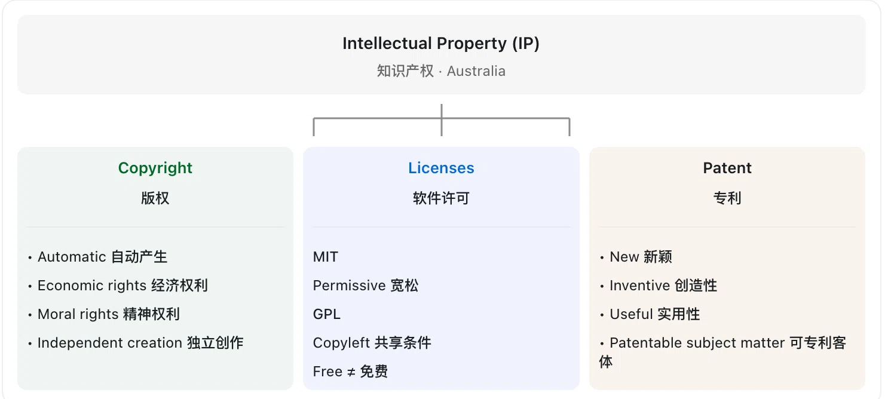
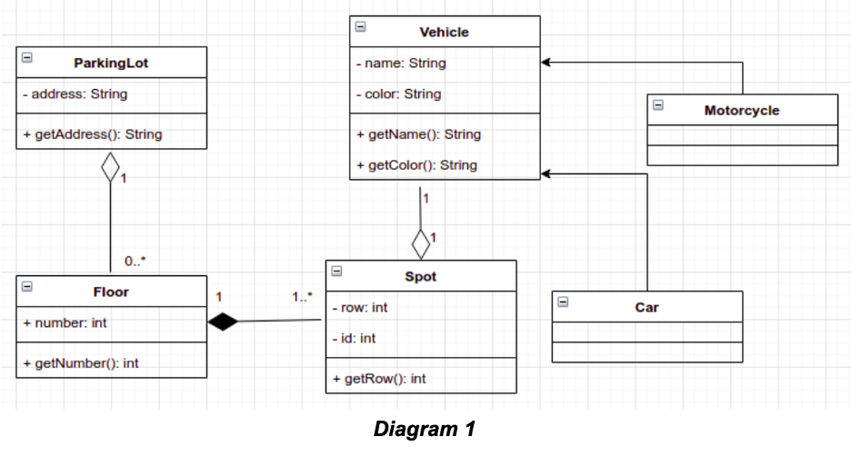
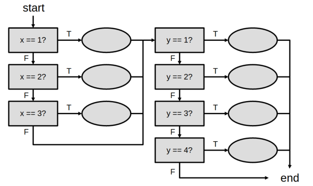
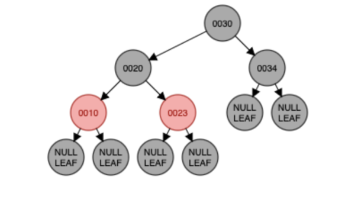
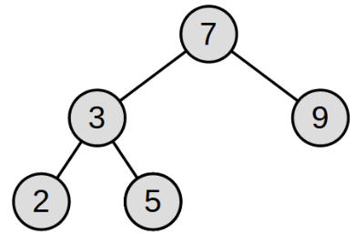

# 选择题真题与 Quiz 2 参考（按主题合并）

本文件由原来两份题集合并而来：**往年真题 29 道**（`exam-practice-questions/past-exams`，2025 S2 5 道、2025 S1 10 道、2024 S1 14 道）与 **Quiz 2 45 条**（工作区 `quiz 2/` 的 54 张截图，合并跨图与重复题后整理）。

主题顺序沿用「由易到难」的排法：按零基础复习所需的概念数量、代码阅读量和手工推演步骤估计，是学习顺序建议，不是考试分值。同一主题内先放**往年真题**（年份从近到远，同年 S2 在 S1 前），再放 **Quiz 2**（编号顺序，大致按概念 → 应用 → 推演）。

题目标题前缀：【往年】期末真题，【Quiz 2】本次 quiz 截图。英文题干、选项、代码、原题图片与批改标记全部保留；往年题的中文逐项解析、Quiz 2 的截图折叠块都在各自条目里。

**读题注意**：2025 S1 每题只有一个正确答案；2024 S1 每题至少一个正确选项，看清问的是 CORRECT 还是 INCORRECT；2025 S2 按题干要求作答。Quiz 2 截图里的勾选与批改不一定正确，只作参考。2019 S1 的 PDF 从 Q2 开始、2019 S2 只有运行说明、2020 S1 缺 Q2，这些年份没有可纳入的选择题题面。

## 主题目录

| 顺序 | 主题 | 参考难度 | 往年 | Quiz 2 | 合计 | 主要任务 |
|---|---|---|---:|---:|---:|---|
| 1 | [软件构建基本概念](#topic-1) | 较易 | 1 | 0 | 1 | 识别软件构建包含的活动。 |
| 2 | [软件工程伦理](#topic-2) | 较易 | 1 | 0 | 1 | 根据隐私、安全和职业责任判断情境。 |
| 3 | [知识产权与许可证](#topic-3) | 较易 | 2 | 1 | 3 | 记忆版权、许可证与专利的基本区别。 |
| 4 | [契约式设计、JML 与文档注释](#topic-4) | 较易 | 2 | 1 | 3 | 识别规范工具的用途与参数注释写法。 |
| 5 | [设计模式 — Singleton 与其他常用模式](#topic-5) | 较易 | 2 | 9 | 11 | 理解私有构造函数、静态成员与唯一实例。 |
| 6 | [Android](#topic-6) | 中等 | 3 | 2 | 5 | 记忆生命周期、返回栈、资源与组件规则。 |
| 7 | [数据持久化与文件格式](#topic-7) | 中等 | 1 | 7 | 8 | 结合文件结构判断数据分片是否合适。 |
| 8 | [UML 类图](#topic-8) | 中等 | 1 | 3 | 4 | 读懂类之间的关系、多重性与可见性。 |
| 9 | [代码坏味道与重构](#topic-9) | 中等 | 2 | 0 | 2 | 阅读代码，识别结构问题及合适的改进。 |
| 10 | [SOLID 设计原则](#topic-10) | 中等偏难 | 2 | 1 | 3 | 把开闭原则与里氏替换原则应用到具体设计。 |
| 11 | [Git 提交历史](#topic-11) | 中等偏难 | 1 | 5 | 6 | 跟踪提交图、合并操作与分支指针。 |
| 12 | [Tokeniser、Parser 与文法](#topic-12) | 中等偏难 | 4 | 1 | 5 | 从概念判断过渡到文法推导与语法树分析。 |
| 13 | [软件测试与分支覆盖](#topic-13) | 较难 | 3 | 6 | 9 | 分析控制流、短路条件与最少测试输入。 |
| 13A | [性能分析（补充主题）](#topic-13A) | 中等偏难 | 0 | 1 | 1 | 用 Amdahl 定律估算整体加速比。 |
| 14 | [树 — BST、AVL、红黑树与数据结构选择](#topic-14) | 较难 | 4 | 8 | 12 | 手动推演插入、旋转、颜色变化、树高与遍历。 |
| | **合计** | | **29** | **45** | **74** | |

数量为 0 的主题表示该批题集没有对应题目。

<a id="topic-1"></a>

## 1. 软件构建基本概念

参考难度为较易。识别软件构建包含的活动。

### 【往年】2024 S1 · MCQ1

原题来源为 [2024 S1 Q4](../exam-practice-questions/past-exams/2024-1/src/Q4/Q4README.md)。

Software Construction - select all that does NOT apply to complete the statement below.

Software Construction includes...

- **A.** coding

- **B.** testing

- **C.** debugging

- **D.** modular design

- **E.** problem definition

- **F.** readability

- **G.** planning

- **H.** construction with reuse

- **I.** use of standards

- **J.** the use of integrated development environments

- **K.** construction for reuse

- **L.** use of profiling and performance analysis tools to support code tuning

#### 题目在问什么

Software Construction（软件构造）指把软件设计真正变成可运行程序的过程。

题干是 *select all that does NOT apply*——**反向多选**，要选的是“不属于软件构造”的选项，不是选属于的。

#### 核心知识点

软件开发（Software Development）是一个大过程，可以简化为四个阶段：

1. **Problem Definition（问题定义）**：弄清楚要解决什么问题。
2. **Planning（规划）**：决定开发目标、时间、资源。
3. **Software Construction（软件构造）**：Coding、Testing、Debugging，以及模块化、代码复用、代码质量、开发工具等。
4. **Deployment & Maintenance（部署与维护）**。

这是帮助理解的简化流程；实际开发中各阶段会重叠、反复迭代。

#### 逐项判断

| 选项 | 中文 | 属于 Construction？ |
|---|---|:---:|
| A. coding | 编写代码 | 是 |
| B. testing | 测试代码 | 是 |
| C. debugging | 调试、修复错误 | 是 |
| D. modular design | 模块化设计 | 是 |
| E. problem definition | 定义问题 | **否** |
| F. readability | 代码可读性 | 是 |
| G. planning | 项目规划 | **否** |
| H. construction with reuse | 利用现有代码构造 | 是 |
| I. use of standards | 使用编码标准 | 是 |
| J. the use of IDEs | 使用集成开发环境 | 是 |
| K. construction for reuse | 编写可复用代码 | 是 |
| L. profiling / performance analysis tools | 性能分析与调优工具 | 是 |

#### 三个易混点

1. **Modular design 为什么算 Construction？** 软件构造不只是敲代码，还包括决定代码怎么组织，例如把大程序拆成多个函数、模块。
2. **Construction with reuse 与 construction for reuse 的区别？** *With reuse* 是使用别人已写好的代码（例如调用 Java 标准库）；*for reuse* 是自己写通用代码供未来复用。两者都属于软件构造。
3. **Readability 为什么也算？** 软件构造强调代码质量：不仅要能运行，还要易读、易懂、易维护。

#### 答案

**E、G**

E. Problem definition、G. Planning 属于软件开发前期的问题定义与项目规划，不是软件构造本身。

记忆：**Software Construction = Coding + Testing + Debugging + Code Quality + Reuse + Tools**；Problem Definition 与 Planning 属于更大范围的 Software Engineering。

[返回主题目录](#主题目录)

<a id="topic-2"></a>

## 2. 软件工程伦理

参考难度为较易。根据隐私、安全和职业责任判断情境。

### 【往年】2024 S1 · MCQ8

原题来源为 [2024 S1 Q4](../exam-practice-questions/past-exams/2024-1/src/Q4/Q4README.md)。

ETHICS - Select all scenarios where the software engineer's decision
is well aligned with the IEEE Code of Ethics for software engineers?

- **A.** A software engineer discovers a critical security flaw in a popular social media platform but chooses not to disclose it to the public to avoid damaging the platform's reputation, based on the second principle ("CLIENT and EMPLOYER") of the IEEE Code of Ethics related to the employer.

- **B.** A software engineer, tasked with developing a new mobile app, includes a hidden feature that collects user data without their consent to improve marketing strategies. This relates to the first principle ("PUBLIC") of the IEEE Code of Ethics, and it is acceptable to collect data as it can be used to further improve the mobile app.

- **C.** A software engineer prioritizes speed and efficiency over thorough testing, resulting in the release of a software product with known bugs. As long as the bugs are known to users, this should not compromise user safety. Therefore, the software engineer will meet the principle related to integrity and judgment.

- **D.** A software engineer refuses to work on a project that involves developing surveillance technology used to infringe upon individuals' privacy rights, citing adherence to ethical principles.

#### 题目在问什么

*Select all scenarios where the software engineer's decision is well aligned with the IEEE Code of Ethics.*

选出**符合** IEEE 软件工程师职业道德规范的行为。这次是正向选择，不是找错误行为。

#### 核心知识点

IEEE/ACM《Software Engineering Code of Ethics》有 8 条原则：

| # | 原则 | 中文理解 |
|---|---|---|
| 1 | PUBLIC | 公众利益优先 |
| 2 | CLIENT AND EMPLOYER | 对客户和雇主负责，但不得损害公众利益 |
| 3 | PRODUCT | 保证软件质量与安全 |
| 4 | JUDGMENT | 保持独立、诚实的专业判断 |
| 5 | MANAGEMENT | 管理过程遵守职业道德 |
| 6 | PROFESSION | 维护行业声誉 |
| 7 | COLLEAGUES | 公平对待同事 |
| 8 | SELF | 持续学习、提升职业能力 |

考试最常用的一条：**公众利益与安全不能为了公司利润、发布速度而牺牲**；对雇主的责任（原则 2）不能压过对公众的责任（原则 1）。

#### 逐项判断

**A. 隐瞒严重安全漏洞——错误。** 工程师发现社交平台的严重安全漏洞，为保护公司名誉而选择不公开，这是拿公众安全换公司声誉，违背 PUBLIC。

> 细究：不向公众披露漏洞细节本身未必错，正确做法是通过负责任渠道报告并推动修复；错在“单纯隐瞒”。

**B. 未经同意收集用户数据——错误。** 偷偷加入收集用户数据的功能以改善营销，即使“有助于改进 App”，也侵犯用户隐私，违背 PUBLIC。

**C. 为追求速度而减少测试——错误。** 跳过充分测试、发布带已知 Bug 的产品；用户“知道有 Bug”不等于软件安全，尤其当缺陷可能影响人身安全时，违背 PRODUCT 与 JUDGMENT。

**D. 拒绝开发侵犯隐私的监控技术——正确。** 拒绝参与侵犯个人隐私权的监控项目，是保护公众权利、坚持职业判断，符合 PUBLIC 与 JUDGMENT。

#### 答案

**D**

#### 速记

遇到 Ethics 题，按四类快速判断：

- **Privacy**：未经同意收集数据 → 错
- **Safety**：隐瞒风险、放任严重漏洞 → 错
- **Quality**：为速度牺牲必要测试 → 错
- **Public interest / judgment**：优先保护公众、坚持独立客观判断 → 对

一句话：**Public Safety & Interest First.**

[返回主题目录](#主题目录)

<a id="topic-3"></a>

## 3. 知识产权与许可证

参考难度为较易。记忆版权、许可证与专利的基本区别。

### 【往年】2025 S1 · MCQ10

原题来源为 [2025 S1 Q4](../exam-practice-questions/past-exams/2025-1/src/Q4/MC_Questions_2025_S1.pdf)。

A colleague has found an implementation of an algorithm publicly available on GitHub, but there is no license listed accompanying the code. Your colleague wants to use this code in their work. Can they? What conditions must they adhere to?

- **A.** The code is assumed to be under an exclusive license, and cannot legally be used.

- **B.** The author is assumed to retain all copyright to the code, but because the code is publicly available, as long as appropriate attribution is provided, the code may legally be used.

- **C.** The code is assumed to be under no license, and can legally be used without attribution. However, if the code contains a glitch or bug, the original author is not liable.

- **D.** According to GitHub’s terms of service, public GitHub repositories without an explicit license are assumed to be under the GNU GPL v3 License. Your colleague may therefore use this code only if the modified source code is shared publicly.

#### 题目在问什么

同事在 GitHub 上找到一份公开的算法实现，但仓库没有附任何 License。他能不能直接用到自己的项目里？需要遵守什么条件？

#### 核心知识点

**Publicly available ≠ Open source ≠ Free to use**（公开可见 ≠ 开源授权 ≠ 可以随便用）。代码放在 GitHub 上人人可见，不等于任何人都有权复制、修改、分发。

| 概念 | 含义 |
|---|---|
| Copyright（版权） | 作者通常自动拥有自己创作的代码版权 |
| License（许可证） | 作者授权别人以特定方式使用代码 |
| No license（无许可证） | 默认保留版权，没有一般性的复制、修改、再分发许可 |

对比常见许可证：

- **MIT**：允许商业使用、修改、分发，但要保留版权与许可声明。
- **GPL v3**：允许使用和修改，但触发分发条件时须遵守相应的源码公开与许可要求。
- **No license**：不能因为代码公开就默认获得授权。

三类 License 允许别人做什么，对照表在 [2024 S1 · MCQ4](#topic-3-mcq4-2024) 的「场景推演」；本题只需抓住：**No License = 保留所有权利**，公开可见不等于授权，署名也不构成授权。

#### 逐项判断

| 选项 | 内容 | 判断 |
|---|---|:---:|
| A | 没有 License，推定为其处于专有许可之下，不能合法使用 | **正确（最接近）** |
| B | 作者保留版权，但代码公开，只要注明出处即可合法使用 | 错误 |
| C | 没有 License，可合法使用且无需署名，出 Bug 作者也不负责 | 错误 |
| D | GitHub 服务条款把无 License 仓库默认归为 GPL v3 | 错误 |

**A 为什么对？** 没有 License 时版权仍归作者，不能擅自复制、修改或用于自己的软件，结论“不能合法使用”成立。

> 但 A 的措辞并不严谨：无 License 不等于存在某种特定的 *exclusive license*，更准确的说法是 **All rights reserved（保留所有权利）**。GitHub 仍允许用户查看、通过平台 Fork 公开仓库，但这不构成对其他使用权的授予。

**B 为什么错？** 署名（attribution）只是许可证里的一项条件，不是许可本身；没有许可证就没有可援引的授权。

**C 为什么错？** 无 License 恰恰意味着默认保留权利，既不能随便用，也不存在“无需署名”的许可；免责声明更不能凭空产生。

**D 为什么错？** GitHub 不会把无 License 仓库自动改成 GPL v3；GPL 只在该仓库明确采用 GPL 时适用。

#### 答案

**A**

#### 速记

**No license = All rights reserved.**

- Public repository ≠ free to use
- Attribution ≠ permission（署名不等于授权）
- No license ≠ GPL
- 想用：先联系作者取得许可，或改用明确授权的替代实现。

补充：可以学习公开代码里的**算法思想**再独立实现；思想与受版权保护的具体代码表达不是一回事。

<a id="topic-3-mcq4-2024"></a>

[返回主题目录](#主题目录)

### 【往年】2024 S1 · MCQ4

原题来源为 [2024 S1 Q4](../exam-practice-questions/past-exams/2024-1/src/Q4/Q4README.md)。

Intellectual Property - Select all CORRECT statements considering the Australian context.

- **A.** Copyright is automatically attributed to an author in Australia, although others can reproduce the same work. Authors must demonstrate their capability of creating the work independently.

- **B.** Copyright protects non-economic rights.

- **C.** Unlike Copyright, software using Copyleft licenses is free, and no fees can be charged whatsoever.

- **D.** MIT License is an example of Copyleft license.

- **E.** Patents protect inventions that are new, useful, inventive, and of suitable subject matter. Software can be patented if it presents technical or business innovation.

#### 题目在问什么

*Intellectual Property — Select all CORRECT statements considering the Australian context.*

按澳大利亚法律选出所有**正确**陈述（正选）。涉及三个概念：Copyright（版权，保护源代码、文章、图片等原创表达）、Copyleft（一种允许使用、修改、传播但附带共享条件的开源许可机制）、Patent（专利，保护符合条件的技术发明）。

#### 场景推演：假设你自己写了一个 Java 程序并上传到 GitHub

**① Copyright（版权）**：代码是你原创的，版权**自动**归你。别人不能因为看到了你的代码，就随便复制、修改、分发。

**② License（许可证）**：你可以给代码添加不同的 License，授权别人以特定方式使用。

| License | 别人可以做什么 |
|---|---|
| No License | 默认没有一般性的复制、修改、分发授权 |
| MIT | 可以复制、修改、商用、闭源，但需要保留版权及许可声明 |
| GPL v3 | 可以复制、修改、商用，但分发衍生程序时通常需要遵守相应的开源条件 |

这张表对应本题的 Copyright 与 Licenses 两面；Patent 是第三根支柱，要件见下。

#### 核心知识点

- 版权在作品创作完成时**自动产生**，无需注册；保护的是具体**表达**，不是思想。
- 版权同时包含**经济权利**与**人身权（moral rights）**：署名、反对错误署名、保护作品完整性。
- 许可证分两大类：**Copyleft**（GPL，要求衍生作品沿用同一许可）与 **Permissive**（MIT、Apache，允许闭源商用）。
- 专利四要件：**New + Inventive + Useful + Patentable subject matter**。



上图把本题三个概念并列：版权（自动产生、经济权利、精神权利、独立创作）、软件许可（MIT = 宽松、GPL = Copyleft 共享条件、Free ≠ 免费）、专利（新颖、创造性、实用性、可专利客体）。

#### 逐项判断

**A. 版权自动归属——正确。** 澳大利亚的版权在原创作品产生时自动生效，不需注册。版权保护表达而非思想，两人**独立**创作出相同或相似作品，不必然侵权。句中的 independently 指独立创作、非抄袭，并不是说申请版权前要提交证明。

**B. 版权保护非经济权利——正确。** 版权除经济利益外，还保护 moral rights（署名权、保护作品完整权等）。

> 措辞提醒：严格说版权以**经济权利**为核心，同时**也**保护非经济权利。若把 B 读成“版权只保护非经济权利”，就成了错句；本题按“版权也涵盖非经济权利”理解才成立。

**C. Copyleft 软件不能收费——错误。** Copyleft 不等于免费。GPL 软件可以收费分发，只是分发时须履行许可证义务。Free Software 的 Free 指 **freedom（自由）**，不是 free of charge（零价格）。

**D. MIT 是 Copyleft——错误。** MIT 是 **Permissive** 许可证，允许用于闭源商业软件，不要求衍生项目开源。典型 Copyleft 是 **GPL**。

**E. 专利保护发明——基本正确，措辞偏宽。** 澳大利亚专利要求发明具备新颖性、创造性、实用性，并属于可专利客体；软件相关发明也可能获专利，例如提升计算机数据处理效率的技术。

> 细节：仅“商业创新（business innovation）”不足以获得专利；软件或商业方法须满足技术性等法律要求。E 末句把 technical 与 business innovation 并列，法律上偏宽；按课程概括性知识点，预期仍计入正确。

#### 答案

**A、B、E（预期答案）**

E 的末句表述过宽（商业创新本身不够），但课程按概括知识点出题时通常仍选 E；若题目要求严格法律判断，需对 E 保留。

#### 速记

| 概念 | 核心 |
|---|---|
| Copyright | 自动产生；保护表达与 moral rights |
| Copyleft | 传染性共享条件；**可以收费** |
| MIT | Permissive，不是 Copyleft |
| GPL | Copyleft，允许商业使用 |
| Patent | New + Inventive + Useful + 可专利客体 |

两个最高频陷阱：**Free ≠ free of charge**；**MIT ≠ Copyleft，GPL = Copyleft**。

[返回主题目录](#主题目录)

### 【Quiz 2】01. 移动应用的版权保护范围

原截图未显示题号 · 截图 13.49.04

原页面有两个 “No answer text provided.” 选项，均保留。

Assume that Australian law applies. Which aspects of a mobile application are typically protected specifically by copyright? Select all that apply.

- **A.** The program's visual design

- **B.** The program's codebase

- **C.** The program's icon

- **D.** The program’s name

- **E.** The program's features

- **F.** No answer text provided.

- **G.** No answer text provided.

- **H.** The program's algorithms

<details>
<summary>查看原始截图与批改标记</summary>


</details>

[返回主题目录](#主题目录)

<a id="topic-4"></a>

## 4. 契约式设计、JML 与文档注释

参考难度为较易。识别规范工具的用途与参数注释写法。

### 【往年】2025 S2 · MCQ4

原题来源为 [2025 S2 Q1](../exam-practice-questions/past-exams/2025-2/src/Q1/MCQQuestions.pdf)。

Which of the following cannot be achieved using JML (Java Modeling Language)?

- **A.** Formally specify preconditions, postconditions, and invariants for Java methods and classes.

- **B.** Perform runtime assertion checking（运行时断言检查，RAC：运行的时候自动检查是否满足 JML 规范）。

- **C.** Document detailed design decisions.

- **D.** Support design by contract.

- **E.** Handle Java XML processing.

#### 题目在问什么

*Which of the following cannot be achieved using JML (Java Modeling Language)?*

选出 **JML 做不到**的事。本题属于 Software Construction 中的 Software Specification（软件规范），除做题外还要分清 JML、Design by Contract、Java assert、Javadoc 各自管什么。

#### 逐项判断

| 选项 | 含义 | 判断 |
|---|---|:---:|
| A | 定义前置条件、后置条件、不变量 | 可以 |
| B | 运行时断言检查（RAC）：运行程序时自动检查是否满足 JML 规范 | 可以 |
| C | 记录详细设计决策 | 不是 JML 的用途 |
| D | 支持契约式设计 | 可以 |
| E | 处理 Java XML | 不可以 |

**C 的解释空间**：JML 能记录行为约束，但不能替代解释架构选择与设计理由的详细设计文档；E 则毫无争议——JML 不是 XML 解析工具。

#### 答案

**C、E**

#### 扩展：Design by Contract（契约式设计）

`int divide(int a, int b) { return a / b; }` 这个函数希望规定：调用前 `b != 0`，调用后返回值等于 `a / b`。这就是契约（Contract）：**调用者满足前置条件，方法就必须保证后置条件。**

```text
Precondition（调用者保证 b != 0）
        ↓
Method divide(10, 2)
        ↓
Postcondition（函数保证 result == 5）
```

| 类型 | JML | 意思 |
|---|---|---|
| Precondition 前置条件 | `requires` | 函数执行前必须满足 |
| Postcondition 后置条件 | `ensures` | 函数正常执行后必须满足 |
| Invariant 不变式 | `invariant` | 对象在规定的可观察状态下必须满足 |

记忆：**Pre = Before；Post = After；Invariant = Always**（在规定的状态下）。

#### 扩展：JML 语法

JML（Java Modeling Language）用特殊注释为 Java 程序写**形式化规范（formal specification）**。

本质上，JML **仍然是注释**——写在 `//@` 或 `/*@ ... @*/` 里，普通 `javac` 会照样把整段当注释跳过。区别在于它是**能被工具读懂并检查**的注释：普通注释只给人看，JML 注释同时给 JML 工具（如 OpenJML）看，可用来做静态验证或运行时检查。

```java
class BankAccount {

    //@ invariant balance >= 0;
    private int balance;

    /*@
      requires amount > 0;
      requires amount <= balance;
      ensures balance == \old(balance) - amount;
    @*/
    void withdraw(int amount) {
        balance -= amount;
    }
}
```

- `invariant balance >= 0`：余额不能为负。
- `requires amount > 0`：取款金额必须为正。
- `requires amount <= balance`：不能超额取款。
- `ensures balance == \old(balance) - amount`：结束后新余额 = 旧余额 − 取款额。
- `\old(balance)` 是执行**前**的余额，`balance` 是执行**后**的余额。

其他常考关键字：

| 关键字 | 功能 | 最小例子 |
|---|---|---|
| `requires` | 前置条件：调用前必须成立 | `requires amount > 0;` |
| `ensures` | 后置条件：正常返回后必须成立 | `ensures \result == a + b;` |
| `invariant` | 类不变量：对象状态始终满足 | `invariant balance >= 0;` |
| `\result` | 方法返回值（只能写在 `ensures` / `signals` 里） | `ensures \result >= 0;` |
| `\old(x)` | 方法执行前 x 的值（只能写在**后置**条件里） | `ensures balance == \old(balance) - amount;` |
| `signals` | 抛出指定异常时必须成立的条件 | `signals (IllegalArgumentException e) amount <= 0;` |
| `assignable` | 允许修改哪些字段/位置（帧条件） | `assignable balance;` |

把它们放进同一个类里看：

```java
public class Account {
    private int balance;

    //@ invariant balance >= 0;                    // 任何可观察状态下余额都非负

    /*@
      assignable balance;                          // 只允许改 balance
      ensures balance == \old(balance) + amount;   // 返回后余额 = 旧余额 + 存款
      signals (IllegalArgumentException e) amount <= 0;  // 抛 IAE 时，必然 amount <= 0
    @*/
    public void deposit(int amount) {
        if (amount <= 0) {
            throw new IllegalArgumentException("amount must be positive");
        }
        balance += amount;
    }

    /*@
      ensures \result == balance;                  // \result 指返回值
    @*/
    public int getBalance() {
        return balance;
    }
}
```

逐行对应：

- `assignable balance;` 声明这个方法**只**动 `balance`，其他字段不会被改；调 `getBalance()` 自然不会出现在它的 assignable 里。
- `ensures ... \old(balance) ...` 中的 `\old(balance)` 是进入方法前的余额，`balance` 是返回时的余额。
- `signals (... e) amount <= 0;` 读作“**如果**抛出 `IllegalArgumentException`，**那么** `amount <= 0` 成立”，所以 `deposit(-5)` 合法地抛异常不算违约。
- `ensures \result == balance;` 里 `\result` 就是 `getBalance()` 的返回值。

```java
/*@
  requires x >= 0;
  ensures \result == x * x;
@*/
int square(int x) {
    return x * x;
}
```

注意：JML 注释本身不会让普通 `javac` 自动检查契约，需要 JML 支持工具。

#### 扩展：Runtime Assertion Checking

JML 不只用来写规范，还能借工具检查运行中是否违反规范。

```java
/*@
  requires x > 0;
  ensures \result > 0;
@*/
int doubleValue(int x) {
    return -x * 2;
}
```

调用 `doubleValue(5)` 得到 `-10`，违反 `ensures \result > 0;`，启用 Runtime Assertion Checking 即可检测到契约违反。

- **Runtime checking**：程序运行时检查条件。
- **Static verification**：不运行程序，尝试证明条件成立。

两者都是 JML 工具生态的重要能力。

#### 扩展：JML、Java assert、Javadoc 的区别

这是高频考点。

| 工具 | 主要用途 | 例子 |
|---|---|---|
| JML | 形式化规定程序行为 | `requires x > 0` |
| Java `assert` | 检查程序内部假设 | `assert x > 0;` |
| Javadoc | 生成人类可读的 API 文档 | `@param x` |

```java
int x = 5;
assert x > 0;   // 以 java -ea 启用；条件为 false 时抛 AssertionError
```

```java
/**
 * Calculates the square of a number.
 *
 * @param x the input number
 * @return the square of x
 */
int square(int x) {
    return x * x;
}
```

`@param`、`@return`、`@throws` 只是生成文档，**不是运行时检查**；而 JML 的 `requires/ensures` 是能被工具理解和检查的形式化规范。

#### 速记

```text
Java Specification
├── JML — Formal Specification
│   ├── requires / ensures / invariant
│   └── Runtime checking、Static verification
├── Java assert — Internal checks
│   └── assert condition（-ea 启用，失败抛 AssertionError）
└── Javadoc — Documentation
    └── @param / @return / @throws
```

三句话：**JML = what must be true；Javadoc = what the code does；Java assert = check an assumption。**

#### 自测

1. Which JML keyword specifies a precondition? A. `ensures` B. `requires` C. `invariant` D. `\result`
2. Which tag describes a method parameter in Javadoc? A. `@param` B. `@requires` C. `@invariant` D. `@argument`
3. Which tool is designed to parse XML in Java? A. JML B. Javadoc C. DOM D. Java assert

参考答案：1-B、2-A、3-C。

[返回主题目录](#主题目录)

### 【往年】2025 S1 · MCQ9

原题来源为 [2025 S1 Q4](../exam-practice-questions/past-exams/2025-1/src/Q4/MC_Questions_2025_S1.pdf)。

```java
/** 
 * Interchanges the elements at indices i and j of the array. 
 * (1) 
 */ 
public static void <T> swap(T[] array, int i, int j) { 
 
T oldi = array[i]; 
 
array[i] = array[j]; 
 
array[j] = oldi; 
}
```

The method swap interchanges the elements at indices i and j of an array. A developer wishes to write some JML annotations which can fill the label (1).

Which JML annotation has the correct syntax to give an informal description to the parameter i?

- **A.** @parameter “The first index” i

- **B.** @input i: “The first index.”

- **C.** @param i The first index.

- **D.** @argument The first index = i

#### 题目在问什么

*Which JML annotation has the correct syntax to give an informal description to the parameter `i`?*

哪个注释语法可以描述参数 `i` 的含义？这里考的是 **Javadoc 风格的参数文档标签 `@param`**，不是 `requires`、`ensures` 这类形式化契约。

#### 逐项判断

| 选项 | 判断 | 原因 |
|---|:---:|---|
| A. `@parameter ...` | 错误 | Java 标准文档标签是 `@param`，不是 `@parameter` |
| B. `@input ...` | 错误 | 标准标签是 `@param`，没有 `@input` |
| C. `@param i The first index.` | 正确 | 参数描述的正确语法 |
| D. `@argument ...` | 错误 | 标准标签是 `@param`，没有 `@argument` |

#### 答案

**C**

#### 完整代码

原题里的泛型方法写法有误，正确形式是 `public static <T> void swap(...)`：

```java
/**
 * Interchanges the elements at indices i and j.
 *
 * @param <T> the element type
 * @param array the input array
 * @param i The first index.
 * @param j The second index.
 */
public static <T> void swap(T[] array, int i, int j) {
    T oldi = array[i];
    array[i] = array[j];
    array[j] = oldi;
}
```

```java
Integer[] a = {10, 20, 30};
swap(a, 0, 2);   // 之后 a = {30, 20, 10}
```

`@param i The first index.` 就是在告诉读代码的人：参数 `i` 表示第一个要交换的数组下标。

#### Javadoc 与 JML 的区别

这题容易混，因为题干提到了 JML，实际考的是 `@param` 文档标签。

| 语法 | 用途 | 示例 |
|---|---|---|
| `@param` | 描述参数 | `@param i first index` |
| `@return` | 描述返回值 | `@return the sum` |
| `@throws` | 描述可能抛出的异常 | `@throws IOException` |
| `requires` | JML 前置条件 | `requires i >= 0;` |
| `ensures` | JML 后置条件 | `ensures \result > 0;` |
| `invariant` | JML 类不变量 | `invariant size >= 0;` |

Javadoc 是**非形式化描述**，只解释用途、不检查取值：

```java
/**
 * @param i The first index.
 */
```

JML 是**形式化约束**，能被工具检查：

```java
/*@
  requires array != null;
  requires i >= 0 && i < array.length;
  requires j >= 0 && j < array.length;
@*/
```

写法的区别也值得记：Javadoc 用 `/** ... */`，JML 用 `/*@ ... @*/`。

#### 速记

```text
Java Documentation & Contract
├── Javadoc — Describe（描述）
│   ├── @param 参数
│   ├── @return 返回值
│   └── @throws 异常
└── JML — Specify（规定）
    ├── requires 前置条件
    ├── ensures 后置条件
    └── invariant 不变量
```

- `@param` = explain the parameter（解释参数）
- `requires` = restrict the input（限制输入）
- `ensures` = guarantee the output（保证输出）

[返回主题目录](#主题目录)

### 【Quiz 2】02. 参数文档注释的语法

原题号 Question 5 · 截图 13.47.50


[返回主题目录](#主题目录)

<a id="topic-5"></a>

## 5. 设计模式 — Singleton 与其他常用模式

参考难度为较易。理解私有构造函数、静态成员与唯一实例。

### 【往年】2025 S2 · MCQ5

原题来源为 [2025 S2 Q1](../exam-practice-questions/past-exams/2025-2/src/Q1/MCQQuestions.pdf)。

Considering the class below, which alternative is CORRECT:

- **A.** The JUnit assertion assertSame(Universe.getInstance(), Universe.getInstance()) will fail.

- **B.** The JUnit assertion assertEquals(Universe.getInstance(), Universe.getInstance()) will fail.

- **C.** You cannot instantiate a Universe instance directly using the constructor outside the class.

- **D.** You can remove the static modifier from the field INSTANCE and from the method getInstance() if you want to implement a Singleton.

```java
public class Universe { 
 
    private static Universe INSTANCE; 
 
    private Universe() { } 
 
    public static Universe getInstance() { 
        if(INSTANCE == null) { 
            INSTANCE = new Universe(); 
        } 
        return INSTANCE; 
    } 
}
```

#### 题目在问什么

*Considering the class below, which alternative is CORRECT?*

考三件事：Singleton、`static` 与 `private` 的作用、JUnit 的 `assertSame` / `assertEquals`。

#### 逐项判断

**A. `assertSame(...)` will fail —— 错误。** `assertSame` 检查是否为同一个对象；`getInstance()` 每次返回同一实例，所以断言**通过**，不会失败。

```java
assertSame(Universe.getInstance(), Universe.getInstance()); // PASS
```

**B. `assertEquals(...)` will fail —— 错误。** `assertEquals` 用 `equals()` 比较，同一个对象当然相等，断言也**通过**。

```java
assertEquals(Universe.getInstance(), Universe.getInstance()); // PASS
```

**C. 类外不能直接用构造函数创建实例 —— 正确。** 构造函数是 `private`，外部 `new Universe()` 直接编译错误，只能走 `Universe.getInstance()`。

```java
Universe u = new Universe();          // 编译错误
Universe u = Universe.getInstance();  // 唯一入口
```

**D. 去掉 `static` 也能实现 Singleton —— 错误。** `static` 让字段和方法属于类而非实例。删掉后 `getInstance()` 变成实例方法，而构造函数又是 `private`，外部根本无法先创建实例来调用它，Singleton 也就没了入口。

#### 答案

**C**

#### 核心知识点：Singleton（单例模式）

Singleton = 整个程序共享同一个对象。

```java
public class Universe {

    private static Universe INSTANCE;

    private Universe() { }

    public static Universe getInstance() {
        if (INSTANCE == null) {
            INSTANCE = new Universe();
        }
        return INSTANCE;
    }
}
```

| 代码 | 作用 |
|---|---|
| `private static Universe INSTANCE` | 保存共享实例 |
| `private Universe()` | 禁止外部直接 `new` |
| `public static Universe getInstance()` | 提供获取实例的入口 |
| `if (INSTANCE == null)` | 第一次调用时才创建对象 |
| `return INSTANCE` | 返回共享实例 |

执行过程：第一次调用 `getInstance()` 时 `INSTANCE == null`，创建对象 A 并保存；第二次调用时 `INSTANCE != null`，直接返回对象 A。两次拿到的是**同一个对象**。

这种“第一次使用时才创建”的写法叫 **Lazy Initialization（懒加载）**。

#### assertSame 与 assertEquals 的区别

| 场景 | `assertSame` | `assertEquals` |
|---|:---:|:---:|
| 同一个对象 | PASS | PASS |
| 不同对象、内容相同（如两个 `new String("hello")`） | FAIL | PASS |

```java
String a = new String("hello");
String b = new String("hello");

assertSame(a, b);    // FAIL：不是同一个对象
assertEquals(a, b);  // PASS：String.equals() 比较内容
```

注意：`Universe` 没有重写 `equals()`，默认沿用 `Object.equals()`，即**按对象身份比较**。所以对 `Universe` 来说，两个断言的结果恰好一致，本题的 A、B 都不成立。

#### 速记

```text
Singleton Pattern 单例模式
├── private constructor → 禁止外部 new
├── static INSTANCE     → 类级别共享实例
├── getInstance()       → 唯一访问入口，返回同一对象
└── lazy initialization → 第一次调用时才创建
```

- `assertSame` → 是否为同一对象（身份）
- `assertEquals` → 是否相等（`equals()`）

补充：上面的懒加载**不是线程安全的**，多线程同时首次调用可能创建出多个实例；需要线程安全时可加 `synchronized` 或用枚举/静态初始化。

[返回主题目录](#主题目录)

### 【往年】2025 S1 · MCQ2

原题来源为 [2025 S1 Q4](../exam-practice-questions/past-exams/2025-1/src/Q4/MC_Questions_2025_S1.pdf)。

A programmer is implementing the Singleton design pattern in a public class called Authenticator. What constructor(s) should the programmer declare in Authenticator?

- **A.** Authenticator should have no explicitly declared constructors.

- **B.** Authenticator should have a private constructor.

- **C.** Authenticator should have a protected constructor.

- **D.** Authenticator should have a public constructor, and a constructor with no access modifiers.

#### 题目在问什么

公开类 `Authenticator` 要做成单例，应该声明哪种构造器？2025 S1 这套卷每题只有一个正确答案。

#### 逐项判断

**A. 一个构造器都不声明 —— 错误。** 不写构造器时，Java 会自动生成一个**无参默认构造器**，访问权限与类相同；类是 `public`，这个默认构造器也就是 `public` 的，外部照样能 `new Authenticator()`。

**B. 私有构造器 —— 正确。** `private Authenticator() {}` 把唯一的创建入口收回类内部，外部无法直接 `new`，只能通过 `getInstance()` 拿同一个实例。

**C. 受保护构造器 —— 错误。** `protected` 允许**同包**类和**子类**调用，子类照样能 `new` 出第二个对象，单例被破坏。

**D. `public` 构造器 + 默认权限构造器 —— 错误。** 两个构造器都是外部可访问的（默认权限同包可见），都能创建实例，与“唯一实例”直接矛盾。

#### 答案

**B**

#### 速记

单例的构造函数只有一种正确写法：**private**。

- 不写 ≠ 私有：默认构造器的可见性跟着类走，`public class` 的默认构造器就是 `public`。
- `protected` 挡不住子类；`public`/默认权限挡不住同包。

[返回主题目录](#主题目录)

### 【Quiz 2】03. DAO 的分类与意图

原题号 Question 1 · 截图 13.41.33

Based strictly on the Design Patterns classification taught in the lecture slides, how is the DAO pattern categorised, and what is its primary intent?

- **A.** It is categorised as an Enterprise pattern outside the standard GoF classifications; its intent is to automatically map domain objects to database tables and queries (transparent object-relational mapping).

- **B.** It is categorised as a Structural pattern; its intent is to decouple domain logic from persistence mechanisms so as not to expose details of data storage (e.g. databases, flat files).

- **C.** It is categorised as a Structural pattern; its intent is to provide a unified, higher-level interface to a set of interfaces in a subsystem to make the subsystem easier to use.

- **D.** It is categorised as a Behavioural pattern; its intent is to define a one-to-many dependency so that when one object changes state, all dependents are notified automatically.

<details>
<summary>查看原始截图与批改标记</summary>


</details>

[返回主题目录](#主题目录)

### 【Quiz 2】04. 跨操作系统对话框的模式选择

原题号 Question 2 · 截图 13.43.44

Consider an text editor application. When the user closes the program without all open files saved, the application should instantiate and display a dialog box to ask if the user wishes to save their work. This dialog box will be a different class depending on the user's operating system. Which design pattern is most suited to this situation?

- **A.** Template

- **B.** Factory

- **C.** State

- **D.** Observer

<details>
<summary>查看原始截图与批改标记</summary>


</details>

[返回主题目录](#主题目录)

### 【Quiz 2】05. 物流路线算法与展示方式的模式选择

原题号 Question 2 · 截图 13.44.30

Consider a logistics application used by a package delivery company. They have written a number of algorithms to find the optimal route for a number of deliveries, and a number of ways the output route can be displayed (e.g. directions in text, or graphically). Which design pattern is most suited to this situation?

- **A.** Factory

- **B.** Template

- **C.** State

- **D.** Iterator

<details>
<summary>查看原始截图与批改标记</summary>


</details>

[返回主题目录](#主题目录)

### 【Quiz 2】06. UI 输入通知的模式选择

原题号 Question 4 · 截图 13.43.56

两张截图的选项顺序不同，已归入同一题。

A UI framework allows visual components, which all extend a class called Component, to receive user input whenever the user presses a key. This can be implemented by having the Components frequently check a central InputManager class for input. Alternatively, the InputManager class could call a function in all Components when a key is pressed. However, both these methods are slow. Which design pattern could be used to implement a better solution?

- **A.** Facade

- **B.** DAO

- **C.** Observer

- **D.** Iterator

<details>
<summary>查看原始截图与批改标记</summary>


</details>

[返回主题目录](#主题目录)

### 【Quiz 2】07. 让 CrazyList 支持 for-each 的模式选择

原题号 Question 4 · 截图 13.45.50

A developer has invented a new data structure, called the CrazyList. This data structure offers substantial performance improvements compared with a standard ArrayList, but is very difficult for other developers to understand. The developer wishes to give other developers a way to use a for-each loop on the CrazyList. Which design pattern is most suited to this situation?

- **A.** Template

- **B.** Factory

- **C.** Facade

- **D.** Iterator

<details>
<summary>查看原始截图与批改标记</summary>


</details>

[返回主题目录](#主题目录)

### 【Quiz 2】08. Iterator 模式相对转数组的优势

原题号 Question 3 · 截图 13.42.04

两张截图的选项顺序不同，已归入同一题。

A developer is implementing a LinkedList (a type of resizable array data structure) and wants to support iterating over the entire list. They know this is possible using either the Iterator design pattern, or by defining a method in the LinkedList class that converts its contents to an array. What are the benefits of the Iterator design pattern in this situation? Select all that apply.

- **A.** The Iterator design pattern allows each element in the iteration to have a different type, whereas an array can only store elements of a single type

- **B.** The Iterator design pattern allows for the traversal of the data contained within the LinkedList without exposing the structure of the LinkedList to a client, reducing coupling and interdependency in the codebase

- **C.** The Iterator design pattern supports moving to a particular index in the iteration, unlike a foreach loop over an array

- **D.** If the iteration is expected to be terminated early (for example, with the "break;" statement), the Iterator will demonstrate substantial performance benefits

- **E.** If the contents of the LinkedList change during the loop, the iterator will be able to incorporate these changes much more easily

- **F.** The Iterator design pattern would need to store only a single copy of each element in the LinkedList, while the array conversion must duplicate each element, approximately doubling memory usage if each element is large.

<details>
<summary>查看原始截图与批改标记</summary>


</details>

[返回主题目录](#主题目录)

### 【Quiz 2】09. Facade 与包内类的访问权限

原题号 Question 4 · 截图 13.47.42

Consider a usage of the Facade design pattern in an email application which uses SpamFilter as the Facade for the spam package. Assuming SpamFilter is also in the spam package, what access modifiers would you expect to be used on classes in spam?

- **A.** SpamFilter would be public, and the other classes would have no access modifier.

- **B.** SpamFilter would be public, and the other classes would be protected

- **C.** Every class in spam would have no access modifier

- **D.** Every class in spam would be public.

<details>
<summary>查看原始截图与批改标记</summary>


</details>

[返回主题目录](#主题目录)

### 【Quiz 2】10. State 模式相对布尔标记的优势

原题号 Question 2 · 截图 13.41.48

另一个截图版本调整了选项顺序，并含一个 “No answer text provided.” 选项。完整版本作为正文，另一版本附在原始截图中。

A developer wishes to store whether or not a user is logged in. They know this may be done with the State design pattern, or by using a boolean flag variable (and possibly additional variables to store data relevant to each state). Which of these are benefits of the State design pattern? Select all that apply.

- **A.** Under proper implementation, the State design pattern makes it harder for the program to enter an illegal state related to variables for multiple states being simultaneously set.

- **B.** The State design pattern allows for changes in state reacting to external stimuli, for example a user being forcefully logged-out when they log in on another device. This is more difficult with the boolean flag approach.

- **C.** The State design pattern clearly delineates behaviour belonging to each state, improving code readability.

- **D.** The length of the resulting program, as measured in lines of code, will be substantially shorter under the State design pattern.

- **E.** If the program is extended to support some new behaviour (changing your password, say), then this can be added as a method to the abstract parent State class. This must then be implemented explicitly in all subclasses, which makes bugs related to changing your password while not being logged in less likely.

- **F.** The boolean flag approach is limited to only two states, which may be limiting.

<details>
<summary>查看原始截图与批改标记</summary>


</details>

[返回主题目录](#主题目录)

### 【Quiz 2】11. State 模式修改当前状态的方式

原题号 Question 4 · 截图 13.49.41

In the State design pattern, some state-based operations will need to modify the current state. There are two obvious ways this can be achieved:

(i) these operations should return the new state, which is then assigned with the Context class

(ii) these operations should execute a method like `Context.setState(State newState);`

Which approach is generally preferred? Why?

- **A.** (i), as it reduces coupling between the Context and State

- **B.** (ii), as if some state subclasses do not change the state, they do not need to return anything

- **C.** (ii), as it allows state operations to be run from classes other than Context

- **D.** (i), as it is necessary if the Context class uses the Singleton pattern

<details>
<summary>查看原始截图与批改标记</summary>


</details>

[返回主题目录](#主题目录)

<a id="topic-6"></a>

## 6. Android

参考难度为中等。记忆生命周期、返回栈、资源与组件规则。

### 【往年】2025 S2 · MCQ2

原题来源为 [2025 S2 Q1](../exam-practice-questions/past-exams/2025-2/src/Q1/MCQQuestions.pdf)。

When a new activity is started in Android, what happens to the previous activity in the activity stack?

- **A.** The previous activity is destroyed immediately; onPause() → onStop() → onDestroy() are called.

- **B.** The previous activity is pushed to the back stack and paused.

- **C.** The previous activity remains active in the stack and no lifecycle methods are called.

- **D.** The previous activity is removed from the stack but kept in memory; only onStop() is called.

#### 题目在问什么

新 Activity 启动时，返回栈里原来那个 Activity 会怎样？

#### 逐项判断

**A. 立即销毁并走完 onPause → onStop → onDestroy —— 错误。** 旧 Activity 通常只是暂停或停止，不会被立刻销毁；`onDestroy()` 要等到系统回收或用户主动 `finish()` 才调用。

**B. 压入返回栈并暂停 —— 正确。** 旧 Activity 留在 Back Stack 中，先进入 paused 状态；若被新 Activity 完全遮挡，还会继续进入 stopped 状态，但实例仍在栈里。

**C. 保持活跃且不调用任何生命周期方法 —— 错误。** 旧 Activity 一定会收到生命周期回调（至少 `onPause()`），不会再处于“活跃”状态。

**D. 从栈中移除但保留在内存、只调用 onStop() —— 错误。** 它不会从栈中被移除，也不只调用 `onStop()`；`onPause()` 一定先发生。

#### 答案

**B**

#### 核心概念：Back Stack 与生命周期

从 Activity A 打开 Activity B：

```text
原来：
┌─────────────┐
│ Activity A  │ ← 正在运行
└─────────────┘

打开 B 后：
┌─────────────┐
│ Activity B  │ ← 前台运行
├─────────────┤
│ Activity A  │ ← 留在返回栈中
└─────────────┘
```

- A 先调用 `onPause()`。
- 如果 B 完全遮挡 A，A 通常接着调用 `onStop()`。
- 用户按返回键关闭 B，A 经 `onRestart()` → `onStart()` → `onResume()` 恢复。

考试记忆：**新 Activity 启动时，旧 Activity 通常保留在 Back Stack 中，而不是立即销毁。**

#### 扩展：Activity 是什么

Activity 可以理解为 Android App 中的一个页面。例如购物 App 有 `LoginActivity`（登录）、`HomeActivity`（主页）、`ProductActivity`（商品详情）；用户从主页点商品，就从 `HomeActivity` 跳到 `ProductActivity`。

#### 扩展：App、Activity 与 View 的关系

从“应用”到“屏幕上的按钮”，是一条单向链：

```text
Android App（整个安卓应用）
   └── Activity（管理 App 的一个页面）
          ├── 创建组件：Button button = new Button(this)
          ├── 设置文字：button.setText("Click Me")
          └── setContentView(button)  →  设为 Activity 的页面内容
                                            ↓
                                 Android 渲染系统把 View 画成图形
                                            ↓
                                    手机屏幕显示 Click Me 按钮
```

放到代码里就是：

```java
public class MainActivity extends Activity {
    @Override
    protected void onCreate(Bundle savedInstanceState) {
        super.onCreate(savedInstanceState);
        Button button = new Button(this);   // 在 Activity 中创建按钮组件
        button.setText("Click Me");         // 设置按钮文字
        setContentView(button);             // 把按钮设为 Activity 的页面内容
    }
}
```

核心逻辑：**App 包含 Activity；Activity 创建 Button 等 View 组件；`setContentView()` 把组件设为页面内容；最后由 Android 渲染系统绘制并显示到屏幕。**

#### 扩展：Activity Lifecycle 六方法

Android 按页面当前状态自动回调：

| 方法 | 含义 |
|---|---|
| `onCreate()` | 页面创建 |
| `onStart()` | 页面可见 |
| `onResume()` | 页面进入前台 |
| `onPause()` | 页面失去焦点 |
| `onStop()` | 页面不可见 |
| `onDestroy()` | 页面销毁 |

这是简化的路径；页面恢复时还会调用 `onRestart()`，并非每次都要走完整条链。

#### 扩展：Back Stack 的入栈与出栈

Android 用**栈（stack）**管理 Activity 的返回顺序，通常遵循后进先出（LIFO）：

```text
初始：            打开 B：           按返回键：
┌──────────┐      ┌──────────┐       ┌──────────┐
│    A     │      │    B     │       │    A     │
└──────────┘      ├──────────┤       └──────────┘
                  │    A     │
                  └──────────┘
```

A 打开 B 时：

1. A 调用 `onPause()`。
2. B 开始运行。
3. 如果 B 完全遮挡 A，A 通常还会调用 `onStop()`。
4. A 仍留在返回栈中，按返回键可重新显示 A。

#### 扩展：这部分要掌握什么

- **Activity**：Android 的页面组件。
- **Lifecycle**：六个主要生命周期回调。
- **Back Stack**：Activity 的入栈、出栈与返回行为。
- **Intent**：启动其他 Activity 的手段。
- **`finish()`**：结束当前 Activity。

特别注意：**`onPause()` ≠ `onDestroy()`**——页面离开前台，不等于页面被销毁。

本题选 B，考的正是：启动新 Activity 时，旧 Activity 通常保留在返回栈中并经历暂停（可能进一步停止），而不是立即销毁。

[返回主题目录](#主题目录)

### 【往年】2025 S1 · MCQ5

原题来源为 [2025 S1 Q4](../exam-practice-questions/past-exams/2025-1/src/Q4/MC_Questions_2025_S1.pdf)。

Which of the following is the recommended way to support multiple languages in an Android app?

- **A.** Detect the user's language using Java code and manually set text for each view.

- **B.** Create separate layout files for each language and switch them in code.

- **C.** Use string resources and provide translations in separate values folders (e.g., values- es/strings.xml).

- **D.** Store all translated strings in a single strings.xml file and load them based on user input.

#### 题目在问什么

支持多语言的推荐做法是什么？考的是 Android 资源系统，而不是“用代码自己判断语言”。

#### 逐项判断

**A. 用 Java 检测语言并逐个 View 手动设置文字 —— 错误。** 能实现，但要为每个控件写切换逻辑，新增语言就要改代码，不是推荐做法。

**B. 为每种语言各做一套布局文件并在代码里切换 —— 错误。** 布局通常是共用的，多语言只需要替换字符串资源；按语言复制整份布局会带来大量重复。

**C. 使用字符串资源，把翻译放进不同的 `values` 文件夹 —— 正确。** 系统按当前语言自动挑对应的 `strings.xml`，布局里的 `@string/...` 引用不用改。

**D. 所有翻译塞进同一个 `strings.xml`，再按用户输入加载 —— 错误。** 资源系统靠文件夹限定符（`values-zh`、`values-es`）区分语言，单个文件里堆所有语言无法被自动选中，最终还是要手写判断逻辑。

#### 答案

**C**

#### 核心概念：Android 多语言实现原理

核心思想：Android 根据当前语言，**自动选择**对应的 `strings.xml`，再从中读取要显示的文字。

**① Android 里有两种 XML**

| XML 文件 | 作用 |
|---|---|
| `activity_main.xml` | 定义页面布局，例如 Button、TextView |
| `strings.xml` | 存储页面要显示的文字 |

布局是共用的，不同语言只切换字符串资源。

**② 不同语言怎么存**

```text
res/
├── layout/
│   └── activity_main.xml   # 页面布局
├── values/
│   └── strings.xml         # 默认英文
├── values-zh/
│   └── strings.xml         # 中文
└── values-es/
    └── strings.xml         # 西班牙语
```

各语言的 `strings.xml` 用**相同的资源名称**，对应不同文字：

```xml
<!-- values/strings.xml（英文） -->
<string name="welcome">Hello</string>
<string name="login">Login</string>
```

```xml
<!-- values-zh/strings.xml（中文） -->
<string name="welcome">你好</string>
<string name="login">登录</string>
```

`welcome`、`login` 相当于变量名，`Hello` / `你好` 才是实际内容。

**③ 页面怎么用**

```xml
<Button
    android:layout_width="wrap_content"
    android:layout_height="wrap_content"
    android:text="@string/login" />
```

`@string/login` 表示：从**当前语言**对应的字符串资源里找名为 `login` 的内容。语言切到西班牙语时，布局不变，Button 文字变成 `Iniciar sesión`。

关键在于：**页面里不直接写字符串**，而是**指向字符串资源**（`@string/login` 只是资源名）；同一个引用在不同语言包下指向不同的字符串资源，实际显示的文字由系统按当前语言解析。

**④ 运行流程**

```text
Activity 调用 setContentView() 加载布局
        ↓
布局 XML 创建 Button 等 View
        ↓
Button 引用 @string/login
        ↓
Android 根据当前语言选择字符串资源
        ↓
Button 显示 Login / 登录 / Iniciar sesión
```

用户改语言配置后，Android 会选用新的字符串资源，页面重新加载或更新时即显示对应翻译。

#### 速记

- **Layout XML**：页面长什么样。
- **Strings XML**：文字是什么。
- **Resource System**：按语言挑对文字。

一句话：**一份布局服务多种语言，靠切换字符串资源实现多语言显示。**

[返回主题目录](#主题目录)

### 【往年】2024 S1 · MCQ12

原题来源为 [2024 S1 Q4](../exam-practice-questions/past-exams/2024-1/src/Q4/Q4README.md)。

Select all INCORRECT statements related to Android Development.

- **A.** Failure to declare internet permission in the AndroidManifest.xml file will result in a compile-time error.

- **B.** When creating an explicit intent, the target component's class name must be provided.

- **C.** The onCreate() method is called when the activity is first created, and it is the only required method to be implemented in the activity lifecycle along with onStart().

- **D.** Constraint Layout supports positioning views relative to each other.

- **E.** Listeners are only applicable to certain types of UI components, such as buttons and text fields.

- **F.** Toasts are used to display brief messages to the user for a short duration of time.

#### 题目在问什么

*Select all INCORRECT statements related to Android Development.*

又是**反选**：选出关于 Android 开发的**错误**陈述。本题的正确陈述是 B、D、F，所以答案取反。

#### 逐项判断

| 选项 | 内容 | 判断 |
|---|---|:---:|
| A | 未在 `AndroidManifest.xml` 声明网络权限会导致编译错误 | **错误（应选）** |
| B | 创建显式 Intent 时必须提供目标组件的类名 | 正确 |
| C | `onCreate()` 在 Activity 首次创建时调用，且它与 `onStart()` 都是必须实现的方法 | **错误（应选）** |
| D | ConstraintLayout 支持让 View 相对彼此定位 | 正确 |
| E | Listener 只适用于按钮、文本框等部分 UI 组件 | **错误（应选）** |
| F | Toast 用于向用户短暂显示提示信息 | 正确 |

#### 答案

**A、C、E**

#### 扩展：A 为什么错——权限是运行时的事

`AndroidManifest.xml` 是 App 的配置文件，用来声明组件、权限等。访问网络要写：

```xml
<uses-permission android:name="android.permission.INTERNET" />
```

不声明时：**程序通常照常编译**，只是运行时访问网络会失败（异常或静默失败）。核心区别是——**编译成功不代表运行时拥有权限**。

#### 扩展：B 为什么对——两种 Intent

Intent 是表达“想做什么”的消息对象，常用于启动另一个 Activity。

| 类型 | 作用 | 示例 |
|---|---|---|
| Explicit（显式） | 明确指定目标组件 | 打开自己 App 的 `SettingsActivity` |
| Implicit（隐式） | 只描述操作，由系统找合适组件 | 打开网页 |

```java
Intent intent = new Intent(this, SettingsActivity.class);
startActivity(intent);
```

`SettingsActivity.class` 就是目标类名，`startActivity()` 请求启动它。显式 Intent 必须指定目标组件，所以 B 正确。

#### 扩展：C 为什么错——生命周期方法不必都重写

```text
onCreate()   创建 Activity，通常在这里初始化页面
onStart()    Activity 变得可见
onResume()   进入前台，可与用户交互
onPause()    即将失去前台焦点
onStop()     不再可见
onDestroy()  被销毁
```

（简化的示意；实际还有 `onRestart()` 等转换路径。）

要分清两件事：

- **系统自动调用**：到了相应阶段，Android 会调用这些方法。
- **开发者必须重写**：并不是每个生命周期方法都要自己实现。

`onCreate()` 之所以常被重写，是因为要在那里 `setContentView(...)` 初始化页面；但父类已有默认实现，`onStart()` 更是通常不需要重写。“`onCreate()` 与 `onStart()` 都是必须实现的”这句本身就不成立，所以 C 错误。

#### 扩展：D 为什么对——ConstraintLayout

ConstraintLayout 用“约束”定义 View 的位置。例如让 Button B 位于 Button A 下方：

```xml
app:layout_constraintTop_toBottomOf="@id/buttonA"
```

意思是把当前 View 的**顶部**约束到 `buttonA` 的**底部**，于是 B 跟着 A 走。所以 D 正确。

#### 扩展：E 为什么错——Listener 不是按钮专属

```java
button.setOnClickListener(v -> {
    // 点击后执行
});
```

Listener 接收的是事件（点击、触摸、文字变化等），几乎所有 UI 组件都继承自 `View`，因此都能用 `View` 提供的监听机制：Button、TextView、ImageView 乃至普通 View 都可以设点击或触摸监听。“只适用于某些组件”是错的。

#### 扩展：F 为什么对——Toast

```java
Toast.makeText(this, "Saved successfully!", Toast.LENGTH_SHORT).show();
```

- `LENGTH_SHORT`：短时间显示；`LENGTH_LONG`：较长时间。
- `.show()`：真正显示出来。
- 提示短暂出现后自动消失，不打断用户操作。

#### 速记

| 知识点 | 必须记住 |
|---|---|
| AndroidManifest | 声明权限与组件；缺网络权限 **≠** 编译错误 |
| Explicit Intent | 必须明确指定目标组件 |
| Activity Lifecycle | 系统自动调用，**不必全部重写** |
| ConstraintLayout | 用约束控制 View 之间的相对位置 |
| Listener | 监听事件，**多种 View 都适用** |
| Toast | 短暂提示，自动消失 |

[返回主题目录](#主题目录)

### 【Quiz 2】12. Activity 生命周期

原题号 Question 3 · 截图 13.39.38

Which one of the following methods is NOT involved in the lifecycle of the Activity class in Android?

- **A.** onClose()

- **B.** onCreate()

- **C.** onStop()

- **D.** onDestroy()

<details>
<summary>查看原始截图与批改标记</summary>


</details>

[返回主题目录](#主题目录)

### 【Quiz 2】13. ConstraintLayout 水平约束

原题号 Question 5 · 截图 13.45.56

In the Design view of a ConstraintLayout, element_2 has the following constraints set:

```text
Start → EndOf element_1 (0dp)
End → EndOf element_1 (0dp)
Bottom → TopOf element_1 (24dp)
```

How is element_2 positioned horizontally with respect to element_1?

- **A.** element_2’s center is in line with element_1’s right side.

- **B.** element_2’s right side is in line with element_1’s center.

- **C.** element_2’s right side is in line with element_1’s right side.

- **D.** element_2’s center is in line with element_1’s center.

<details>
<summary>查看原始截图与批改标记</summary>


</details>

[返回主题目录](#主题目录)

<a id="topic-7"></a>

## 7. 数据持久化与文件格式

参考难度为中等。结合文件结构判断数据分片是否合适。

### 【往年】2025 S1 · MCQ7

原题来源为 [2025 S1 Q4](../exam-practice-questions/past-exams/2025-1/src/Q4/MC_Questions_2025_S1.pdf)。

A client wishes to apply “sharding” to a large amount of data persistently. Sharding is the practice of splitting a single large file into a large number of smaller files, each of which can be accessed concurrently for greater performance. For example, instead of a file with 10,000 instances, the client wants to generate 10 files, each with 1,000 instances. Which formats are suitable for this purpose?

- **A.** CSV is suitable, because it is non-hierarchical, so the parser does not need to know what tags are open at the start of a particular shard.

- **B.** XML is suitable, because it supports attributes, which allow the developer to indicate where a shard ends and begins.

- **C.** JSON is suitable, as it has native support for sharding through the GSON Java library.

- **D.** Serialization is suitable only if the objects are each less than 128 bytes in size. In this case, Java can serialize multiple objects to the same file.

#### 题目在问什么

Sharding（分片）= 把一个大文件拆成很多小文件，让它们能被并发访问以提升性能。例如原来 1 个文件存 10,000 条记录，现在拆成 10 个文件各 1,000 条。问哪种格式**适合**这样做。

#### 逐项判断

| 选项 | 解释 | 判断 |
|---|---|:---:|
| A | CSV 无层级结构，解析器不需要知道分片开头还开着哪些标签 | ✅ 正确 |
| B | XML 有属性，可以用它标记分片的起止 | ❌ 错误 |
| C | JSON 通过 GSON 库原生支持分片 | ❌ 错误 |
| D | 序列化要求每个对象小于 128 字节才能分片 | ❌ 错误 |

#### 答案

**A**

#### 扩展：Sharding 的基本要求

```text
students.csv（10,000 条）
        ↓ 拆分
#1 … #10，每个 1,000 条
```

不同程序或线程访问不同分片，从而实现并发处理。最要紧的一点：**每个分片都必须能独立读取、独立解析**。

#### 扩展：CSV 为什么适合

CSV 用逗号分隔字段，一行一条记录：

```text
id,name,age
1,Alice,20
2,Bob,21
3,Tom,19
4,Jack,22
```

按完整记录切开就得到两个合法文件：

```text
# shard1.csv            # shard2.csv
id,name,age             id,name,age
1,Alice,20              3,Tom,19
2,Bob,21                4,Jack,22
```

CSV 没有 XML/JSON 那样的层级嵌套，解析器从任意一条记录开始读都不需要“上文”，所以能按记录边界拆分。注意：**不能按任意字节位置切**——字段里可能含引号和换行符，切在字段中间就破坏了记录。

#### 扩展：XML 为什么不选 B 给的理由

XML 是层级结构：

```xml
<students>
    <student id="1"><name>Alice</name></student>
    <student id="2"><name>Bob</name></student>
</students>
```

从中间切开就会得到缺少结束标签的片段：

```xml
<student id="1">
    <name>Alice</name>
```

它无法作为独立、格式完整的 XML 文档解析。B 错在**归因**：XML 属性并不能提供自动分片机制。

> XML 并非完全不能分片——只要把每个分片重新包装成完整文档（各自带根元素）即可。

#### 扩展：JSON 为什么不选 C

```json
{
  "students": [
    {"id": 1, "name": "Alice"},
    {"id": 2, "name": "Bob"}
  ]
}
```

GSON 负责 Java 对象 ↔ JSON 的转换，**没有**原生 Sharding 功能，不能自动把大 JSON 拆成多个独立文件。开发者可以自己写分片逻辑，但那不是 GSON 内置的机制。

#### 扩展：Serialization 为什么不选 D

序列化把 Java 对象写成可持久化的字节流：

```java
out.writeObject(student1);
out.writeObject(student2);
```

`ObjectOutputStream` 可以把多个对象写进同一个文件，Java 里**不存在**“对象必须小于 128 字节”这种限制。D 是凭空造出的规则。

#### 四种格式对比

| 格式 | 数据结构 | 能否分片 |
|---|---|---|
| CSV | 扁平、按记录组织 | ✅ 容易 |
| XML | 层级、标签嵌套 | ✅ 可以，但需保证每片是完整文档 |
| JSON | 层级、对象与数组 | ✅ 可以，但需自行组织分片 |
| Java Serialization | 二进制对象流 | ✅ 可以，但需正确管理对象流 |

#### 速记

这题实际考两点：

1. **结构决定难度**：CSV 扁平，按完整记录切即可；XML/JSON 层级，乱切会破坏格式。
2. **格式 ≠ 库**：CSV/XML/JSON 是数据格式，GSON 是处理 JSON 的 Java 库，Serialization 是 Java 的序列化机制。

注意：这不等于 XML、JSON、Serialization 完全不能分片，而是 **B、C、D 给出的理由不成立**。

[返回主题目录](#主题目录)

### 【Quiz 2】14. CSV、XML、JSON 的字符转义

原题号 Question 4 · 截图 13.44.48

A client wishes to store some string data persistently. This data is encoded in ASCII and is expected to include all printable ASCII characters. Which format would not be suitable for this purpose?

- **A.** CSV, as it does not support some ASCII characters, such as the comma "," and newline "\n".

- **B.** XML, as it does not support some ASCII characters, such as the less than and greater than signs "<" and ">".

- **C.** JSON, as it does not support some ASCII characters, such as the square brackets "[" and "]".

- **D.** XML, JSON, and CSV all support the entire set of ASCII characters, provided they are properly escaped.

<details>
<summary>查看原始截图与批改标记</summary>


</details>

[返回主题目录](#主题目录)

### 【Quiz 2】15. 图片的持久化存储方式

原题号 Question 5 · 截图 13.44.05

A client wishes to store user account data persistently. This data includes a profile picture, which is a 256 by 256 pixel PNG image, to be stored with each account. Which formats are suitable for this purpose?

- **A.** Because the number of pixels in the image is fixed, the data is suitable for storing in a CSV array.

- **B.** Because XML is based on HTML, XML is able to include images using standard HTML syntax.

- **C.** Because java.awt.Image implements the Serializable interface, it can be represented in any format that supports serialization.

- **D.** None of XML, JSON, or CSV natively support storing images. The data could be stored separately with its file path referenced inside XML, JSON, or CSV, or the image data could be manually encoded and decoded to a string-like representation.

<details>
<summary>查看原始截图与批改标记</summary>


</details>

[返回主题目录](#主题目录)

### 【Quiz 2】16. Gson 将集合写成 JSON

原题号 Question 2 · 截图 13.45.33

Suppose a have a variable 'accounts' of type `Collection<Account>`. If gson is an instance of Gson, how can accounts be written to a JSON string?

- **A.** `String data = gson.toJson(accounts, 0, accounts.size());`

- **B.** `String data = gson.toJson(accounts.stream());`

- **C.** `String data = gson.toJson(accounts);`

- **D.** `String data = gson.toJson<Account>(accounts);`

<details>
<summary>查看原始截图与批改标记</summary>


</details>

[返回主题目录](#主题目录)

### 【Quiz 2】17. Gson 将 JSON 读回泛型集合

原题号 Question 2 · 截图 13.46.13

选项中的 `TokenType` 按原截图保留。

Suppose we have a variable 'accounts' of type `Collection<Account>`. If gson is an instance of Gson, accounts can be written to a JSON string as `String data = gson.toJson(accounts);`

Next, how can the data variable be parsed back to a `Collection<Account>`?

- **A.** `accounts = gson.fromJson(data, new TokenType<Collection<Account>>());`

- **B.** `accounts = gson.fromJson(data);`

- **C.** `accounts = gson.fromJson(data, new Collection<Account>());`

- **D.** `accounts = gson.fromJson<Collection<Account>>(data);`

<details>
<summary>查看原始截图与批改标记</summary>


</details>

[返回主题目录](#主题目录)

### 【Quiz 2】18. OpenCSV 字段绑定注解

原题号 Question 2 · 截图 13.47.31

Suppose a CSV document in use by a car sales platform has the following format:

```text
id-brand-model-year-price
1234-"Mercedes-Benz"-"C-Class C300"-2018-50000
5678-Ferrari-Superamerica-2006-420000
```

A developer wants to serialise this data to instances of the class Car using OpenCSV. Which annotation should be given to the field `private int yearMade;`?

- **A.** `@CsvBindByPosition(position = 3)`

- **B.** `@CsvBindByName`

- **C.** `@CsvMarker("year")`

- **D.** No annotation should be given to this field.

<details>
<summary>查看原始截图与批改标记</summary>


</details>

[返回主题目录](#主题目录)

### 【Quiz 2】19. 持久化格式的文件大小比较

原题号 Question 2 · 截图 13.48.46

“No answer text provided.” 为原页面显示的空选项文字。

A particular class LogEntry contains some string String fields, but mostly numerical primitives like int and double as fields. Instances of LogEntry typically require about 10 kilobytes of RAM to represent. Which ordering correctly depicts how we would expect the file sizes of a LogEntry stored in the JSON, CSV, XML, and Serialized formats to compare to each other?

- **A.** Serialized < CSV < JSON < XML.

- **B.** Serialized < CSV < XML < JSON.

- **C.** CSV < Serialized < XML < JSON.

- **D.** No answer text provided.

- **E.** CSV < Serialized < JSON < XML.

<details>
<summary>查看原始截图与批改标记</summary>


</details>

[返回主题目录](#主题目录)

### 【Quiz 2】20. SAX 流式读取的主要优势

原题号 Question 2 · 截图 13.49.29

Stream-based data reading (such as SAX) is recommended when the input file size is extremely large. In what aspect would we expect to notice the greatest improvement from using a stream-based system?

- **A.** Memory usage (that is, the program uses less memory while reading the file)

- **B.** Running time (that is, the program takes less time to read the same amount of data)

- **C.** Correctness (that is, we are able to fix more malformed inputs)

- **D.** Concurrency (that is, the program processes more data instances simultaneously)

<details>
<summary>查看原始截图与批改标记</summary>


</details>

[返回主题目录](#主题目录)

<a id="topic-8"></a>

## 8. UML 类图

参考难度为中等。读懂类之间的关系、多重性与可见性。

### 【往年】2024 S1 · MCQ9

原题来源为 [2024 S1 Q4](../exam-practice-questions/past-exams/2024-1/src/Q4/Q4README.md)。

Considering the class diagram below, which alternative is INCORRECT? 

 

In case the UML diagram for MCQ9 is not showing, look for the file named "UML-MCQ9.png" in the root directory of Q4.

- **A.** The relationship between Floor and Spot is a composition. It means that if an instance of Floor is destroyed the Spot instance must also be destroyed.

- **B.** Car is a Vehicle and Motorcycle is a Vehicle. This relationship is an aggregation.

- **C.** One ParkingLot has zero or many instances of Floor.

- **D.** Vehicle is the parent class of Motorcycle and Car. It means that the Car and Motorcycle inherits the operation getColor() and getName(). Besides, the attributes name and color are private in Vehicle class.

#### 逐项判断

**A. Floor 与 Spot 是组合关系（composition）——正确。** 图中两者之间是**实心菱形 ◆**，实心菱形就是 composition 的标志。组合的语义是生命周期绑定：整体被销毁，部分也必须随之销毁，题干「若 Floor 的实例被销毁则 Spot 实例也必须被销毁」正是这层意思。一个 Floor 至少包含一个 Spot，也支持这一读法。

**B. Car is a Vehicle, Motorcycle is a Vehicle —— 但称之为 aggregation —— 错误。** 前半句对，后半句错。Car 与 Motorcycle 都通过**空心三角箭头**指向 Vehicle，这是 **Inheritance / Generalization（继承 / 泛化）**，不是 Aggregation。泛化是 **is-a**（Car 是一种 Vehicle），聚合是 **has-a**（整体拥有部分），两者语义不同，图形符号也不同：空心三角 vs 空心菱形。

```java
class Vehicle {
    private String name;
    private String color;

    public String getName() {
        return name;
    }

    public String getColor() {
        return color;
    }
}

class Car extends Vehicle {}          // is-a：Car 是一种 Vehicle
class Motorcycle extends Vehicle {}   // is-a：Motorcycle 是一种 Vehicle
```

注意这里**没有任何「拥有」关系**：Car 的对象里没有 Vehicle 字段，Vehicle 也不是 Car 的部件。所以 B 把继承说成聚合，是本题的错误项。

**C. 一个 ParkingLot 有零个或多个 Floor——正确。** 看 ParkingLot 与 Floor 之间的标注：Floor 一侧是 `1`（一个 Floor 归属一个 ParkingLot），ParkingLot 一侧是 `0..*`（一个 ParkingLot 可有零个或多个 Floor），整体是 `1` 对 `0..*`。ParkingLot 与 Floor 之间是**空心菱形 ◇**，即 Aggregation——正好和 A 的实心菱形形成对照：ParkingLot 被销毁时 Floor 不必销毁，但 Floor 内部的 Spot 随之销毁。

**D. Vehicle 是父类，Car 与 Motorcycle 继承 getColor() 与 getName()，且 name 与 color 在 Vehicle 中是 private——正确。** 图中属性写作 `- name: String`、`- color: String`，方法写作 `+ getName(): String`、`+ getColor(): String`。`-` 是 private，`+` 是 public。

- private 属性：`name` 和 `color` 只能被 Vehicle 自身的方法访问，子类 Car / Motorcycle 不能直接读写。
- public 方法：`getName()` 和 `getColor()` 被继承，子类实例可以直接调用。
- 补充：private 字段**仍然存在于子类对象的内存布局中**，只是子类代码无法直接引用，只能通过父类提供的 public 访问器拿到。

#### 答案

**B（INCORRECT，错误选项）**

B 把 Inheritance（继承）说成了 Aggregation（聚合）。其余三条 A、C、D 都与类图一致。

#### 速记

三句话判断关系：

- **is-a → Inheritance**：Car 是一种 Vehicle（空心三角）。
- **has-a → Aggregation / Composition**：ParkingLot 拥有 Floor（空心菱形）、Floor 拥有 Spot（实心菱形）。
- **生命周期绑定 → Composition**：Floor 一死，它的 Spot 必须跟着死；ParkingLot 一死，Floor 可以活着。

看到 `extends` 想到继承，看到**空心菱形**想到聚合，看到**实心菱形**想到组合。本题的唯一陷阱就在 B：把继承说成了聚合。

[返回主题目录](#主题目录)

### 【Quiz 2】21. Notification Factory 类图判断

原题号 Question 4 · 截图 13.42.19


[返回主题目录](#主题目录)

### 【Quiz 2】22. DAO、State 与 Iterator 的 UML 关系

原题号 Question 5 · 截图 13.42.27


[返回主题目录](#主题目录)

### 【Quiz 2】23. MyDAO 与 X 的 UML 关系

原截图未显示题号 · 截图 13.48.59


[返回主题目录](#主题目录)

<a id="topic-9"></a>

## 9. 代码坏味道与重构

参考难度为中等。阅读代码，识别结构问题及合适的改进。

### 【往年】2024 S1 · MCQ11

原题来源为 [2024 S1 Q4](../exam-practice-questions/past-exams/2024-1/src/Q4/Q4README.md)。

CODE SMELLS - Given the RecipeManager class, select all code smells present in the code and potential solutions to resolve them with refactoring.
```
  public class RecipeManager {
     private static final String DEFAULT_UNIT = "grams";
     public static void main(String[] args) {
         RecipeManager rm = new RecipeManager();
         rm.addRecipe("Spaghetti Bolognese", "500 grams spaghetti", "300 grams minced beef", "2 cups tomato sauce", "1 onion, diced", "2 cloves garlic, minced", "Salt and pepper to taste");
         rm.addRecipe("Vegan Salad", "200 grams lettuce", "100 grams cherry tomatoes", "50 grams olives", "30 grams vegan cheese", "1 tbsp olive oil", "Salt to taste", "Pepper to taste");
         rm.calculateCalories();
     }
     public void addRecipe(String recipeName, String ingredient1, String ingredient2, String ingredient3, String ingredient4, String ingredient5, String ingredient6) {
         System.out.println("Adding recipe: " + recipeName);
         System.out.println("Ingredients: " + ingredient1 + ", " + ingredient2 + ", " + ingredient3 + ", " + ingredient4 + ", " + ingredient5 + ", " + ingredient6);
     }
     public void calculateCalories() {
         System.out.println("Calculating calories for Spaghetti Bolognese...");
         int spaghettiCalories = 500;
         int mincedBeefCalories = 300;
         int tomatoSauceCalories = 80;
         int onionCalories = 40;
         int garlicCalories = 10;
         int totalCalories = spaghettiCalories + mincedBeefCalories + tomatoSauceCalories + onionCalories + garlicCalories;
         System.out.println("Total calories for Spaghetti Bolognese: " + totalCalories);
         System.out.println("Calculating calories for Vegan Salad...");
         int lettuceCalories = 15;
         int cherryTomatoesCalories = 20;
         int olivesCalories = 120;
         int veganCheeseCalories = 70;
         int oliveOilCalories = 120;
         int totalSaladCalories = lettuceCalories + cherryTomatoesCalories + olivesCalories + veganCheeseCalories + oliveOilCalories;
         System.out.println("Total calories for Vegan Salad: " + totalSaladCalories);
     }
     public void displaySomething() {
         System.out.println("This method does nothing...");
     }
}
```

- **A.** DRY

- **B.** Hardcoding

- **C.** Mysterious Names

- **D.** Dead Code

- **E.** Long parameter list

- **F.** The RecipeManager class has no code smells. This class does not need to be refactored

- **G.** Create a method to calculate recipe calories receiving a list of ingredients may remove one of the existing code smells

- **H.** Removing the displaySomething method may remove at least two code smells.

#### 逐项判断

**A. DRY——正确（存在重复代码）。** `calculateCalories()` 里两道菜各写了一遍"若干 int 相加 → 打印 Total calories"的流程：`totalCalories = ...` 与 `totalSaladCalories = ...` 结构完全一致，只有变量名和数字不同。DRY 是**原则名**，对应的坏味道叫 Duplicate Code；选项用原则名指代"存在重复"。

**B. Hardcoding——正确。** `500`、`300`、`80`、`40`、`10`、`15`、`120` 等热量值直接写在方法体里，菜名、`"grams"` 也是字面量。热量或单位一调整就得改代码、重新编译，无法靠配置或数据驱动。

**C. Mysterious Names——正确。** `displaySomething()` 从名字看不出它到底做什么，实现却是打印 `"This method does nothing..."`——名字与行为还对不上。

**D. Dead Code——正确。** `displaySomething()` 无人调用且自身不做任何事；另外 `DEFAULT_UNIT` 声明后从未被使用，也是一处死代码。

**E. Long parameter list——正确。** `addRecipe` 有 7 个参数（`recipeName` + 6 个食材），调用点必须按位置对齐六个字符串，错一个位置就"串味"。顺带数一下 `main` 里 Vegan Salad 那行：传了 8 个实参，比声明的 7 个多一个，按原样根本编译不过——这种长签名本身就脆弱。

**F. 没有坏味道、不需要重构——错误。** A–E 已列出五种坏味道，这段代码恰是坏味道的集中展示，F 是本题唯一的干扰项。

**G. 抽出"按食材列表累加热量"的方法——正确。** 提炼后重复的两段流程合并（消除 A 的 Duplicate Code），同时六个散参数收成一个集合（缓解 E 的 Long Parameter List）。一个改动消掉两个坏味道。

**H. 删除 `displaySomething()`——正确。** 该方法同时是 Dead Code（没人调用、什么也不做）与 Mysterious Name（名字看不出用途），删掉一次解决两个坏味道。

#### 答案

**A、B、C、D、E、G、H（F 不选）**

本题为多选题。判分要点是**每个选项都要给出代码证据**，只写坏味道名称不够。

#### 速记

| 看到的代码现象 | 坏味道 | 本次对应的选项 |
|---|---|---|
| 两段流程只差变量名和数字 | Duplicate Code（违反 DRY） | A |
| 数值、字符串直接写死 | Hardcoding / Magic Number | B |
| `xxxSomething`、名字与行为不符 | Mysterious Name | C |
| 没人调用、方法体空、变量声明后不用 | Dead Code | D |
| 一个方法 5 个以上同类型参数 | Long Parameter List | E |
| 一个重构动作同时消掉两个坏味道 | 通常是正确选项 | G、H |

口诀：**重复、写死、怪名、死代码、长参数**——五个全命中，只有"没问题"那条不选。坏味道的完整清单与对应重构手法见 [3.3 速查资料](3.3-选择题速查资料-考点预测.md#topic-9) 的「9.2 坏味道讲解」。

[返回主题目录](#主题目录)

### 【往年】2024 S1 · MCQ14

原题来源为 [2024 S1 Q4](../exam-practice-questions/past-exams/2024-1/src/Q4/Q4README.md)。

Consider the classes:
```
public class Player {
   private String name;
   private String position;
   private int jerseyNumber;
   // Constructor, getters, setters, and methods are not provided for simplicity
}
```
```
import java.util.List;

public class Team {
   private String name;
   private String coach;
   private List<Player> players;
   // Constructor, getters, setters, and methods are not provided for simplicity
}
```
```
import java.util.Date;

public class Match {
   private Team homeTeam;
   private Team awayTeam;
   private Date date;
   private String location;
   // Constructor, getters, setters, and methods are not provided for simplicity
}
```
Which of the following suggestions would be appropriate for refactoring the given classes?

- **A.** Create a new "Person" and "Coach" classes. "Player"  and "Coach" classes should implement "Person" Class.

- **B.** Create a "Location" class to better represent the location of a Match.

- **C.** Change the access modifier of the players attribute in the Team class from private to public.

- **D.** Use an ENUM to represent player positions instead of String.

- **E.** In case we would like to add and visualise statistics about the matches, related methods and attributes should be in the Match class.

#### 逐项判断

**A. 新建 `Person` 与 `Coach`，让 `Player`、`Coach` implement `Person`——不建议（存疑项）。** 这个建议想解决两个真问题：`Team.coach` 是 `String`（Primitive Obsession），而 `Player` 与 `Coach` 都有 `name`（可 Extract Superclass）。但按严格读法有两处站不住：

1. Java 里类只能 `extends`，`implements` 后面必须跟接口。选项写的是 "Person **Class**" 又要求 `implement`，语法上不成立。
2. 两者只有 `name` 一个共享字段，为它拉一整层继承，结构变复杂而收益很薄，反而接近 Speculative Generality。

所以本资料不选 A。

**B. 建一个 `Location` 类来表示比赛地点——建议。** `Match.location` 现在只是一个 `String`。地点一旦要承载场馆名、地址、城市、容量等信息，就是典型的数据泥团＋基本类型偏执；抽成 `Location` 值对象可以集中校验、复用和展示，属 **Replace Primitive with Object**。

```java
class Location {
    private final String venue;
    private final String city;
    // 校验、格式化都收在这里
}
```

**C. 把 `Team.players` 从 private 改成 public——不建议。** 直接暴露 `List` 之后，外部可以随意 `add`／`clear`，绕过"人数上限、同一名球员不能重复"这类不变量，也把内部结构变成对外契约。正确做法是保留 private，提供 `addPlayer()`、`removePlayer()`、`roster()` 这类受约束的操作（对外给不可变副本）。

**D. 用 enum 代替 `String` 表示球员位置——建议。** 位置是有限集合（`GOALKEEPER`／`DEFENDER`／`MIDFIELDER`／`FORWARD`）。`String` 拦不住 `"golkeeper"` 这种拼写错误，要等到运行期才发现；enum 编译期就校验，还能穷举、挂方法，属 **Replace Type Code with Enum**。

```java
enum Position { GOALKEEPER, DEFENDER, MIDFIELDER, FORWARD }
```

**E. 把统计相关的方法和字段放进 `Match`——不建议。** 统计口径（进球、胜率、控球率）和展示方式（表格、图表）的变化节奏与比赛日程毫无关系；塞进 `Match` 会让这个类有两个不同方向的变化原因，违反 SRP，把它推成 God Class。应放进独立的 `Statistics` 服务或 View 类，由它读取 `Match` 的数据。

#### 答案

**B、D**

C、E 是明确错误的两项：C 破坏封装，E 违反 SRP。A 按严格读法不成立——`implements` 一个 Class 语法不成立，且只为 `name` 一个字段建继承层收益不足。

> 说明：若把 A 读成"类名笔误、`Person` 本意是接口"，A 也能算合理重构（消掉 `String coach` 这个 Primitive Obsession）。本资料与 [3.3 速查资料](3.3-选择题速查资料-考点预测.md#topic-9) 的「9.5 真题：Player／Team／Match 的重构」保持一致，按严格读法不选 A。应试时先锁定 C、E 两个必错项，A 按老师上课口径决定。

#### 速记

| 选项 | 一句话 | 结论 |
|---|---|---|
| A | `implements` 一个 Class 不成立；为一个 `name` 字段建继承层太薄 | 不选（存疑） |
| B | `String location` → `Location` 值对象 | 选 |
| C | `private` → `public` 破坏封装 | 不选 |
| D | `position` 是有限集合 → enum | 选 |
| E | 统计塞进 `Match` → SRP 违例、God Class | 不选 |

判断题通用三问：**这是真坏味道吗？解掉之后会不会引入更糟的问题？改动是否小而收益明确？** C、E 让设计更糟，B、D 是小步且收益明确的重构。

[返回主题目录](#主题目录)

<a id="topic-10"></a>

## 10. SOLID 设计原则

参考难度为中等偏难。把开闭原则与里氏替换原则应用到具体设计。

### 【往年】2025 S1 · MCQ8

原题来源为 [2025 S1 Q4](../exam-practice-questions/past-exams/2025-1/src/Q4/MC_Questions_2025_S1.pdf)。

```java
class Vector2 { 
     private double x, y; 
     public Vector2(double x, double y) { 
          this.x = x; 
          this.y = y; 
     } 
      
     // Returns the distance from the origin to this vector. 
     public double getLength() { 
          return Math.sqrt(x*x + y*y); 
     } 
      
     // Scales the vectors together componentwise 
     public Vector2 dilate(Vector2 other) { 
          return new Vector2(x*other.x, y*other.y); 
     } 
}
```

Video game engines frequently use classes like the one partially shown above to represent a position in 2D space. A developer is tasked with extending this functionality by writing a Vector3 class to represent a position in 3D space by adding a z-axis. What might the developer do in this situation to avoid violating the Liskov substitution principle?

- **A.** Have Vector2 and Vector3 both extend an abstract Vector class.

- **B.** Invert the class hierarchy by making Vector2 a subclass of Vector3.

- **C.** Convert Vector2 from a class to an interface which is implemented by Vector3.

- **D.** Make Vector2 and Vector3 both be immutable by marking their fields as final.

#### 逐项判断

先把 LSP 的检验方式说清楚：**把父类对象换成子类对象，原来的代码还正常吗？** 这里的关键是 `Vector2` 的公开契约不止「有 x、y」，还包括两个方法的**行为承诺**——`getLength()` 量的是这个向量的长度，`dilate(Vector2 other)` 做逐分量相乘并返回**同类**向量。

**A. 让 `Vector2` 与 `Vector3` 都继承一个抽象 `Vector`——正确。** 两者变成**兄弟**而不是父子，谁也不冒充谁：代码里要 2D 就传 `Vector2`，要 3D 就传 `Vector3`，不存在"3D 对象被塞进只承诺 2 个维度的地方"。公共契约（比如 `getLength()`）提到抽象父类，各自实现各自维度的算法。这是 LSP 下最自然的分支扩张方式。

```java
abstract class Vector {
    public abstract double getLength();   // 共同契约：长度
}

class Vector2 extends Vector {
    public double getLength() { return Math.sqrt(x*x + y*y); }
    public Vector2 dilate(Vector2 other) { return new Vector2(x*other.x, y*other.y); }
}

class Vector3 extends Vector {
    public double getLength() { return Math.sqrt(x*x + y*y + z*z); }
    public Vector3 dilate(Vector3 other) { return new Vector3(x*other.x, y*other.y, z*other.z); }
}
```

**B. 反转层次，让 `Vector2` 成为 `Vector3` 的子类——错误。** 这等于宣称"二维向量是一种三维向量"，领域上就说反了。更实质的问题是行为：父类 `Vector3` 承诺 `dilate` 会把三个分量都按比例缩放，子类 `Vector2` 只有两个分量，第三个维度凭空消失；父类对象能响应 `z` 相关的读写，子类响应不了。用父类的地方换成子类就出意外，正是 LSP 违例的教科书形态。

**C. 把 `Vector2` 改成接口，由 `Vector3` 实现——错误。** 换名字没换关系：`Vector3 implements Vector2` 仍然宣布"三维向量是一种二维向量"，替换问题原样保留。而且接口不承载状态和共同实现，`x`、`y` 字段和 `dilate` 的默认逻辑都得在每个实现类里重写，反而更糟。

**D. 把两个类都改成不可变（字段 `final`）——错误。** 不可变是**另一个**设计属性：它能消除共享可变状态带来的别名问题，值得做，但与"子类能否替换父类"无关。一个不可变的子类照样可以违背父类的行为承诺；LSP 考的是行为契约，不是可变性。

#### 答案

**A**

本题是单选题（2025 S1 原卷每题只有一个正确答案）。B、C 都把两个维度不同的类型摆成父子关系，问题是同一个；D 解决的是另一类问题（可变性），与 LSP 无关。

#### 速记

| 选项 | 一句话 | 结论 |
|---|---|---|
| A | 两个类**平级**继承抽象 `Vector`，谁也不冒充谁 | 选 |
| B | `Vector2 extends Vector3`：2D 是一种 3D？`z` 凭空消失 | 不选 |
| C | `Vector3 implements Vector2`：换成接口，替换问题不变 | 不选 |
| D | `final` 管的是不可变性，不是可替换性 | 不选 |

判断 LSP 只有一句：**"子类替换父类后，原来的调用代码会不会出意外？"** 只要答案里隐含"2D 是 3D 的特例"或"3D 是 2D 的特例"，就是违例；让它们成为共同父类下的兄弟，才是安全扩展。

同一道题在 [3.3 速查资料](3.3-选择题速查资料-考点预测.md#topic-10) 的「10.5 真题：Vector2／Vector3 与 LSP」里也有完整解析，可对照看。

[返回主题目录](#主题目录)

### 【往年】2024 S1 · MCQ10

原题来源为 [2024 S1 Q4](../exam-practice-questions/past-exams/2024-1/src/Q4/Q4README.md)。

A software application for managing a recipe database includes a Recipe class that has methods for displaying recipe details. The application is frequently updated to support new types of recipes (e.g., vegetarian, vegan, gluten-free) and to provide new ways of displaying information about these recipes.

Select all design approaches that best adheres to the Open/Closed Principle (OCP) of SOLID?

- **A.** Modify the Recipe class to include additional methods for each new type of recipe and display format.

- **B.** Use inheritance to create subclasses like VegetarianRecipe and VeganRecipe, each with their own methods for displaying information.

- **C.** Implement an interface Displayable with a method displayInfo(), and have each recipe type class implement this interface.

- **D.** Use a single Recipe class and add conditional statements in the displayInfo() method to handle different types of recipes and formats.

#### 逐项判断

OCP 的判据只有一句：**对扩展开放（加新类型／新展示方式只需新增类），对修改关闭（不改已有类）**。落到题目上就是问：新增一种食谱、或新增一种展示方式时，要动哪些文件？

**A. 直接在 `Recipe` 上加方法——违反 OCP。** 每来一种类型（vegetarian、vegan、gluten-free）就要回来加 `displayVegetarian()`、`displayVegan()`……；每来一种展示方式（详情页、导出、列表）又要再加一轮。`Recipe` 被无限修改并不断膨胀，正是 OCP 要避免的"修改式扩展"。

**B. 用继承建 `VegetarianRecipe`、`VeganRecipe` 等子类，各自实现展示方法——符合 OCP。** 新增食谱类型时只新增一个子类，已有子类、调用方都不用改；多态让调用方按父类型统一处理。这是"用新类承载新行为"的典型形态。

```java
abstract class Recipe {
    public abstract String displayInfo();     // 稳定契约
}

class VegetarianRecipe extends Recipe {
    @Override public String displayInfo() { return "Vegetarian: " + name; }
}

class VeganRecipe extends Recipe {
    @Override public String displayInfo() { return "Vegan: " + name; }
}
```

**C. 抽 `Displayable` 接口、各食谱类实现 `displayInfo()`——符合 OCP。** 思路与 B 相同，但用接口解耦：调用方只依赖 `Displayable`，不认识任何具体食谱类；新增类型只要实现接口，连继承树都不用碰。这是 OCP 最常被引用的写法。

```java
interface Displayable {
    String displayInfo();
}

class Recipe implements Displayable { ... }
class GlutenFreeRecipe extends Recipe { ... }

void print(Displayable d) {                  // 调用方只依赖抽象
    System.out.println(d.displayInfo());
}
```

**D. 单个 `Recipe` 类 + `displayInfo()` 里堆条件分支——违反 OCP。** 每来一种类型都要改 `if`／`switch`，而且分支随"类型 × 展示方式"的组合膨胀（3 种类型 × 3 种格式 = 9 个分支）。这类"按类型分支"正是 Strategy／多态最典型的替换对象。

#### 答案

**B、C**

A、D 都要求"新增功能时修改旧类"，直接违背 OCP；B、C 都把变化收敛到新增的类里。

> 两点补充：① 本题是多选题（2024 S1 原卷注明每题至少一个正确选项）。② **继承不天然等于符合 OCP**——B 之所以成立，是因为它用新子类承载新行为；若子类违背父类的行为承诺，就另犯 LSP（对比 §10 的 2025 S1 · MCQ8）。

#### 速记

| 选项 | 新增食谱类型时要改什么 | 结论 |
|---|---|---|
| A | 改 `Recipe`，加方法 | 违反 OCP |
| B | 只新增子类 | 符合 OCP |
| C | 只新增实现 `Displayable` 的类 | 符合 OCP |
| D | 改 `Recipe`，加 `if` 分支 | 违反 OCP |

判断 OCP 的动作只有一个：**数一数"新增一个类型要改几个已有文件"**——答案是 0，符合；要改旧类，违反。对比记忆：**OCP 管"能不能只加不改"，LSP 管"能不能换而不错"。**

同一道题在 [3.3 速查资料](3.3-选择题速查资料-考点预测.md#topic-10) 的「10.6 真题：OCP 的设计选择」里也有解析，结论一致（B、C）。

[返回主题目录](#主题目录)

### 【Quiz 2】24. Vector2、Vector3 与里氏替换原则

原题号 Question 5 · 截图 13.46.46

**原题第 1 部分**


**原题第 2 部分**


[返回主题目录](#主题目录)

<a id="topic-11"></a>

## 11. Git 提交历史

参考难度为中等偏难。跟踪提交图、合并操作与分支指针。

### 【往年】2025 S1 · MCQ1

原题来源为 [2025 S1 Q4](../exam-practice-questions/past-exams/2025-1/src/Q4/MC_Questions_2025_S1.pdf)。

In a git repository, Bernardo and Dylan have made conflicting changes to a tracked file. Bernardo pushes his changes first, and these are accepted. When Dylan goes to push, discovering the conflict, he uses “git fetch” and “git merge” to merge these changes, then pushes. Dylan uses “git log --graph –oneline” to see what has happened, which gives an output including.

```text
*   A (HEAD -> my_branch) 
|\ 
| * B (origin/my_branch) 
* | C 
|/ 
*   D
```

Which of these statements is plausible?

- **A.** Commit D was the most recent of the four commits.

- **B.** Commits A and B were created by the “git merge” command.

- **C.** Commit C was pointed to by a remote-tracking branch prior to merging.

- **D.** Commits B and D were made by Bernardo.

#### 先读图

`git log --graph` 的输出是**一行一个对象**，读图前先认准这一点：

- **和 `*` 同一行的才是提交名**（A、B、C、D），括号里的 `HEAD -> my_branch`、`origin/my_branch` 是此刻指向它的引用。
- `|\`、`|/`、`|` 都**单独占一行**，只是画连线的符号，不属于任何提交的名字。
- `*` 表示一个提交；`|\` 表示它有两个父（合并提交）；`|/` 表示两条线汇回同一个父；越靠上越新。

逐行对照（每行末尾的 `←` 是注释）：

```text
1   *   A (HEAD -> my_branch)     ← 提交 A，本地 my_branch 指向它
2   |\                            ← 单独一行：A 有两个父，分叉从这里开始
3   | * B (origin/my_branch)      ← 提交 B，远程跟踪分支 origin/my_branch 指向它
4   * | C                         ← 提交 C（* 在这一行左列）；右侧那根竖线是 B 那条线继续往下
5   |/                            ← 单独一行：两条线在这里汇合
6   *   D                         ← 提交 D，汇合点即两人的共同祖先
```

所以历史是 `D → C → A` 与 `D → B → A` 两条线，最后在 A 汇合。B 的竖线从第 3 行一路贯到第 5 行，C 的 `*` 落在第 4 行左列——**看见 `*` 停在谁那一行，提交名就归谁**。

#### 逐项判断

**A. Commit D was the most recent of the four commits——错误。** 正好读反了：`git log --graph` 上面新下面旧，D 在最底下，是**最早**的提交，A 才是最晚的。

**B. Commits A and B were created by "git merge"——错误。** 只有 A 有两条父线（`|\`），是 merge 创建的合并提交；B 是一条普通提交，是 Bernardo 推送成功的那一个。`git merge` 只会新建合并提交 A，不会去创建 B。

**C. Commit C was pointed to by a remote-tracking branch prior to merging——错误。** 合并前 `origin/my_branch` 指向的是 **B**（图上也标在 B 后面），C 只是 Dylan 本地 `my_branch` 的 tip。C 从来没有被任何远程跟踪分支指过。

**D. Commits B and D were made by Bernardo——合理（plausible）。** B 必须是 Bernardo 的——它是"Bernardo 先推送并被接受"的提交。D 是两人的共同祖先，是 Bernardo 更早的提交完全说得通。题目问的是 **plausible（说得通）**，不是"能被图证明"；A、B、C 都被图直接否掉，只剩 D 不被矛盾。

#### 答案

**D**

这是单选题。注意措辞：**plausible 只要求与图不矛盾**，所以即使图上没有作者信息、无法证明 D 一定是 Bernardo 做的，D 仍是唯一可选。

#### 速记

| 图上的样子 | 读法 |
|---|---|
| 最上面的提交 | 最新 |
| `|\` 分叉的提交 | 合并提交（两个父） |
| 名字带 `origin/` 的引用 | 远程跟踪分支，记录"上次 fetch 时远端在哪" |
| 最下面的汇合点 | 共同祖先，最早 |

本题一条时间线记住就够：**D 是共同祖先 → C 是 Dylan 的本地提交、B 是 Bernardo 的远程提交 → 二者在 A 汇合**。于是"D 最新"（A 项）、"B 由 merge 创建"（B 项）、"C 曾被远程跟踪分支指向"（C 项）三句话都与图冲突。

[返回主题目录](#主题目录)

### 【Quiz 2】25. Git 分支在内部代表什么

原题号 Question 1 · 截图 13.42.41


[返回主题目录](#主题目录)

### 【Quiz 2】26. 创建分支后 HEAD 与分支指针的变化

原题号 Question 3 · 截图 13.42.57

In a git repository, HEAD and the branch main both point to commit H. A user runs "git branch other" and then creates a commit J. Where do HEAD, main, and other point?

- **A.** main and HEAD point to H; other points to J.

- **B.** other and HEAD point to H; main points to J.

- **C.** main points to H; HEAD and other point to J.

- **D.** other points to H; HEAD and main point to J.

<details>
<summary>查看原始截图与批改标记</summary>


</details>

[返回主题目录](#主题目录)

### 【Quiz 2】27. 根据 Git 提交图定位短哈希

原题号 Question 5 · 截图 13.41.10


[返回主题目录](#主题目录)

### 【Quiz 2】28. Git 合并提交与分支操作

原题号 Question 3 · 截图 13.43.52

For the following git repo: https://gitlab.cecs.anu.edu.au/comp2100-2024-s2-marker/git-quiz-project, one git commit in this repository merges two branches together. Which explanation as to how the developer made this commit is the most plausible?

- **A.** They checked out the factorial-implementation branch, and ran "git merge main". Because no changes had been made to the main branch since factorial-implementation was created, the merge was performed automatically.

- **B.** They checked out the main branch, ran "git merge factorial-implementation", and selected which changes should be included.

- **C.** They checked out the factorial-implementation branch, ran "git merge main", and selected which changes should be included.

- **D.** They checked out the main branch, and ran "git merge factorial-implementation". Because no changes had been made to the main branch since factorial-implementation was created, the merge was performed automatically.

<details>
<summary>查看原始截图与批改标记</summary>


</details>

[返回主题目录](#主题目录)

### 【Quiz 2】29. Git 历史中的已删除文件

原题号 Question 1 · 截图 13.44.24

For the following git repo: https://gitlab.cecs.anu.edu.au/comp2100-2024-s2-marker/git-quiz-project, what file was deleted from this git repository?

- **A.** The file "MyPasswords.txt" was added in a commit, but the commit itself was later deleted.

- **B.** Of all the files added in any commit to this repository, none of them were later deleted.

- **C.** The file "CatPicture.png" was briefly included on the factorial-implementation branch.

- **D.** Git does not provide functionality to view the names of deleted files as a security measure.

<details>
<summary>查看原始截图与批改标记</summary>


</details>

[返回主题目录](#主题目录)

<a id="topic-12"></a>

## 12. Tokeniser、Parser 与文法

参考难度为中等偏难。从概念判断过渡到文法推导与语法树分析。

### 【往年】2025 S2 · MCQ3

原题来源为 [2025 S2 Q1](../exam-practice-questions/past-exams/2025-2/src/Q1/MCQQuestions.pdf)。

Considering the grammar below and assuming that there is a parser for it, which instruction is NOT acceptable for this grammar?

- **A.** fetch name, age in Person having id = -12

- **B.** fetch street in Address having id = 1

- **C.** fetch name, age, height in Person having id 2

- **D.** fetch name in Person having id = 4

```text
<command> := fetch <fields> in <table_name> having id = <id_value> 
 <fields> := <field>, <fields> | <field> 
 <table_name> := <string_value> 
 <id_value> := <int_value> 
 <field> := <string_value>
```

#### 文法怎么读

先看整体：这套文法只描述**一个固定句型** `fetch <fields> in <table_name> having id = <id_value>`，句中只有三个位置能换内容——字段列表、表名、id 值，其余全是写死的文字。

`:=` 是"可以替换成"，左边是**非终结符**（还要继续展开），右边是替换方式；`|` 是"或"。这套文法里真正**必须原样出现**的固定文字只有 `fetch`、`in`、`having id =`，其余尖括号位置才能换内容：

- `<fields>` 至少一个字段，多个字段用**逗号**分隔（`<field>, <fields>` 递归展开）；
- `<table_name>` 是一个字符串；
- `<id_value>` 是一个整数——文法只写 `int_value`，没有额外限定非负。

#### 逐项判断

**A. `fetch name, age in Person having id = -12`——合法。** `fields` 用 `<fields> := <field>, <fields>` 展开两次得到 `name, age`；`Person` 是表名；`having id =` 齐全；`-12` 是整数。推一遍就是：

```text
<command> ⇒ fetch <fields> in <table_name> having id = <id_value>
          ⇒ fetch <field>, <fields> in <table_name> having id = <int_value>
          ⇒ fetch name, age in Person having id = -12
```

**B. `fetch street in Address having id = 1`——合法。** 这里用另一条分支 `<fields> := <field>`，只有一个字段也成立；`=` 和整数都在。

**C. `fetch name, age, height in Person having id 2`——不合法（答案）。** 字段列表和表名都没问题，问题在 `having id 2` **少了等号**：`<command>` 里的 `having id =` 是固定终结符，`id` 与 `<id_value>` 之间必须有 `=`，不能省略也不能换成空格。

**D. `fetch name in Person having id = 4`——合法。** 单字段 + 表名 + `=` + 整数，结构完整。

#### 答案

**C**

题干问的是 **NOT acceptable**，只有 C 拼不出合法推导。

#### 速记

检查顺序固定为三步，可套用到所有文法题：

1. **固定文字齐不齐**：`fetch`、`in`、`having id =`，尤其那个**等号**；
2. **变量位置类型对不对**：`fields` 是否用逗号分隔、表名是不是一个词、id 是不是整数；
3. **有没有多余/缺失的符号**：多一个逗号、少一个 `=` 都会让文法断掉。

本题唯一的坑是 C 的缺 `=`。别被 A 的负号骗——文法没写"非负整数"，`-12` 照样合法；真正的语法错误是少了一个终结符。

[返回主题目录](#主题目录)

### 【往年】2025 S1 · MCQ6

原题来源为 [2025 S1 Q4](../exam-practice-questions/past-exams/2025-1/src/Q4/MC_Questions_2025_S1.pdf)。

Consider the grammar with initial symbol ‘sentence’ and production rules given by

```text
sentence → noun_phrase verb noun_phrase 
 
noun_phrase → adjective noun_phrase | noun | noun_phrase “that” verb noun_phrase 
 
noun → “cats” | “dogs” | “rabbits” | “people” 
 
adjective → “white” | “black” | “gray” | “brown” 

 
verb → “like” | “chase” | “talk to” | “see”
```

> 符号说明：这里的 `→` 就是前面 2025 S2 · MCQ3 里的 `:=`，两者含义相同——"左边可以改写成右边"；`|` 仍表示"或"。本段沿用原卷的 `→` 写法，读的时候按同一套规则处理即可。

implemented with a tokeniser that ignores capitalisation and punctuaction, and a recursive descent parser.

When applied to the input “Dogs chase gray rabbits that talk to white rabbits.”, what node would be at the root of the parse tree?

- **A.** a Sentence with verb=“chase”

- **B.** a Sentence with verb=“talk to”

- **C.** a Verb with string “chase”

- **D.** a Verb with string “talk to”

#### 从开始符号往下推

下面一律用文法里的符号写法（`sentence`、`noun_phrase`、`verb`、`adjective`、`noun`）；选项里的 Sentence、Verb 只是这些非终结符首字母大写的节点名，指的是同一件事。

先定两件事：**根节点永远是开始符号**（这里是 `sentence`），以及**词法阶段先把输入归一化**。

1. **分词**：tokeniser 忽略大小写和标点，`Dogs` → `dogs`，句末的 `.` 直接丢掉。注意 `"talk to"` 在 `verb` 里是一个整体终结符，算**一个 token**，不是两个。
2. **套主规则**：`sentence` 只有一条规则 `sentence → noun_phrase verb noun_phrase`，所以根节点类型就是开始符号 `sentence`，它有三个孩子：`noun_phrase`、`verb`、`noun_phrase`。
3. **切出主句的三段**：第一个 `noun_phrase` 只能吃到 `dogs`（`dogs chase` 不能构成名词短语），于是中间的 `verb` = **`chase`**；剩下的 `gray rabbits that talk to white rabbits` 整段归第二个 `noun_phrase`。
4. **从句挂在第二个 `noun_phrase` 里面**：`that talk to white rabbits` 是通过 `noun_phrase → noun_phrase "that" verb noun_phrase` 展开的，所以 `talk to` 属于第二个 `noun_phrase` 内部的 `verb`，不在根上。

树长这样：

```text
sentence
├─ noun_phrase : dogs
├─ verb        : chase          ← 根上的 verb
└─ noun_phrase : gray rabbits that talk to white rabbits
   ├─ adjective : gray
   └─ noun_phrase : rabbits that talk to white rabbits
      ├─ noun_phrase : rabbits
      ├─ "that"
      ├─ verb : talk to          ← 从句里的 verb，藏在第二层
      └─ noun_phrase : white rabbits
         ├─ adjective : white
         └─ noun_phrase : rabbits
```

#### 逐项判断

**A. a Sentence with verb="chase"——正确。** 根节点类型就是开始符号 `sentence`（选项写作 Sentence），它的 `verb` 孩子是主句动词 `chase`。

**B. a Sentence with verb="talk to"——错误。** `talk to` 确实出现在句子里，但它属于第二个 `noun_phrase` 内部的从句，不是根节点的孩子。这是本题的陷阱：**别把最后出现的动词当成根动词**。

**C. a Verb with string "chase"——错误。** 动词确实对，但**节点类型错了**：根是 `sentence`（选项写作 Sentence），`verb` 只是它的一个子节点。

**D. a Verb with string "talk to"——错误。** 节点类型错（不是根），动词也错（不在主句）。

#### 答案

**A**

本题是单选题。两个判断维度要同时满足：**根的类型 = `sentence`（选项写作 Sentence）**，**根上的 `verb` = 主句动词 `chase`**。B 错在第二个维度，C、D 错在第一个维度。

#### 速记

| 判断项 | 怎么定 | 本题结果 |
|---|---|---|
| 根节点类型 | 永远等于**开始符号** | `sentence`（选项写作 Sentence） |
| 根上的 `verb` | 主句 `noun_phrase verb noun_phrase` 中间那个 `verb` | `chase` |
| 从句里的动词 | 由 `noun_phrase "that" verb noun_phrase` 产生，埋在 `noun_phrase` 内部 | `talk to`（不在根上）|

一句话：**先看开始符号定根的类型，再切主句定根的内容；`that` 后面的东西都往里层走。**

> 细节补充：这条文法对 `noun_phrase` 是**左递归**的（`noun_phrase → noun_phrase "that" …`），严格来说直接写递归下降会无限递归，实际实现要先改写成 `noun_phrase → noun ("that" verb noun_phrase)*` 之类的形式。本题只问树根长什么样，按"从开始符号展开"的语义读即可，不影响答案。

[返回主题目录](#主题目录)

### 【往年】2024 S1 · MCQ7

原题来源为 [2024 S1 Q4](../exam-practice-questions/past-exams/2024-1/src/Q4/Q4README.md)。

Tokenisation - Select all INCORRECT options.

- **A.** The tokenisation process ends after identifying all tokens of a text and evaluating the expressions found. For instance, it is part of the tokenisation to detect the tokens of the expression “((1+2) * 3)” and show its result, in this case, 9.

- **B.** A tokenisation process can be case-insensitive or case-sensitive since it is usual to find texts with lower and upper case words.

- **C.** A token is defined as a string with an assigned meaning. It is structured as a pair consisting of a type and value. For instance, in the sentence “Hello 1 2 3”, number and word can be values of tokens.

- **D.** Tokenisation is the process of converting a sequence of characters into a sequence of tokens. Considering the sentence “I am 30 years old.”, the words “I”, “years”, “am”,  “old”, the punctuation mark “.” and the number “30” may be examples of tokens.

#### 考点：分词的职责边界

一条 token 管线分三段，各管各的，不能越界：

| 阶段 | 输入 → 输出 | 是否做 |
|---|---|---|
| Tokenisation（词法） | 字符序列 → token 序列 | 只切分、打标签 |
| Parsing（语法） | token 序列 → 语法树 | 这一步才看结构 |
| Evaluation（求值） | 语法树 → 结果 | 这一步才算出 `9` |

**Tokenizer 只认"这一段字符像什么"（单词、数字、标点、运算符），不认"它算出来是几"，也不认语法对不对。**记住这条边界，本题大部分选项就能判。

#### 逐项判断

**A. 分词在"识别完所有 token"之后还要"对表达式求值"——错误（本题要选它）。** 两处越界：

- `((1+2) * 3)` 分词的结果只是 `( ( 1 + 2 ) * 3 )` 这样一串 token，**不会**变成 `9`；
- 算出 `9` 是 parse + evaluate 阶段的事，不属于 tokenisation。

分词的结束条件是"输入被完整切完、剩下的空串"，与求值无关。

**B. 分词可以大小写敏感，也可以不敏感——正确（不选）。** 这本来就是由语言规则和实现决定的设计选择：SQL 关键字不敏感、Java 标识符敏感；同一份文本里出现大小写混排也属常见，所以才需要这个策略。

**C. token 是"带含义的字符串"，由 type 和 value 组成；"Hello 1 2 3" 里 number、word 可以是 token 的值——基本正确（不选）。** 前半句是标准定义：token = `(type, value)` 对，例如 `(WORD, "Hello")`、`(NUMBER, "1")`。

> 措辞提醒：严格说 `word`、`number` 是 token 的**类型**，`"Hello"`、`"1"` 才是**值**。这句把两者混着说了，但按"token 的值可以是单词或数字"来读就成立，本题按正确陈述计，不选。

**D. 分词是把字符序列转换成 token 序列；"I am 30 years old." 里的单词、标点和数字都可能是 token——正确（不选）。** 定义准确，例子也对：tokeniser 不知道 `30` 是年龄、`old` 是形容词，它只管切；标点 `.` 同样可以被切成一个独立 token（也可以被丢弃，取决于规则）。

#### 答案

**A（INCORRECT，错误选项）**

只有 A 越界。判据一句话：**看到"分词会求值/会算结果/会判断语义"，一律是错的。**

#### 速记

| 说法 | 对错 |
|---|---|
| 分词负责把字符切成 token | 对 |
| 分词会计算表达式结果 | 错（求值属 evaluate） |
| 分词会建语法树 | 错（属 parse） |
| 大小写敏感/不敏感都可能有 | 对 |
| token = (type, value) | 对 |
| 标点、数字、单词都能成为 token | 对 |

记住三段流水线：**tokenise（切）→ parse（搭树）→ evaluate（算）**。题目把后两段的活儿说成分词的，就是错误选项。

[返回主题目录](#主题目录)

### 【往年】2024 S1 · MCQ13

原题来源为 [2024 S1 Q4](../exam-practice-questions/past-exams/2024-1/src/Q4/Q4README.md)。

Select all CORRECT statements that apply, considering the following context-free 
grammar that attempts to model a subset of a syntax of a new programming language.
```
S -> Modifier Type Identifier ; | Type Identifier ;
Modifier -> public | private | protected
Type -> PrimitiveType | Identifier
PrimitiveType -> int | double | boolean | void
Identifier -> a | b | c | d | e | f
```
Note that all lowercase characters/words are terminals whereas words starting with uppercase characters are non-terminals. The Start variable is S.

- **A.** "private void a;" and "int c;" are valid strings according to the grammar.

- **B.** This grammar presents the basic structure of a method signature in Java.

- **C.** According to the grammar, "blah" would be considered a correct identifier.

- **D.** The inclusion of a modifier is optional according to the provided grammar.

- **E.** "protected final int a;" is a valid string according to the grammar.

#### 文法结构

先分清两类符号：**小写的是终结符**（`public`、`int`、`a`、`;`，不能再展开），**大写开头的是非终结符**（`S`、`Modifier`、`Type`、`Identifier`，还要继续替换）。判一个字符串合法不合法，就是看能不能从开始符号 `S` 出发，一路替换到只剩终结符。

两条关键规则：

- `S -> Modifier Type Identifier ; | Type Identifier ;` —— **两条产生式**，第一条带修饰符，第二条不带，所以修饰符在语法上**可有可无**；
- `Type -> PrimitiveType | Identifier` —— 类型既可以是 `int` 这类基本类型，也可以是一个标识符（如 `a`）。

#### 逐项判断

**A. `"private void a;"` 与 `"int c;"` 都合法——正确。** 两条字符串分别走 `S` 的两条产生式：

```text
S ⇒ Modifier Type Identifier ;
  ⇒ private  void a          ;        Modifier=private, Type=void, Identifier=a

S ⇒ Type Identifier ;
  ⇒ int  c          ;                 Type=int, Identifier=c
```

**B. 这个文法呈现了 Java 方法签名的基本结构——错误。** Java 方法签名至少要有**方法名 + 参数列表**（`void a()`），而这条文法里标识符后面直接跟 `;`，没有任何括号和参数；`private void a;` 在 Java 里根本不是合法成员声明。它更像**"修饰符 类型 名字 ;"这种字段／变量声明模板**，是刻意简化过的语法子集。选项说成"method signature"就过头了。

**C. `"blah"` 会是合法标识符——错误。** `Identifier` 只能展开成 `a | b | c | d | e | f` 六个终结符之一，是一个**有限枚举**，不是"任意字母串"。`blah` 里没有任何一条路径能拼出来。

**D. 修饰符是可选的——正确。** 这正是 `S` 第二条产生式 `S -> Type Identifier ;` 的作用：允许不带 `public`／`private`／`protected`。`"int c;"` 就是它的实例。

**E. `"protected final int a;"` 合法——错误。** 问题出在 `final`：`Modifier` 只能产生 `public`、`private`、`protected` 三者之一，`final` 不在候选里；也没有别的规则能生成它。替换到 `protected` 之后，剩下的 `final int a ;` 无法由 `Type Identifier ;` 吸收，推导卡死。

#### 答案

**A、D**

本题是多选题（2024 S1 原卷注明每题至少一个正确选项），选的是 **CORRECT**。B、C、E 都推不出合法推导。

#### 速记

| 选项 | 一句话 | 结论 |
|---|---|---|
| A | 分别对上 `S` 的两条产生式 | 对 |
| B | 没有参数列表，不是方法签名 | 错 |
| C | `Identifier` 只有 a–f 六个 | 错 |
| D | 第二条产生式允许省略修饰符 | 对 |
| E | `final` 不在 `Modifier` 里 | 错 |

判断口诀：**从 `S` 出发，能一路替换到只剩终结符就合法；中途出现规则里没列出的词（`final`、`blah`）就断。**

> 顺带一个反直觉点：因为 `Type -> Identifier`，`"a b;"` 在这个文法里也合法（`Type` 取 `a`、`Identifier` 取 `b`）。文法只规定形状，不管语义是否合理——判题时按文法走，别用 Java 的常识去否决。

[返回主题目录](#主题目录)

### 【Quiz 2】30. 文法与语法树根节点

原题号 Question 5 · 截图 13.49.47

Consider the grammar with initial symbol 'sentence' and production rules given by

```text
sentence → noun_phrase verb noun_phrase
noun_phrase → adjective noun_phrase | noun | noun_phrase "that" verb noun_phrase
noun → "cats" | "dogs" | "rabbits" | "people"
adjective → "white" | "black" | "gray" | "brown"
verb → "like" | "chase" | "talk to" | "see"
```

implemented with a tokeniser that ignores capitalisation and punctuation, and a recursive descent parser.

When applied to the input "Dogs chase gray rabbits that talk to white rabbits.", what node would be at the root of the parse tree?

- **A.** a Sentence with verb="chase"

- **B.** a Sentence with verb="talk to"

- **C.** a Verb with string "chase"

- **D.** a Verb with string "talk to"

<details>
<summary>查看原始截图与批改标记</summary>


</details>

[返回主题目录](#主题目录)

<a id="topic-13"></a>

## 13. 软件测试与分支覆盖

参考难度为较难。分析控制流、短路条件与最少测试输入。

### 【往年】2025 S1 · MCQ3

原题来源为 [2025 S1 Q4](../exam-practice-questions/past-exams/2025-1/src/Q4/MC_Questions_2025_S1.pdf)。

Consider a program with the following control flow graph, where each oval represents a distinct statement.



What is the minimum number of test cases needed to achieve branch complete coverage for the shown control flow graph?

- **A.** 4

- **B.** 5

- **C.** 6

- **D.** 9

- **E.** 12

- **F.** 20

- **G.** 21

[返回主题目录](#主题目录)

### 【往年】2024 S1 · MCQ2

原题来源为 [2024 S1 Q4](../exam-practice-questions/past-exams/2024-1/src/Q4/Q4README.md)。

How many branches are present in the following function?
```
   public boolean checkAnswer(RiddleType type, String input) {
       boolean isCorrect = false;

       if (type == RiddleType.TEXT_RIDDLE) {
           if (input.equalsIgnoreCase(answer)) {
               isCorrect = true;
           }
       } else if (type == RiddleType.NUMERIC_RIDDLE) {
           if (input.matches("\\d+") && Integer.parseInt(input) == Integer.parseInt(answer)) {
               isCorrect = true;
           }
       } else if (type == RiddleType.ANAGRAM_RIDDLE) {
           char[] inputChars = input.toLowerCase().toCharArray();
           char[] answerChars = answer.toLowerCase().toCharArray();
           Arrays.sort(inputChars);
           Arrays.sort(answerChars);
           if (Arrays.equals(inputChars, answerChars)) {
               isCorrect = true;
           }
       }

       if (isCorrect) {
           isSolved = true;
       }
       return isCorrect;
   }
 ```

- **A.** 10

- **B.** 11

- **C.** 12

- **D.** 14

- **E.** 15

- **F.** 16

[返回主题目录](#主题目录)

### 【往年】2024 S1 · MCQ3

原题来源为 [2024 S1 Q4](../exam-practice-questions/past-exams/2024-1/src/Q4/Q4README.md)。

本题引用的 `checkAnswer` 函数见紧邻上方的 2024 S1 · MCQ2。

How many distinct test inputs are necessary to ensure full branch coverage of 
  the `checkAnswer` function shown in MCQ2?

- **A.** 5

- **B.** 6

- **C.** 7

- **D.** 8

[返回主题目录](#主题目录)

### 【Quiz 2】31. 字符串结果的 JUnit 断言

原题号 Question 1 · 截图 13.46.08

An implementation of string reversal has a test case that begins with

```java
String r = CustomReverse.reverse("hello");
```

Which Junit assertion could then be used to check the output in reverse in this case?

- **A.** `assertEquals("olleh", r);`

- **B.** `assertSame("olleh", r);`

- **C.** `assertApproximatelyEquals("olleh", r);`

- **D.** `assertEquals("olleh", r, 1e-10);`

<details>
<summary>查看原始截图与批改标记</summary>


</details>

[返回主题目录](#主题目录)

### 【Quiz 2】32. 不同覆盖标准的包含关系

原题号 Question 1 · 截图 13.49.24

Which statement is true about the relationship between different types of coverage?

- **A.** Path coverage subsumes branch coverage.

- **B.** Branch coverage subsumes condition coverage.

- **C.** Branch coverage subsumes path coverage.

- **D.** Condition coverage subsumes branch coverage.

<details>
<summary>查看原始截图与批改标记</summary>


</details>

[返回主题目录](#主题目录)

### 【Quiz 2】33. 70% 路径覆盖能够推出什么

原题号 Question 1 · 截图 13.47.11

Through instrumentation, a test suite MyTests has been found to achieve 70% path coverage. What is known about the branch coverage of MyTests?

- **A.** MyTests may have less than 70% branch coverage

- **B.** MyTests has at least 70% branch coverage.

- **C.** MyTests has 100% branch coverage.

- **D.** MyTests has exactly 70% branch coverage.

- **E.** Nothing; path coverage does’t say anything about branch coverage.

<details>
<summary>查看原始截图与批改标记</summary>


</details>

[返回主题目录](#主题目录)

### 【Quiz 2】34. 阶乘函数的 JUnit 测试评审

原题号 Question 1 · 截图 13.45.22

**原题第 1 部分**


**原题第 2 部分**


[返回主题目录](#主题目录)

### 【Quiz 2】35. JUnit 参数化测试代码纠错

原截图未显示题号 · 截图 13.48.35

原截图有两条相同的 “On line 10, the test function should be non-static.” 选项，均保留。

**原题第 1 部分**


**原题第 2 部分**


[返回主题目录](#主题目录)

### 【Quiz 2】36. 控制流图与最少分支覆盖用例

原题号 Question 5 · 截图 13.44.58


[返回主题目录](#主题目录)

<a id="topic-13A"></a>

## 13A. 性能分析（补充主题）

参考难度为中等偏难。用 Amdahl 定律估算整体加速比。

### 【Quiz 2】37. Amdahl 定律与整体加速比

原题号 Question 5 · 截图 13.40.13

Your program has one very slow procedure that consumes 80% of the total time. Next, you improve it by a factor of 5. What is the performance gain in the overall latency?

- **A.** 2.777778

- **B.** 3.777778

- **C.** 1.7777779

- **D.** 0.44444445

- **E.** Not possible to know without the performance of the other procedures.

<details>
<summary>查看原始截图与批改标记</summary>


</details>

[返回主题目录](#主题目录)

<a id="topic-14"></a>

## 14. 树 — BST、AVL、红黑树与数据结构选择

参考难度为较难。手动推演插入、旋转、颜色变化、树高与遍历。

### 【往年】2025 S2 · MCQ1

原题来源为 [2025 S2 Q1](../exam-practice-questions/past-exams/2025-2/src/Q1/MCQQuestions.pdf)。



After inserting the node with key 25 into the Red-Black Tree shown above, select all the correct statements:

- **A.** A left rotation over the node with key 23 is required to maintain the properties of the Red- Black Tree.

- **B.** The nodes 20 and 25 will be the only red nodes in the tree to preserve its Red-Black properties.

- **C.** The height of the BST is 3 (excluding the null leaves).

- **D.** The in-order traversal of the tree is 20, 10, 34, 23, 25, 30.

[返回主题目录](#主题目录)

### 【往年】2025 S1 · MCQ4

原题来源为 [2025 S1 Q4](../exam-practice-questions/past-exams/2025-1/src/Q4/MC_Questions_2025_S1.pdf)。

Consider this AVL Tree, with keys sorted in ascending order, and root node 7.



When the key 6 is inserted, what type of rotation, if any, would be performed to balance the tree?

- **A.** Left-right

- **B.** Right-left

- **C.** Left

- **D.** Right

- **E.** No rotation

[返回主题目录](#主题目录)

### 【往年】2024 S1 · MCQ5

原题来源为 [2024 S1 Q4](../exam-practice-questions/past-exams/2024-1/src/Q4/Q4README.md)。

You built a plain binary search tree and added the following nodes in this order:
80, 97, 49, 2, 20, 52, 25, 9, 27, 76
(You first added node 80, then node 97, then node 49, and so on).

Which is the CORRECT tree height?

- **A.** 4

- **B.** 5

- **C.** 6

- **D.** 7

[返回主题目录](#主题目录)

### 【往年】2024 S1 · MCQ6

原题来源为 [2024 S1 Q4](../exam-practice-questions/past-exams/2024-1/src/Q4/Q4README.md)。

You built a red-black tree and added the following nodes in this order 
  16, 34, 18, 40, 57, 15 (You first added node 16, then node 34, then node 18, and so on). 
  If you walk in this tree using the post-order approach, what will be the 
  CORRECT node and color output?

- **A.** 15 RED, 16 BLACK, 18 BLACK, 34 RED, 40 BLACK, 57 RED

- **B.** 15 RED, 16 BLACK, 34 RED, 57 RED, 40 BLACK, 18 BLACK

- **C.** 15 RED, 57 RED, 34 RED, 16 BLACK, 40 BLACK, 18 BLACK

- **D.** 34 RED, 16 BLACK, 15 RED, 57 RED, 40 BLACK, 18 BLACK

[返回主题目录](#主题目录)

### 【Quiz 2】38. 按用户 ID 高频查询的数据结构选择

原题号 Question 5 · 截图 13.43.27

两个截图中的原题号分别为 Question 5 和 Question 1，选项顺序不同，已归入同一题。

A social media application needs to store instances of a User class with corresponding numerical IDs in a data structure. The IDs for each user are unique, starting at 1 for the first user, and counting up. It is expected that new Users will be added to this data structure at a rate of about 100 000 per day, and removed at a similar rate, but it is necessary to retrieve users by their ID at a rate of 100 000 000 per day. Which data structure is most appropriate for this goal?

- **A.** An ArrayList of Users

- **B.** An AVL Tree with Integers as keys and Users as values

- **C.** An Array of Users

- **D.** A Map with Integers as keys and Users as values

<details>
<summary>查看原始截图与批改标记</summary>


</details>

[返回主题目录](#主题目录)

### 【Quiz 2】39. 前序遍历中 M 的相邻节点

原题号 Question 3 · 截图 13.44.40


[返回主题目录](#主题目录)

### 【Quiz 2】40. 后序遍历中 Y 的相邻节点

原题号 Question 3 · 截图 13.45.41

**原题第 1 部分**


**原题第 2 部分**


[返回主题目录](#主题目录)

### 【Quiz 2】41. 删除双子节点后的替代节点

原题号 Question 3 · 截图 13.46.21

**原题第 1 部分**


**原题第 2 部分**


[返回主题目录](#主题目录)

### 【Quiz 2】42. AVL 插入 6 后的旋转

原题号 Question 3 · 截图 13.47.37


[返回主题目录](#主题目录)

### 【Quiz 2】43. 红黑树的合法性

原截图未显示题号 · 截图 13.48.53


[返回主题目录](#主题目录)

### 【Quiz 2】44. 区间键红黑树的插入与前序遍历

原题号 Question 4 · 截图 13.39.46

Consider a red-black tree whose keys are intervals. An interval is represented by (startTime, endTime).

For a pair of intervals i1, i2, we write i1 < i2, if

1. i1.startTime < i2.startTime, or
2. i1.startTime = i2.startTime, and i1.endTime < i2.endTime

You build a red-black tree by adding the following keys in the following order:

```text
(9, 16), (5, 15), (5, 10), (8, 14), (2, 11), (2, 8)
```

If you walk in the final tree using the pre-order approach, what will be the CORRECT node and colour output?

- **A.** (5, 15) BLACK, (2, 11) BLACK, (2, 8) RED, (5, 10) RED, (9, 16) BLACK, (8, 14) RED

- **B.** (2, 8) RED, (5, 10) RED, (2, 11) BLACK, (8, 14) RED, (9, 16) BLACK, (5, 15) BLACK

- **C.** (9, 16) BLACK, (5, 10) RED, (2, 11) BLACK, (8, 14) RED, (2, 8) RED, (5, 15) BLACK

- **D.** (5, 15) BLACK, (9, 16) BLACK, (2, 8) RED, (5, 10) RED, (2, 11) BLACK, (8, 14) RED

<details>
<summary>查看原始截图与批改标记</summary>


</details>

[返回主题目录](#主题目录)

### 【Quiz 2】45. 三阶 B 树删除节点 14

原题号 Question 3 · 截图 13.49.34


[返回主题目录](#主题目录)
