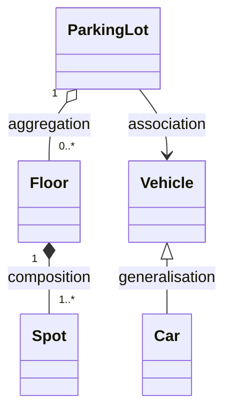
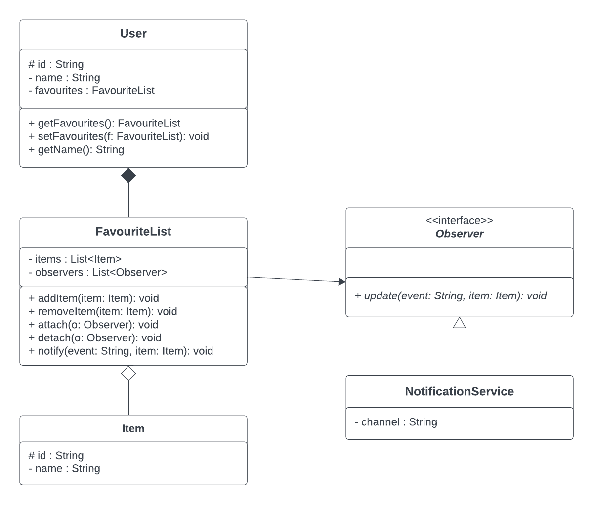
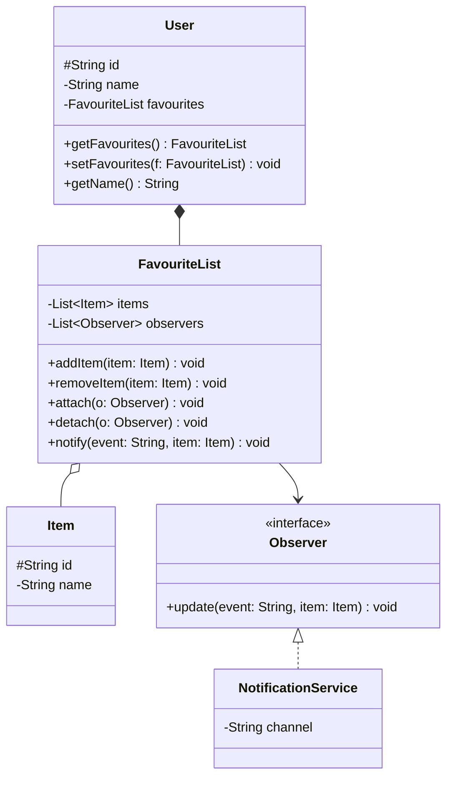
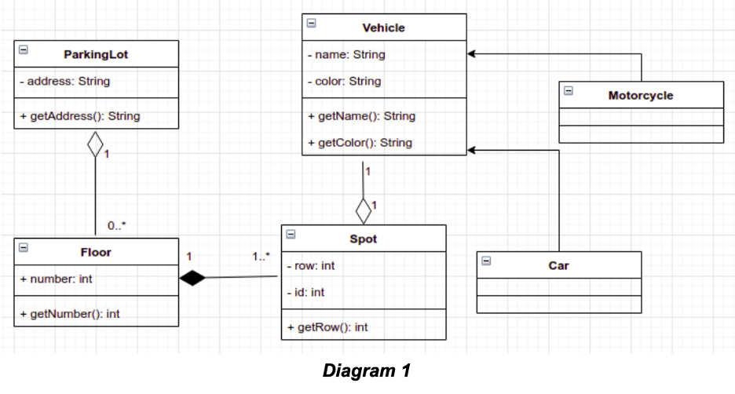
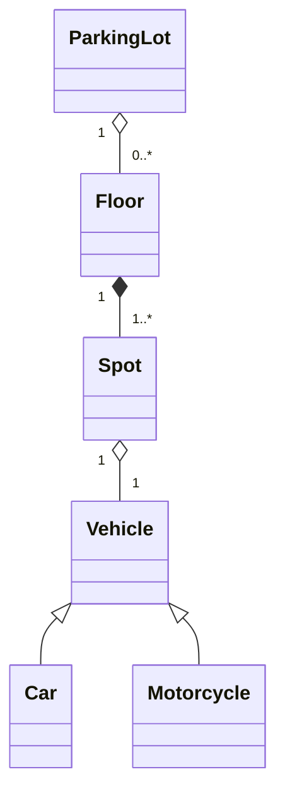
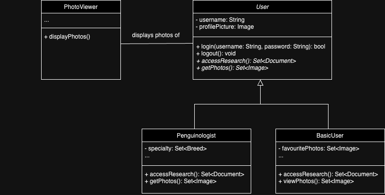
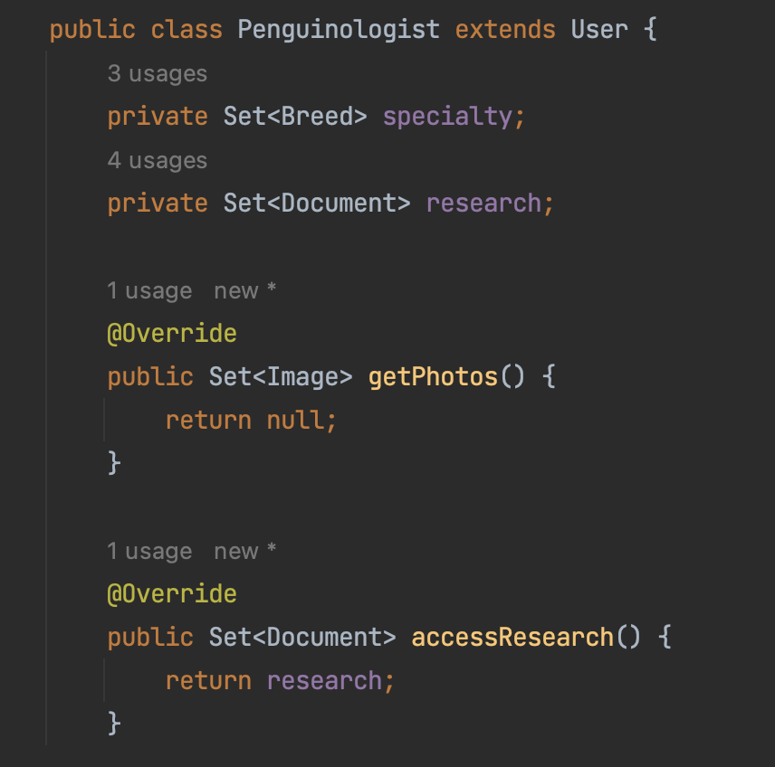
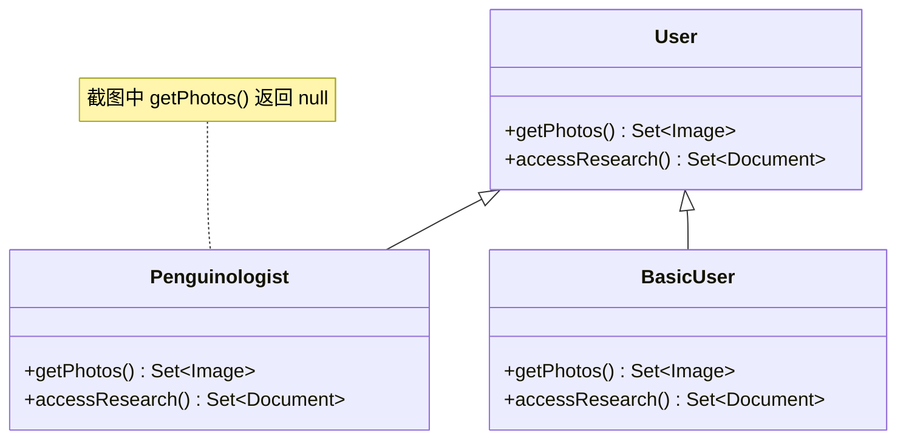

# 第3章 考点F：UML＋SOLID＋重构＋开放题

> 目标：看懂类图，能用代码证据解释 SOLID，能把“这里不太好”写成具体的重构方案。
>
> 所有答案均为非官方参考解答。开放题通常没有唯一答案，重点是概念准确、证据具体、方案可执行。

## 第一部分：知识点的零基础学习

### 知识点 1：UML 类图是在看什么？

把 UML 类图想成“代码的结构说明书”。每个方框通常有三层：类名、字段、方法。

```text
┌──────────────────────────┐
│ User                     │  ← 类名
├──────────────────────────┤
│ - name: String           │  ← 字段：private String name
│ # id: String             │  ← 字段：protected String id
├──────────────────────────┤
│ + getName(): String      │  ← 方法：public String getName()
└──────────────────────────┘
```

| UML 符号 | Java 中的意思 | 最短记法 |
|---|---|---|
| `+` | `public` | 大家都能用 |
| `-` | `private` | 只有本类能用 |
| `#` | `protected` | 本类、同包、子类可用 |
| `~` | 包可见 | 不写访问修饰符 |
| 方法名后的 `: String` | 返回类型 | 不是字段类型 |

#### 1.1 四种关系不要混



- **关联 association**：一个对象知道或使用另一个对象，例如 `FavouriteList` 调用 `Observer.update()`。
- **聚合 aggregation**：整体包含部分，但部分可以独立存在，例如球队与球员。空心菱形 `◇` 在整体一端。
- **组合 composition**：整体负责部分的生命周期，例如 `User` 创建并拥有自己的 `FavouriteList`。实心菱形 `◆` 在整体一端。
- **聚合 vs 组合**：两者都是整体—部分关系；部分能独立存在是聚合，整体消失时部分也随之消失是组合。
- **泛化 generalisation**：就是继承，空心三角箭头指向父类。读作 `Car is a Vehicle`，不是聚合。

多重性写在关联两端：`1` 表示恰好一个，`0..*` 表示零个或多个，`1..*` 表示至少一个。

> 直观检查法：先问“是不是继承”，是则为泛化；再看是不是整体—部分关系。部分能独立存在的是聚合，整体消失时部分也随之消失的是组合；如果不是整体—部分，只是一个对象知道或使用另一个对象，就是关联。

### 知识点 2：SOLID 不是五句口号，而是五种检查问题

| 原则 | 白话解释 | 看代码时问什么 |
|---|---|---|
| SRP 单一职责 | 一个类只围绕一件事变化 | 修改两个不相干需求时，是否都要改它？ |
| OCP 开闭原则 | 加新功能优先加新代码，而非反复改旧代码 | 加一种类型是否又要加一串 `if`？ |
| LSP 里氏替换 | 子类不能破坏父类对调用者的承诺 | 把父类换成子类，程序是否仍按原约定工作？ |
| ISP 接口隔离 | 不给使用者塞它不需要的方法 | 实现类是否被迫空实现或抛异常？ |
| DIP 依赖倒置 | 高层逻辑依赖抽象，而不是具体实现 | 是否到处 `new` 某个具体类？ |

#### 2.1 SRP：一个类有太多“变化理由”

##### 不同变化理由的方法切分成不同的类，不然会冲突

```java
class Report {
    String load(String path) { return "data"; }
    String format(String data) { return data.toUpperCase(); }
    void save(String text) { System.out.println(text); }
}
```

读取、格式化、保存是三件事。文件格式变化、展示格式变化、存储方式变化都会逼你改这个类。可拆成 `ReportLoader`、`ReportFormatter`、`ReportRepository`。

**“变化理由”具体指什么？** 可以理解成：未来哪一类需求变化时，会逼着你去修改这个类？

`Report` 因此有三个不同的变化理由：

1. **读取方式变了**：原来读本地文件，后来要读数据库或网络，需要修改 `load`。
2. **展示格式变了**：原来全部转大写，后来要输出 Markdown 或 HTML，需要修改 `format`。
3. **保存方式变了**：原来打印到控制台，后来写文件或上传云端，需要修改 `save`。

这三类变化互不相干，却都会修改同一个类。拆开后：

```java
class ReportLoader {
    String load(String path) {
        return "data";
    }
}

class ReportFormatter {
    String format(String data) {
        return data.toUpperCase();
    }
}

class ReportRepository {
    void save(String text) {
        System.out.println(text);
    }
}

class ReportService {
    private final ReportLoader loader;
    private final ReportFormatter formatter;
    private final ReportRepository repository;

    ReportService(ReportLoader loader,
                  ReportFormatter formatter,
                  ReportRepository repository) {
        this.loader = loader;
        this.formatter = formatter;
        this.repository = repository;
    }

    void generate(String path) {
        String data = loader.load(path);
        String text = formatter.format(data);
        repository.save(text);
    }
}
```

现在改读取方式只动 `ReportLoader`，改显示格式只动 `ReportFormatter`，改存储位置只动 `ReportRepository`。`ReportService` 只负责协调流程，不再包办三个实现细节。

**注意**：SRP 不是“一个类只能有一个方法”。一个类可以有很多方法，只要它们属于同一职责、因为同一类原因变化。例如价格类中的 `calculateSubtotal()` 和 `applyDiscount()` 都在负责定价，通常不算违反 SRP。

**SRP 小结**：不是按“方法数量”切割，而是按“变化理由／职责”把相关方法和字段移到不同类。`Report` 中的读取、格式化、保存可以拆，是因为数据来源、展示形式、存储位置会独立变化；`Calculator` 中的加减乘都在负责整数运算，通常属于同一职责，不需要拆成一个方法一个类。拆分后如果这些职责仍需协作，再用 `ReportService` 这样的协调类把它们组合并编排起来。

#### 2.2 OCP：新类型出现时，旧代码还在不断修改

##### 旧写法的问题

```java
String read(String type) {
    if (type.equals("JSON")) return "read JSON";
    if (type.equals("XML")) return "read XML";
    return "read CSV";
}
```

这段代码现在“能用”，但每次增加格式都要回来修改它：

```java
String read(String type) {
    if (type.equals("JSON")) return "read JSON";
    if (type.equals("XML")) return "read XML";
    if (type.equals("YAML")) return "read YAML";
    return "read CSV";
}
```

问题不只是“多了一个 `if`”：

- 增加 YAML 时，JSON 和 XML 的原方法也要重新编译、测试和回归。
- 旧代码越来越长，分支之间可能互相影响。
- 未知类型会默默落到 `return "read CSV"`，把错误隐藏起来。
- “选择哪种读取方式”和“每种方式怎么读取”混在同一个方法里。

OCP 希望避免的是这种局面：

> 每增加一种新类型，都要修改已经稳定工作的旧代码。

不能因为“最后还是加了新类”就认为一定符合 OCP；关键是**旧调用方、旧实现和稳定抽象**是否还需要跟着改。

##### OCP 到底要求什么

**Open for extension, closed for modification**：

- **对扩展开放**：增加新行为时，可以增加新实现；
- **对修改封闭**：已经稳定的业务调用方和已有实现不需要跟着改。

它不是“永远不修改任何一行代码”。现实中的创建、注册或配置文件仍可能变化，但这些变化应被集中到很小的入口，而不是散落在业务流程里。

##### 第一步：抽出统一能力

无论 JSON、XML 还是 CSV，读取都要做同一件事：给一个路径，返回读到的字符串。

```java
interface DataReader {
    String read(String path);
}
```

这个接口是稳定抽象。业务代码只需要知道“我能调用 `read(path)`”，不需要知道具体格式。

##### 第二步：每种格式独立实现

```java
class JsonReader implements DataReader {
    @Override
    public String read(String path) {
        return "read JSON from " + path;
    }
}

class XmlReader implements DataReader {
    @Override
    public String read(String path) {
        return "read XML from " + path;
    }
}

class CsvReader implements DataReader {
    @Override
    public String read(String path) {
        return "read CSV from " + path;
    }
}
```

现在每种格式只负责自己的读取细节。JSON 读取逻辑变化时，不需要修改 XML 或 CSV。

##### 第三步：业务类依赖接口，而不是具体实现

**由外部选择器决定传入什么：构造器只声明需要一个抽象 `DataReader`，具体传入 `JsonReader`、`XmlReader` 还是其他实现，由外部决定。**

```java
class DataService {
    private final DataReader reader;

    // 由外部选择器决定传入什么具体实现
    DataService(DataReader reader) {
        this.reader = reader;
    }

    String load(String path) {
        return reader.read(path);
    }
}
```

逐行理解：

- `private final DataReader reader`：保存一个“会读取”的对象；
- `DataService(DataReader reader)`：由外部把具体 Reader 传进来；
- `this.reader = reader`：把传入的对象保存到字段；
- `reader.read(path)`：把读取任务转交给当前对象。

接口不能直接 `new`，但接口变量可以保存任何实现：

```java
DataService jsonService = new DataService(new JsonReader());
DataService xmlService = new DataService(new XmlReader());
```

两个 `DataService` 的 `load` 代码完全一样，却会执行不同的 `read` 实现。这就是**多态**与**委派**。

`DataService` 不负责决定格式，也不负责创建 Reader。它只声明：

> 我需要一个 `DataReader`，请在外面把具体实现交给我。

这种“外部创建依赖，再通过构造器传入”的方式叫**构造器依赖注入**。

##### 第四步：在组装层决定传入哪个 Reader

如果程序只处理 JSON，可以直接固定：

```java
public class Main {
    public static void main(String[] args) {
        DataReader reader = new JsonReader();
        DataService service = new DataService(reader);

        System.out.println(service.load("data.json"));
    }
}
```

如果同一个程序要处理多种扩展名，用工厂选择：

```java
class DataReaderFactory {
    static DataReader forPath(String path) {
        if (path.endsWith(".json")) {
            return new JsonReader();
        }
        if (path.endsWith(".xml")) {
            return new XmlReader();
        }
        if (path.endsWith(".csv")) {
            return new CsvReader();
        }
        if (path.endsWith(".yaml")) {
            return new YamlReader();
        }
        throw new IllegalArgumentException("Unsupported file: " + path);
    }
}
```

```java
public class Main {
    public static void main(String[] args) {
        String path = args[0];

        DataReader reader = DataReaderFactory.forPath(path);
        DataService service = new DataService(reader);

        System.out.println(service.load(path));
    }
}
```

执行关系：

```text
Main
  ↓ 根据路径选择实现
JsonReader / XmlReader / CsvReader / YamlReader
  ↓ 构造器注入
DataService(reader)
  ↓ load 委派
reader.read(path)
```

未知类型直接抛异常，而不是悄悄当成 CSV。这样可以尽早暴露错误。

##### 第五步：新增 YAML 时改哪里

只需增加：

```java
class YamlReader implements DataReader {
    @Override
    public String read(String path) {
        return "read YAML from " + path;
    }
}
```

然后让工厂认识它：

```java
if (path.endsWith(".yaml")) {
    return new YamlReader();
}
```

以下内容不需要改变：

- `DataReader` 接口；
- `JsonReader`、`XmlReader`、`CsvReader`；
- `DataService.load`；
- 调用 `service.load(path)` 的业务代码。

需要诚实说明的是：工厂里仍然增加了一个创建分支。OCP 并不是要求“任何地方都零修改”，而是把变化限制在**创建／注册入口**，让稳定的业务逻辑依赖于抽象，不再被具体格式牵着走。

如果希望把工厂的分支也进一步集中，可以用注册表：

```java
Map<String, Supplier<DataReader>> readers = Map.of(
        "json", JsonReader::new,
        "xml", XmlReader::new,
        "csv", CsvReader::new,
        "yaml", YamlReader::new
);
```

这种方式同样需要注册新类型，只是把“映射关系”集中成配置。考试回答时，写清接口、实现、工厂或配置、客户端依赖抽象，已经足够表达 OCP。

##### 如何决定构造时传入什么

| 场景 | 做法 |
|---|---|
| 程序只处理一种格式 | `new DataService(new JsonReader())` |
| 根据文件扩展名选择 | `DataReaderFactory.forPath(path)` 后再传入 |
| 根据用户配置选择 | 读取配置中的格式，再创建对应 Reader |
| 单元测试 | 传入 `FakeReader`，避免真实文件 I/O |
| 每次请求都可能不同格式 | 把工厂注入 `DataService`，在 `load` 内动态选择 |

把“选择实现”放在外层，`DataService` 才能保持稳定。若在 `DataService` 内部写 `new JsonReader()`，就又和具体实现绑死了。

##### OCP 与设计模式的关系

- OCP 是**设计原则**；
- `DataReader` 及多个实现体现 Strategy 思路；
- 工厂负责创建具体策略，Factory 模式负责对象创建；
- 构造器注入让高层类依赖抽象，也支持 DIP。

模式不是目的。这里的核心目标是：**新增格式时，不改已经稳定的读取流程**。

##### 小结

旧写法把“选择格式”和“实现格式”放在一个方法里，所以每新增格式都必须修改旧方法。改进后用 `DataReader` 固定调用契约，用具体 Reader 承载各格式实现，用工厂决定实例，用构造器注入把实例交给 `DataService`。以后新增 YAML，主要只是增加 `YamlReader` 并在创建入口注册它，而业务调用方保持不变。

#### 2.3 LSP：返回值相同不等于行为守约

##### 判断法：把父类对象换成子类对象后，原来的代码还正常吗？

**正常 → 符合 LSP；崩溃或行为变了 → 违反 LSP。**

如果父类承诺 `getPhotos()` 返回可遍历的集合，子类却返回 `null`，调用者换成这个子类后可能出现 `NullPointerException`。这就是行为破坏，而不是单纯的“代码不好看”。

#### 2.4 ISP 与 DIP 的短例

##### ISP：不要强迫类实现用不到的方法

```java
interface Printer {
    void print();
    void fax();
}
```

一个普通打印机只会打印，但因为实现了 `Printer`，它被迫写 `fax()`：

```java
class SimplePrinter implements Printer {
    @Override
    public void print() {
        System.out.println("printing");
    }

    @Override
    public void fax() {
        // 不会传真，但接口要求必须实现
    }
}
```

或者更危险地直接抛异常：

```java
@Override
public void fax() {
    throw new UnsupportedOperationException();
}
```

调用者看到接口里有 `fax()`，会以为这个对象支持传真；实际运行时才可能失败。这就是 ISP 想避免的“胖接口”：接口把不相关的能力绑在一起，迫使实现者和调用者都依赖它们不需要的方法。

应拆成两个更小的接口：

```java
interface Printable {
    void print();
}

interface Faxable {
    void fax();
}
```

普通打印机只实现需要的能力：

```java
class SimplePrinter implements Printable {
    @Override
    public void print() {
        System.out.println("printing");
    }
}
```

多功能打印机则按实际能力实现两个接口：

```java
class MultiFunctionPrinter implements Printable, Faxable {
    @Override
    public void print() {
        System.out.println("printing");
    }

    @Override
    public void fax() {
        System.out.println("faxing");
    }
}
```

客户端同样只依赖自己需要的能力：

```java
void printDocument(Printable device) {
    device.print();
}
```

这样 `printDocument` 不会看到 `fax()`，也不会错误地调用它。

**ISP 的判断信号**：

- 某个类被迫写空方法，或被迫抛出 `UnsupportedOperationException`；
- 调用者依赖一个大接口，却只使用其中一两个方法；
- 修改接口中一个无关方法，会迫使无关实现类重新修改和测试。

**ISP 一句话**：客户端需要什么能力，就依赖什么接口；不要把一堆无关方法塞进同一个接口。

**注意**：ISP 不是“接口方法越少越好”。如果所有使用者确实都需要 `print()` 和 `fax()`，保留一个接口也合理；关键是不要强迫使用者依赖它不需要的方法。

##### DIP：高层业务在使用具体功能时，不要依赖具体类，而要用类的抽象

```java
class Service {
    private final DataReader reader;
    Service(DataReader reader) { this.reader = reader; }
}
```

`Service` 依赖 `DataReader` 抽象，并由外部传入实现，是 DIP 的常见做法，也方便测试时换成假实现。

### 知识点 3：代码坏味道与重构

**代码坏味道 code smell** 是“可能有问题、值得调查的信号”，不是必然错误。重构是在不改变外部可观察行为的前提下改善内部结构。

| 坏味道 | 直观特征 | 常见重构 |
|---|---|---|
| Long Method | 一个方法做太多步骤 | Extract Method |
| Long Parameter List | 参数一长串 | Introduce Parameter Object |
| Duplicate Code | 同一逻辑复制多份 | 提取共用方法或类 |
| Long if-else chain | 按类型不断分支 | Strategy／多态替换条件语句 |
| Hardcoding | 魔法值散落代码 | 提取常量或配置 |
| Dead Code | 永远不用或什么都不做 | 删除 |
| Mysterious Name | 看不出用途 | 按业务含义重命名 |
| God Class | 数据与职责都堆在一个类 | 按职责拆类 |

重构安全顺序：**先补测试 → 小步修改 → 每步运行测试 → 再提交**。不要一边改架构一边改业务结果。

##### 1. Long Method：一个方法做太多步骤

```java
void printInvoice(List<Item> items) {
    double subtotal = 0;
    for (Item item : items) {
        subtotal += item.price() * item.quantity();
    }
    double tax = subtotal * 0.1;
    double total = subtotal + tax;

    System.out.println("Subtotal: " + subtotal);
    System.out.println("Tax: " + tax);
    System.out.println("Total: " + total);
}
```

它同时计算小计、计算税费、计算总额并打印。任何一步变化都要修改同一个方法。

用 **Extract Method**：

```java
double calculateSubtotal(List<Item> items) { ... }
double calculateTax(double subtotal) { ... }
void printSummary(double subtotal, double tax, double total) { ... }

void printInvoice(List<Item> items) {
    double subtotal = calculateSubtotal(items);
    double tax = calculateTax(subtotal);
    printSummary(subtotal, tax, subtotal + tax);
}
```

现在计算公式和打印格式可以分别测试、分别修改。

##### 2. Long Parameter List：参数一长串

```java
void register(String name, String email, String phone,
              String street, String city, String postcode,
              String country) {
    // ...
}
```

这些参数其实分成三组：姓名、联系方式、地址。参数过多时，调用顺序容易写错，新增字段也要改所有调用点。

用 **Introduce Parameter Object**：

```java
class ContactDetails {
    String email;
    String phone;
}

class Address {
    String street;
    String city;
    String postcode;
    String country;
}

void register(String name, ContactDetails contact, Address address) {
    // ...
}
```

地址格式变化时只改 `Address`，不再让每个调用者都增加参数。

##### 3. Duplicate Code：同一逻辑复制多份

```java
double memberPrice(double price) {
    return price * 0.9;
}

double promotionPrice(double price) {
    return price * 0.9;
}
```

两份折扣计算完全相同。将来折扣从 10% 改成 15%，很容易只改一处、漏另一处。

提取共用方法：

```java
double applyDiscount(double price, double rate) {
    return price * (1 - rate);
}

double memberPrice(double price) {
    return applyDiscount(price, 0.1);
}

double promotionPrice(double price) {
    return applyDiscount(price, 0.1);
}
```

规则只有一份，修改和测试也只需要针对一份逻辑。

##### 4. Long if-else chain：按类型不断分支

```java
int shippingCost(String type, int weight) {
    if (type.equals("standard")) {
        return 5 + weight;
    } else if (type.equals("express")) {
        return 10 + weight * 2;
    } else if (type.equals("overnight")) {
        return 20 + weight * 3;
    }
    throw new IllegalArgumentException("Unknown shipping type");
}
```

新增“国际快递”又要修改这个方法。

用 **Strategy／多态替换条件语句**：

```java
interface ShippingMethod {
    int cost(int weight);
}

class StandardShipping implements ShippingMethod {
    public int cost(int weight) { return 5 + weight; }
}

class ExpressShipping implements ShippingMethod {
    public int cost(int weight) { return 10 + weight * 2; }
}

class OvernightShipping implements ShippingMethod {
    public int cost(int weight) { return 20 + weight * 3; }
}
```

调用者改为：

```java
int cost = shippingMethod.cost(weight);
```

新增运输方式时增加实现，不需要在旧方法里继续加 `else if`。

##### 5. Hardcoding：魔法值散落代码

```java
double calculateTotal(double subtotal, String country) {
    double tax = subtotal * 0.1;
    double shipping = country.equals("AU") ? 15 : 40;
    return subtotal + tax + shipping;
}
```

`0.1`、`15`、`40` 都没有说明含义。税率或运费变化时需要到处搜索并替换数字，还可能改错。

用常量或配置：

```java
static final double GST_RATE = 0.1;
static final double DOMESTIC_SHIPPING = 15;
static final double INTERNATIONAL_SHIPPING = 40;

double calculateTotal(double subtotal, String country) {
    double tax = subtotal * GST_RATE;
    double shipping = country.equals("AU")
            ? DOMESTIC_SHIPPING
            : INTERNATIONAL_SHIPPING;
    return subtotal + tax + shipping;
}
```

数字有了名字，业务含义和修改位置都清楚了。

##### 6. Dead Code：永远不用或什么都不做

```java
double calculateOldPrice(double price) {
    return price * 0.8;
}

void displaySomething() {
    System.out.println("This method does nothing...");
}
```

如果 `calculateOldPrice` 已经没有任何调用，`displaySomething` 又只是无意义输出，它们只会增加阅读和维护负担。

用**删除**处理。删除前先：

1. 搜索调用点；
2. 运行现有测试；
3. 确认没有反射、配置或外部代码依赖它。

版本控制系统会保留历史，不要用大段注释把死代码留在源文件里。

##### 7. Mysterious Name：看不出用途

```java
double calc(double x) {
    return x * 0.1;
}

void doIt(Order order) {
    repository.save(order);
}
```

仅看名字无法知道 `calc` 算的是税、折扣还是利息，也不知道 `doIt` 保存的是什么。

按业务含义重命名：

```java
double calculateGst(double amount) {
    return amount * 0.1;
}

void saveOrder(Order order) {
    repository.save(order);
}
```

名字应说明“做什么”和“对象是什么”，而不是用 `data`、`temp`、`doStuff` 隐藏真实意图。

##### 8. God Class：数据与职责都堆在一个类

```java
class OrderManager {
    void validateOrder(Order order) { ... }
    void saveToDatabase(Order order) { ... }
    void sendConfirmationEmail(Order order) { ... }
    byte[] generatePdf(Order order) { ... }
}
```

`OrderManager` 同时负责校验、数据库、邮件和 PDF。修改邮件模板或数据库表结构，都要修改这个类。

按职责拆类：

```java
class OrderValidator { ... }
class OrderRepository { ... }
class EmailService { ... }
class InvoicePdfGenerator { ... }
```

再由一个协调类编排流程：

```java
class OrderService {
    void placeOrder(Order order) {
        validator.validate(order);
        repository.save(order);
        emailService.sendConfirmation(order);
        pdfGenerator.generate(order);
    }
}
```

`OrderService` 只负责顺序，具体工作交给各自的服务。

### 知识点 4：开放题怎样写得有分

使用四段式：

1. **Definition**：先准确定义原则或坏味道。
2. **Evidence**：指出具体类、字段、方法或分支。
3. **Impact**：说明修改、测试、扩展或运行时会出什么问题。
4. **Refactoring**：说明新增什么抽象、移动什么代码、调用方怎样改。

```text
不要只写：This violates SRP.
改成：MDToken has multiple reasons to change because ...
      For example, ... Therefore, I would ...
```

##### 四段式具体示例：OrderManager 的 God Class

题目：分析下面这个类，指出一个代码坏味道，并说明如何重构。

```java
class OrderManager {
    private Database database;
    private Mailer mailer;
    private PdfRenderer pdf;

    void validate(Order order) {
        if (order.total() < 0) {
            throw new IllegalArgumentException("Invalid total");
        }
    }

    void save(Order order) {
        database.insert("orders", order);
    }

    void sendEmail(Order order) {
        mailer.send(order.email(), "Order confirmed");
    }

    byte[] generatePdf(Order order) {
        return pdf.render(order);
    }
}
```

可以直接模仿的四段式答案：

**Definition.** A God Class is a class that concentrates several unrelated responsibilities, so it has multiple reasons to change and becomes difficult to understand, test, and maintain.

**中文翻译：** God Class（上帝类）是把多个互不相关的职责集中在一个类中的类，因此它有多个需要变化的原因，并变得难以理解、测试和维护。

**Evidence.** `OrderManager` validates an order, writes it to the database, sends a confirmation email, and generates a PDF. Validation, persistence, notification, and document rendering are four unrelated responsibilities in the same class.

**中文翻译：** `OrderManager` 校验订单、把订单写入数据库、发送确认邮件并生成 PDF。校验、持久化、通知和文档渲染是同一个类中的四种互不相关的职责。

**Impact.** Changing the email template, database schema, or PDF layout all require modifying `OrderManager`. These changes can affect unrelated behaviour and force the whole class to be retested. The class also depends directly on `Database`, `Mailer`, and `PdfRenderer`, making isolated testing harder.

**中文翻译：** 修改邮件模板、数据库结构或 PDF 排版都需要修改 `OrderManager`。这些修改可能影响无关行为，并迫使整个类重新测试。这个类还直接依赖 `Database`、`Mailer` 和 `PdfRenderer`，使隔离测试更加困难。

**Refactoring.** I would extract `OrderValidator`, `OrderRepository`, `EmailService`, and `InvoicePdfGenerator` according to their responsibilities. An `OrderService` would orchestrate the workflow by calling these collaborators, which are supplied through its constructor. The public “place order” behaviour remains unchanged, while each extracted class can be tested and modified independently.

**中文翻译：** 我会按职责抽取 `OrderValidator`、`OrderRepository`、`EmailService` 和 `InvoicePdfGenerator`。再由 `OrderService` 调用这些协作者来编排流程，这些对象通过其构造器传入。对外的“下单”行为保持不变，而每个被抽出的类都可以独立测试和修改。

**写法提醒**：

- Definition 只下定义：God Class 是职责过多、变化原因过多的类。
- Evidence 必须点名证据：`validate`、`save`、`sendEmail`、`generatePdf`。
- Impact 说明真实后果：邮件、数据库、PDF 任一变化都会重开这个类。
- Refactoring 说清具体动作：拆成哪些类、由谁协调、依赖怎样传入。

这段话不算长，但每一段都有具体证据，比单纯写“This class has low cohesion”更容易得分。

有字数限制时，先写直接证据和具体改法，删掉背景套话。有多个合理方案时，选一个论证完整，不要把所有模式堆上去。

## 真题讲解 1：PaymentProcessor 的坏味道与重构（2025 S2 Q3）

来源：[`Q3README.md`](../exam-practice-questions/past-exams/2025-2/src/Q3/Q3README.md)、[`PaymentProcessor.java`](../exam-practice-questions/past-exams/2025-2/src/Q3/PaymentProcessor.java)

### 1.1 题目原文

**中文题意：** 分析 `PaymentProcessor`，指出一个可用课程设计模式解决的代码坏味道，并按 A–E 的字数限制说明坏味道名称、位置、影响、模式名称与具体重构方案。

> Analyze the `PaymentProcessor` class and identify one code smell that could be resolved using one design pattern covered in the course.
>
> In `Q3Answers.java`, respond to the following questions:
> - A) What is the name of the code smell you identified? (Word limit: ≤4)
> - B) Precisely indicate where in the code the smell occurs. (Word limit: ≤20)
> - C) Explain the problem caused by this code smell in the context of the software. (Word limit: ≤100)
> - D) What is the name of the design pattern you propose to apply? (Word limit: ≤4)
> - E) Describe how to apply this design pattern to refactor the code. (Word limit: ≤100)
>   Be specific and precise about what changes should be made, to which part(s) of the code, and where the changes should be placed.
>
> Strict word limits apply to each section.

原始代码：

```java
public class PaymentProcessor {
    public void processPayment(String method, double amount) {
        System.out.println("Processing payment of $" + amount);

        if (method.equals("CREDIT_CARD")) {
            System.out.println("Connecting to credit card gateway...");
            System.out.println("Charging card: $" + amount);
        } else if (method.equals("PAYPAL")) {
            System.out.println("Connecting to PayPal...");
            System.out.println("Transferring funds: $" + amount);
        } else if (method.equals("BANK_TRANSFER")) {
            System.out.println("Connecting to bank...");
            System.out.println("Initiating bank transfer of $" + amount);
        } else {
            System.out.println("Unknown payment method: " + method);
        }

        System.out.println("Payment completed.");
    }
}
```

### 1.2 直观分析

新增一种支付方式时要改哪里？一定要回到 `processPayment` 加分支。这意味着：

- 分支是**具体代码证据**；
- 问题是扩展时反复修改旧类，容易引入回归，也让测试集中在一个不断膨胀的方法上；
- Strategy 把“怎样付款”变成可替换对象，新增策略不必修改已有策略。

### 1.3 英文示范答案

**A) Code smell**

Long if-else chain

**B) Location**

The method chain in `processPayment`, lines 6–17.

**C) Impact**

Every **new payment method** requires modifying `processPayment`. This increases the **risk of breaking existing payment flows**, makes the method harder to read, and **prevents each payment algorithm from being tested independently**.

**D) Design pattern**

Strategy

**E) Refactoring plan**

Create a `PaymentStrategy` interface declaring `pay(double amount)`. Implement `CreditCardPayment`, `PayPalPayment`, and `BankTransferPayment`; move each existing branch, including gateway connection and charge or transfer logic, into its matching implementation. Add a private final `PaymentStrategy` field and a `PaymentProcessor(PaymentStrategy strategy)` constructor. Its `processPayment(double amount)` should retain only the common start and end messages and delegate payment work to `strategy.pay(amount)`. Add `PaymentStrategyFactory.create(String method)` to select implementations; adding a method then requires one new strategy and one factory registration, without changing existing strategies or the processor workflow.

**中文翻译：** 创建一个 `PaymentStrategy` 接口，声明 `pay(double amount)` 方法。实现 `CreditCardPayment`、`PayPalPayment` 和 `BankTransferPayment`；把现有的每个条件分支，包括网关连接以及扣款或转账逻辑，迁移到对应的实现类中。为 `PaymentProcessor` 增加一个 `private final PaymentStrategy` 字段，以及一个 `PaymentProcessor(PaymentStrategy strategy)` 构造器。其 `processPayment(double amount)` 方法只保留公共的开头和结尾提示，并把支付工作委托给 `strategy.pay(amount)`。增加 `PaymentStrategyFactory.create(String method)` 来选择具体实现；这样新增一种支付方式时，只需新增一个策略实现并在工厂中注册一次，无需修改已有策略或处理器的工作流程。

**得分点**：位置精确、影响联系支付业务、改法说清接口与分支搬到哪里。只写“用 Strategy 改善代码”不够具体。

##### E) 代码展开：具体移动哪些逻辑

```java
interface PaymentStrategy {
    void pay(double amount);
}

class CreditCardPayment implements PaymentStrategy {
    @Override
    public void pay(double amount) {
        System.out.println("Connecting to credit card gateway...");
        System.out.println("Charging card: $" + amount);
    }
}

class PayPalPayment implements PaymentStrategy {
    @Override
    public void pay(double amount) {
        System.out.println("Connecting to PayPal...");
        System.out.println("Transferring funds: $" + amount);
    }
}

class BankTransferPayment implements PaymentStrategy {
    @Override
    public void pay(double amount) {
        System.out.println("Connecting to bank...");
        System.out.println("Initiating bank transfer of $" + amount);
    }
}
```

原来的 `PaymentProcessor` 保留通用前后提示，只把具体支付工作交给策略：

```java
class PaymentProcessor {
    private final PaymentStrategy strategy;

    PaymentProcessor(PaymentStrategy strategy) {
        this.strategy = strategy;
    }

    public void processPayment(double amount) {
        System.out.println("Processing payment of $" + amount);
        strategy.pay(amount);
        System.out.println("Payment completed.");
    }
}
```

由工厂选择策略：

```java
class PaymentStrategyFactory {
    static PaymentStrategy create(String method) {
        return switch (method) {
            case "CREDIT_CARD" -> new CreditCardPayment();
            case "PAYPAL" -> new PayPalPayment();
            case "BANK_TRANSFER" -> new BankTransferPayment();
            default -> throw new IllegalArgumentException(
                    "Unknown payment method: " + method);
        };
    }
}
```

使用方式：

```java
String method = "PAYPAL";
PaymentStrategy strategy = PaymentStrategyFactory.create(method);
PaymentProcessor processor = new PaymentProcessor(strategy);
processor.processPayment(100.0);
```

具体对应关系：

| 原 `processPayment` 中的分支 | 移动到哪个类 |
|---|---|
| `CREDIT_CARD` 的两个输出 | `CreditCardPayment.pay` |
| `PAYPAL` 的两个输出 | `PayPalPayment.pay` |
| `BANK_TRANSFER` 的两个输出 | `BankTransferPayment.pay` |
| 开头 `Processing payment...` | 保留在 `PaymentProcessor`，属于公共流程 |
| 结尾 `Payment completed.` | 保留在 `PaymentProcessor`，属于公共流程 |
| 未知方式的处理 | 工厂抛出 `IllegalArgumentException` |

以后新增支付方式：

1. 新增一个 `PaymentStrategy` 实现；
2. 在工厂中注册新方法；
3. 已有 `CreditCardPayment`、`PayPalPayment`、`BankTransferPayment` 和 `PaymentProcessor.processPayment` 都不需要修改。

## 真题讲解 2：Vector2／Vector3 与 LSP（2025 S1 MCQ8）

来源：[`MC_Questions_2025_S1.pdf`](../exam-practice-questions/past-exams/2025-1/src/Q4/MC_Questions_2025_S1.pdf)，第 3–4 页。

### 2.1 题目原文

**中文题意：** 游戏引擎已有 `Vector2`，现在要新增带 z 轴的 `Vector3`；问怎样设计两者关系，才能避免破坏里氏替换原则（LSP）。

```java
class Vector2 {
    private double x, y;
    public Vector2(double x, double y) {
        this.x = x;
        this.y = y;
    }

    // Returns the distance from the origin to this vector.
    public double getLength() {
        return Math.sqrt(x*x + y*y);
    }

    // Scales the vectors together componentwise
    public Vector2 dilate(Vector2 other) {
        return new Vector2(x*other.x, y*other.y);
    }
}
```

> Video game engines frequently use classes like the one partially shown above to represent a position in 2D space. A developer is tasked with extending this functionality by writing a `Vector3` class to represent a position in 3D space by adding a z-axis.
>
> What might the developer do in this situation to avoid violating the Liskov substitution principle?
>
> a. Have `Vector2` and `Vector3` both extend an abstract `Vector` class.
> b. Invert the class hierarchy by making `Vector2` a subclass of `Vector3`.
> c. Convert `Vector2` from a class to an interface which is implemented by `Vector3`.
> d. Make `Vector2` and `Vector3` both be immutable by marking their fields as `final`.

### 2.2 参考答案与解析

**答案：a。**

让两个类直接继承一个能表达共同契约的抽象 `Vector`，避免强行宣称“二维向量是一种三维向量”或反过来。`dilate(Vector2 other)` 的参数与返回类型也说明：简单让 `Vector3 extends Vector2` 容易破坏替换后的行为约定。

- **b 错**：`Vector2 is a Vector3` 不符合领域含义。
- **c 错**：只把 `Vector2` 改成接口，没有解决共同的向量契约应放在哪里的问题。
- **d 错**：不可变性有用，但不能自动保证子类遵守父类契约。

**做题抓手**：LSP 题不要先找“字段像不像”，先检查“替换后，参数、返回值、异常和结果是否仍符合原承诺”。

## 真题讲解 3：按 UML 实现 Observer（2025 S2 Q5）

来源：[`Q5README.md`](../exam-practice-questions/past-exams/2025-2/src/Q5/Q5README.md)、[`UML_ob.png`](../exam-practice-questions/past-exams/2025-2/src/Q5/UML_ob.png)、[`FavouriteList.java`](../exam-practice-questions/past-exams/2025-2/src/Q5/FavouriteList.java)

### 3.1 题目原文

**中文题意：** 按 Observer UML 创建收藏系统类结构；实现观察者的注册／移除、收藏项的按 id 添加与按 id 和名称删除，以及变化通知；最后在 `Main` 中按要求演示两个用户和两个通知服务。

> You are given a UML diagram that demonstrate the design of a favourites management system that applies the Observer design pattern, where a user’s favourites list notifies observers (like a notification service) whenever items change.
>
> **Task A: Class Structure**
>
> Create the classes in accordance with the provided UML diagram. You will be marked based on how accurately your code reflects the structure and relationships defined in the UML, for `Observer`, `NotificationService`, `Item`, `User`, and `FavouriteList`.
>
> Ensure that all classes, fields, and methods exactly match the names and signatures specified in the provided UML diagram. Do not introduce any extra fields or methods, except that you may implement constructor(s), getters, and setters.
>
> **Task B: Design Pattern Implementation**
>
> - In `FavouriteList`,
>   - `attach` adds the observer once, without duplicates. No-op if the parameter is null.
>   - `detach` remove the observer passed in if present, no-op otherwise.
>   - `addItem`: adds the `item` to the list of items if no items with the same id exists. No-op otherwise. If successfully added, call `notify("added", item)`.
>   - `removeItem`: removes the `item` from the list of items if an item with the same id and name exists. No-op otherwise. If successfully removed, call `notify("removed", item)`.
> - In `NotificationService`, `update` should print a message which includes the channel, event, item id and item name. For instance, the printed message may look like `[channel ABC] event: added, item #I1 (exam question)`.
>
> **Task C: Demonstration / Main Program**
>
> - Create two Users (with id = "1" and id = "2", respectively) and attach them (through their FavouriteList) to two observers that are NotificationService with `channel` "ABC" and "DEF", respectively.
> - Add an item (item1) with id `I1` and name `Item 1` to both users' favouriteList.
> - Add an item (item2) with id `I2` and name `Item 2A` to user2's favouriteList.
> - Add an item (item3) with id `I2` and name `Item 2B` to user2's favouriteList.
> - Detach the observer from the second user (with id = "2"), then remove item1 from both users' favouriteLists.

原图：



Mermaid 重绘：



### 3.2 Task A：Class Structure（类结构）

**English explanation:** Task A checks whether you can translate the UML into code accurately. Create the five types shown in the diagram, preserve every class name, field name, visibility marker, method name, parameter type, and return type, and reproduce the relationships. Constructors, getters, and setters are allowed, but extra fields and methods are not.

**中文讲解：** Task A 就是“照着图纸搭骨架”，暂时不要求你设计新功能。UML 中的五个方框分别对应 `Observer`、`NotificationService`、`Item`、`User` 和 `FavouriteList`。`+` 要写成 `public`，`-` 要写成 `private`，`#` 要写成 `protected`。除了构造器、getter 和 setter，不要自行增加字段或方法。

**解答 / Solution：**

| 类型 | 必须写出的结构 |
|---|---|
| `Observer` | 接口；`void update(String event, Item item)` |
| `Item` | `protected String id`、`private String name`；可写构造器和 getter |
| `NotificationService` | `private String channel`；`implements Observer`，实现 `update` |
| `User` | `protected String id`、`private String name`、`private FavouriteList favourites`；实现图中三个方法 |
| `FavouriteList` | `private List<Item> items`、`private List<Observer> observers`；实现 `addItem`、`removeItem`、`attach`、`detach`、`notify` |

四条关系也要落实到代码：

- `User *-- FavouriteList`：组合，`User` 拥有自己的 `FavouriteList`。
- `FavouriteList o-- Item`：聚合，列表保存若干 `Item`，但 `Item` 可以独立存在。
- `FavouriteList --> Observer`：关联，列表通过 `Observer` 接口通知观察者。
- `Observer <|.. NotificationService`：接口实现，所以写 `NotificationService implements Observer`。

### 3.3 Task B：Design Pattern Implementation（设计模式实现）

**English explanation:** Task B gives the behaviour of each method. A no-op means returning without changing the list and without sending a notification. The duplicate rules are deliberately different: `attach` checks the observer object, `addItem` checks only the item id, and `removeItem` checks both id and name. Notifications are sent only after a successful addition or removal.

**中文讲解：** Task B 是让骨架真正动起来。这里的 **no-op** 就是“什么都不做”：不修改列表、不通知，也不要抛异常。三条重复规则不能混：`attach` 判断观察者是否已经注册；`addItem` 只比较 id；`removeItem` 必须同时比较 id 和 name。只有操作真的成功，才调用 `notify`。

**解答 / Solution：**

```java
public void attach(Observer o) {
    if (o != null && !observers.contains(o)) {
        observers.add(o);
    }
}

public void detach(Observer o) {
    observers.remove(o);
}

public void addItem(Item item) {
    if (item == null) {
        return;
    }
    for (Item existing : items) {
        if (existing.getId().equals(item.getId())) {
            return;
        }
    }
    items.add(item);
    notify("added", item);
}

public void removeItem(Item item) {
    if (item == null) {
        return;
    }
    for (int i = 0; i < items.size(); i++) {
        Item existing = items.get(i);
        if (existing.getId().equals(item.getId())
                && existing.getName().equals(item.getName())) {
            items.remove(i);
            notify("removed", item);
            return;
        }
    }
}

public void notify(String event, Item item) {
    for (Observer o : observers) {
        o.update(event, item);
    }
}
```

`NotificationService` 的解答是打印题目要求的四类信息：

```java
@Override
public void update(String event, Item item) {
    System.out.println("[channel " + channel + "] event: " + event
            + ", item #" + item.getId() + " (" + item.getName() + ")");
}
```

通知链条为：`addItem`／`removeItem` 成功 → `notify` 遍历观察者 → 每个观察者执行 `update`。`FavouriteList` 只依赖 `Observer` 接口，不需要知道具体观察者是不是 `NotificationService`。

### 3.4 Task C：Demonstration / Main Program（演示程序）

**English explanation:** Task C tests whether the rules produce the correct observable behaviour. Attach ABC to user1 and DEF to user2. Item 2B must be rejected because its id `I2` already exists, even though its name differs. After DEF is detached, user2's removal must not notify DEF.

**中文讲解：** Task C 是按题目步骤写 `Main`，并用输出检查前面的规则。`item2` 和 `item3` 的 id 都是 `I2`，所以 `item3` 即使名称不同也不能加入。user2 在删除 item1 前已经移除 DEF，因此 DEF 收不到这次删除通知。

**解答 / Solution：**

```java
public class Main {
    public static void main(String[] args) {
        User user1 = new User("1", "User 1", new FavouriteList());
        User user2 = new User("2", "User 2", new FavouriteList());
        NotificationService abc = new NotificationService("ABC");
        NotificationService def = new NotificationService("DEF");

        user1.getFavourites().attach(abc);
        user2.getFavourites().attach(def);

        Item item1 = new Item("I1", "Item 1");
        Item item2 = new Item("I2", "Item 2A");
        Item item3 = new Item("I2", "Item 2B");

        user1.getFavourites().addItem(item1);
        user2.getFavourites().addItem(item1);
        user2.getFavourites().addItem(item2);
        user2.getFavourites().addItem(item3);

        user2.getFavourites().detach(def);
        user1.getFavourites().removeItem(item1);
        user2.getFavourites().removeItem(item1);
    }
}
```

**Expected output / 预期输出：**

```text
[channel ABC] event: added, item #I1 (Item 1)
[channel DEF] event: added, item #I1 (Item 1)
[channel DEF] event: added, item #I2 (Item 2A)
[channel ABC] event: removed, item #I1 (Item 1)
```

ABC 收到 user1 的一次添加和一次删除；DEF 只收到 user2 的两次添加。`item3` 被拒绝，所以第三次添加没有输出；user2 的删除发生在 `detach` 之后，所以 DEF 没有删除输出。

### 3.5 读题：先分清两条“重复”规则

- `attach` 的重复看 **observer 是否已在列表中**。
- `addItem` 的重复只看 **id**；所以同 id 的 item3 不能加入，即使 name 不同。
- `removeItem` 要同时匹配 **id＋name**。
- 只有真的添加或删除成功才通知；`detach` 后发生的修改不再通知该观察者。

### 3.6 完整参考实现

`Observer.java`：

```java
public interface Observer {
    void update(String event, Item item);
}
```

`Item.java`：

```java
public class Item {
    protected String id;
    private String name;

    public Item(String id, String name) {
        this.id = id;
        this.name = name;
    }

    public String getId() {
        return id;
    }

    public String getName() {
        return name;
    }
}
```

`NotificationService.java`：

```java
public class NotificationService implements Observer {
    private String channel;

    public NotificationService(String channel) {
        this.channel = channel;
    }

    @Override
    public void update(String event, Item item) {
        System.out.println("[channel " + channel + "] event: " + event
                + ", item #" + item.getId() + " (" + item.getName() + ")");
    }
}
```

`FavouriteList.java`：

```java
import java.util.ArrayList;
import java.util.List;

public class FavouriteList {
    private List<Item> items;
    private List<Observer> observers;

    public FavouriteList() {
        this(new ArrayList<>(), new ArrayList<>());
    }

    public FavouriteList(List<Item> items, List<Observer> observers) {
        this.items = items;
        this.observers = observers;
    }

    public void attach(Observer o) {
        if (o != null && !observers.contains(o)) {
            observers.add(o);
        }
    }

    public void detach(Observer o) {
        observers.remove(o);
    }

    public void addItem(Item item) {
        if (item == null) {
            return;
        }
        for (Item existing : items) {
            if (existing.getId().equals(item.getId())) {
                return;
            }
        }
        items.add(item);
        notify("added", item);
    }

    public void removeItem(Item item) {
        if (item == null) {
            return;
        }
        for (int i = 0; i < items.size(); i++) {
            Item existing = items.get(i);
            if (existing.getId().equals(item.getId())
                    && existing.getName().equals(item.getName())) {
                items.remove(i);
                notify("removed", item);
                return;
            }
        }
    }

    public void notify(String event, Item item) {
        for (Observer o : observers) {
            o.update(event, item);
        }
    }
}
```

`User.java`：

```java
public class User {
    protected String id;
    private String name;
    private FavouriteList favourites;

    public User(String id, String name, FavouriteList favourites) {
        this.id = id;
        this.name = name;
        this.favourites = favourites;
    }

    public FavouriteList getFavourites() {
        return favourites;
    }

    public void setFavourites(FavouriteList favourites) {
        this.favourites = favourites;
    }

    public String getName() {
        return name;
    }
}
```

`Main.java`：

```java
public class Main {
    public static void main(String[] args) {
        User user1 = new User("1", "User 1", new FavouriteList());
        User user2 = new User("2", "User 2", new FavouriteList());
        NotificationService abc = new NotificationService("ABC");
        NotificationService def = new NotificationService("DEF");

        user1.getFavourites().attach(abc);
        user2.getFavourites().attach(def);

        Item item1 = new Item("I1", "Item 1");
        Item item2 = new Item("I2", "Item 2A");
        Item item3 = new Item("I2", "Item 2B");

        user1.getFavourites().addItem(item1);
        user2.getFavourites().addItem(item1);
        user2.getFavourites().addItem(item2);
        user2.getFavourites().addItem(item3);

        user2.getFavourites().detach(def);
        user1.getFavourites().removeItem(item1);
        user2.getFavourites().removeItem(item1);
    }
}
```

**自测预期**：ABC 收到 user1 的添加与删除通知；DEF 只收到 user2 的两次添加通知。item3 被同 id 规则拒绝，user2 的删除发生在 `detach` 后，所以 DEF 不收到删除通知。

## 真题讲解 4：UML 关系辨析（2024 S1 Q4 MCQ9）

来源：[`Q4README.md`](../exam-practice-questions/past-exams/2024-1/src/Q4/Q4README.md)、[`UML-MCQ9.png`](../exam-practice-questions/past-exams/2024-1/src/Q4/UML-MCQ9.png)

### 4.1 题目原文

**中文题意：** 阅读停车场的 UML 类图，判断关于组合、聚合、继承、多重性和可见性的四条陈述中哪一条错误。

> Considering the class diagram below, which alternative is INCORRECT?





> A. The relationship between Floor and Spot is a composition. It means that if an instance of Floor is destroyed the Spot instance must also be destroyed.
>
> B. Car is a Vehicle and Motorcycle is a Vehicle. This relationship is an aggregation.
>
> C. One ParkingLot has zero or many instances of Floor.
>
> D. Vehicle is the parent class of Motorcycle and Car. It means that the Car and Motorcycle inherits the operation getColor() and getName(). Besides, the attributes name and color are private in Vehicle class.

### 4.2 参考答案与逐项解析

**答案：B。** 空心三角箭头表示泛化（继承），不是 aggregation。

- **A 正确**：Floor 一端是实心菱形，表示 Floor 与 Spot 是组合。
- **C 正确**：ParkingLot 端为 `1`，Floor 端为 `0..*`。
- **D 正确**：`+` 方法是 public，`-` 字段是 private；子类可继承可用的公开操作，但不因此把父类 private 字段变成自己的可访问字段。

## 真题讲解 5：OCP 的设计选择（2024 S1 Q4 MCQ10）

来源：[`Q4README.md`](../exam-practice-questions/past-exams/2024-1/src/Q4/Q4README.md)

### 5.1 题目原文

**中文题意：** 食谱系统不断新增食谱类型与展示方式；从四个方案中选出最符合开闭原则（OCP）的设计。

> A software application for managing a recipe database includes a Recipe class that has methods for displaying recipe details. The application is frequently updated to support new types of recipes (e.g., vegetarian, vegan, gluten-free) and to provide new ways of displaying information about these recipes.
>
> Select all design approaches that best adheres to the Open/Closed Principle (OCP) of SOLID?
>
> A. Modify the Recipe class to include additional methods for each new type of recipe and display format.
>
> B. Use inheritance to create subclasses like VegetarianRecipe and VeganRecipe, each with their own methods for displaying information.
>
> C. Implement an interface Displayable with a method displayInfo(), and have each recipe type class implement this interface.
>
> D. Use a single Recipe class and add conditional statements in the displayInfo() method to handle different types of recipes and formats.

### 5.2 参考答案与解析

**答案：B、C。** 两者都允许通过新增类扩展行为，而不是持续修改同一个 `Recipe`。

- **A、D 错**：新增类型仍要修改旧类，D 还会不断扩大条件分支。
- **注意**： inheritance 不是天然符合 OCP；本题 B 之所以可选，是因为它明确用新子类承载新显示行为。若子类破坏父类契约，仍会违反 LSP。

## 真题讲解 6：识别 RecipeManager 的坏味道（2024 S1 Q4 MCQ11）

来源：[`Q4README.md`](../exam-practice-questions/past-exams/2024-1/src/Q4/Q4README.md)

### 6.1 题目原文

**中文题意：** 阅读 `RecipeManager` 代码，选出其中存在的坏味道及能消除坏味道的重构建议，如重复、硬编码、神秘命名、死代码、长参数列表等。

> CODE SMELLS - Given the RecipeManager class, select all code smells present in the code and potential solutions to resolve them with refactoring.

```java
public class RecipeManager {
    private static final String DEFAULT_UNIT = "grams";
    public static void main(String[] args) {
        RecipeManager rm = new RecipeManager();
        rm.addRecipe("Spaghetti Bolognese", "500 grams spaghetti", "300 grams minced beef", "2 cups tomato sauce", "1 onion, diced", "2 cloves garlic, minced", "Salt and pepper to taste");
        rm.addRecipe("Vegan Salad", "200 grams lettuce", "100 grams cherry tomatoes", "50 grams olives", "30 grams vegan cheese", "1 tbsp olive oil", "Salt to taste", "Pepper to taste");
        rm.calculateCalories();
    }
    public void addRecipe(String recipeName, String ingredient1, String ingredient2, String ingredient3, String ingredient4, String ingredient5, String ingredient6) {
        System.out.println("Adding recipe: " + recipeName);
        System.out.println("Ingredients: " + ingredient1 + ", " + ingredient2 + ", " + ingredient3 + ", " + ingredient4 + ", " + ingredient5 + ", " + ingredient6);
    }
    public void calculateCalories() {
        System.out.println("Calculating calories for Spaghetti Bolognese...");
        int spaghettiCalories = 500;
        int mincedBeefCalories = 300;
        int tomatoSauceCalories = 80;
        int onionCalories = 40;
        int garlicCalories = 10;
        int totalCalories = spaghettiCalories + mincedBeefCalories + tomatoSauceCalories + onionCalories + garlicCalories;
        System.out.println("Total calories for Spaghetti Bolognese: " + totalCalories);
        System.out.println("Calculating calories for Vegan Salad...");
        int lettuceCalories = 15;
        int cherryTomatoesCalories = 20;
        int olivesCalories = 120;
        int veganCheeseCalories = 70;
        int oliveOilCalories = 120;
        int totalSaladCalories = lettuceCalories + cherryTomatoesCalories + olivesCalories + veganCheeseCalories + oliveOilCalories;
        System.out.println("Total calories for Vegan Salad: " + totalSaladCalories);
    }
    public void displaySomething() {
        System.out.println("This method does nothing...");
    }
}
```

> A. DRY
> B. Hardcoding
> C. Mysterious Names
> D. Dead Code
> E. Long parameter list
> F. The RecipeManager class has no code smells. This class does not need to be refactored
> G. Create a method to calculate recipe calories receiving a list of ingredients may remove one of the existing code smells
> H. Removing the displaySomething method may remove at least two code smells.

### 6.2 参考答案与解析

**答案：A、B、C、D、E、G、H。**

| 选项 | 判断依据 |
|---|---|
| A | 两份卡路里累加与打印流程重复，违反 DRY。 |
| B | 菜名、食材热量等具体值直接写死在方法中。 |
| C | `displaySomething` 没有表达明确用途。 |
| D | 该方法未参与有效业务，而且自身表示“does nothing”。 |
| E | `addRecipe` 用六个独立食材参数，适合引入食材列表或参数对象。 |
| G | 共用计算方法可减少重复，列表也可缩短参数列表。 |
| H | 删除 `displaySomething` 同时处理神秘命名和死代码。 |

## 真题讲解 7：Player／Team／Match 的重构（2024 S1 Q4 MCQ14）

来源：[`Q4README.md`](../exam-practice-questions/past-exams/2024-1/src/Q4/Q4README.md)

### 7.1 题目原文

**中文题意：** 针对 Player、Team、Match 三个类，判断哪些重构建议合理：抽象 Person／Coach、引入 Location、公开 players、用枚举表示位置，或把统计塞入 Match。

```java
public class Player {
    private String name;
    private String position;
    private int jerseyNumber;
}
```

```java
import java.util.List;

public class Team {
    private String name;
    private String coach;
    private List<Player> players;
}
```

```java
import java.util.Date;

public class Match {
    private Team homeTeam;
    private Team awayTeam;
    private Date date;
    private String location;
}
```

> Which of the following suggestions would be appropriate for refactoring the given classes?
>
> A. Create a new "Person" and "Coach" classes. "Player" and "Coach" classes should implement "Person" Class.
>
> B. Create a "Location" class to better represent the location of a Match.
>
> C. Change the access modifier of the players attribute in the Team class from private to public.
>
> D. Use an ENUM to represent player positions instead of String.
>
> E. In case we would like to add and visualise statistics about the matches, related methods and attributes should be in the Match class.

### 7.2 参考答案与解析

**答案：B、D。**

- **B**：若地点有名称、地址、容量等稳定概念，值对象 `Location` 能减少散装字符串并集中校验。
- **D**：若位置属于固定集合，`enum Position` 能限制非法值并提高可读性。
- **A 不选**：不能仅因都有名字就强行建继承层；且接口/抽象类和 `implements`/`extends` 要分清。
- **C 不选**：直接公开字段破坏封装。
- **E 不选**：把统计与可视化都塞入 `Match` 会增加职责，应评估独立统计服务或视图类。

## 真题讲解 8：多格式读取设计与 LSP（2023 S2 Q3）

来源：[`readme_Q3.md`](../exam-practice-questions/past-exams/2023-2/src/Q3/readme_Q3.md)、[`UML_Q3.png`](../exam-practice-questions/past-exams/2023-2/src/Q3/UML_Q3.png)、[`UML_Example_PenguinologistClass.png`](../exam-practice-questions/past-exams/2023-2/src/Q3/UML_Example_PenguinologistClass.png)

### 8.1 题目原文

**中文题意：** 针对企鹅 App 的多种文件格式读取设计给出模式方案；再根据 UML 与 `Penguinologist` 代码，指出被违反的 SOLID 原则、证据、问题与重构方式。

> You are planning to develop an App about Penguins as a hobby project. In order to build a prototype, you have gathered data from Kaggle, DBpedia, and by scraping posts and media from Instagram.
>
> 1. Read in data from local files for the App. The data include various types of information/content, and are in different forms. This includes files in JSON, XML, CSV, and Bespoke format.
> 2. Create two types of user accounts which fit the use case of different users (`Penguinologist`, who want to see all the detailed information about the different species, and `Basic` users, who would appreciate a smooth user experience and mostly just want to see cute pictures of penguins rather than information.).
>
> **(Q3a)** Describe a good way to design the first feature. Specifically,
> 1. Give a general description about your ideas/design of the feature,
> 2. What design pattern(s) could be used
> 3. In what ways could this design pattern improve code quality?
>
> **(Q3b)** Your peer have created a draft UML and some classes. Leaving in a hurry, he left a note,
>
> "Oops... Realized that my design violated a SOLID principle so seriously. Need your help."
>
> Judging from his UML (and an except of one of the classes)
> 1. Which SOLID principle has been violated?
> 2. Why and how it was violated (and explain why is this problematic)?
> 3. Explain how you could rectify this problem.

原图与代码截图：





Mermaid 重绘核心关系：



### 8.2 Q3a：怎样设计“多格式文件读取”？

**先看清范围：** Q3a 只问第一个功能——读取 JSON、XML、CSV 和 Bespoke 文件。这里先不要讨论用户继承或 LSP。

#### 第一步：找出会变化的部分

文件格式会不断增加，但业务目标始终是：

```text
给我一个文件路径 → 读取内容 → 返回结果
```

如果直接把格式判断写在业务代码中：

```java
String read(String type, Path path) {
    if (type.equals("JSON")) {
        // 读取 JSON
    } else if (type.equals("XML")) {
        // 读取 XML
    } else if (type.equals("CSV")) {
        // 读取 CSV
    }
    // 新格式还要继续添加分支
    return "";
}
```

每增加一种格式，都要修改旧方法。因此，应把“每种格式怎样读取”分别封装起来。

#### 第二步：用四个角色组织设计

| 角色 | 负责什么 |
|---|---|
| `DataReader` 接口 | 统一规定所有读取器都有 `read(Path path)` |
| `JsonReader` 等实现类 | 每个类只负责一种格式 |
| 工厂或配置 | 根据扩展名或用户选择，决定创建哪种 Reader |
| App 业务代码 | 只调用 `reader.read(path)`，不关心具体格式 |

```java
interface DataReader {
    String read(Path path);
}

class JsonReader implements DataReader {
    @Override
    public String read(Path path) {
        return "read JSON";
    }
}

class XmlReader implements DataReader {
    @Override
    public String read(Path path) {
        return "read XML";
    }
}
```

CSV 和 Bespoke 也各自增加实现类。调用关系是：

```text
App 收到文件
   ↓
工厂根据扩展名选择 DataReader 实现
   ↓
App 调用统一的 reader.read(path)
   ↓
实际执行 JsonReader／XmlReader／CsvReader／BespokeReader 的读取逻辑
```

#### 第三步：说明模式与好处

- **Strategy**：每种格式是一种可以互相替换的读取算法，这是主要答案。
- **Factory**：集中负责创建具体 Reader，可以作为辅助答案。
- **OCP**：新增 YAML 时，主要新增 `YamlReader` 并注册，不必修改已有 Reader 和业务流程。
- **DIP 与可测试性**：App 依赖 `DataReader` 抽象；测试时可以传入假的 Reader，不必读取真实文件。

#### Q3a 英文示范答案

I would define a `DataReader` interface with an operation such as `read(Path path)`. `JsonReader`, `XmlReader`, `CsvReader`, and `BespokeReader` would provide separate implementations. The application would depend on `DataReader` rather than constructing a concrete parser inside its business logic. A small factory or configuration step could select the appropriate implementation from the file extension or an explicit user choice.

The main design pattern is **Strategy**, because each format has an interchangeable reading algorithm. A factory can complement it by centralising object creation. This design improves the Open/Closed Principle because a new format can be added as a new class without modifying existing parsers. It also supports the Dependency Inversion Principle and testability: application code depends on an abstraction, and a fake reader can be injected during testing.

**中文翻译：** 我会定义一个包含 `read(Path path)` 操作的 `DataReader` 接口，由 `JsonReader`、`XmlReader`、`CsvReader` 和 `BespokeReader` 分别实现。App 依赖 `DataReader`，而不是在业务逻辑中直接创建某种具体解析器。再用一个小型工厂或配置步骤，根据文件扩展名或用户选择决定具体实现。

主要模式是 **Strategy**，因为每种格式都是一种可替换的读取算法；工厂可以辅助集中创建对象。新增格式时只需增加新实现，无须修改已有解析器，因此更符合 OCP。App 依赖抽象也符合 DIP，并且测试时可以注入假 Reader。

### 8.3 Q3b：为什么 `Penguinologist` 违反 LSP？

**先看清范围：** Q3b 只分析 `User`、`Penguinologist` 和 `BasicUser` 的继承关系，与 Q3a 的文件读取设计无关。

#### 第一步：父类作出了什么承诺？

`User` 中有：

```java
Set<Image> getPhotos()
```

调用者看到这个返回类型，会合理地认为：返回的是一个可以使用的集合，因此可以执行：

```java
user.getPhotos().size();
```

#### 第二步：子类怎样破坏了承诺？

截图中的 `Penguinologist.getPhotos()` 返回：

```java
return null;
```

于是，同样的调用代码换成子类对象就会出错：

```java
User user = new Penguinologist();
user.getPhotos().size(); // NullPointerException
```

方法名、参数和返回类型虽然没变，但行为已经从“返回可用集合”变成“返回 null，调用可能崩溃”。这就是：

> **把父类对象换成子类对象后，原来的代码不能正常工作了，所以违反 LSP。**

问题不是“返回 null 看起来不好”，而是**子类削弱了父类对调用者的行为承诺**。

#### 第三步：怎样修？

首选改法：

```java
@Override
public Set<Image> getPhotos() {
    return photos;
}
```

如果当前确实没有照片，返回空集合：

```java
return Collections.emptySet();
```

这样调用者仍然可以安全地执行 `size()`、遍历等集合操作。

如果两类用户的照片能力确实完全不同，无法遵守同一个契约，则应重新设计抽象：`User` 只保留双方真正共有的操作，把特有操作移到单独接口中，而不是让子类提供一个会误导调用者的 `getPhotos()`。

#### Q3b 英文示范答案

The design violates the **Liskov Substitution Principle**. Clients of `User` can reasonably expect `getPhotos()` to return a usable `Set<Image>`, but `Penguinologist.getPhotos()` returns `null`. Code such as `user.getPhotos().size()` may therefore work for one subclass and fail with a `NullPointerException` when a `Penguinologist` is substituted. The override has the same Java signature but does not preserve the behavioural contract.

`Penguinologist` should return a valid collection containing the appropriate photos, or an empty set when no photos exist. Preconditions should not be strengthened, and postconditions should not be weakened by the subclass. If research users and basic users genuinely have incompatible photo capabilities, the common abstraction should be redesigned: keep only shared operations in `User` and move specialised operations to separate interfaces rather than providing a misleading override.

**中文翻译：** 该设计违反 **里氏替换原则（LSP）**。`User` 的调用者可以合理地认为 `getPhotos()` 会返回可用的 `Set<Image>`，但 `Penguinologist.getPhotos()` 返回 `null`。因此，`user.getPhotos().size()` 对某个子类可能正常，换成 `Penguinologist` 却会抛出 `NullPointerException`。重写方法虽然保持相同的 Java 签名，却没有遵守原来的行为契约。

`Penguinologist` 应返回包含相应照片的有效集合；没有照片时返回空集合。子类不应加强前置条件，也不应削弱后置条件。如果两类用户的照片能力确实不兼容，就应重新设计共同抽象，只在 `User` 中保留共享操作，把特有操作移到独立接口中。

### 8.4 两问不要混

| 问题 | 核心对象 | 核心答案 |
|---|---|---|
| Q3a | `DataReader` 与多种文件格式 | Strategy＋工厂；新增格式不必反复修改旧业务代码 |
| Q3b | `User` 与 `Penguinologist` | LSP；子类返回 `null`，破坏父类的集合返回契约 |

**评分点：** Q3a 要写清接口、实现、选择机制和扩展好处；Q3b 要写出 `null`、`NullPointerException` 的替换证据，以及返回有效集合或重设计抽象的改法。

## 真题讲解 9：MDToken 的 SOLID 分析（2023 S1 Q3）

来源：[`Q3README.md`](../exam-practice-questions/past-exams/2023-1/Q3/Q3README.md)、[`MDToken.java`](../exam-practice-questions/past-exams/2023-1/Q2/MDToken.java)

### 9.1 题目原文

**中文题意：** 分析同时表示有序、无序列表项的 `MDToken`，选择两个被违反的 SOLID 原则，分别说明定义、代码证据、实际后果与具体改进方案。

> The `MDToken` class in Question 2 is used to model elements within a markdown file. Currently, it is designed to model ordered and unordered elements and record a limited amount of information.
>
> In this question, you are expected to evaluate this class by referring to the SOLID principles, and explain how you may make improvements in code quality.
>
> 1. Identify and select TWO SOLID principles that the class has violated.
>    1. Describe the principles,
>    2. Explain how those principles were violated,
>    3. and provide an example (e.g., actual use case) to illustrate why such violation could be problematic.
> 2. Describe what you could do to rectify the mentioned issues and improve code quality.
>    1. Describe the strategy/approach that you could apply, and
>    2. provide a high-level description of the specific implementation details.

必要的原始代码：

```java
package Q2;

public class MDToken {
    protected MDTokenType tokenType;
    String content;
    int level;
    int number;

    public MDToken() {
        this.tokenType = MDTokenType.LIST_ROOT;
    }

    public MDToken(MDTokenType tokenType, String content, int number, int level) {
        this.tokenType = tokenType;
        this.content = content;
        this.number = number;
        this.level = level;
    }

    public MDToken(MDTokenType tokenType, String content, int level) {
        this.tokenType = tokenType;
        this.content = content;
        this.level = level;
    }

    @Override
    public String toString() {
        return " ".repeat((Math.max(level, 0))*4) + "[" + tokenType +"] " + content;
    }

    public int getLevel() {
        return this.level;
    }

    public String getContent() {
        return this.content;
    }

    public MDTokenType getTokenType() {return this.tokenType;}

    @Override
    public boolean equals(Object o) {
        if (this == o) return true;
        if (o == null || getClass() != o.getClass()) return false;
        MDToken mdToken = (MDToken) o;
        if (tokenType != mdToken.tokenType) return false;
        return content.equals(mdToken.content);
    }
}
```

### 9.2 先找证据，再选原则

最直观的证据是 `number` 只与有序列表有关，却与所有 token 共用同一个类；不同列表类型还对应不同构造方式。可以把 **SRP** 作为主答案，把 **OCP** 作为第二个有论证的答案。不要把 LSP、ISP 等名词硬套到没有相关结构的代码上。

### 9.3 英文示范答案

#### Principle 1 — Single Responsibility Principle

The Single Responsibility Principle states that a class should have one reason to change. `MDToken` represents ordered items, unordered items, and the list root while storing type-specific state such as `number`. Changes to ordered-list numbering, unordered-list representation, or common token behaviour can therefore all force changes to the same class.

**中文翻译：** 单一职责原则规定：一个类应该只有一个需要发生变化的原因。`MDToken` 同时表示有序列表项、无序列表项和列表根节点，还保存了 `number` 这种只与特定类型有关的状态。因此，无论是修改有序列表的编号方式、无序列表的表示方式，还是所有 Token 的公共行为，都可能迫使开发者修改同一个类。

For example, if ordered items need a new numbering format, developers may have to modify and retest code that is also used for unordered items, even though those items do not use `number`. This increases the chance of unrelated regressions.

**中文翻译：** 例如，如果有序列表项需要一种新的编号格式，开发者可能就要修改并重新测试那些同时也被无序列表项使用的代码，尽管无序列表项根本不会使用 `number`。这会增加无关功能出现回归问题的风险。

I would introduce a common token abstraction and separate implementations for ordered and unordered items. Shared fields such as `content` and `level` would remain in the abstraction, while `OrderedItemToken` would own `number`. The list root should have a distinct representation if its behaviour differs from ordinary items.

**中文翻译：** 我会引入一个公共的 Token 抽象，并为有序列表项和无序列表项分别建立不同的实现。`content` 和 `level` 等公共字段保留在公共抽象中，而 `number` 则由 `OrderedItemToken` 自己保存。如果列表根节点的行为与普通列表项不同，也应该为它建立单独的表示方式。

#### Principle 2 — Open/Closed Principle

The Open/Closed Principle states that software entities should be open for extension but closed for modification. The current type-specific constructors and fields make adding another list-element representation a change to `MDToken` itself rather than an extension through a new type.

**中文翻译：** 开闭原则规定：软件实体应该对扩展开放，对修改关闭。目前，与具体类型有关的构造器和字段都集中在 `MDToken` 中。因此，增加另一种列表元素的表示方式时，就必须直接修改 `MDToken`，而不是通过增加一个新类型来扩展功能。

For example, a task-list item may need a `checked` attribute. Adding it directly to `MDToken` would make the shared class larger and expose irrelevant state to ordered and unordered items. Existing clients would also have to be reviewed and retested.

**中文翻译：** 例如，任务列表项可能需要一个 `checked` 属性，用来表示任务是否已完成。如果直接把它加入 `MDToken`，就会让这个公共类变得越来越庞大，还会让有序列表项和无序列表项也携带与它们无关的状态。现有调用方也需要重新检查和测试。

I would define a stable `ListItemToken` abstraction and place new behaviour in subclasses such as `TaskItemToken`. Client code should depend on the common abstraction. A factory or parser can create the appropriate subtype from the token type, so a new representation is added mainly through new code rather than repeated modification of the shared class.

**中文翻译：** 我会定义一个稳定的 `ListItemToken` 抽象，把新行为放在 `TaskItemToken` 等子类中。客户端代码应依赖这个公共抽象，而不是依赖具体子类。工厂或解析器可以根据 Token 类型创建相应的子类对象。这样，新增一种表示方式时，主要通过增加新代码来完成，而不必反复修改公共类。

### 9.4 评分点与替代方案

- 每个原则都必须完成“定义—代码证据—实际后果—改法”。
- `number`、多个构造器、列表类型是证据；只写类名不算证据。
- OCP 的论证依赖“新增类型需要改共享类”这一前提，因此必须把这个前提写出来。
- 也可以提出不同原则或设计，但要能解释代码结构如何造成对应问题；本答案不是唯一解。

## 坏味道与 SOLID 答题清单

### 1. SOLID 五原则

#### 1.1 SRP：一个类承担了多种职责

**是什么**

SRP（Single Responsibility Principle，单一职责原则）要求一个类主要围绕一种职责变化。“单一”不是“只能有一个方法”，而是**不应因为几件互不相关的需求而反复修改同一个类**。

**直观比喻**

一个餐厅员工既负责炒菜，又负责收银，还负责送餐。菜谱、收银规则、配送路线任意一个变化，都要重新培训这个员工。更合理的方式是让厨师、收银员、配送员分别负责。

**看到什么情况写它**

- 一个类同时读取、格式化、保存，或同时校验、访问数据库、发邮件。
- 一个类表示多种类型，某字段只有其中一种类型使用，例如 `MDToken.number` 只与有序列表有关。
- 修改需求 A 时，总要修改也负责需求 B 的同一个类。

**具体例子**

```java
class Report {
    String load(String path) { ... }
    String format(String data) { ... }
    void save(String text) { ... }
}
```

读取来源、展示格式、保存方式是三件可以独立变化的事。

**怎么答题**

1. **定义**：A class should have one primary reason to change.
2. **证据**：`Report` is responsible for loading, formatting, and saving.
3. **影响**：Changing the storage mechanism requires modifying and retesting the class that also handles loading and formatting.
4. **改法**：Extract `ReportLoader`、`ReportFormatter`、`ReportRepository`；如果流程仍需协作，再由 `ReportService` 调用它们。

**不要误写**

方法多不一定违反 SRP。`Calculator` 的加、减、乘都属于整数运算职责，通常不需要拆成“一个方法一个类”。

#### 1.2 OCP：新增功能时，不要反复修改旧代码

**是什么**

OCP（Open/Closed Principle，开闭原则）是“对扩展开放，对修改关闭”：新增类型时，优先增加一个新实现，而不是不断修改已经稳定的业务代码。

**直观比喻**

插排增加一种电器时，希望直接插入一个新插头，而不是每次把整面墙重新布线。

**看到什么情况写它**

- 新增格式、支付方式、运输方式时，要在旧方法里再加一个 `else if`。
- 新增列表类型时，要修改公共类的字段和构造器。
- 题目明确问“未来经常新增类型，怎样设计”。

**具体例子**

```java
if (method.equals("CREDIT_CARD")) { ... }
else if (method.equals("PAYPAL")) { ... }
else if (method.equals("BANK_TRANSFER")) { ... }
```

新增一种支付方式时，还要回来修改这段旧逻辑。

**怎么答题**

1. **定义**：Software entities should be open for extension but closed for modification.
2. **证据**：Adding a payment method requires modifying `PaymentProcessor.processPayment`.
3. **影响**：Existing payment flows must be rechecked, and the conditional keeps growing.
4. **改法**：定义 `PaymentStrategy.pay(amount)`；新增 `CreditCardPayment`、`PayPalPayment` 等实现；由工厂选择策略，处理器只调用 `strategy.pay(amount)`。

**不要误写**

OCP 不是“任何地方都零修改”。工厂的注册分支或配置仍可能增加一行；关键是**旧业务流程和已有实现不需要跟着改**。

#### 1.3 LSP：子类替换父类后，原来的代码仍应正常

**是什么**

LSP（Liskov Substitution Principle，里氏替换原则）关心的是**行为契约**。子类不仅要方法名和返回类型相同，还不能破坏调用者对父类行为的合理预期。

**直观判断**

```text
把父类对象换成子类对象
→ 原代码仍正常：符合 LSP
→ 崩溃或行为违背原承诺：违反 LSP
```

**看到什么情况写它**

- 子类把父类承诺的集合返回值改成 `null`。
- 子类突然抛出父类不允许的异常。
- 子类加强输入限制，或削弱父类保证的结果。
- 题目问“为什么方法签名相同仍然有问题”。

**具体例子**

```java
User user = new Penguinologist();
user.getPhotos().size();
```

如果 `Penguinologist.getPhotos()` 返回 `null`，这里会抛出 `NullPointerException`。

**怎么答题**

1. **定义**：Subtypes must preserve the behavioural contract of their parent type.
2. **证据**：`User.getPhotos()` promises a usable `Set<Image>`, but `Penguinologist` returns `null`.
3. **影响**：Code that works for `User` can fail when a `Penguinologist` is substituted.
4. **改法**：返回实际照片集合或 `Collections.emptySet()`；如果两类用户能力确实不兼容，就重设计公共抽象。

**不要误写**

返回类型相同不代表符合 LSP；父类 private 字段是否可访问也不是 LSP 的核心。

#### 1.4 ISP：不要强迫使用者依赖不需要的方法

**是什么**

ISP（Interface Segregation Principle，接口隔离原则）要求把接口按照使用者的需要拆开，避免“胖接口”。

**直观比喻**

只买打印机的人，不应该被迫同时接受传真机、扫描仪的操作要求。

**看到什么情况写它**

- 实现类被迫写空方法。
- 实现类用 `UnsupportedOperationException` 应付接口要求。
- 调用者依赖一个大接口，却只使用其中一两个方法。

**具体例子**

```java
interface Printer {
    void print();
    void fax();
}
```

普通打印机不会传真，却被迫实现 `fax()`。

**怎么答题**

1. **定义**：Clients should not be forced to depend on methods they do not use.
2. **证据**：`SimplePrinter` must implement `fax()` even though it cannot fax.
3. **影响**：The interface advertises unsupported behaviour and may cause runtime failures.
4. **改法**：拆成 `Printable` 和 `Faxable`；普通打印机只实现 `Printable`，多功能设备再同时实现两个接口。

**不要误写**

ISP 不是“接口方法越少越好”。如果所有使用者确实都需要这些方法，保留一个接口也合理。

#### 1.5 DIP：业务代码依赖抽象，不依赖具体实现

**是什么**

DIP（Dependency Inversion Principle，依赖倒置原则）要求高层业务依赖接口或抽象类。具体对象由外部创建，再通过构造器等方式传入。

**直观比喻**

台灯依赖“标准插座”，而不是把某一台固定发电器永久焊死在台灯里。更换供电来源时，台灯不需要重写。

**看到什么情况写它**

- 业务类内部直接 `new JsonReader()`、`new Database()`。
- 更换实现时必须修改业务类。
- 单元测试无法方便地换成假实现。

**具体例子**

不推荐：

```java
class DataService {
    private JsonReader reader = new JsonReader();
}
```

推荐：

```java
class DataService {
    private final DataReader reader;

    DataService(DataReader reader) {
        this.reader = reader;
    }
}
```

**怎么答题**

1. **定义**：High-level modules should depend on abstractions rather than concrete implementations.
2. **证据**：`DataService` directly constructs `JsonReader`.
3. **影响**：Changing the reader or supplying a fake implementation for testing requires modifying `DataService`.
4. **改法**：引入 `DataReader` 接口，通过构造器注入；外部工厂或配置决定传入 `JsonReader`、`XmlReader` 或测试假对象。

**不要误写**

DIP 不是“完全不能 `new`”。具体对象仍要在外层创建，只是业务类不应被具体实现绑死。

### 2. 代码坏味道

#### 2.1 Long Method：一个方法做了太多步骤

**是什么**

一个方法同时完成计算、校验、保存、打印等多步工作。判断重点不是单纯行数，而是能否从中识别出多个应独立命名的步骤。

**典型画面**

```java
void printInvoice(...) {
    // 计算小计
    // 计算税
    // 计算总额
    // 打印三部分结果
}
```

**怎么答**

点名方法和步骤；说明修改税率或打印格式都要修改同一方法；用 **Extract Method** 拆成 `calculateSubtotal`、`calculateTax`、`printSummary`，原方法只负责调用顺序。

#### 2.2 Long Parameter List：参数一长串

**是什么**

参数太多，调用者难以记住顺序；多个参数其实共同描述一个概念。

**典型画面**

```java
register(name, email, phone, street, city, postcode, country)
```

其中 `email/phone` 是联系方式，`street/city/postcode/country` 是地址。

**怎么答**

列出参数并分组；说明新增地址字段会迫使所有调用点修改；用 **Introduce Parameter Object** 引入 `ContactDetails` 和 `Address`，食材等同类数据也可改用列表。

**不要误写**

没有固定的“超过 N 个才算”的数字，关键是参数是否难以管理、是否应形成对象。

#### 2.3 Duplicate Code：同一逻辑写了多份

**是什么**

相同规则或流程重复出现，违反 DRY（Don’t Repeat Yourself）。重复不要求一字不差，**变量名和数字不同但流程相同也算**。

**典型画面**

两份代码分别计算两道菜的热量，但都在“逐项相加 → 得到总数 → 打印”。

**怎么答**

指出两处共同逻辑；说明修改规则时容易只改一处；提取 `calculateRecipeCalories(name, calories)`，不同调用方只传不同数据。

**注意**

DRY 是原则，Duplicate Code 是坏味道名称。

#### 2.4 Long if-else chain：按类型不断增加分支

**是什么**

一个方法通过长串条件判断选择行为，新增类型就要继续修改它。

**典型画面**

```java
if (type.equals("JSON")) { ... }
else if (type.equals("XML")) { ... }
else if (type.equals("CSV")) { ... }
```

**怎么答**

指出分支位置；写“新增 YAML 必须修改旧读取方法”；用 Strategy／多态替换条件语句，每种格式一个实现，工厂负责选择。

**不要误写**

短而稳定的条件判断不必然是坏味道；答题时要强调分支会持续扩张或混淆不同算法。

#### 2.5 Hardcoding：魔法值直接写死

**是什么**

有业务含义的数字或字符串散落代码中，读者不知道含义，修改时也不知道全部位置。

**典型画面**

```java
double tax = subtotal * 0.1;
double shipping = country.equals("AU") ? 15 : 40;
```

`0.1` 是税率，`15` 和 `40` 是不同运费，但代码没有表达这些含义。

**怎么答**

点名具体值；说明税率变化时要搜索并替换，容易漏改；提取 `GST_RATE`、`DOMESTIC_SHIPPING` 等常量或配置。

**不要误写**

循环中的 `0`、`1` 不自动属于 Hardcoding，重点是值是否具有需要命名和集中管理的业务含义。

#### 2.6 Dead Code：代码没有实际用途

**是什么**

代码没有被调用、没有有效行为，或永远不可能执行。

**典型画面**

```java
public void displaySomething() {
    System.out.println("This method does nothing...");
}
```

它既没有参与业务流程，方法体也表明自己没有实际作用。

**怎么答**

说明没有调用或没有有效行为；先搜索调用点、运行测试并确认没有反射或配置依赖；然后删除，不要用大段注释保留。

#### 2.7 Mysterious Name：名字看不出用途

**是什么**

名称不能表达“做什么、对象是什么”，读者必须进入方法体才能猜测。

**典型画面**

```java
double calc(double x) { return x * 0.1; }
void doIt(Order order) { repository.save(order); }
```

`calc` 不知道是在算税还是折扣，`doIt` 不知道是保存订单还是删除订单。

**怎么答**

引用具体名称；说明它隐藏业务意图；重命名为 `calculateGst`、`saveOrder` 等能表达用途的名字。

#### 2.8 God Class：一个类变成“什么都管”的上帝类

**是什么**

大量数据、依赖和互不相关的职责集中在一个类中。它是坏味道；SRP 是可以用来解释它为何有问题的设计原则。

**典型画面**

```java
class OrderManager {
    void validate(Order order) { ... }
    void saveToDatabase(Order order) { ... }
    void sendConfirmationEmail(Order order) { ... }
    byte[] generatePdf(Order order) { ... }
}
```

校验、数据库、邮件和 PDF 都堆在一个类中。

**怎么答**

列出至少两个不相关职责；说明邮件模板、数据库结构或 PDF 排版任一变化都要修改并重测整个类；抽取 `OrderValidator`、`OrderRepository`、`EmailService`、`InvoicePdfGenerator`，再由 `OrderService` 编排。

**注意区分**

多个构造器不自动等于坏味道。只有它们暴露出多种类型的字段和职责都堆在一个类中时，才可作为 SRP／OCP 的辅助证据。

### 3. 开放题统一写法

无论选择哪一项，都按四步展开：

```text
定义：它是什么？
证据：题目哪个类、字段、方法或分支体现了它？
影响：需求变化或对象替换时，具体会发生什么坏结果？
重构：新增什么接口或类，移动哪些字段／方法，调用方怎样改？
```

英文可直接套成：

```text
[Principle/Smell] means that ...
In [class/method], [specific code evidence] ...
When [concrete change], this causes [concrete impact] ...
Therefore, I would [specific refactoring] ...
```

只写 “This violates SRP” 或 “Use Strategy” 没有完整论证；必须补上**具体证据、实际后果和代码改法**。


