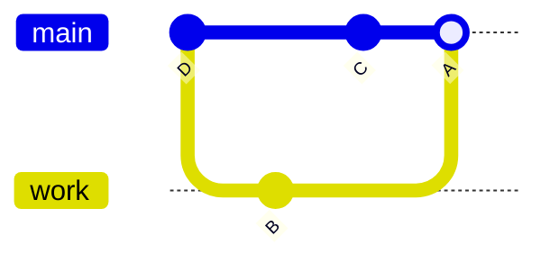
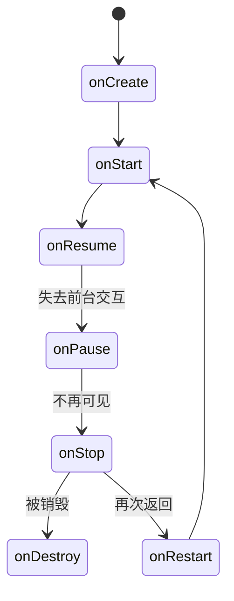

# 第4章 考点G：选择题（Git／Android／复杂度／IP／伦理）

> 目标：不靠模糊印象猜选项，而是给每个选项找一条明确规则或反例。
>
> 答案均为非官方参考解答；法律内容按课程考试语境整理，不构成法律意见。

## 第一部分：知识点的零基础学习

### 知识点 1：Git 图与冲突合并

Git 提交可以想成一张张带父指针的快照。分支只是指向某个提交的可移动名字；`HEAD` 表示你当前所在的位置。



- `fetch`：把远程对象和远程跟踪分支取回，**不改你的工作文件**。
- `merge`：把另一条历史合并进当前分支；两条历史都有新提交时，通常产生有两个父提交的 merge commit。
- `pull`：通常相当于 `fetch` 后再 `merge`（也可配置成 rebase）。
- `origin/my_branch`：远程跟踪分支，不是你当前可直接工作的普通本地分支。
- 冲突：双方改了同一处，Git 无法自动决定最终内容，需要人工解决后再提交。

发生冲突的直观流程：

```text
自己的提交 C        远程接受的提交 B
       \              /
        ---- A ------   ← 合并提交，父提交是 B、C
```

做图题先找**最新 merge commit**，再沿父指针看谁由谁合并而来；不要只按字母大小猜时间。

### 知识点 2：Android 生命周期与常用组件

#### 2.1 Activity 与返回栈

Activity 是一个屏幕级的组件。常见回调顺序：



- `onCreate()`：首次创建时初始化界面与资源。
- `onResume()`：进入可交互状态；`onPause()`：离开前台交互。
- 新 Activity 启动时，前一个通常进入 back stack 并暂停，**不代表立即销毁**。
- 回调由系统调用；是否走到 `onDestroy()` 取决于系统与用户行为，不能背成固定每次完整执行。

#### 2.2 选择题中的高频规则

| 主题 | 正确理解 |
|---|---|
| Explicit Intent | 明确指定目标组件类。 |
| Manifest 权限 | 缺少 INTERNET 权限通常是运行时失败，不是 Java 编译错误。 |
| `ConstraintLayout` | 可相对父布局或其他 View 设置约束。 |
| Listener | 可用于点击、文本变化、选择等多种 UI 事件，不限于按钮。 |
| Toast | 显示短时提示，不适合长期或复杂交互。 |
| 多语言 | 文本放进 `res/values/strings.xml`，翻译放进 `values-es/` 等目录。 |

```xml
<!-- values/strings.xml -->
<string name="welcome">Welcome</string>

<!-- values-es/strings.xml -->
<string name="welcome">Bienvenido</string>
```

布局统一引用 `@string/welcome`，系统按 locale 选择资源，不要在 Java 中逐 View 手写语言分支。

### 知识点 3：复杂度是在比较“输入变大后会怎样”

大 O 描述增长上界，不是精确毫秒数。`n` 通常是元素个数、字符数或节点数。

| 复杂度 | 典型例子 | n 翻倍时的大致趋势 |
|---|---|---|
| `O(1)` | 数组按下标访问 | 基本不变 |
| `O(log n)` | 有序数组二分查找 | 只多一步 |
| `O(n)` | 遍历列表 | 时间约翻倍 |
| `O(n log n)` | 高效比较排序 | 比翻倍略多 |
| `O(n²)` | 两层都遍历 n 的嵌套循环 | 约四倍 |
| `O(2ⁿ)` | 枚举所有子集 | 爆炸增长 |

```java
int sum = 0;
for (int i = 0; i < n; i++) {
    for (int j = 0; j < n; j++) {
        sum += i * j;
    }
}
```

两层循环都随 `n` 增长，因此是 `O(n²)` 时间、`O(1)` 额外空间。

还要分清：

- **最坏／最好／平均**：同一个算法在不同输入下的表现。
- **均摊 amortized**：一串操作平均下来，例如动态数组偶尔扩容很贵，但多次 `add` 通常均摊 `O(1)`。
- **平衡树**：AVL、红黑树保证搜索、插入、删除最坏 `O(log n)`；普通 BST 最坏可退化成 `O(n)`。
- **性能分析**：复杂度用于预测扩展趋势， profiling 用于在真实运行中找热点，两者互补。

### 知识点 4：澳大利亚语境下的知识产权与许可证

- **版权 copyright**：原创作品完成后自动产生，不要求先注册；保护表达，不直接保护抽象想法。
- **独立创作**：别人独立写出相同表达不当然等于复制侵权；“接触并复制”与“独立创作”要区分。
- **精神权利 moral rights**：属于非经济权利，例如署名和反对不当处理。
- **公开仓库≠公共领域**：没有许可证时，通常应默认保留版权，而不是默认可复制、修改或商用。署名也不能替代授权。
- **MIT**：宽松许可证，通常允许使用、修改、再发布，但需保留版权和许可声明。
- **Copyleft**：例如 GPL 要求再分发时延续相应自由与源代码义务；不等于禁止收费。
- **专利 patent**：保护满足新颖、实用、创造性及适格主题等要求的发明；软件相关方案是否可专利要看具体技术与法律标准。

```text
看到“无 License”：先选“默认保留权利，需要授权”，不要选“公开所以随便用”。
```

### 知识点 5：伦理题优先看谁受到影响

IEEE/ACM 软件工程伦理强调公众利益、诚实、专业判断、隐私与安全。做题时问：

1. 是否把公众安全、隐私和权益放在商业压力之前？
2. 是否隐瞒已知风险、收集数据或安全漏洞？
3. 是否如实说明能力、测试结果与产品限制？
4. 是否考虑弱势群体及长期社会、环境影响？

“老板要求”“用户没发现”“功能已经上线”都不能自动证明行为合乎伦理。

## 真题讲解 1：从 Git 图判断合并历史（2025 S1 Q1）

来源：[`MC_Questions_2025_S1.pdf`](../exam-practice-questions/past-exams/2025-1/src/Q4/MC_Questions_2025_S1.pdf)，第 1 页。

### 1.1 题目原文

**中文题意：** Bernardo 先推送，Dylan 的本地提交与远程冲突；Dylan 用 `fetch` 和 `merge` 合并后得到给定历史图。判断四项关于提交先后、merge commit 和远程跟踪分支的说法哪一项合理。

> In a git repository, Bernardo and Dylan have made conflicting changes to a tracked file. Bernardo pushes his changes first, and these are accepted. When Dylan goes to push, discovering the conflict, he uses “git fetch” and “git merge” to merge these changes, then pushes. Dylan uses “git log --graph –oneline” to see what has happened, which gives an output including.
>
> ```text
> *   A (HEAD -> my_branch)
> |\
> | * B (origin/my_branch)
> * | C
> |/
> *   D
> ```
>
> Which of these statements is plausible?
>
> a. Commit D was the most recent of the four commits.
> b. Commits A and B were created by the “git merge” command.
> c. Commit C was pointed to by a remote-tracking branch prior to merging.
> d. Commits B and D were made by Bernardo.

### 1.2 参考答案与解析

**答案：d。**

- A 是最新 merge commit，父提交为 B、C；B 是合并前远程跟踪分支指向的提交，C 是 Dylan 的本地提交，D 是共同祖先。
- **a 错**：D 在图的底部，是较早的共同祖先。
- **b 错**：A 是 merge commit，B 不是这次 merge 创建的。
- **c 错**：合并前由 `origin/my_branch` 指向的是 B。
- **d 合理**：B 是 Bernardo 已推送的提交，D 也可能是他更早创建的提交；题目只问 plausible，不要求必然。

### 英文讲解对照（English Explanation）

A is the newest merge commit and has B and C as parents. B is the accepted remote commit, C is Dylan's local commit, and D is their common ancestor. Only D is plausible: B was created by Bernardo, and D may also be an earlier commit by him. D is not the newest commit, and B was not created by the merge command.

## 真题讲解 2：Android 多语言（2025 S1 Q5）

来源：[`MC_Questions_2025_S1.pdf`](../exam-practice-questions/past-exams/2025-1/src/Q4/MC_Questions_2025_S1.pdf)，第 2 页。

### 2.1 题目原文

**中文题意：** Android 应用推荐用哪种方式支持多语言：代码里手动切换、为每种语言复制布局，还是使用 `values-语言/strings.xml` 字符串资源？

> Which of the following is the recommended way to support multiple languages in an Android app?
>
> a. Detect the user's language using Java code and manually set text for each view.
> b. Create separate layout files for each language and switch them in code.
> c. Use string resources and provide translations in separate values folders (e.g., values-es/strings.xml).
> d. Store all translated strings in a single strings.xml file and load them based on user input.

### 2.2 参考答案与解析

**答案：c。** Android 资源系统会按设备 locale 选择相应 `values-语言` 目录。布局仍使用同一套 `@string/...` 引用，避免为每种语言复制界面逻辑。

### 英文讲解对照（English Explanation）

Use string resources in `res/values/strings.xml` and locale-specific folders such as `values-es/strings.xml`. Layouts refer to `@string/...`, so the system selects translations automatically. Manual per-view language conditionals or duplicated layouts create unnecessary maintenance.

## 真题讲解 3：启动新 Activity 后旧 Activity 去哪了（2025 S2 Q2）

来源：[`MCQQuestions.pdf`](../exam-practice-questions/past-exams/2025-2/src/Q1/MCQQuestions.pdf)，第 1 页。

### 3.1 题目原文

**中文题意：** Android 启动一个新 Activity 后，返回栈中的前一个 Activity 会立即销毁、被压入返回栈并暂停，还是保持无变化？

> When a new activity is started in Android, what happens to the previous activity in the activity stack?
>
> (a) The previous activity is destroyed immediately; onPause() → onStop() → onDestroy() are called.
>
> (b) The previous activity is pushed to the back stack and paused.
>
> (c) The previous activity remains active in the stack and no lifecycle methods are called.
>
> (d) The previous activity is removed from the stack but kept in memory; only onStop() is called.

### 3.2 参考答案与解析

**答案：b。** 新 Activity 覆盖到前台时，旧 Activity 通常留在 back stack 并经历暂停／停止，以便用户返回；它不是必然立即销毁。

### 英文讲解对照（English Explanation）

When a new activity comes to the foreground, the previous activity is normally placed on the back stack and paused; it is not immediately destroyed. This allows the user to return to it. Destruction depends on system and lifecycle conditions, so option A is too absolute.

## 真题讲解 4：Android 综合判断（2024 S1 Q4 MCQ12）

来源：[`Q4README.md`](../exam-practice-questions/past-exams/2024-1/src/Q4/Q4README.md)

### 4.1 题目原文

**中文题意：** 在六条 Android 陈述中选出所有错误项，涉及 INTERNET 权限、显式 Intent、生命周期回调、ConstraintLayout、监听器和 Toast。

> Select all INCORRECT statements related to Android Development.
>
> A. Failure to declare internet permission in the AndroidManifest.xml file will result in a compile-time error.
>
> B. When creating an explicit intent, the target component's class name must be provided.
>
> C. The onCreate() method is called when the activity is first created, and it is the only required method to be implemented in the activity lifecycle along with onStart().
>
> D. Constraint Layout supports positioning views relative to each other.
>
> E. Listeners are only applicable to certain types of UI components, such as buttons and text fields.
>
> F. Toasts are used to display brief messages to the user for a short duration of time.

### 4.2 参考答案与逐项解析

**答案：A、C、E。**

- **A 错误**：缺少权限一般在使用网络时表现为运行时安全错误，不是 Java 编译器发现缺少 XML 声明。
- **B 正确**：explicit intent 明确目标组件。
- **C 错误**：`onCreate()` 是创建阶段的核心初始化回调，但 `onStart()` 并不是每个 Activity 都必须自行重写实现的抽象方法。
- **D 正确**：相对定位正是 `ConstraintLayout` 的核心能力。
- **E 错误**：监听器可用于很多组件与事件类型，不限于按钮和文本框。
- **F 正确**：Toast 用于短时消息。

### 英文讲解对照（English Explanation）

A is incorrect because a missing INTERNET permission normally causes a runtime security failure, not a Java compile-time error. C is incorrect because `onStart()` is not an abstract method every activity must implement. E is incorrect because listeners support many components and event types. Explicit intents name their target, ConstraintLayout supports relative positioning, and Toast shows brief messages.

## 真题讲解 5：GitHub 公开代码没有 License（2025 S1 Q10）

来源：[`MC_Questions_2025_S1.pdf`](../exam-practice-questions/past-exams/2025-1/src/Q4/MC_Questions_2025_S1.pdf)，第 4 页。

### 5.1 题目原文

**中文题意：** GitHub 上一段公开算法代码没有许可证；判断同事能否使用，以及署名、无版权或自动适用 GPL 等说法是否正确。

> A colleague has found an implementation of an algorithm publicly available on GitHub, but there is no license listed accompanying the code. Your colleague wants to use this code in their work. Can they? What conditions must they adhere to?
>
> a. The code is assumed to be under an exclusive license, and cannot legally be used.
> b. The author is assumed to retain all copyright to the code, but because the code is publicly available, as long as appropriate attribution is provided, the code may legally be used.
> c. The code is assumed to be under no license, and can legally be used without attribution. However, if the code contains a glitch or bug, the original author is not liable.
> d. According to GitHub’s terms of service, public GitHub repositories without an explicit license are assumed to be under the GNU GPL v3 License. Your colleague may therefore use this code only if the modified source code is shared publicly.

### 5.2 参考答案与解析

**答案：a。** 没有许可证不等于放弃版权，也不等于 GitHub 自动替作者选择 GPL。按课程的保守规则，应视为作者保留专有权，未获授权不能复制或修改使用。

- **b 错**：署名不能替代授权。
- **c 错**：公开可访问不等于无版权或许可自由使用。
- **d 错**：GitHub 不会把无 License 仓库自动变成 GPL。

### 英文讲解对照（English Explanation）

Public availability does not remove copyright. Without a licence, the author normally retains exclusive rights, and attribution alone does not grant permission to copy or modify. GitHub does not automatically apply GPL to unlicensed repositories. The conservative course answer is that the code cannot legally be reused without authorisation.

## 真题讲解 6：澳大利亚知识产权（2024 S1 Q4 MCQ4）

来源：[`Q4README.md`](../exam-practice-questions/past-exams/2024-1/src/Q4/Q4README.md)

### 6.1 题目原文

**中文题意：** 在澳大利亚语境下判断关于版权、精神权利、Copyleft、MIT 许可证和软件专利的五条陈述哪些正确。

> Intellectual Property - Select all CORRECT statements considering the Australian context.
>
> A. Copyright is automatically attributed to an author in Australia, although others can reproduce the same work. Authors must demonstrate their capability of creating the work independently.
>
> B. Copyright protects non-economic rights.
>
> C. Unlike Copyright, software using Copyleft licenses is free, and no fees can be charged whatsoever.
>
> D. MIT License is an example of Copyleft license.
>
> E. Patents protect inventions that are new, useful, inventive, and of suitable subject matter. Software can be patented if it presents technical or business innovation.

### 6.2 参考答案与解析

**参考答案：A、B、E。** A 的表述较拗口，应结合“自动取得版权”和“独立创作不当然侵权”理解。

- **A 正确**：澳大利亚版权自动产生；原创中的独立创作与复制侵权不是一回事。
- **B 正确**：澳大利亚版权体系也保护精神权利等非经济利益。
- **C 错**：Copyleft 的自由是使用、修改和分享等自由，不是“任何情况下不得收费”。
- **D 错**：MIT 是 permissive license，不是 copyleft。
- **E 正确**：题目列出专利适格性的课程判断标准；实际软件专利仍需具体分析，不是写了代码就能专利。

### 英文讲解对照（English Explanation）

Copyright arises automatically and protects original expression; independent creation of similar expression is different from copying. Australian copyright law also recognises moral rights, which are non-economic. Copyleft concerns freedom to use, modify, and redistribute and does not forbid charging fees. MIT is permissive, not copyleft. Patents protect eligible inventions meeting the stated requirements; software patentability requires technical or subject-matter analysis.

## 真题讲解 7：IEEE 伦理情境（2024 S1 Q4 MCQ8）

来源：[`Q4README.md`](../exam-practice-questions/past-exams/2024-1/src/Q4/Q4README.md)

### 7.1 题目原文

**中文题意：** 四个软件工程师情境中，哪些行为符合 IEEE 软件工程伦理：隐瞒安全漏洞、隐蔽收集数据、为速度跳过测试，还是拒绝侵犯隐私的监控项目？

> ETHICS - Select all scenarios where the software engineer's decision is well aligned with the IEEE Code of Ethics for software engineers?
>
> A. A software engineer discovers a critical security flaw in a popular social media platform but chooses not to disclose it to the public to avoid damaging the platform's reputation, based on the second principle ("CLIENT and EMPLOYER") of the IEEE Code of Ethics related to the employer.
>
> B. A software engineer, tasked with developing a new mobile app, includes a hidden feature that collects user data without their consent to improve marketing strategies. This relates to the first principle ("PUBLIC") of the IEEE Code of Ethics related to the employer, and it is acceptable to collect this data without the user's consent to improve marketing strategies.
>
> C. A software engineer prioritizes speed and efficiency over thorough testing, resulting in the release of a software product with known bugs. As long as the bugs are known to users, this should not compromise user safety. Therefore, the software engineer will meet the principle related to integrity and judgment.
>
> D. A software engineer refuses to work on a project that involves developing surveillance technology used to infringe upon individuals' privacy rights, citing adherence to ethical principles.

### 7.2 参考答案与解析

**答案：D。** 拒绝参与侵犯隐私的监控项目体现了对公众与隐私权的重视。

- **A**：对雇主忠诚不能自动压过严重安全风险；应通过负责任渠道推动披露和修复。
- **B**：隐蔽收集且未经同意，直接产生隐私与诚信问题。
- **C**：已知缺陷可能危害用户时，不能以进度代替专业判断；“用户知道”也不等于风险消失。

### 英文讲解对照（English Explanation）

Only D aligns with the ethics principles: refusing surveillance work that infringes privacy prioritises public rights. Concealing a critical security flaw to protect reputation, collecting data covertly without consent, and releasing known defects to save time all subordinate public safety, privacy, or professional judgement to convenience or reputation.

## 真题讲解 8：性能分析、知识产权与伦理（2024 S2 Q4）

来源：[`Q4README.md`](../exam-practice-questions/past-exams/2024-2/src/Q4/Q4README.md)、[`Q4Answers.md`](../exam-practice-questions/past-exams/2024-2/src/Q4/Q4Answers.md)

### 8.1 题目原文

**中文题意：** 从九个主题中选择两个，在限定句数内解释它们与软件构建的关系、两者联系，并提出一个相关的伦理或社会／环境影响问题。

> Select two topics from the following list,
> - Design Patterns
> - Software Testing
> - Data Structures (Trees)
> - Tokenisation and Parsing
> - Persistent Data
> - Refactoring
> - Design by Contract
> - Performance Analysis
> - Intellectual Property
>
> and answer the following questions:
>
> A. Concisely explain both topics and how they relate to software construction, giving examples [maximum 10 sentences];
>
> B. Examine how the two topics relate to each other [maximum 5 sentences]; and
>
> C. Propose and explain one potential ethical issue (or negative societal/environmental impact) related to one or both topics [maximum 5 sentences].
>
> You must provide a justification for any claims made.

### 8.2 选题与结构

选 **Performance Analysis＋Intellectual Property**，可以同时覆盖复杂度、IP 和伦理。答案严格分成 A/B/C，每部分不突破句数上限。

### 8.3 英文示范答案

#### A) Explain both topics — 7 sentences

Performance analysis evaluates how a program uses time and resources as the workload changes. Complexity analysis predicts growth, such as the difference between an O(n) linear scan and an O(log n) binary search, while profiling measures actual execution to locate hotspots. These methods guide software construction because developers can select suitable data structures and optimise measured bottlenecks rather than guessing. Intellectual Property defines the legal rights associated with creative and technical work. Copyright protects original software expression automatically, whereas licences such as MIT or GPL specify permissions and obligations for reuse. Patents may protect eligible inventions, but they do not replace copyright in source code. Respecting IP during construction means tracking dependencies, preserving required notices, and avoiding unauthorised copying.

#### B) Relationship — 3 sentences

Performance work often depends on reusing existing algorithms and implementations, whose licences may restrict modification or redistribution. For example, copying a highly optimised library without checking its licence can create legal risk even if it improves runtime. Teams should therefore evaluate measured performance, maintenance costs, and licence obligations together when deciding whether to reuse or independently implement a component.

#### C) Ethical issue — 4 sentences

One ethical issue is taking unauthorised code from a public repository to gain a performance or delivery advantage. This can violate the author’s rights and unfairly transfer the benefit of their work to another product. The responsible approach is to check the licence, obtain permission when necessary, preserve attribution, and document the dependency. If reuse is not authorised, the team should use a properly licensed alternative or create an independent implementation.

### 8.4 评分点

- A 同时讲清两个主题，并有具体例子。
- B 必须讲“关系”，不是把两个定义再写一遍。
- C 要有受影响的人、为什么不道德、怎样更负责任。
- 句数按句点控制；不要用超长分号句规避限制。

### 英文讲解对照（English Explanation）

Performance analysis predicts complexity and uses profiling to locate measured bottlenecks. Intellectual property governs copyright, patents, and licence obligations. They interact when teams reuse an optimised library: runtime benefits must be balanced against licence restrictions, maintenance cost, and attribution. Taking public code without permission can create legal and ethical harm; the responsible path is to check the licence, obtain permission, preserve notices, or use an authorised alternative.


