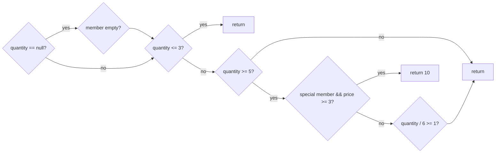
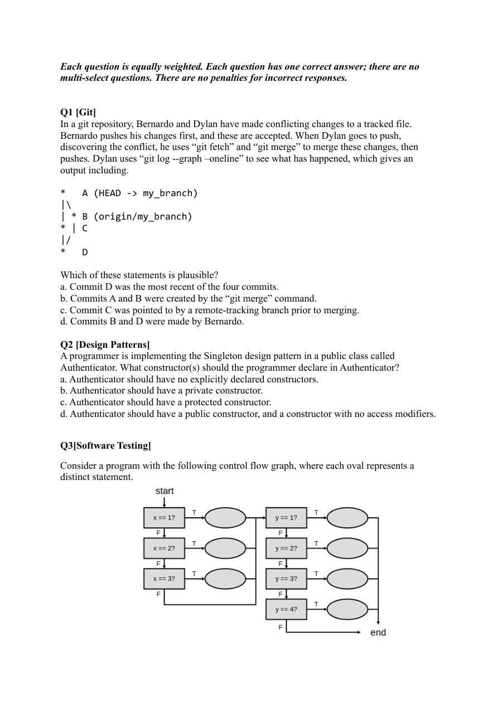
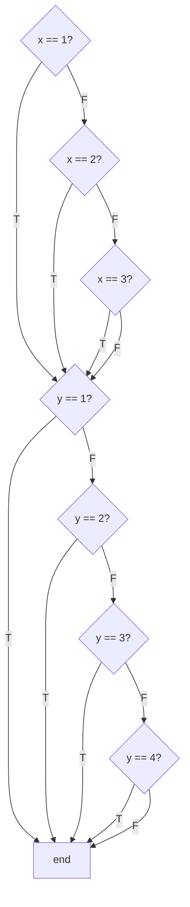

# 第5章 考点B：软件测试（分支覆盖／最少用例／参数化／黑盒）

> 目标：从代码或规格出发设计测试，而不是随便写几个输入后碰运气。
>
> 本手册采用课程常见口径：分析完整分支时，`&&`、`||` 的短路子条件也单独考虑。

## 第一部分：知识点的零基础学习

### 知识点 1：白盒、黑盒与测试层次

- **白盒测试**：看得到代码，按语句、判断、分支和路径设计用例。
- **黑盒测试**：只看规格，按等价类、边界值和预期异常设计用例。
- **单元测试**：验证一个方法或类；**集成测试**：验证多个组件协作；**系统测试**：验证完整系统行为。

```text
规格说 size 合法范围是 1..31：
黑盒等价类 → 小于 1、1..31、大于 31
边界值     → 0、1、2、30、31、32
```

等价类是“按规格应被同样处理的一组输入”。从每个等价类选代表，再用边界值捕捉差一错误。

### 知识点 2：语句、分支、条件不是一回事

```java
if (a != null && a.isValid()) {
    run(a);
}
```

- 执行一次 `if` 内的 `run`，不代表覆盖了所有判断结果。
- `a == null`：第一个条件为假，`&&` 短路，第二个不执行。
- `a != null` 但 `a.isValid()` 为假：两个条件都执行，整体仍为假。
- `a != null` 且有效：整体为真，执行 `run`。

| 覆盖视角 | 要覆盖什么 |
|---|---|
| 语句 | 每条可执行语句至少一次 |
| 判断／分支 | 每个判断的真、假出口 |
| 子条件 | `&&`／`||` 中每个条件的真、假及短路情况 |
| 路径 | 从入口到出口的具体组合；通常比分支覆盖成本更高 |

**最少分支用例**不是机械地“每个 if 两个测试”。一个输入可以同时覆盖多个新分支；也有些分支因前置条件只能在特定输入下到达。

### 知识点 3：用覆盖表倒推最少用例



步骤：

1. 标出每个判断的真、假出口。
2. 标出不可达或受前面输入限制的出口。
3. 每次优先选择能覆盖多个新出口的输入。
4. 最后解释为什么剩下的每个出口都不能再合并，形成最少性理由。

### 知识点 4：JUnit 4 参数化测试

参数化测试让同一测试逻辑运行多组数据，避免复制测试方法。

```java
@RunWith(Parameterized.class)
public class PriceTest {
    private final int input;
    private final int expected;

    public PriceTest(int input, int expected) {
        this.input = input;
        this.expected = expected;
    }

    @Parameterized.Parameters
    public static Collection<Object[]> data() {
        return Arrays.asList(new Object[][]{
            {1, 10},
            {2, 20}
        });
    }

    @Test(timeout = 1000)
    public void calculatesPrice() {
        assertEquals(expected, input * 10);
    }
}
```

每一行数组会调用一次构造器，再运行每个 `@Test`。常见错误：参数顺序与构造器不一致、把期望值写反、漏 `@RunWith`、把测试数据写成引用同一可变对象后相互污染。

异常测试：

```java
try {
    service.hash(invalidInput);
    fail("Expected an exception");
} catch (ComponentOutOfRangeException expected) {
    // 预期异常已发生
}
```

### 知识点 5：好测试必须有“ oracle（判定依据）”

Oracle 是判断对错所依据的独立规则：规格中的固定示例、手工推导的期望值、数学性质或参考模型。

- 不要写 `assertEquals(actual, actual)`。
- 不要直接调用被测方法来计算自己的期望值。
- 黑盒测试的期望值应从规格独立推导。
- 测试正确实现应全过；至少一个测试应能抓住每类典型错误。

## 真题讲解 1：Pricing 的最小分支用例（2025 S2 Q2）

来源：[`Q2README.md`](../exam-practice-questions/past-exams/2025-2/src/Q2/Q2README.md)、[`Pricing.java`](../exam-practice-questions/past-exams/2025-2/src/Q2/Pricing.java)、[`CalculatePriceTest.java`](../exam-practice-questions/past-exams/2025-2/src/Q2/CalculatePriceTest.java)

### 1.1 题目原文

**中文题意：** 为 `Pricing.calculatePrice` 设计最少、且达到完整分支覆盖的参数化测试用例；不能触发异常，期望值必须按给定实现推导，测试必须全部通过。

> You are testing the `calculatePrice` method in the provided `Pricing` class. The `calculatePrice` method uses multiple decisions (if/else chains) that affect the final price.
>
> **Task: Branch-complete Coverage using parameterized tests**
>
> Design test cases for the `calculatePrice` method of the `Pricing` class.
>
> Your goal is to design a minimum set of test cases that achieves branch-complete coverage.
> - Create the test cases within the `data()` method of the `CalculatePriceTest` class.
> - You must use the parameterized test framework already provided.
>
> Note that we are assessing your ability to design test cases for a given piece of code (white-box testing), rather than your ability to critique the code itself. Focus on analysing the code’s control flow and decision points to design test cases that achieve complete branch coverage, rather than interpreting or questioning the underlying logic.
>
> - Do not include any test cases that cause the calculatePrice() method throw an exception.
> - You must assume that calculatePrice() is implemented correctly.
> - All your designed test cases should pass when executed against the provided implementation.
> - You must create test cases based on the code provided (white-box testing).

原始方法：

```java
public static Integer calculatePrice(int unitPrice, Integer quantity, String memberId) {
    double discount = 0.0;

    if (quantity == null) {
        discount -= 0.2;
        quantity = 1;

        if ((memberId == null || memberId.trim().isEmpty())) {
            discount -= 0.1;
        }
    }

    if (quantity <= 3) {
        return unitPrice * 4;
    }
    else if (quantity >= 5) {
        if (List.of("id1", "id2", "id3").contains(memberId) && unitPrice >= 3) {
            return 10;
        } else if (quantity / 6 >= 1) {
            quantity -= quantity / 6;
        }
    }

    return (int) (unitPrice * quantity * (1 - Math.min(discount, 0)));
}
```

### 1.2 分支拆解

| 编号 | 判断 | 要覆盖的结果 |
|---|---|---|
| A | `quantity == null` | true／false |
| B1 | `memberId == null` | true／false |
| B2 | `memberId.trim().isEmpty()` | true／false，仅在 B1 false 后执行 |
| C | `quantity <= 3` | true／false |
| D | `quantity >= 5` | true／false |
| E1 | 会员列表包含 `memberId` | true／false |
| E2 | `unitPrice >= 3` | true／false，仅在 E1 true 后执行 |
| F | `quantity / 6 >= 1` | true／false |

只把 B、E 当作两个普通 if，会得到 7 组并漏掉短路子条件。完整口径需要 **8 组**。

### 1.3 完整覆盖表与期望值

以下统一取 `unitPrice = 3`，只有最后一组特意改成 `2`。

| 用例 | `(unitPrice, quantity, memberId)` | 关键覆盖 | 期望 |
|---|---|---|---:|
| T1 | `(3, null, null)` | A true、B1 true、C true | 12 |
| T2 | `(3, null, "")` | B1 false、B2 true | 12 |
| T3 | `(3, null, "id1")` | B2 false | 12 |
| T4 | `(3, 2, "id1")` | A false、C true | 12 |
| T5 | `(3, 4, "id1")` | C false、D false | 12 |
| T6 | `(3, 5, "id1")` | D true、E1 true、E2 true | 10 |
| T7 | `(3, 5, "other")` | E1 false、F false | 15 |
| T8 | `(2, 6, "id1")` | E2 false、F true，数量由 6 改为 5 | 10 |

最少性直观理由：三个 null 相关结果无法与非 null 路径合并；C false／D false、E true、E1 false、E2 false、F true／false 又需要相应的独立路径，而表中已经把可合并的 F 分支与 E 分支配对。

### 1.4 完整答案代码

```java
@Parameterized.Parameters(name = "{index}: calculatePrice({0}) = {1}")
public static Collection<Object[]> data() {
    return Arrays.asList(new Object[][]{
        {new Pricing(3, null, null), 12},
        {new Pricing(3, null, ""), 12},
        {new Pricing(3, null, "id1"), 12},
        {new Pricing(3, 2, "id1"), 12},
        {new Pricing(3, 4, "id1"), 12},
        {new Pricing(3, 5, "id1"), 10},
        {new Pricing(3, 5, "other"), 15},
        {new Pricing(2, 6, "id1"), 10}
    });
}
```

**易错点**：T8 先因 `unitPrice < 3` 跳过特价，再执行 `quantity -= quantity / 6`，所以最终数量是 5，不是 6。

### 英文讲解对照（English Explanation）

The compound conditions are treated as part of full branch coverage. Three null cases are needed for the quantity-null path: null member, empty member, and a valid member. A non-null quantity covers the false path of the null decision and the true path of quantity ≤ 3. Quantity 4 reaches the false path of quantity ≥ 5. Quantity 5 with `id1` covers the special-member branch. Quantity 5 with a non-member covers the first false condition and quantity/6 below 1, while quantity 6 with `id1` and unit price 2 covers the second false condition and quantity/6 at least 1. The eight expected values follow execution of the supplied code, not business intuition.

## 真题讲解 2：CFG 的最少测试数（2025 S1 Q3）

来源：[`MC_Questions_2025_S1.pdf`](../exam-practice-questions/past-exams/2025-1/src/Q4/MC_Questions_2025_S1.pdf)，第 1–2 页。

### 2.1 题目原文

**中文题意：** 给定一张控制流图，要求达到分支完整覆盖；问最少需要多少个测试用例。

> Consider a program with the following control flow graph, where each oval represents a distinct statement.
>
> What is the minimum number of test cases needed to achieve branch complete coverage for the shown control flow graph?
>
> a. 4
> b. 5
> c. 6
> d. 9
> e. 12
> f. 20
> g. 21

原图：



结构重绘：



### 2.2 参考答案与解析

**答案：b（5）。**

- x 区域有 4 种路径：`x=1`、`x=2`、`x=3`、其他。
- y 区域有 5 种路径：`y=1`、`y=2`、`y=3`、`y=4`、其他。
- 两个区域顺序执行，一次测试可同时覆盖一个 x 分支和一个 y 分支，所以下界是 `max(4,5)=5`，而且确实能用 5 组配齐。

一组覆盖示例：`(1,1)`、`(2,2)`、`(3,3)`、`(0,4)`、`(1,0)`。

### 英文讲解对照（English Explanation）

The x decision chain has four outcomes and the y chain has five. Because the regions execute in sequence, one input can cover one x outcome and one y outcome at the same time. The minimum is therefore `max(4, 5) = 5`, achievable with pairs such as (1,1), (2,2), (3,3), (other,4), and (1,other).

## 真题讲解 3：数分支与最少输入（2024 S1 Q4 MCQ2–3）

来源：[`Q4README.md`](../exam-practice-questions/past-exams/2024-1/src/Q4/Q4README.md)

### 3.1 题目原文

**中文题意：** 先数 `checkAnswer` 中一共有多少个分支，再求达到完整分支覆盖所需的最少不同测试输入数量。

MCQ2：

> How many branches are present in the following function?

```java
public boolean checkAnswer(RiddleType type, String input) {
    boolean isCorrect = false;

    if (type == RiddleType.TEXT_RIDDLE) {
        if (input.equalsIgnoreCase(answer)) {
            isCorrect = true;
        }
    } else if (type == RiddleType.NUMERIC_RIDDLE) {
        if (input.matches("\\d+") && Integer.parseInt(input) == Integer.parseInt(answer)) {
            isCorrect = true;
        }
    } else if (type == RiddleType.ANAGRAM_RIDDLE) {
        char[] inputChars = input.toLowerCase().toCharArray();
        char[] answerChars = answer.toLowerCase().toCharArray();
        Arrays.sort(inputChars);
        Arrays.sort(answerChars);
        if (Arrays.equals(inputChars, answerChars)) {
            isCorrect = true;
        }
    }

    if (isCorrect) {
        isSolved = true;
    }
    return isCorrect;
}
```

> A. 10
> B. 11
> C. 12
> D. 14
> E. 15
> F. 16

MCQ3：

> How many distinct test inputs are necessary to ensure full branch coverage of the `checkAnswer` function shown in MCQ2?
>
> A. 5
> B. 6
> C. 7
> D. 8

### 3.2 参考答案与解析

**MCQ2：F（16）；MCQ3：D（8）。**

- 七个 `if`／`else if` 判断语句各有两个出口，共 14 个。
- 数字判断中的 `&&` 还包含两个可分别真假的子条件；把短路分支也纳入后，总数为 16。
- 最少输入按路径分配：文本正确／错误 2 个；数字格式错误、数值正确、数值错误 3 个；anagram 正确／错误 2 个；最后让 `type` 不属于任何枚举值 1 个，共 8 个。

这里的“1 个不属于任何类型”可通过 `type = null` 实现，因为三次相等判断都为 false，最后的 `isCorrect` 也保持 false。

### 英文讲解对照（English Explanation）

There are seven if/else decision statements, giving fourteen ordinary decision branches. The short-circuit `&&` in the numeric branch adds two condition branches, making sixteen under the course convention. Eight distinct inputs cover full branch coverage: text correct and incorrect; numeric format failure, equal numeric value, and different numeric value; anagram correct and incorrect; and a null type that makes all type comparisons false.

## 真题讲解 4：用最少节点测试 AVL 四种旋转（2024 S1 Q2）

来源：[`Q2README.md`](../exam-practice-questions/past-exams/2024-1/src/Q2/Q2README.md)、[`AVLTreeTest.java`](../exam-practice-questions/past-exams/2024-1/src/Q2/AVLTreeTest.java)、[`AVLTree.java`](../exam-practice-questions/past-exams/2024-1/src/Q2/MockClasses/AVLTree.java)

### 4.1 题目原文

**中文题意：** 用参数化黑盒测试验证多个 AVL 实现：设计树与预序期望，尽量少用总节点，正确实现全过、错误实现至少一败。

> As a software tester, you are tasked with checking the correctness of several implementations of AVL trees created by 400 students in the COMP2100/6442 course at ANU. You must use parameterized tests to verify their correctness.
>
> You must conduct black-box testing and create parameterized test cases. To verify the correctness of an AVL tree, you must compare the output of the pre-order traversal of the tree to the expected outcome.
>
> Implement the static `data()` method by providing parameterized test cases and returning a Collection of Object arrays. For each tree, provide an identifier and the expected list of integers following pre-order traversal.
>
> Implement the `createTree()` method in the `AVLTreeTest` class. The argument is an index which selects the tree to be returned.
>
> - You must minimize the number of overall nodes used in all the trees you created.
> - All test cases should pass if an AVL tree implementation is correct.
> - At least one test case should fail if an AVL tree implementation is incorrect.
> - You do not need to test null, duplicate values and incorrect inputs.
> - You may create a concrete AVLTree with a single node using `createTreeNode()`; you must not call `SampleAVLTree` in your tests directly.

### 4.2 测试设计

产生一次旋转最少需要三个节点。四种旋转各用一棵三节点树，总计 **12 个节点**：

| ID | 插入顺序 | 旋转 | 正确前序 |
|---|---|---|---|
| 0 | `3,2,1` | LL，右旋 | `[2,1,3]` |
| 1 | `1,2,3` | RR，左旋 | `[2,1,3]` |
| 2 | `3,1,2` | LR，先左后右 | `[2,1,3]` |
| 3 | `1,3,2` | RL，先右后左 | `[2,1,3]` |

四棵树结果相同并不浪费：错误发生在**形成树的过程**，相同的预期前序反而让断言保持简单。

### 4.3 完整答案代码

在原有 import 上增加 `import java.util.Arrays;`，然后实现：

```java
@Parameterized.Parameters
public static Collection<Object[]> data() {
    return Arrays.asList(new Object[][]{
        {0, List.of(2, 1, 3)},
        {1, List.of(2, 1, 3)},
        {2, List.of(2, 1, 3)},
        {3, List.of(2, 1, 3)}
    });
}
```

```java
private AVLTree createTree(int treeIdentifier) {
    int[][] insertions = {
        {3, 2, 1},
        {1, 2, 3},
        {3, 1, 2},
        {1, 3, 2}
    };

    AVLTree tree = createTreeNode(insertions[treeIdentifier][0]);
    for (int i = 1; i < insertions[treeIdentifier].length; i++) {
        tree = tree.insert(insertions[treeIdentifier][i]);
    }
    return tree;
}
```

**易错点**：必须写 `tree = tree.insert(...)`。题目的不可变 AVL 实现可能返回新的根；只调用 `tree.insert(...)` 而不接返回值会丢失旋转后的根。

### 英文讲解对照（English Explanation）

Four three-node insertion sequences test the four rotation cases: `3,2,1` for LL, `1,2,3` for RR, `3,1,2` for LR, and `1,3,2` for RL. Each must produce pre-order `[2,1,3]`. Twelve nodes total are sufficient. The immutable insertion result must be assigned back to the tree because the returned root may change after rotation. The supplied unbalanced sample should fail these tests, while a correct AVL implementation should pass all four.

## 真题讲解 5：黑盒识别 HashingBox 实现（2024 S2 Q2）

来源：[`Q2README.md`](../exam-practice-questions/past-exams/2024-2/src/Q2/Q2README.md)、[`Q2Test.java`](../exam-practice-questions/past-exams/2024-2/src/Q2/Q2Test.java)、[`HashingBox.java`](../exam-practice-questions/past-exams/2024-2/src/Q2/HashingBox.java)

### 5.1 题目原文

**中文题意：** 用参数化黑盒测试区分 13 个 `HashingBox` 实现：依据 sizeHash、前六字符 nameHash 和材质形状值设计用例，使正确实现全过、错误实现至少失败一项。

> You are tasked with checking the correctness of different implementations of `HashingBox`.
>
> A `HashingBox`, if implemented correctly, must produce the correct results from its `hash` function given a valid (non-null) `Thing`.
>
> 1) The `sizeHash` is the largest prime number not larger than the `size` of the Thing, with an exception where the sizeHash for a Thing with size==1 is 2.
>
> 2) The `nameHash` computes a hash by summing the product of each letter's ASCII value (considering only the first 6 characters for the ASCII-sum) and multiplying it by the specified `sizeHash`, then adding the length of the name. Only alphabetic characters (English letters) are included in the ASCII-sum.
>
> 3) The `materialSizeHash` is the product of the values of the `material` and `shape` of the Thing.
>
> 4) The overall `hash` value is the sum of `nameHash` and `materialShapeHash`. When the `size` is out of bound, `hash` is expected to throw a `ComponentOutOfRangeException`.
>
> There are 13 classes that extend the `HashingBox` abstract class. You must complete the parameterised tests in `Q2Test.java` to identify the correct and incorrect HashingBox(es) respectively.
>
> - You may create one or more JUnit test method(s).
> - For each test method you write, include `@Test(timeout = 1000)`.
> - You are STRONGLY ADVISED to perform Black Box Testing.
> - ALL incorrect HashingBox(es) must fail at least one test, and ALL correct HashingBox(es) must pass all tests.

### 5.2 黑盒覆盖表

| 用例 | 抓什么错误 | 独立推导的期望 |
|---|---|---:|
| README 示例 | 基本公式 | 4905 |
| size=1，名字 `A` | size 1 特例 | `65×2+1+1018=1149` |
| size=6，长名字含数字 | 只取前六字符、忽略非字母 | 5027 |
| size=2，Silver／Semicircle | 材质与形状不能额外乘零 | 2636 |
| size=31 | 上边界质数 | 7881 |
| 空名字 | 空串与长度处理 | 3700 |
| 全非字母名字 | ASCII-sum 为 0，但保留名字长度 | 1024 |
| 名字为 `[` | 字母附近 ASCII 符号也不能计入 | 1019 |
| size=4，名字 `abc` | 合数向下找质数 | 1884 |
| size=32 | 越界异常 | 抛出异常 |

第三个用例的名字为 `Ab3!xyZ123`：前六字符是 `A b 3 ! x y`，字母 ASCII 和为 `65+98+120+121=404`，所以 `404×5+10+999×3=5027`。第七个字符 `Z` 不能参与求和。

### 5.3 完整答案代码

以下测试应放入原 `Q2Test` 类，使用已有的 `hashingBox` 参数：

```java
private void assertHash(Thing thing, int expected) throws ComponentOutOfRangeException {
    assertEquals(expected, hashingBox.hash(thing));
}

@Test(timeout = 1000)
public void readmeExample() throws ComponentOutOfRangeException {
    assertHash(new Thing(Material.SILVER, 3, Shape.SQUARE, "Comp2100"), 4905);
}

@Test(timeout = 1000)
public void sizeOneUsesTwo() throws ComponentOutOfRangeException {
    assertHash(new Thing(Material.STEEL, 1, Shape.CIRCLE, "A"), 1149);
}

@Test(timeout = 1000)
public void onlyLettersInFirstSixCharactersCount() throws ComponentOutOfRangeException {
    assertHash(new Thing(Material.GOLD, 6, Shape.TRIANGLE, "Ab3!xyZ123"), 5027);
}

@Test(timeout = 1000)
public void silverSemicircleHasNormalMaterialValue() throws ComponentOutOfRangeException {
    assertHash(new Thing(Material.SILVER, 2, Shape.SEMICIRCLE, "1aaaa1aaaa"), 2636);
}

@Test(timeout = 1000)
public void maximumSizeAndPentagon() throws ComponentOutOfRangeException {
    assertHash(new Thing(Material.STEEL, 31, Shape.PENTAGON, "Z"), 7881);
}

@Test(timeout = 1000)
public void emptyName() throws ComponentOutOfRangeException {
    assertHash(new Thing(Material.SILVER, 1, Shape.SQUARE, ""), 3700);
}

@Test(timeout = 1000)
public void nonLettersStillContributeNameLength() throws ComponentOutOfRangeException {
    assertHash(new Thing(Material.STEEL, 3, Shape.CIRCLE, "123!!!"), 1024);
}

@Test(timeout = 1000)
public void punctuationNextToAsciiLettersIsExcluded() throws ComponentOutOfRangeException {
    assertHash(new Thing(Material.STEEL, 3, Shape.CIRCLE, "["), 1019);
}

@Test(timeout = 1000)
public void compositeSizeUsesPreviousPrime() throws ComponentOutOfRangeException {
    assertHash(new Thing(Material.GOLD, 4, Shape.CIRCLE, "abc"), 1884);
}

@Test(timeout = 1000)
public void sizeAboveMaximumThrows() {
    try {
        hashingBox.hash(new Thing(Material.STEEL, 32, Shape.CIRCLE, "A"));
        fail("Expected ComponentOutOfRangeException");
    } catch (ComponentOutOfRangeException expected) {
        // Expected behaviour.
    }
}
```

**为什么不只测几个普通值**：错误实现可能只在第六／第七字符、字母边界、空串、特殊材质组合或 size=1 时出错。黑盒测试的目标是覆盖规格中的每一条规则，而不是覆盖实现里的每一行。

### 英文讲解对照（English Explanation）

The tests must independently derive expected values from the specification. Important cases are the README example, the size-1 exception, the first six characters only, non-letter characters, empty names, composite sizes using the previous prime, the size-31 boundary, material/shape products, and size 32 causing an exception. A punctuation character near ASCII letter ranges catches implementations that confuse “letter-like code range” with `Character.isLetter`. The complete suite distinguishes the one correct implementation from all incorrect ones.

## 真题讲解 6：Riddle.checkAnswer 的最小分支测试（2023 S1 Q1 Part 1）

来源：[`Q1README.md`](../exam-practice-questions/past-exams/2023-1/Q1/Q1README.md)、[`Riddle.java`](../exam-practice-questions/past-exams/2023-1/Q1/Riddle.java)、[`RiddleCheckAnswerTest.java`](../exam-practice-questions/past-exams/2023-1/Q1/RiddleCheckAnswerTest.java)

### 6.1 题目原文

**中文题意：** 为 `Riddle.checkAnswer` 设计最少的分支完整测试用例，覆盖文本、数字和 anagram 的判断及其成功／失败路径。

> The Escape Room software manages different types of riddles:
> 1. TextRiddle: The answer is a string (non-case-sensitive)
> 2. NumericRiddle: The answer is a number
> 3. AnagramRiddle: The answer is an anagram of a word/string
>
> Your task is to achieve branch complete with the minimal set of test cases for the `checkAnswer` method of the `Riddle` class.
> - Create the test cases within the `tests` method of the `RiddleCheckAnswerTest` class.

原始核心代码与本章真题讲解 3 相同：文本比较、数字的 `matches && 数值相等`、anagram 排序后比较，以及最后的 `if (isCorrect)`。

### 6.2 八组输入的覆盖逻辑

| 类型 | 输入 | 覆盖目标 | 期望 |
|---|---|---|---|
| TEXT，答案 `Echo` | `eChO` | 忽略大小写且正确 | true |
| TEXT，答案 `Echo` | `Echo!` | 文本错误 | false |
| NUMERIC，答案 `42` | `042` | 格式正确且数值正确 | true |
| NUMERIC，答案 `42` | `4x2` | `matches` false，触发短路 | false |
| NUMERIC，答案 `42` | `41` | 格式正确但数值不同 | false |
| ANAGRAM，答案 `Listen` | `Silent` | 排序后相同 | true |
| ANAGRAM，答案 `Listen` | `Listen!` | 排序后不同 | false |
| `type = null` | 任意字符串 | 三个类型判断都 false | false |

### 6.3 完整答案代码

```java
@Test
public void tests() {
    Riddle text = new Riddle("Word?", "Echo", Riddle.RiddleType.TEXT_RIDDLE);
    assertTrue(text.checkAnswer("eChO"));
    assertFalse(new Riddle("Word?", "Echo", Riddle.RiddleType.TEXT_RIDDLE)
            .checkAnswer("Echo!"));

    Riddle numeric = new Riddle("Number?", "42", Riddle.RiddleType.NUMERIC_RIDDLE);
    assertTrue(numeric.checkAnswer("042"));
    assertFalse(new Riddle("Number?", "42", Riddle.RiddleType.NUMERIC_RIDDLE)
            .checkAnswer("4x2"));
    assertFalse(new Riddle("Number?", "42", Riddle.RiddleType.NUMERIC_RIDDLE)
            .checkAnswer("41"));

    Riddle anagram = new Riddle("Anagram?", "Listen", Riddle.RiddleType.ANAGRAM_RIDDLE);
    assertTrue(anagram.checkAnswer("Silent"));
    assertFalse(new Riddle("Anagram?", "Listen", Riddle.RiddleType.ANAGRAM_RIDDLE)
            .checkAnswer("Listen!"));

    assertFalse(new Riddle("Other", "x", null).checkAnswer("x"));
}
```

**为什么数字类需要三组**：`matches` false 时不会执行数值比较；还需要分别让数值比较为 true 和 false，才能覆盖短路表达式中的所有子条件。

### 英文讲解对照（English Explanation）

Eight inputs cover the branches: two text cases, three numeric cases that separately exercise format failure and value failure, two anagram cases, and a null type. Numeric input `4x2` short-circuits before parsing, `042` exercises a valid numeric comparison, and `41` exercises a valid format with an unequal value. The solved-riddle flag follows a successful result, so no extra test is needed merely to enter the final `if (isCorrect)` branch.


