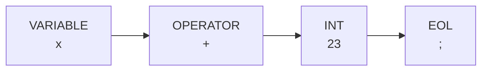
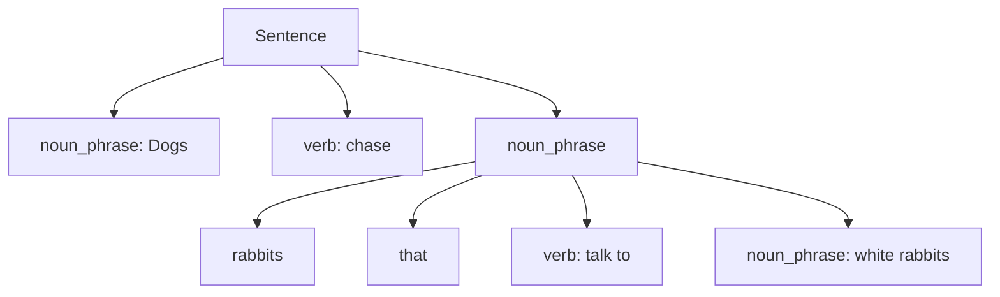
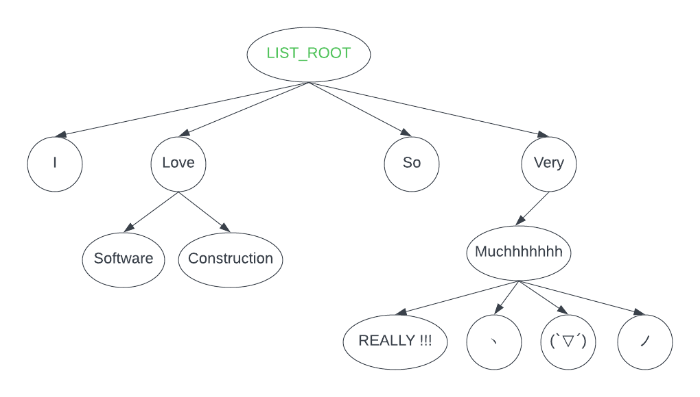
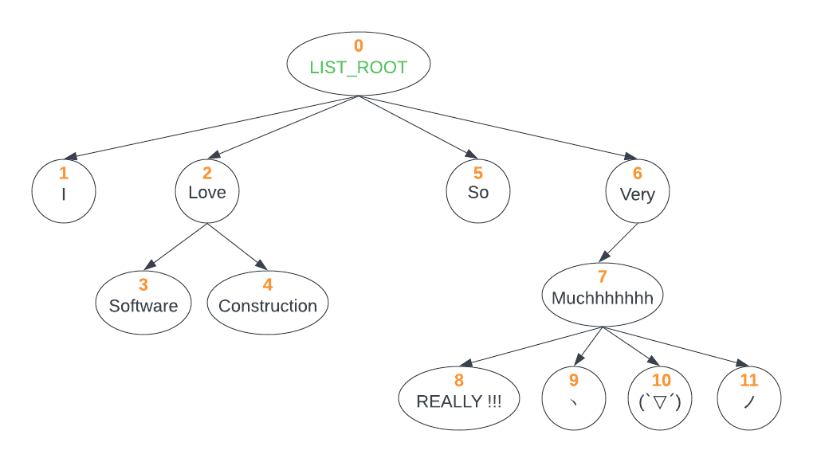
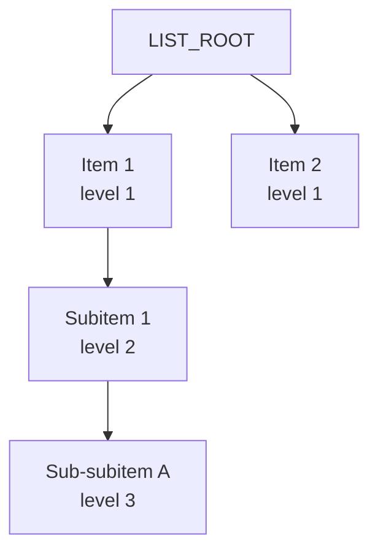

# 第6章 考点A：Tokeniser＋Parser（分词＋递归下降）

> 目标：能把输入字符串拆成 Token，再按文法逐个消费 Token，构造表达式、命令或树。

## 第一部分：知识点的零基础学习

### 知识点 1：Tokeniser 只负责“切”，不负责“理解全局”

输入 `x + 23;` 可以拆成：



Token 通常保存：

- **type**：类别，例如 `INT`、`VARIABLE`；
- **value**：原文或转换后的值，例如 `"23"`、`23`。

Tokeniser 的基本循环：

```text
跳过允许的空格 → 看缓冲区开头 → 找到最长匹配 → 创建 Token → 移除已消费文本
```

`WHERE { ?subject ?subject }` 这样的组合可以不符合文法，但每个 Token 单独仍可能合法。**分词器不要提前做Parser的全局工作。**

#### 1.1 最长匹配与消费边界

`[CTRL][Z]` 应整体识别为 `UNDO`，不能先看到 `[` 就报错；连续数字 `2000` 应先作为一个数字候选，再检查是否超过 999，而不是拆成四个合法数字。

```java
if (buffer.startsWith("[CTRL][Z]")) {
    token = new InputToken(TokenType.UNDO);
    buffer = buffer.substring("[CTRL][Z]".length());
}
```

失败时按题目要求设置 `currentToken = null`，并保留尚未成功消费的缓冲区，方便定位错误。

### 知识点 2：先读文法符号，再写 Parser

```text
<SingleExp> := <Value> <OP> <SingleExp> | <Value>
<Value>     := <VAR> | <INT>
```

- `<...>`：非终结符，需要继续展开。
- 字面字符或 Token：终结符，例如 `+`、`INT`。
- `:=` 右边：可以怎样展开。
- `|`：或者。
- `ε`：空，不消费任何 Token。

上面的文法是右递归：`x + y * 2` 应理解为 `x + (y * 2)`。**递归下降不是自动带数学优先级，结构完全由题目文法决定。**

### 知识点 3：一条规则对应一个方法

```java
Exp parseSingleExp(List<Token> tokens) {
    Token value = tokens.remove(0);
    Exp left = makeValue(value);

    if (!tokens.isEmpty() && tokens.get(0).getType() == TokenType.OPERATOR) {
        Token op = tokens.remove(0);
        Exp right = parseSingleExp(tokens);
        return makeOperation(left, op, right);
    }
    return left;
}
```

关键动作只有三个：

- **查看 lookahead**：`tokens.get(0)`，不消费；
- **消费 match／remove**：确认类型后 `remove(0)`；
- **递归**：把剩余 Token 交给同一规则或下一规则。

任何一步不符合文法，就返回 `null` 或按题目要求抛异常。最后还要检查是否有多余 Token，防止只解析前缀就误接受整串。

### 知识点 4：括号和嵌套为什么需要递归

```text
Factor → INT | "(" Exp ")"
```

解析 `(` 时调用 `parseExp()` 处理内部，返回后必须消费 `)`。递归调用栈正好对应括号嵌套；缺少右括号时不能假装成功。

通用树 Parser 常用另一种栈：**父节点栈**。新 Token 的 level 为 2 时，父节点是 level 1 栈顶；回到 level 1 时，先弹出深层节点，再插到根下。

### 知识点 5：最小自测清单

- 单个合法 Token 与单个合法表达式。
- 多个 Token 连在一起、多个空格、大小写边界。
- 非法开头、非法中间、非法结尾。
- 缺少操作数、缺少分隔符、多余分隔符、多余 Token。
- 空输入、只有空白、嵌套结构、递归结束后仍有剩余。

## 真题讲解 1：数学表达式 Tokeniser 与右递归 Parser（2025 S1 Q3）

来源：[`Q3README.md`](../exam-practice-questions/past-exams/2025-1/src/Q3/Q3README.md)、[`Tokeniser.java`](../exam-practice-questions/past-exams/2025-1/src/Q3/Tokeniser.java)、[`Parser.java`](../exam-practice-questions/past-exams/2025-1/src/Q3/Parser.java)、[`Q3Test.java`](../exam-practice-questions/past-exams/2025-1/src/Q3/Q3Test.java)

### 1.1 题目原文

**中文题意：** 为整数、变量、加减乘、分号序列组成的表达式实现 Tokeniser 与递归下降 Parser，构造 `Exp` 树；Token 不合法或不符合文法时返回 `null`。

> Implement a tokeniser and parser for simple mathematical expressions.
>
> This includes simple expressions with a single value, i.e., an integer expression or variable expression. Operation expressions can be used to create expressions which add, subtract, or multiply two expressions. Finally, sequence expressions comprise a list of expressions.
>
> The tokeniser converts strings into `INT`, `VARIABLE`, `OPERATOR`, and `EOL` tokens. The parser creates `IntExp`, `VarExp`, `OpExp` and `SeqExp`.
>
> ```text
> <S>         := <SeqExp>
> <SeqExp>    := <SingleExp> | <SingleExp> <EOL> | <SingleExp> <EOL> <SeqExp>
> <SingleExp> := <Value> <OP> <SingleExp> | <Value>
> <Value>     := <VAR> | <INT>
> <VAR>       := a | b | c | ... | x | y | z
> <INT>       := an integer
> <OP>        := + | - | *
> <EOL>       := ;
> ```
>
> Variables are case-sensitive. Whitespaces are acceptable between tokens, but not within a single token.
>
> **Task A:** Implement `next()` in `Tokeniser`.
>
> **Task B:** Implement `parse()` in `Parser`. Return `null` if the tokens do not conform with the grammar.

原测试明确给出了右递归结构：

```text
x + y * 5 + 2 - 1
→ (x ADD (y MULTIPLY (5 ADD (2 SUBTRACT 1))))
```

### 1.2 Tokeniser 完整参考实现

原骨架的 `takeNext()` 负责真正截断缓冲区，因此 `next()` 只识别当前开头的 Token，不重复消费。

```java
public Token next() {
    if (buffer.isEmpty()) {
        currentToken = null;
        return null;
    }

    char first = buffer.charAt(0);
    if (first >= '0' && first <= '9') {
        int end = 0;
        while (end < buffer.length() && Character.isDigit(buffer.charAt(end))) {
            end++;
        }
        currentToken = new Token(TokenType.INT, buffer.substring(0, end));
    } else if (first >= 'a' && first <= 'z') {
        currentToken = new Token(TokenType.VARIABLE, buffer.substring(0, 1));
    } else if (first == '+' || first == '-' || first == '*') {
        currentToken = new Token(TokenType.OPERATOR, buffer.substring(0, 1));
    } else if (first == ';') {
        currentToken = new Token(TokenType.EOL, ";");
    } else {
        currentToken = null;
    }
    return currentToken;
}
```

### 1.3 Parser 的直观走法

先看第一个 Value；只有当下一个 Token 是运算符时才消费它并递归解析右侧。遇到 `;` 时不能把它当运算符消费掉，所以先把 Token 收进列表，用 `get(0)` 预读。

### 1.4 Parser 完整参考实现

增加 `import java.util.ArrayList;` 和 `import java.util.List;`：

```java
public Exp parse() {
    List<Token> tokens = new ArrayList<>();
    while (tokeniser.hasNext()) {
        Token token;
        try {
            token = tokeniser.takeNext();
        } catch (NullPointerException | NumberFormatException e) {
            return null;
        }
        if (token == null) {
            return null;
        }
        tokens.add(token);
    }
    if (tokens.isEmpty()) {
        return null;
    }

    List<Exp> expressions = new ArrayList<>();
    Exp first = parseSingleExp(tokens);
    if (first == null) {
        return null;
    }
    expressions.add(first);

    while (!tokens.isEmpty()) {
        Token separator = tokens.remove(0);
        if (separator.getType() != TokenType.EOL) {
            return null;
        }
        if (tokens.isEmpty()) {
            break;
        }
        Exp next = parseSingleExp(tokens);
        if (next == null) {
            return null;
        }
        expressions.add(next);
    }

    return expressions.size() == 1
            ? expressions.get(0)
            : new SeqExp(expressions);
}

private Exp parseSingleExp(List<Token> tokens) {
    if (tokens.isEmpty()) {
        return null;
    }

    Token value = tokens.remove(0);
    Exp left;
    if (value.getType() == TokenType.INT) {
        left = new IntExp(Integer.valueOf(value.getValue()));
    } else if (value.getType() == TokenType.VARIABLE) {
        left = new VarExp(value.getValue());
    } else {
        return null;
    }

    if (tokens.isEmpty() || tokens.get(0).getType() != TokenType.OPERATOR) {
        return left;
    }

    Token operator = tokens.remove(0);
    OpExp.OpType type;
    switch (operator.getValue()) {
        case "+" -> type = OpExp.OpType.ADD;
        case "-" -> type = OpExp.OpType.SUBTRACT;
        case "*" -> type = OpExp.OpType.MULTIPLY;
        default -> {
            return null;
        }
    }

    Exp right = parseSingleExp(tokens);
    return right == null ? null : new OpExp(left, type, right);
}
```

**自测**：`3`、`x + 1`、`x + 3; y - x + 5; y;`、`x +`、`3 4`、`A + 1`。前三类应成功，后三类分别因缺右操作数、多余 Value、变量大写而失败。

### 英文讲解对照（English Explanation）

`next()` inspects the start of the buffer and recognises consecutive digits as INT, one lowercase letter as VARIABLE, one of `+ - *` as OPERATOR, and `;` as EOL. It does not consume the buffer because `takeNext()` does so. The parser first collects all tokens, then parses one Value and recursively parses the right side whenever an operator follows. EOL separates sequence expressions. The resulting tree follows the grammar rather than ordinary arithmetic precedence, so `x + y * 5 + 2 - 1` becomes `x ADD (y MULTIPLY (5 ADD (2 SUBTRACT 1)))`. Missing operands, uppercase variables, or extra values return null.

## 真题讲解 2：Parse Tree 的根节点（2025 S1 Q6）

来源：[`MC_Questions_2025_S1.pdf`](../exam-practice-questions/past-exams/2025-1/src/Q4/MC_Questions_2025_S1.pdf)，第 2–3 页。

### 2.1 题目原文

**中文题意：** 给定以 `sentence` 为起始符号、包含名词短语、形容词、动词和 `that` 从句的文法，分析句子 “Dogs chase gray rabbits that talk to white rabbits.” 的语法树根节点是什么。

> Consider the grammar with initial symbol ‘sentence’ and production rules given by
>
> ```text
> sentence → noun_phrase verb noun_phrase
> noun_phrase → adjective noun_phrase | noun | noun_phrase “that” verb noun_phrase
> noun → “cats” | “dogs” | “rabbits” | “people”
> adjective → “white” | “black” | “gray” | “brown”
> verb → “like” | “chase” | “talk to” | “see”
> ```
>
> implemented with a tokeniser that ignores capitalisation and punctuaction, and a recursive descent parser.
>
> When applied to the input “Dogs chase gray rabbits that talk to white rabbits.”, what node would be at the root of the parse tree?
>
> a. a Sentence with verb=“chase”
> b. a Sentence with verb=“talk to”
> c. a Verb with string “chase”
> d. a Verb with string “talk to”

### 2.2 参考答案与解析

**答案：a。** 起始符号是 `sentence`，所以根必须是 Sentence。根的直接结构是：



`talk to` 位于 `that` 引出的嵌套部分，不会取代根上的 `chase`。

### 英文讲解对照（English Explanation）

The start symbol is `sentence`, so the root must be a Sentence. Its main verb is `chase` and its two noun phrases are `Dogs` and `gray rabbits that talk to white rabbits`. The relative clause introduced by `that` is nested inside the second noun phrase, so `talk to` cannot become the verb at the root.

## 真题讲解 3：哪条指令不符合文法（2025 S2 Q3）

来源：[`MCQQuestions.pdf`](../exam-practice-questions/past-exams/2025-2/src/Q1/MCQQuestions.pdf)，第 2 页。

### 3.1 题目原文

**中文题意：** 给定 `fetch ... in ... having id = ...` 的文法，四条查询中哪一条不能由该文法生成。

> Considering the grammar below and assuming that there is a parser for it, which instruction is NOT acceptable for this grammar?
>
> (a) fetch name, age in Person having id = -12
>
> (b) fetch street in Address having id = 1
>
> (c) fetch name, age, height in Person having id 2
>
> (d) fetch name in Person having id = 4
>
> ```text
> <command> := fetch <fields> in <table_name> having id = <id_value>
> <fields> := <field>, <fields> | <field>
> <table_name> := <string_value>
> <id_value> := <int_value>
> <field> := <string_value>
> ```

### 3.2 参考答案与解析

**答案：c。** 它在 `id` 后缺少终结符 `=`。A 的 `-12` 可以属于整数，文法没有限制只能非负；fields 可以递归展开为一个或多个字段。

### 英文讲解对照（English Explanation）

Option C omits the literal `=` after `id`, so it cannot match `having id = <id_value>`. Negative integers are not excluded by the grammar, and the field nonterminal can recursively expand to several comma-separated fields.

## 真题讲解 4：Git 命令 Tokeniser 与 Parser（2024 S2 Q3）

来源：[`Q3README.md`](../exam-practice-questions/past-exams/2024-2/src/Q3/Q3README.md)、[`Tokeniser.java`](../exam-practice-questions/past-exams/2024-2/src/Q3/Tokeniser.java)、[`Parser.java`](../exam-practice-questions/past-exams/2024-2/src/Q3/Parser.java)

### 4.1 题目原文

**中文题意：** 为简化 Git 命令实现 Tokeniser 和 Parser：识别 `git`、`add`、`commit`、`push`、点开头路径与 `;`，并按 CFG 返回命令列表；任一命令非法时整串返回 `null`。

> Implement a simple tokeniser and parser for Git commands.
>
> ```text
> <GitCommands> := <GitCommand><Sep> | <GitCommand><Sep> <GitCommands>
> <GitCommand> := <GitAddCommand> | <GitCommitCommand> | <GitPushCommand>
> <GitAddCommand> := git add <path>
> <GitCommitCommand> := git commit
> <GitPushCommand> := git push
> <path> := .<any_characters_without_space/separator>
> <Sep> := ;
> ```
>
> A simplified path starts with `.` and ends immediately before the next space or separator. Tokens can be placed together or separated by one or more spaces. Tokenisation is case-sensitive.
>
> **Task A:** Implement `next()` in `Tokeniser`. If a space-delimited string does not match any token, set `currentToken` to `null` and return `null`.
>
> **Task B:** Implement `parse()` in `Parser`. Return a list of `GitCommand` instances, or `null` if the tokens do not conform with the grammar. If any later command is invalid, the entire input is invalid.

### 4.2 Tokeniser 完整参考实现

```java
public GitToken next() {
    int offset = 0;
    while (offset < buffer.length() && buffer.charAt(offset) == ' ') {
        offset++;
    }
    if (offset == buffer.length()) {
        buffer = "";
        currentToken = null;
        return null;
    }

    String remaining = buffer.substring(offset);
    GitToken token;
    int consumed;

    if (remaining.startsWith("git")) {
        token = new GitToken(GitTokenType.GIT);
        consumed = 3;
    } else if (remaining.startsWith("add")) {
        token = new GitToken(GitTokenType.ADD);
        consumed = 3;
    } else if (remaining.startsWith("commit")) {
        token = new GitToken(GitTokenType.COMMIT);
        consumed = 6;
    } else if (remaining.startsWith("push")) {
        token = new GitToken(GitTokenType.PUSH);
        consumed = 4;
    } else if (remaining.startsWith(";")) {
        token = new GitToken(GitTokenType.SEPARATOR);
        consumed = 1;
    } else if (remaining.startsWith(".")) {
        consumed = 1;
        while (consumed < remaining.length()
                && remaining.charAt(consumed) != ' '
                && remaining.charAt(consumed) != ';') {
            consumed++;
        }
        token = new GitToken(GitTokenType.PATH, remaining.substring(0, consumed));
    } else {
        currentToken = null;
        return null;
    }

    buffer = remaining.substring(consumed);
    currentToken = token;
    return currentToken;
}
```

这里只有在成功识别后才截断 `buffer`；非法输入不会丢掉尚未识别的文本。

### 4.3 Parser 完整参考实现

```java
public List<GitCommand> parse() {
    List<GitCommand> commands = new ArrayList<>();
    if (!tokeniser.hasNext()) {
        return null;
    }

    while (tokeniser.hasNext()) {
        if (tokeniser.getCurrentToken().getType() != GitTokenType.GIT) {
            return null;
        }
        GitToken operation = tokeniser.next();
        if (operation == null) {
            return null;
        }

        GitCommand command;
        if (operation.getType() == GitTokenType.ADD) {
            GitToken path = tokeniser.next();
            if (path == null || path.getType() != GitTokenType.PATH) {
                return null;
            }
            command = new GitCommand(GitCommand.GitCommandType.GIT_ADD, path.getValue());
            tokeniser.next();
        } else if (operation.getType() == GitTokenType.COMMIT) {
            command = new GitCommand(GitCommand.GitCommandType.GIT_COMMIT);
            tokeniser.next();
        } else if (operation.getType() == GitTokenType.PUSH) {
            command = new GitCommand(GitCommand.GitCommandType.GIT_PUSH);
            tokeniser.next();
        } else {
            return null;
        }

        if (tokeniser.getCurrentToken() == null
                || tokeniser.getCurrentToken().getType() != GitTokenType.SEPARATOR) {
            return null;
        }
        commands.add(command);
        tokeniser.next();
    }

    return tokeniser.isEmpty() ? commands : null;
}
```

**检查例子**：`git add .; git commit;` 返回两个命令；`git add .; git git commit;` 在第二个 `git` 后无法匹配 add／commit／push，因此整个返回 `null`；`git add .` 因缺少分号失败。

### 英文讲解对照（English Explanation）

The tokeniser skips spaces, recognises the exact keywords `git`, `add`, `commit`, and `push`, consumes paths from `.` until a space or semicolon, and recognises semicolons. Invalid text leaves the buffer unconsumed and returns null. The parser requires every command to begin with GIT, then selects add/commit/push, requires a PATH after add, and requires a separator after each command. If any later command is invalid, the whole input is rejected rather than returning a valid prefix.

## 真题讲解 5：Word Processor 的完整分词（2024 S1 Q3）

来源：[`Q3README.md`](../exam-practice-questions/past-exams/2024-1/src/Q3/Q3README.md)、[`Tokeniser.java`](../exam-practice-questions/past-exams/2024-1/src/Q3/Tokeniser.java)、[`Parser.java`](../exam-practice-questions/past-exams/2024-1/src/Q3/Parser.java)

### 5.1 题目原文

**中文题意：** 为简化文字处理器实现分词器和收集器：识别 Type、换行、撤销／重做、小于 1000 的重复次数和 CapsLock；遇到任一非法 Token 时整个结果返回 `null`。

> You must implement a tokeniser and parser for a simple Word Processor.
>
> | Token Strings | Enum Value |
> |---|---|
> | `"\n"` | SEPARATOR |
> | `[CTRL][Z]` | UNDO |
> | `[CTRL][Y]` | REDO |
> | A non-negative integer less than 1000 | OCCURRENCES |
> | `{CapsLock}` | CAPITALISE |
> | Any English letters (not listed above) | TYPE |
>
> Token strings can either be placed together or be separated by spaces. Consecutive digits must be considered a candidate for OCCURRENCES; for example, `2000` is one candidate and is invalid because it exceeds the upper limit.
>
> The buffer `abc` should become three TYPE tokens; `a3` should become TYPE followed by OCCURRENCES with value 3.
>
> **Task A:** Implement `next()` in `Tokeniser`.
>
> **Task B:** Implement `getAllTokens()` in `Parser`. Return a list of all tokens if valid, or `null` if there is any invalid token string within the buffer. A valid prefix does not make the whole list valid.

### 5.2 Tokeniser 完整参考实现

```java
public void next() {
    int offset = 0;
    while (offset < buffer.length() && buffer.charAt(offset) == ' ') {
        offset++;
    }
    if (offset == buffer.length()) {
        buffer = "";
        currentToken = null;
        return;
    }

    String remaining = buffer.substring(offset);
    InputToken token = null;
    int consumed = 0;

    if (remaining.startsWith("\n")) {
        token = new InputToken(TokenType.SEPARATOR);
        consumed = 1;
    } else if (remaining.regionMatches(true, 0, "[CTRL][Z]", 0, 9)) {
        token = new InputToken(TokenType.UNDO);
        consumed = 9;
    } else if (remaining.regionMatches(true, 0, "[CTRL][Y]", 0, 9)) {
        token = new InputToken(TokenType.REDO);
        consumed = 9;
    } else if (remaining.regionMatches(true, 0, "{CapsLock}", 0, 10)) {
        token = new InputToken(TokenType.CAPITALISE);
        consumed = 10;
    } else if (Character.isDigit(remaining.charAt(0))) {
        while (consumed < remaining.length()
                && Character.isDigit(remaining.charAt(consumed))) {
            consumed++;
        }
        int value = Integer.parseInt(remaining.substring(0, consumed));
        if (value < 1000) {
            token = new InputToken(TokenType.OCCURRENCES, value);
        }
    } else if (Character.isLetter(remaining.charAt(0))) {
        token = new InputToken(TokenType.TYPE);
        consumed = 1;
    }

    if (token == null) {
        currentToken = null;
        return;
    }
    buffer = remaining.substring(consumed);
    currentToken = token;
}
```

### 5.3 Parser 完整参考实现

```java
public List<InputToken> getAllTokens() {
    List<InputToken> tokens = new java.util.ArrayList<>();
    while (true) {
        if (tokeniser.getCurrentToken() == null) {
            return tokeniser.isEmpty() ? tokens : null;
        }
        tokens.add(tokeniser.getCurrentToken());
        tokeniser.next();
    }
}
```

**终止条件要同时看当前 Token 与缓冲区**：当前 Token 为 null 且缓冲区为空，表示最后一个预读 Token 已经加入列表，可以正常返回；当前 Token 为 null 但缓冲区非空，表示还有无法识别的输入，必须返回 null。此实现已通过原题 9 个 JUnit 测试。

### 英文讲解对照（English Explanation）

The tokeniser recognises newline as SEPARATOR and performs case-insensitive longest matches for the control strings `[CTRL][Z]`, `[CTRL][Y]`, and `{CapsLock}`. Each English letter is one TYPE token. Consecutive digits form one OCCURRENCES candidate and are invalid if the resulting value is not below 1000. The parser repeatedly consumes the preloaded current token and terminates by checking both the current token and the buffer: a null token with an empty buffer is normal completion, whereas a null token with a non-empty buffer is invalid input.

## 真题讲解 6：Tokenisation 概念判断（2024 S1 Q4 MCQ7）

来源：[`Q4README.md`](../exam-practice-questions/past-exams/2024-1/src/Q4/Q4README.md)

### 6.1 题目原文

**中文题意：** 根据分词的定义判断四条陈述：分词是否负责求值、大小写策略、Token 的类型与值，以及字符序列如何被切分为 Token。

> Tokenisation - Select all INCORRECT options.
>
> A. The tokenisation process ends after identifying all tokens of a text and evaluating the expressions found. For instance, it is part of the tokenisation to detect the tokens of the expression “((1+2) * 3)” and show its result, in this case, 9.
>
> B. A tokenisation process can be case-insensitive or case-sensitive since it is usual to find texts with lower and upper case words.
>
> C. A token is defined as a string with an assigned meaning. It is structured as a pair consisting of a type and value. For instance, in the sentence “Hello 1 2 3”, number and word can be values of tokens.
>
> D. Tokenisation is the process of converting a sequence of characters into a sequence of tokens. Considering the sentence “I am 30 years old.”, the words “I”, “years”, “am”, “old”, the punctuation mark “.” and the number “30” may be examples of tokens.

### 6.2 参考答案与解析

**答案：A。** 分词只把字符序列转换为 Token 序列；计算表达式得到 9 属于后续解析／求值，不属于 tokenisation。大小写是否敏感由具体语言规则决定，B 正确。

### 英文讲解对照（English Explanation）

Tokenisation only converts a character sequence into tokens; evaluating `((1+2)*3)` to 9 belongs to later parsing or evaluation. A token normally has a type and value, and case sensitivity depends on the language rules. Therefore only statement A is incorrect.

## 真题讲解 7：CFG 的终结符、非终结符与可选部分（2024 S1 Q4 MCQ13）

来源：[`Q4README.md`](../exam-practice-questions/past-exams/2024-1/src/Q4/Q4README.md)

### 7.1 题目原文

**中文题意：** 给定 `S → Modifier Type Identifier ; | Type Identifier ;` 文法，判断哪些语句正确，涉及可选修饰符、合法 Identifier、`final` 以及它是否表示 Java 方法签名。

> Select all CORRECT statements that apply, considering the following context-free grammar:
>
> ```text
> S -> Modifier Type Identifier ; | Type Identifier ;
> Modifier -> public | private | protected
> Type -> PrimitiveType | Identifier
> PrimitiveType -> int | double | boolean | void
> Identifier -> a | b | c | d | e | f
> ```
>
> A. "private void a;" and "int c;" are valid strings according to the grammar.
>
> B. This grammar presents the basic structure of a method signature in Java.
>
> C. According to the grammar, "blah" would be considered a correct identifier.
>
> D. The inclusion of a modifier is optional according to the provided grammar.
>
> E. "protected final int a;" is a valid string according to the grammar.

### 7.2 参考答案与解析

**答案：A、D。**

- A 分别匹配有、无 Modifier 两条 S 产生式；D 正因有第二条产生式而成立。
- B 错：没有方法名后的参数列表，更像简化的字段／变量声明。
- C 错：Identifier 只能是 a–f 中的一个，不是任意字符串。
- E 错：`final` 不在 Modifier 的候选中。

### 英文讲解对照（English Explanation）

`private void a;` uses the first S production and `int c;` uses the modifier-free production, so both are valid. The grammar lacks method parameters, so it is not a complete Java method signature. Identifier can only be one of `a` to `f`, so `blah` is invalid. The second S production makes Modifier optional. `final` is not listed under Modifier, so `protected final int a;` is invalid.

## 真题讲解 8：知识图谱查询处理（2023 S2 Q1）

来源：[`readme_Q1.md`](../exam-practice-questions/past-exams/2023-2/src/Q1/readme_Q1.md)、[`QueryTokenizer.java`](../exam-practice-questions/past-exams/2023-2/src/Q1/QueryTokenizer.java)、[`QueryParser.java`](../exam-practice-questions/past-exams/2023-2/src/Q1/QueryParser.java)、[`TripleReader.java`](../exam-practice-questions/past-exams/2023-2/src/Q1/Triples/TripleReader.java)

### 8.1 题目原文

**中文题意：** 读取 XML 三元组，按 SELECT-WHERE 查询文法实现分词和解析，依据 subject／predicate／object 条件筛选，并返回选定分量或整个三元组。

> In a Knowledge Graph (KG), we represent data as `triples`. A triple is a 3-component tuple known as subject (s), predicate (p), and object (o).
>
> Your task is to process queries that aim to retrieve specific components from a set of triples. The Context-Free Grammar (CFG) is:
>
> ```text
> <QUERY>                  -> <SELECT> <WHERE>
> <SELECT>                 -> SELECT <TARGET>
> <TARGET>                 -> ?subject | ?predicate | ?object | triple
> <WHERE>                  -> WHERE { <CONDITION> }
> <CONDITION>              -> <SUBJECT_INPUT> <PREDICATE_OBJECT_INPUT>
> <SUBJECT_INPUT>          -> ?subject | <TARGET_VALUE>
> <PREDICATE_OBJECT_INPUT> -> <PREDICATE_INPUT> <OBJECT_INPUT> | ε
> <PREDICATE_INPUT>        -> ?predicate | <TARGET_VALUE>
> <OBJECT_INPUT>           -> ?object | <TARGET_VALUE> | ε
> ```
>
> **Part 1) Reading Triples:** Complete `read` in `TripleReader`. It reads an XML file and returns a Set of Triples, or `null` in the event of an exception.
>
> **Part 2) Tokeniser:** Complete Q1b to Q1d in `QueryTokenizer`. You do not need to consider the global validity of the query while tokenizing.
>
> **Part 3) Search with a Parser:** `<TARGET_VALUE>` can contain letters, digits, colon, forward slash, underscore, and full stops. Tokens are whitespace-separated and case-sensitive. Conditions are conjunctive. `?subject`, `?predicate`, and `?object` in WHERE are represented by `WHERE_ANY`; literal restrictions use `WHERE_MATCH`. Complete `parse` in `QueryParser`.

原始 XML 示例：

```xml
<?xml version="1.0" encoding="UTF-8"?>
<triples>
    <triple>
        <subject type="STRING">I</subject>
        <predicate type="STRING">am</predicate>
        <object type="STRING">the_exam</object>
    </triple>
</triples>
```

### 8.2 Part 1：TripleReader 完整参考实现

```java
public static Set<Triple> read(String filePath) {
    Set<Triple> triples = new HashSet<>();
    try {
        DocumentBuilder builder = DocumentBuilderFactory.newInstance().newDocumentBuilder();
        Document document = builder.parse(filePath);
        NodeList nodes = document.getElementsByTagName("triple");

        for (int i = 0; i < nodes.getLength(); i++) {
            Element element = (Element) nodes.item(i);
            TripleComponent subject = new TripleComponent(
                    TripleComponent.TripleComponentType.SUBJECT,
                    element.getElementsByTagName("subject").item(0).getTextContent());
            TripleComponent predicate = new TripleComponent(
                    TripleComponent.TripleComponentType.PREDICATE,
                    element.getElementsByTagName("predicate").item(0).getTextContent());
            TripleComponent object = new TripleComponent(
                    TripleComponent.TripleComponentType.OBJECT,
                    element.getElementsByTagName("object").item(0).getTextContent());
            triples.add(new Triple(subject, predicate, object));
        }
        return triples;
    } catch (Exception e) {
        return null;
    }
}
```

这里的 `type="STRING"` 是输入文件的附加信息；`TripleComponentType` 按 subject／predicate／object 的位置设置，不要把字符串 `"STRING"` 硬转成不存在的枚举值。

### 8.3 Part 2：QueryTokenizer 完整参考实现

```java
public QToken getSelectTokenIfValid() {
    String[] parts = buffer.trim().split("\\s+", 3);
    if (parts.length < 3 || !parts[0].equals("SELECT")) {
        return null;
    }

    TripleComponent.TripleComponentType target;
    switch (parts[1]) {
        case "?subject" -> target = TripleComponent.TripleComponentType.SUBJECT;
        case "?predicate" -> target = TripleComponent.TripleComponentType.PREDICATE;
        case "?object" -> target = TripleComponent.TripleComponentType.OBJECT;
        case "triple" -> target = TripleComponent.TripleComponentType.TRIPLE;
        default -> {
            return null;
        }
    }
    buffer = parts[2];
    return new QToken(QTokenType.SELECT, target);
}
```

```java
public boolean whereIsValid() {
    String trimmed = buffer.trim();
    int open = trimmed.indexOf('{');
    if (open < 0 || !trimmed.endsWith("}")
            || !trimmed.substring(0, open).trim().equals("WHERE")) {
        return false;
    }
    buffer = trimmed.substring(open + 1, trimmed.length() - 1).trim();
    return true;
}
```

```java
public QToken next() {
    String trimmed = buffer.trim();
    if (trimmed.isEmpty()) {
        return null;
    }

    String[] parts = trimmed.split("\\s+", 2);
    buffer = parts.length == 1 ? "" : parts[1];

    TripleComponent.TripleComponentType any;
    switch (parts[0]) {
        case "?subject" -> any = TripleComponent.TripleComponentType.SUBJECT;
        case "?predicate" -> any = TripleComponent.TripleComponentType.PREDICATE;
        case "?object" -> any = TripleComponent.TripleComponentType.OBJECT;
        default -> any = null;
    }
    if (any != null) {
        return new QToken(QTokenType.WHERE_ANY, any);
    }
    return parts[0].matches("[A-Za-z0-9:/_.]+") ? new QToken(parts[0]) : null;
}
```

### 8.4 Part 3：先校验位置，再过滤 Triple

WHERE 中 `WHERE_ANY` 的类型必须与位置一致：第一个只能是 `?subject`，第二个只能是 `?predicate`，第三个只能是 `?object`。字面条件则约束相应位置的值。

```java
public static Set<Object> parse(List<QToken> tokens, Set<Triple> triples) {
    if (tokens == null || tokens.size() < 2 || tokens.size() > 4) {
        return null;
    }

    QToken select = tokens.get(0);
    if (select == null || select.getqTokenType() != QTokenType.SELECT
            || select.getElemType() == null) {
        return null;
    }

    for (int i = 1; i < tokens.size(); i++) {
        QToken condition = tokens.get(i);
        if (condition == null) {
            return null;
        }
        TripleComponent.TripleComponentType expected = switch (i) {
            case 1 -> TripleComponent.TripleComponentType.SUBJECT;
            case 2 -> TripleComponent.TripleComponentType.PREDICATE;
            default -> TripleComponent.TripleComponentType.OBJECT;
        };

        if (condition.getqTokenType() == QTokenType.WHERE_ANY) {
            if (condition.getElemType() != expected) {
                return null;
            }
        } else if (condition.getqTokenType() != QTokenType.WHERE_MATCH
                || condition.getValue() == null
                || !condition.getValue().matches("[A-Za-z0-9:/_.]+")) {
            return null;
        }
    }

    Set<Triple> filtered = new HashSet<>();
    for (Triple triple : triples) {
        boolean matches = true;
        for (int i = 1; i < tokens.size(); i++) {
            QToken condition = tokens.get(i);
            if (condition.getqTokenType() != QTokenType.WHERE_MATCH) {
                continue;
            }

            TripleComponent component = switch (i) {
                case 1 -> triple.getSubject();
                case 2 -> triple.getPredicate();
                default -> triple.getObject();
            };
            String actual = component.getValue();
            String wanted = condition.getValue();
            if (!actual.equals(wanted) && !actual.endsWith("/" + wanted)) {
                matches = false;
                break;
            }
        }
        if (matches) {
            filtered.add(triple);
        }
    }

    Set<Object> results = new HashSet<>();
    for (Triple triple : filtered) {
        switch (select.getElemType()) {
            case SUBJECT -> results.add(triple.getSubject());
            case PREDICATE -> results.add(triple.getPredicate());
            case OBJECT -> results.add(triple.getObject());
            case TRIPLE -> results.add(triple);
        }
    }
    return results;
}
```

需要 `import java.util.HashSet;`。URI 的 `.../I` 与字面值 `I` 可按末尾路径段匹配；`exams/Iam` 不会被误判为 `I`，因为比较的是完整值或完整最后一段。

### 英文讲解对照（English Explanation）

XML triples are read as subject/predicate/object components. The select token records the requested target. WHERE tokens use WHERE_ANY for variable bindings and WHERE_MATCH for literal restrictions. The parser permits one to three conditions, requires a WHERE_ANY token to match the correct position (subject, predicate, or object), and filters conjunctively. A literal may match the complete value or a final URI path segment. Results contain the selected component or the whole triple.

## 真题讲解 9：Markdown 列表的读取、分词与树构建（2023 S1 Q2）

来源：[`Q2README.md`](../exam-practice-questions/past-exams/2023-1/Q2/Q2README.md)、[`MDFileReader.java`](../exam-practice-questions/past-exams/2023-1/Q2/MDFileReader.java)、[`MDTokenizer.java`](../exam-practice-questions/past-exams/2023-1/Q2/MDTokenizer.java)、[`MDParser.java`](../exam-practice-questions/past-exams/2023-1/Q2/MDParser.java)、[`ListElementsTree.java`](../exam-practice-questions/past-exams/2023-1/Q2/ListElementsTree.java)

### 9.1 题目原文

**中文题意：** 读取 Markdown 列表文件，按四级缩进分词，以父节点栈建立层级树，并按前序输出节点内容、排除虚拟根；处理空行、混合有序／无序列表。

> In this question, we will read and process list elements in markdown files (.md). For simplicity, we only tackle two specific types of list elements of a strict syntax.
>
> For unordered lists:
>
> ```text
> - Element A
> - Element B
>     - Element C
>         - Element D
>     - Element E
> ```
>
> For ordered lists:
>
> ```text
> 1. Element A
> 2. Element B
>     3. Element C
>         4. Element D
>     5. Element E
> ```
>
> Elements at the first level (`level`=1) shall have no prefixing spaces, and elements at the next level must have exactly 4 additional spaces. Elements at level l have exactly 4 × (l-1) spaces before them. Ordered-list indices are integers. There could be empty lines, whitespace-only lines, and mixed nested list elements.
>
> **Part 1) Reading Markdown Files:** Complete `read()` in `MDFileReader` to return the file content as a String.
>
> **Part 2) Tokenizer:** Complete `next()` in `MDTokenizer`. Each token has `tokenType`, `content`, `level` and `number`; token types are `ORDERED_ITEM` and `UNORDERED_ITEM`.
>
> **Part 3) Parser and Data Structure:** Complete `parse()` in `MDParser`. Create a tree containing all tokens while retaining parent-children relationships and order. A root node of type `LIST_ROOT` is always given.
>
> **Part 4) Data Structure:** Implement `preOrderWalk()` in `ListElementsTree`. Visit the current node, then traverse children from leftmost to rightmost. Exclude the `LIST_ROOT` from the returned list.

原题树结构与前序示意：





### 9.2 Part 1：读取文件

```java
public static String read(String filePath) {
    try {
        return java.nio.file.Files.readString(java.nio.file.Path.of(filePath));
    } catch (java.io.IOException | RuntimeException e) {
        return null;
    }
}
```

`readString` 保留换行；不要在读取后随意 `trim()`，否则可能改变首行缩进和末尾换行。

### 9.3 Part 2：MDTokenizer 完整参考实现

```java
public MDToken next() {
    while (!buffer.isEmpty()) {
        int newline = buffer.indexOf('\n');
        String line;
        if (newline >= 0) {
            line = buffer.substring(0, newline);
            buffer = buffer.substring(newline + 1);
        } else {
            line = buffer;
            buffer = "";
        }

        if (line.endsWith("\r")) {
            line = line.substring(0, line.length() - 1);
        }
        if (line.trim().isEmpty()) {
            continue;
        }

        int spaces = 0;
        while (spaces < line.length() && line.charAt(spaces) == ' ') {
            spaces++;
        }
        if (spaces % 4 != 0) {
            current = null;
            return null;
        }

        int level = spaces / 4 + 1;
        String item = line.substring(spaces);
        if (item.startsWith("- ")) {
            current = new MDToken(MDTokenType.UNORDERED_ITEM,
                    item.substring(2), level);
            return current;
        }

        int dot = item.indexOf(". ");
        if (dot > 0 && item.substring(0, dot).matches("\\d+")) {
            int number = Integer.parseInt(item.substring(0, dot));
            current = new MDToken(MDTokenType.ORDERED_ITEM,
                    item.substring(dot + 2), number, level);
            return current;
        }

        current = null;
        return null;
    }
    current = null;
    return null;
}
```

**检查 `- U1`**：spaces=0、level=1、content=`U1`；检查 `    2. U5B`：spaces=4、level=2、number=2、content=`U5B`。

### 9.4 Part 3：用父节点栈构建树



```java
public ListElementsTree parse() {
    ListElementsTree tree = new ListElementsTree();
    java.util.List<ListElementsTree.Node> parents = new java.util.ArrayList<>();
    parents.add(tree.root);

    while (tokenizer.hasNext()) {
        MDToken token = tokenizer.next();
        if (token == null) {
            if (!tokenizer.hasNext()) break;
            return null;
        }

        int level = token.getLevel();
        if (level < 1 || level > parents.size()) {
            return null;
        }
        while (parents.size() > level) {
            parents.remove(parents.size() - 1);
        }

        ListElementsTree.Node parent = parents.get(level - 1);
        ListElementsTree.Node inserted = parent.insert(token.getContent());
        parents.add(inserted);
    }
    return tree;
}
```

`parents.get(level - 1)` 就是当前 level 的父节点。同级新节点到来时先弹出旧同级节点；回到更浅层级时弹出所有更深层节点。

### 9.5 Part 4：前序遍历，排除虚拟根

在 `ListElementsTree` 中实现：

```java
public List<String> preOrderWalk() {
    List<String> result = new ArrayList<>();
    for (Node child : root.getChildren()) {
        child.preOrder(result);
    }
    return result;
}
```

在内部类 `Node` 中增加：

```java
void preOrder(List<String> result) {
    result.add(value);
    for (Node child : children) {
        child.preOrder(result);
    }
}
```

**直观检查**：先访问节点本身，再按 `children` 列表原顺序递归，所以得到 root-left-right 的前序；最外层从虚拟根的子节点开始，因此 `LIST_ROOT` 不会出现在答案中。

### 英文讲解对照（English Explanation）

The file reader preserves line breaks and indentation. The tokenizer skips blank lines, requires indentation in multiples of four, maps `level = spaces / 4 + 1`, and creates ordered or unordered tokens with content and number. The parser keeps a stack of the current path: deeper levels keep the parent, a new same-level item replaces the previous stack top, and shallower levels pop descendants. Pre-order traversal visits the node and then each child from left to right while excluding LIST_ROOT.


