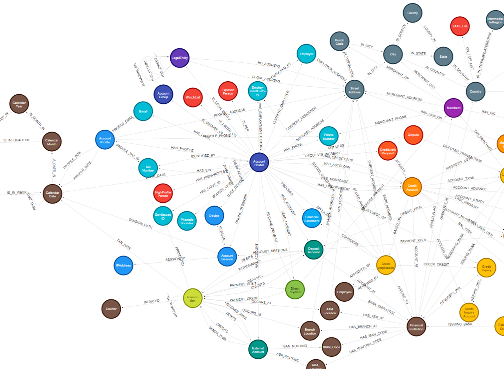
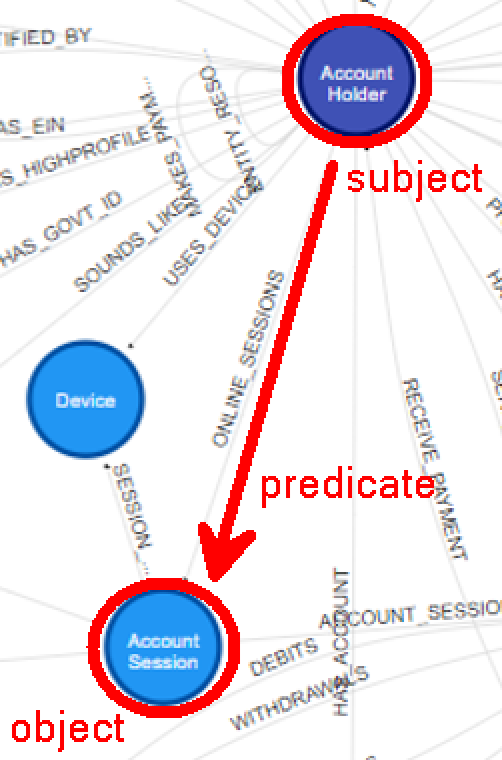
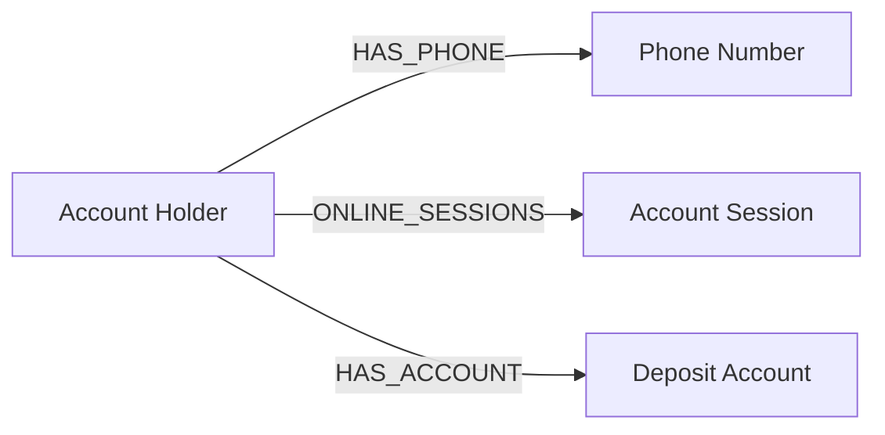
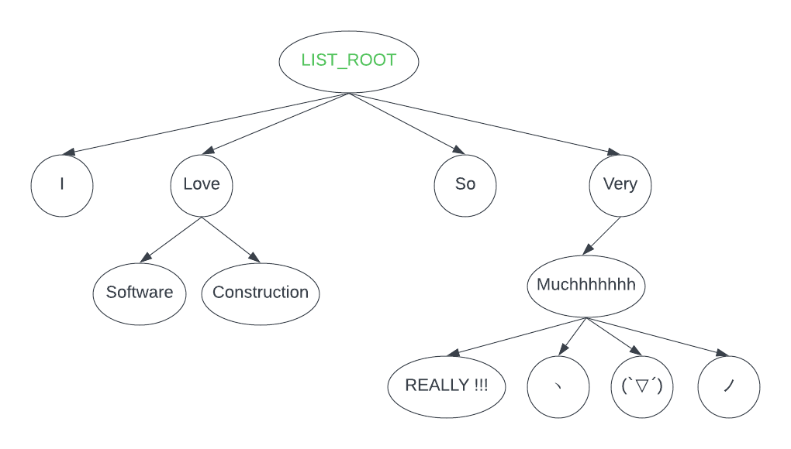
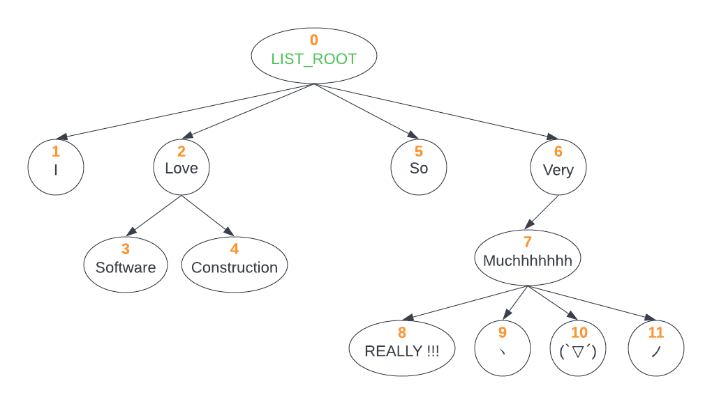

# 第7章 考点E：持久化 XML／JSON／CSV

> 目标：把文件中的文本恢复成 Java 对象，也能把 Java 对象按指定格式写回文件。

## 第一部分：知识点的零基础学习

### 知识点 1：三种格式分别在表达什么

| 格式 | 最自然的结构 | 简短例子 | 解析重点 |
|---|---|---|---|
| XML | 标签树 | `<City name="Hobart"/>` | 元素、属性、父子层级 |
| JSON | 对象、数组、值 | `{"name":"ACT","employees":[]}` | 字段映射、嵌套对象与列表 |
| CSV | 表格记录 | `33;John;20;Student` | 表头、分隔符、引号与转义 |


**持久化不只是读字符串**：解析后还要检查必填字段、空值、数字格式、重复记录和层级关系。

### 知识点 2：XML DOM 的核心对象

DOM 把整个 XML 读成内存树：

- `Document`：整份文档；`getDocumentElement()` 得到根元素。
- `Element`：标签元素；`getTagName()` 是标签名，`getAttribute("name")` 读属性。
- `Node`：更一般的节点，包括元素、文本、注释等。
- `NodeList`：节点列表，用 `getLength()` 和 `item(i)` 遍历。

```java
NodeList children = element.getChildNodes();
for (int i = 0; i < children.getLength(); i++) {
    Node node = children.item(i);
    if (node.getNodeType() == Node.ELEMENT_NODE) {
        Element child = (Element) node;
        System.out.println(child.getTagName());
    }
}
```

格式化 XML 的缩进会产生文本节点，所以要过滤 `ELEMENT_NODE`。

`getElementsByTagName("City")` 会找**所有后代**中的 City；`getChildNodes()` 只看**直接子节点**。平铺读取和递归读取不要混用。

#### 2.1 递归复制 XML 树

```java
Location readLocation(Element element) {
    Location result = new Location(element.getTagName(), element.getAttribute("name"));
    for (Element child : elementChildren(element)) {
        result.addChild(readLocation(child));
    }
    return result;
}
```

基本模式：先创建当前节点，再递归创建子节点并挂到当前节点上。

### 知识点 3：JSON 与 Gson 对象映射

```json
{
  "name": "ACT Software",
  "employees": [
    {"name": "John", "skills": ["Java", "PHP"]}
  ]
}
```

对应 Java 字段：

```java
class Company {
    private String name;
    private List<Employee> employees;
}
class Employee {
    private String name;
    private List<String> skills;
}
```

使用仓库已有的 Gson：

```java
Gson gson = new Gson();
try (FileReader reader = new FileReader(file)) {
    Company company = gson.fromJson(reader, Company.class);
}
try (FileWriter writer = new FileWriter(file)) {
    gson.toJson(company, writer);
}
```

默认字段名与 JSON key 对应；字段名不同可用 `@SerializedName`。读取后仍要检查 `null`、重复员工和空技能列表。

### 知识点 4：CSV 不是永远 `split(",")` 就结束

简单题目若明确字段不含分隔符，可以使用：

```java
String[] fields = line.split(";", -1);
```

`-1` 保留末尾空字段。表头说明列顺序，数据行再转换为对象。

真实 CSV 还可能有：

```text
33;"John; Jr.";20;Student
```

这时不能按每个 `;` 直接切，因为引号内的分隔符属于内容；需要逐字符状态机或成熟 CSV 库。考试先看题目是否排除了引号，别过度设计，也别把简单规则用错。

### 知识点 5：空值、异常与分片

- 缺失可选值与空白值通常映射为 `null`，但数字字段在转换前要先判空。
- 文件不存在、XML malformed、数字非法时，按题目要求返回 `null` 或抛异常，不要默默返回半份结果。
- CSV 的记录通常可独立切分，适合按行分片；XML／JSON 有外层根与嵌套结构，不能从任意字节处切开就直接解析。
- 写 XML／JSON 时使用库的转义，不要手写字符串拼接处理 `<`、`&`、引号等特殊字符。

## 真题讲解 1：平铺与层级 XML 读取（2025 S2 Q4）

来源：[`Q4README.md`](../exam-practice-questions/past-exams/2025-2/src/Q4/Q4README.md)、[`LocationLoader.java`](../exam-practice-questions/past-exams/2025-2/src/Q4/LocationLoader.java)、[`Location.java`](../exam-practice-questions/past-exams/2025-2/src/Q4/Location.java)

### 1.1 题目原文

**中文题意：** 读取位置 XML：Task A 把根的直接子元素映射为名称和可选人口；Task B 按标签与嵌套关系递归构造 Location 树，并处理缺失名称、空白人口和错误输入。

> Read and process location data stored in XML format using the `org.w3c.dom` and `javax.xml` libraries.
>
> **Task A: Loading a flat XML**
>
> The XML contains a `<Locations>` as the root. Each direct child element of `<Locations>` represents one location, and each of them must have a String `name` attribute, and can optionally have exactly one inner `<Population>` element which contains an integer.
>
> ```xml
> <?xml version="1.0" encoding="utf-8" standalone="no"?>
> <Locations>
>     <State name="New South Wales">
>         <Population>8545100</Population>
>     </State>
>     <State name="Victoria">
>         <Population>7011100</Population>
>     </State>
>     <State name="Tasmania">
>     </State>
> </Locations>
> ```
>
> Complete `loadPopulationInfo`, returning a mapping of location names to populations. The tag name is arbitrary. The map value should be `null` if Population is missing or blank. Return `null` on error.
>
> **Task B: Loading a hierarchical XML**
>
> Each direct or indirect child element represents a location. The tag name indicates the location type; the name attribute specifies its name.
>
> ```xml
> <Locations>
>     <Country name="Australia" capital="Canberra" population="26000000">
>         <State name="Tasmania">
>             <Region name="South">
>                 <City name="Hobart"/>
>             </Region>
>             <Region name="North">
>                 <City name="Launceston"/>
>             </Region>
>         </State>
>         <State name="New South Wales">
>         </State>
>     </Country>
> </Locations>
> ```
>
> Complete `loadLocations`, returning the set of direct children of `<Locations>` with nested child Location instances. If the name attribute is missing, skip the entire element. The population attribute is optional; set it to `null` if missing or blank. Ignore additional tags and attributes. Return `null` on error.

### 1.2 两个任务的结构差异

Task A 只处理根的直接子元素，并构造 `Map`；Task B 对每个直接子元素递归，构造 `Location` 树。可选值统一先 `trim()`，空白则返回 `null`。

### 1.3 完整参考实现

增加 imports：

```java
import org.w3c.dom.Document;
import org.w3c.dom.Element;
import org.w3c.dom.Node;
import org.w3c.dom.NodeList;
import javax.xml.parsers.DocumentBuilderFactory;
```

Task A：

```java
public static Map<String, Integer> loadPopulationInfo(File f) {
    Map<String, Integer> result = new LinkedHashMap<>();
    try {
        Document document = DocumentBuilderFactory.newInstance()
                .newDocumentBuilder().parse(f);
        Element root = document.getDocumentElement();
        if (!root.getTagName().equals("Locations")) {
            return null;
        }

        NodeList nodes = root.getChildNodes();
        for (int i = 0; i < nodes.getLength(); i++) {
            Node node = nodes.item(i);
            if (node.getNodeType() != Node.ELEMENT_NODE) {
                continue;
            }

            Element location = (Element) node;
            if (!location.hasAttribute("name")) {
                return null;
            }

            Integer population = null;
            int populationCount = 0;
            NodeList children = location.getChildNodes();
            for (int j = 0; j < children.getLength(); j++) {
                Node childNode = children.item(j);
                if (childNode.getNodeType() != Node.ELEMENT_NODE) {
                    continue;
                }
                Element child = (Element) childNode;
                if (!child.getTagName().equals("Population") || populationCount > 0) {
                    return null;
                }
                populationCount++;
                population = parseOptionalInteger(child.getTextContent());
            }
            result.put(location.getAttribute("name"), population);
        }
        return result;
    } catch (Exception e) {
        return null;
    }
}
```

Task B 与辅助方法：

```java
public static Set<Location> loadLocations(File f) {
    try {
        Document document = DocumentBuilderFactory.newInstance()
                .newDocumentBuilder().parse(f);
        Element root = document.getDocumentElement();
        if (!root.getTagName().equals("Locations")) {
            return null;
        }

        Set<Location> result = new LinkedHashSet<>();
        NodeList nodes = root.getChildNodes();
        for (int i = 0; i < nodes.getLength(); i++) {
            Node node = nodes.item(i);
            if (node.getNodeType() == Node.ELEMENT_NODE) {
                Location location = readLocation((Element) node);
                if (location != null) {
                    result.add(location);
                }
            }
        }
        return result;
    } catch (Exception e) {
        return null;
    }
}

private static Location readLocation(Element element) {
    if (!element.hasAttribute("name")) {
        return null;
    }

    Location result = new Location(element.getTagName(), element.getAttribute("name"));
    result.population = parseOptionalInteger(element.getAttribute("population"));

    NodeList nodes = element.getChildNodes();
    for (int i = 0; i < nodes.getLength(); i++) {
        Node node = nodes.item(i);
        if (node.getNodeType() == Node.ELEMENT_NODE) {
            Location child = readLocation((Element) node);
            if (child != null) {
                result.addChild(child);
            }
        }
    }
    return result;
}

private static Integer parseOptionalInteger(String text) {
    return text == null || text.trim().isEmpty()
            ? null
            : Integer.valueOf(text.trim());
}
```

**易错点**：`LinkedHashMap` 和 `LinkedHashSet` 允许保留遍历顺序；不要用 `Map.of(...)` 构造含 `null` 人口的 map，因为它不允许 null 值。

### 英文讲解对照（English Explanation）

For Task A, iterate only the direct element children of the `Locations` root. Require a name attribute, allow at most one direct `Population` child, and map a missing or blank population to null. Return null on invalid structure. For Task B, recursively create a `Location` from each element, using its tag as type and the name attribute as name. Attach recursively created element children and skip a subtree whose element lacks a name. Read the optional population attribute as an integer. Both tasks should return null for parsing or format errors.

## 真题讲解 2：哪种格式适合 Sharding（2025 S1 Q7）

来源：[`MC_Questions_2025_S1.pdf`](../exam-practice-questions/past-exams/2025-1/src/Q4/MC_Questions_2025_S1.pdf)，第 3 页。

### 2.1 题目原文

**中文题意：** 要把大文件拆成多个可并发访问的小分片；问在给定四种理由中，哪种格式及其解释最适合 sharding。

> A client wishes to apply “sharding” to a large amount of data persistently. Sharding is the practice of splitting a single large file into a large number of smaller files, each of which can be accessed concurrently for greater performance. For example, instead of a file with 10,000 instances, the client wants to generate 10 files, each with 1,000 instances. Which formats are suitable for this purpose?
>
> a. CSV is suitable, because it is non-hierarchical, so the parser does not need to know what tags are open at the start of a particular shard.
>
> b. XML is suitable, because it supports attributes, which allow the developer to indicate where a shard ends and begins.
>
> c. JSON is suitable, as it has native support for sharding through the GSON Java library.
>
> d. Serialization is suitable only if the objects are each less than 128 bytes in size. In this case, Java can serialize multiple objects to the same file.

### 2.2 参考答案与解析

**答案：a。** 在题目给出的简单记录模型下，CSV 不依赖外层标签的嵌套状态，可以按记录边界切分。XML 的属性可以记录元数据，但不能让任意片段自动成为可独立解析的 XML；Gson 没有题目所说的原生 sharding 支持；Java Serialization 也没有 128 字节这一限制。

### 英文讲解对照（English Explanation）

CSV is record-oriented and does not require an open tag hierarchy around each shard, so simple record boundaries make it suitable under the question's model. XML attributes do not automatically make arbitrary shard fragments valid documents. JSON has no native Gson sharding feature. Java serialization has no 128-byte restriction. Therefore A is correct.

## 真题讲解 3：CSV→红黑树→XML（2020 S2 Q3，早期真题补缺口）

来源：[`README.md`](../exam-practice-questions/past-exams/2020-2/Q3/README.md)、[`Application.java`](../exam-practice-questions/past-exams/2020-2/Q3/Application.java)、[`RBTree.java`](../exam-practice-questions/past-exams/2020-2/Q3/RBTree.java)、[`ApplicationTest.java`](../exam-practice-questions/past-exams/2020-2/Q3/ApplicationTest.java)

### 3.1 题目原文

**中文题意：** 完成红黑树的右到左层序遍历；读取分号分隔的 CSV 生成 Person；按 id 建立红黑树；再按层序把人员写为指定结构的 `people.xml`。

> Implement `levelTraversal()` in `RBTree`, and `readCsv()`, `createTree()`, and `saveXML()` in `Application`.
>
> The `levelTraversal()` method must return the level order traversal from the right to left. For the tree below, it must return `[33, 88, 11, 43, 16, 10]`.
>
> ```text
>         33
>       /    \
>     11      88
>    / \     /
>  10  16  43
> ```
>
> The `readCsv()` method must read a csv file with fields separated by `;`:
>
> ```text
> id;name;age;occupation
> 33;John;20;Student
> 11;Jerry;40;Lecturer
> 88;Tom;21;Student
> 10;Mary;35;Manager
> 16;Paul;40;Programmer
> 43;Ben;45;Youtuber
> ```
>
> It must return Person instances with id, name, age and occupation.
>
> The `createTree()` method must return a Red-Black tree containing all people, with integer id as key and Person as data. The `saveXML()` method must create `people.xml` containing all Person instances in level traversal order. The XML root is `<people>`; each `<person>` contains `<id>`, `<name>`, `<age>`, and `<occupation>`. Use only the standard Java 8+ XML library.

### 3.2 数据流先看懂


### 3.3 完整参考实现

`RBTree.levelTraversal()`：

```java
public List<Node> levelTraversal() {
    List<Node> ret = new LinkedList<>();
    if (root == null || root.key == null) {
        return ret;
    }

    Queue<Node> queue = new LinkedList<>();
    queue.add(root);
    while (!queue.isEmpty()) {
        Node current = queue.remove();
        ret.add(current);
        if (current.right != null && current.right.key != null) {
            queue.add(current.right);
        }
        if (current.left != null && current.left.key != null) {
            queue.add(current.left);
        }
    }
    return ret;
}
```

`Application.readCsv()`：

```java
public List<Person> readCsv(String fileName) {
    List<Person> list = new LinkedList<>();
    try (java.io.BufferedReader reader = new java.io.BufferedReader(
            new java.io.FileReader(fileName))) {
        String header = reader.readLine();
        if (header == null) {
            return list;
        }

        String line;
        while ((line = reader.readLine()) != null) {
            if (line.trim().isEmpty()) {
                continue;
            }
            String[] fields = line.split(";", -1);
            if (fields.length != 4) {
                return null;
            }
            list.add(new Person(
                    Integer.valueOf(fields[0].trim()),
                    fields[1].trim(),
                    Integer.valueOf(fields[2].trim()),
                    fields[3].trim()));
        }
        return list;
    } catch (java.io.IOException | RuntimeException e) {
        return null;
    }
}
```

`Application.createTree()`：

```java
public RBTree<Integer, Person> createTree(List<Person> personList) {
    RBTree<Integer, Person> tree = new RBTree<>();
    if (personList != null) {
        for (Person person : personList) {
            tree.insert(person.getId(), person);
        }
    }
    return tree;
}
```

`Application.saveXML()` 与文本元素辅助方法：

```java
public void saveXML(RBTree<Integer, Person> tree) {
    if (tree == null) {
        return;
    }

    try {
        List<Node> list = tree.levelTraversal();
        javax.xml.parsers.DocumentBuilder builder =
                javax.xml.parsers.DocumentBuilderFactory.newInstance().newDocumentBuilder();
        org.w3c.dom.Document document = builder.newDocument();
        org.w3c.dom.Element root = document.createElement("people");
        document.appendChild(root);

        for (Node node : list) {
            Person person = (Person) node.getData();
            org.w3c.dom.Element element = document.createElement("person");
            root.appendChild(element);
            appendText(document, element, "id", person.getId());
            appendText(document, element, "name", person.getName());
            appendText(document, element, "age", person.getAge());
            appendText(document, element, "occupation", person.getOccupation());
        }

        javax.xml.transform.Transformer transformer =
                javax.xml.transform.TransformerFactory.newInstance().newTransformer();
        transformer.setOutputProperty(javax.xml.transform.OutputKeys.ENCODING, "UTF-8");
        transformer.setOutputProperty(javax.xml.transform.OutputKeys.INDENT, "yes");
        transformer.transform(
                new javax.xml.transform.dom.DOMSource(document),
                new javax.xml.transform.stream.StreamResult(new java.io.File("people.xml")));
    } catch (Exception e) {
        return;
    }
}

private void appendText(org.w3c.dom.Document document,
                        org.w3c.dom.Element parent,
                        String tag,
                        Object value) {
    org.w3c.dom.Element child = document.createElement(tag);
    child.setTextContent(String.valueOf(value));
    parent.appendChild(child);
}
```

**自测重点**：层序是“当前层全部完成后再下一层”，不是右到左的 DFS；`readCsv` 跳过表头而不是把表头当 Person；XML 顺序必须来自 `levelTraversal()`，不能换成 `inorder()`。

## 补充练习 1：JSON 读取、合并与保存（misc q1-json，仓库补充练习，非真题）

**中文题意：** 使用 Gson 从 `company.json` 读取 Company 与 Employee，按姓名合并同名员工的技能并去重，再把结果按相同 JSON 结构写回文件。

来源：[`Company.java`](../exam-practice-questions/misc-questions/q1-json/Company.java)、[`Employee.java`](../exam-practice-questions/misc-questions/q1-json/Employee.java)、[`CompanyTest.java`](../exam-practice-questions/misc-questions/q1-json/CompanyTest.java)、[`company.json`](../exam-practice-questions/misc-questions/q1-json/company.json)

### 1.1 题目原文

> The goal of this task is to write a program that loads/stores a college in JSON format. The `Company.java` has a company name and a list of `Employee` instances. Each employee has an employee name and a list of skills. There are some duplicates of the employees in the `company.json` file. Your job is to implement the three methods in the `Company` class:
>
> - `loadFromJsonFile`
> - `mergeEmployees`
> - `saveToJsonFile`
>
> in order to load from the given `company.json` file, merge the skills of the employees with the same names, and write the processed data into a JSON file, which should be the same as the given `company_processed.json` file.

必要的原始数据节选：

```json
{
  "name": "ACT Software",
  "employees": [
    {"name": "John", "skills": ["Java", "PHP"]},
    {"name": "Alice", "skills": ["Java", "PHP"]},
    {"name": "David", "skills": ["C++"]},
    {"name": "Alice", "skills": ["Java", "HTML"]},
    {"name": "John", "skills": ["C++", "HTML"]},
    {"name": "David", "skills": ["C++", "HTML"]}
  ]
}
```

### 1.2 直观分析

合并时用 `LinkedHashMap<String, Employee>`：

- 第一次见到某员工：创建新条目；
- 再次见到同名员工：把新技能按出现顺序加入，已存在则跳过；
- 最后把 map 的 values 转回 list。

这样既去重，又保留员工第一次出现的顺序和技能首次出现的顺序。

### 1.3 完整参考实现

```java
public static Company loadFromJsonFile(File file) {
    try (java.io.FileReader reader = new java.io.FileReader(file)) {
        return new com.google.gson.Gson().fromJson(reader, Company.class);
    } catch (java.io.IOException | RuntimeException e) {
        return null;
    }
}
```

```java
public void mergeEmployees() {
    Map<String, Employee> merged = new LinkedHashMap<>();
    if (employees == null) {
        return;
    }

    for (Employee employee : employees) {
        Employee existing = merged.get(employee.getName());
        if (existing == null) {
            merged.put(employee.getName(), new Employee(
                    employee.getName(), new ArrayList<>(employee.getSkills())));
        } else {
            for (String skill : employee.getSkills()) {
                if (!existing.getSkills().contains(skill)) {
                    existing.getSkills().add(skill);
                }
            }
        }
    }
    employees = new ArrayList<>(merged.values());
}
```

```java
public void saveToJsonFile(File file) {
    try (java.io.FileWriter writer = new java.io.FileWriter(file)) {
        new com.google.gson.GsonBuilder()
                .setPrettyPrinting()
                .create()
                .toJson(this, writer);
    } catch (java.io.IOException e) {
        return;
    }
}
```

在文件顶部补充：

```java
import java.util.ArrayList;
import java.util.LinkedHashMap;
import java.util.Map;
```

**自测预期**：原始 8 名员工合并为 5 名；John 的技能依次为 Java、PHP、C++、HTML；重复技能不重复出现。

### JSON 补充练习英文讲解（English Explanation）

Gson maps the `Company` JSON object directly to Java fields. `mergeEmployees` uses a `LinkedHashMap` keyed by employee name: the first occurrence preserves order, later occurrences append only unseen skills. Converting the map values back to a list yields five employees after merging the eight input records. `saveToJsonFile` writes the merged company with `GsonBuilder.setPrettyPrinting()`.

### 英文讲解对照（English Explanation）

`readCsv` skips the header, splits each semicolon-separated record while preserving empty fields, converts id and age to integers, and constructs Person objects. `createTree` inserts each person using the integer id as the key. Right-to-left level traversal uses a queue: enqueue the right child before the left child at every level. `saveXML` walks that level order, creates a `<person>` element for each node, appends id/name/age/occupation text elements, and writes `people.xml` through the standard DOM transformer.

## 真题讲解 4：XML Triples 与知识图谱查询（2023 S2 Q1，跨考点完整收录）

来源：[`readme_Q1.md`](../exam-practice-questions/past-exams/2023-2/src/Q1/readme_Q1.md)、[`TripleReader.java`](../exam-practice-questions/past-exams/2023-2/src/Q1/Triples/TripleReader.java)、[`QueryTokenizer.java`](../exam-practice-questions/past-exams/2023-2/src/Q1/QueryTokenizer.java)、[`QueryParser.java`](../exam-practice-questions/past-exams/2023-2/src/Q1/QueryParser.java)

### 4.1 题目原文与原始图示

**中文题意：** 从 XML 读取 subject／predicate／object 三元组，再对 SELECT-WHERE 查询进行分词和解析，按条件筛选三元组并返回所选分量或完整 triple。

> In a Knowledge Graph (KG), we represent data as `triples` in an inter-connected world. A triple is a 3-component tuple; they are known as subject (s), predicate (p), and object (o).
>
> - `Triple`: Consists of a subject, predicate, and object. Represents a single fact/statement in the KG.
> - Each subject, predicate, and object is a `TripleComponent`, and their values are represented by strings.
>
> Your task is to process queries that aim to retrieve specific components from a set of triples.
>
> ```text
> <QUERY>                  -> <SELECT> <WHERE>
> <SELECT>                 -> SELECT <TARGET>
> <TARGET>                 -> ?subject | ?predicate | ?object | triple
> <WHERE>                  -> WHERE { <CONDITION> }
> <CONDITION>              -> <SUBJECT_INPUT> <PREDICATE_OBJECT_INPUT>
> <SUBJECT_INPUT>          -> ?subject | <TARGET_VALUE>
> <PREDICATE_OBJECT_INPUT> -> <PREDICATE_INPUT> <OBJECT_INPUT> | ε
> <PREDICATE_INPUT>        -> ?predicate | <TARGET_VALUE>
> <OBJECT_INPUT>           -> ?object | <TARGET_VALUE> | ε
> ```
>
> **Part 1) Reading Triples:** Complete `read` in `TripleReader`. It reads an XML file based on the file path and returns a Set of Triples.
>
> **Part 2) Tokeniser:** Complete Q1b to Q1d in `QueryTokenizer`. You do not need to consider global query validity while tokenizing.
>
> **Part 3) Search with a Parser:** `<TARGET_VALUE>` may include letters, digits, colon, forward slash, underscore, and full stops. Tokens are whitespace-separated and case-sensitive. Conditions are conjunctive. Variables in WHERE use `WHERE_ANY`; literal restrictions use `WHERE_MATCH`. Complete `parse` in `QueryParser`.







原始 XML：

```xml
<triples>
    <triple>
        <subject type="STRING">I</subject>
        <predicate type="STRING">am</predicate>
        <object type="STRING">the_exam</object>
    </triple>
</triples>
```

### 4.2 TripleReader 完整参考实现

```java
public static Set<Triple> read(String filePath) {
    Set<Triple> triples = new HashSet<>();
    try {
        Document document = DocumentBuilderFactory.newInstance()
                .newDocumentBuilder().parse(filePath);
        NodeList nodes = document.getElementsByTagName("triple");
        for (int i = 0; i < nodes.getLength(); i++) {
            Element element = (Element) nodes.item(i);
            triples.add(new Triple(
                    new TripleComponent(TripleComponent.TripleComponentType.SUBJECT,
                            element.getElementsByTagName("subject").item(0).getTextContent()),
                    new TripleComponent(TripleComponent.TripleComponentType.PREDICATE,
                            element.getElementsByTagName("predicate").item(0).getTextContent()),
                    new TripleComponent(TripleComponent.TripleComponentType.OBJECT,
                            element.getElementsByTagName("object").item(0).getTextContent())));
        }
        return triples;
    } catch (Exception e) {
        return null;
    }
}
```

### 4.3 QueryTokenizer 完整参考实现

```java
public QToken getSelectTokenIfValid() {
    String[] parts = buffer.trim().split("\\s+", 3);
    if (parts.length < 3 || !parts[0].equals("SELECT")) {
        return null;
    }
    TripleComponent.TripleComponentType target;
    switch (parts[1]) {
        case "?subject" -> target = TripleComponent.TripleComponentType.SUBJECT;
        case "?predicate" -> target = TripleComponent.TripleComponentType.PREDICATE;
        case "?object" -> target = TripleComponent.TripleComponentType.OBJECT;
        case "triple" -> target = TripleComponent.TripleComponentType.TRIPLE;
        default -> {
            return null;
        }
    }
    buffer = parts[2];
    return new QToken(QTokenType.SELECT, target);
}

public boolean whereIsValid() {
    String trimmed = buffer.trim();
    int open = trimmed.indexOf('{');
    if (open < 0 || !trimmed.endsWith("}")
            || !trimmed.substring(0, open).trim().equals("WHERE")) {
        return false;
    }
    buffer = trimmed.substring(open + 1, trimmed.length() - 1).trim();
    return true;
}

public QToken next() {
    String trimmed = buffer.trim();
    if (trimmed.isEmpty()) {
        return null;
    }
    String[] parts = trimmed.split("\\s+", 2);
    buffer = parts.length == 1 ? "" : parts[1];

    TripleComponent.TripleComponentType any;
    switch (parts[0]) {
        case "?subject" -> any = TripleComponent.TripleComponentType.SUBJECT;
        case "?predicate" -> any = TripleComponent.TripleComponentType.PREDICATE;
        case "?object" -> any = TripleComponent.TripleComponentType.OBJECT;
        default -> any = null;
    }
    if (any != null) {
        return new QToken(QTokenType.WHERE_ANY, any);
    }
    return parts[0].matches("[A-Za-z0-9:/_.]+") ? new QToken(parts[0]) : null;
}
```

### 4.4 QueryParser 完整参考实现

```java
public static Set<Object> parse(List<QToken> tokens, Set<Triple> triples) {
    if (tokens == null || tokens.size() < 2 || tokens.size() > 4) {
        return null;
    }
    QToken select = tokens.get(0);
    if (select == null || select.getqTokenType() != QTokenType.SELECT
            || select.getElemType() == null) {
        return null;
    }

    for (int i = 1; i < tokens.size(); i++) {
        QToken condition = tokens.get(i);
        if (condition == null) {
            return null;
        }
        TripleComponent.TripleComponentType expected = switch (i) {
            case 1 -> TripleComponent.TripleComponentType.SUBJECT;
            case 2 -> TripleComponent.TripleComponentType.PREDICATE;
            default -> TripleComponent.TripleComponentType.OBJECT;
        };
        if (condition.getqTokenType() == QTokenType.WHERE_ANY) {
            if (condition.getElemType() != expected) {
                return null;
            }
        } else if (condition.getqTokenType() != QTokenType.WHERE_MATCH
                || condition.getValue() == null
                || !condition.getValue().matches("[A-Za-z0-9:/_.]+")) {
            return null;
        }
    }

    Set<Triple> filtered = new HashSet<>();
    for (Triple triple : triples) {
        boolean matches = true;
        for (int i = 1; i < tokens.size(); i++) {
            QToken condition = tokens.get(i);
            if (condition.getqTokenType() != QTokenType.WHERE_MATCH) {
                continue;
            }
            TripleComponent component = switch (i) {
                case 1 -> triple.getSubject();
                case 2 -> triple.getPredicate();
                default -> triple.getObject();
            };
            String actual = component.getValue();
            String wanted = condition.getValue();
            if (!actual.equals(wanted) && !actual.endsWith("/" + wanted)) {
                matches = false;
                break;
            }
        }
        if (matches) {
            filtered.add(triple);
        }
    }

    Set<Object> results = new HashSet<>();
    for (Triple triple : filtered) {
        switch (select.getElemType()) {
            case SUBJECT -> results.add(triple.getSubject());
            case PREDICATE -> results.add(triple.getPredicate());
            case OBJECT -> results.add(triple.getObject());
            case TRIPLE -> results.add(triple);
        }
    }
    return results;
}
```

**本章关注点**：XML 解析负责生成 Triple；Tokeniser 再把查询变成条件；Parser 最后按位置过滤。不要把查询解析和 XML 文件解析混为一谈。

### 英文讲解对照（English Explanation）

The XML reader creates Triple objects with component types inferred by position. The query tokenizer reads SELECT and its target, validates the WHERE braces, and produces WHERE_ANY tokens for variables or WHERE_MATCH tokens for literals. The parser enforces the condition positions, requires a subject and allows optional predicate and object tokens, then applies all restrictions conjunctively. Matching supports exact values and URI path suffixes. The result set contains the selected triple component or complete triple.

## 真题讲解 5：Markdown 文件读取与层级列表（2023 S1 Q2，跨考点完整收录）

来源：[`Q2README.md`](../exam-practice-questions/past-exams/2023-1/Q2/Q2README.md)、[`MDFileReader.java`](../exam-practice-questions/past-exams/2023-1/Q2/MDFileReader.java)、[`MDTokenizer.java`](../exam-practice-questions/past-exams/2023-1/Q2/MDTokenizer.java)、[`MDParser.java`](../exam-practice-questions/past-exams/2023-1/Q2/MDParser.java)、[`ListElementsTree.java`](../exam-practice-questions/past-exams/2023-1/Q2/ListElementsTree.java)

### 5.1 题目原文

**中文题意：** 读取 Markdown 文件，把四级空格缩进的混合有序／无序列表分词，再用父节点栈构建树，并按前序输出全部条目（不含虚拟根）。

> In this question, we will read and process list elements in markdown files (.md). For simplicity, we only tackle two specific types of list elements of a strict syntax.
>
> Unordered items use `- `; ordered items use an integer followed by `. `. Elements at level 1 have no prefixing spaces; each deeper level adds exactly 4 spaces. Empty lines and whitespace-only lines may occur, and ordered and unordered items can be mixed.
>
> **Part 1) Reading Markdown Files:** Complete `read()` in `MDFileReader` to return the content as text.
>
> **Part 2) Tokenizer:** Complete `next()` in `MDTokenizer`. Each token records `tokenType`, `content`, `level` and `number`.
>
> **Part 3) Parser and Data Structure:** Complete `parse()` in `MDParser`. Build a tree that retains all parent-children relationships and the order of list elements. A `LIST_ROOT` is provided.
>
> **Part 4) Data Structure:** Implement `preOrderWalk()` in `ListElementsTree`, visiting each node before its children from left to right and excluding `LIST_ROOT`.





### 5.2 完整参考实现

`MDFileReader.read()`：

```java
public static String read(String filePath) {
    try {
        return java.nio.file.Files.readString(java.nio.file.Path.of(filePath));
    } catch (java.io.IOException | RuntimeException e) {
        return null;
    }
}
```

`MDTokenizer.next()`：

```java
public MDToken next() {
    while (!buffer.isEmpty()) {
        int newline = buffer.indexOf('\n');
        String line;
        if (newline >= 0) {
            line = buffer.substring(0, newline);
            buffer = buffer.substring(newline + 1);
        } else {
            line = buffer;
            buffer = "";
        }
        if (line.endsWith("\r")) {
            line = line.substring(0, line.length() - 1);
        }
        if (line.trim().isEmpty()) {
            continue;
        }

        int spaces = 0;
        while (spaces < line.length() && line.charAt(spaces) == ' ') {
            spaces++;
        }
        if (spaces % 4 != 0) {
            current = null;
            return null;
        }

        int level = spaces / 4 + 1;
        String item = line.substring(spaces);
        if (item.startsWith("- ")) {
            current = new MDToken(MDTokenType.UNORDERED_ITEM,
                    item.substring(2), level);
            return current;
        }

        int dot = item.indexOf(". ");
        if (dot > 0 && item.substring(0, dot).matches("\\d+")) {
            current = new MDToken(MDTokenType.ORDERED_ITEM,
                    item.substring(dot + 2),
                    Integer.parseInt(item.substring(0, dot)), level);
            return current;
        }
        current = null;
        return null;
    }
    current = null;
    return null;
}
```

`MDParser.parse()`：

```java
public ListElementsTree parse() {
    ListElementsTree tree = new ListElementsTree();
    java.util.List<ListElementsTree.Node> parents = new java.util.ArrayList<>();
    parents.add(tree.root);

    while (tokenizer.hasNext()) {
        MDToken token = tokenizer.next();
        if (token == null) {
            if (!tokenizer.hasNext()) break;
            return null;
        }
        int level = token.getLevel();
        if (level < 1 || level > parents.size()) {
            return null;
        }
        while (parents.size() > level) {
            parents.remove(parents.size() - 1);
        }
        ListElementsTree.Node parent = parents.get(level - 1);
        parents.add(parent.insert(token.getContent()));
    }
    return tree;
}
```

`ListElementsTree.preOrderWalk()`：

```java
public List<String> preOrderWalk() {
    List<String> result = new ArrayList<>();
    for (Node child : root.getChildren()) {
        child.preOrder(result);
    }
    return result;
}
```

`Node` 中的辅助方法：

```java
void preOrder(List<String> result) {
    result.add(value);
    for (Node child : children) {
        child.preOrder(result);
    }
}
```

**本章关注点**：文件读取必须保留缩进与换行，否则后续 level 无法恢复；不要用 `trim()` 处理整份 Markdown。

### 英文讲解对照（English Explanation）

The Markdown reader must preserve line breaks and indentation. Tokenization skips blank lines, requires four-space indentation steps, and records level, content, and ordered-list number. Parsing uses a parent stack so the new node is attached to the parent at `level - 1`; same-level and shallower inserts pop stale paths. Pre-order traversal excludes the virtual root and visits each child from left to right.


