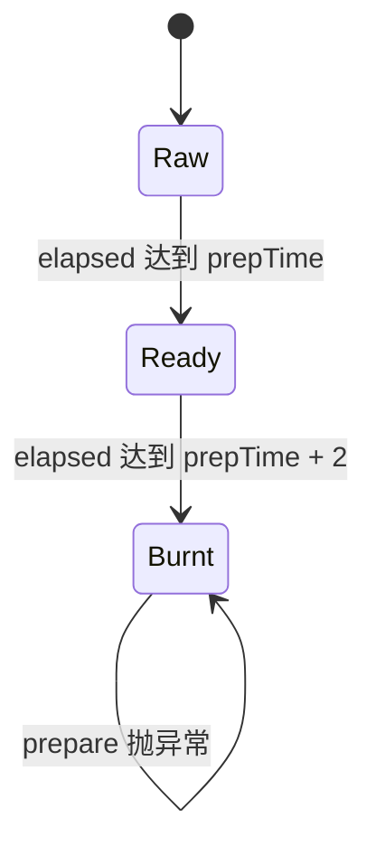
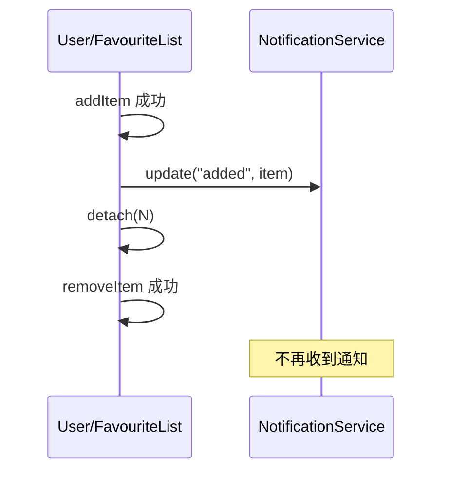
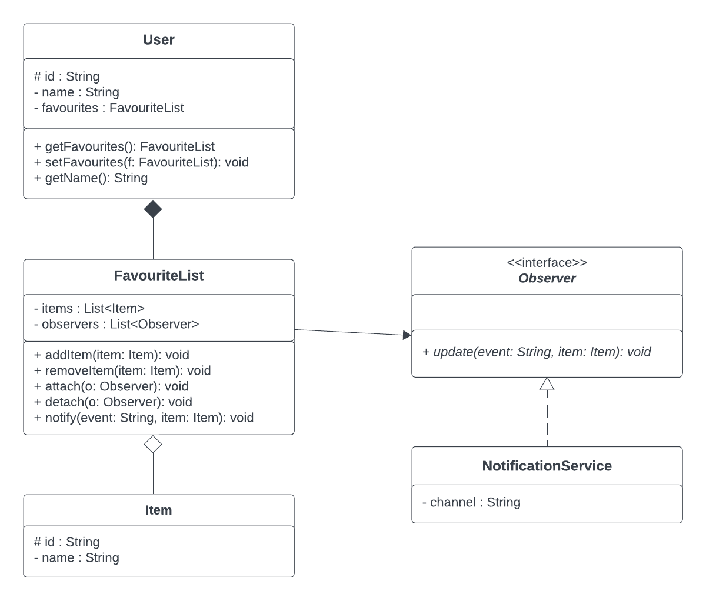
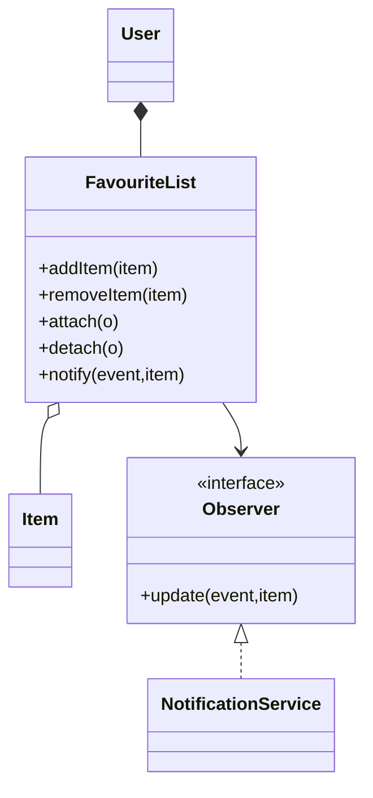
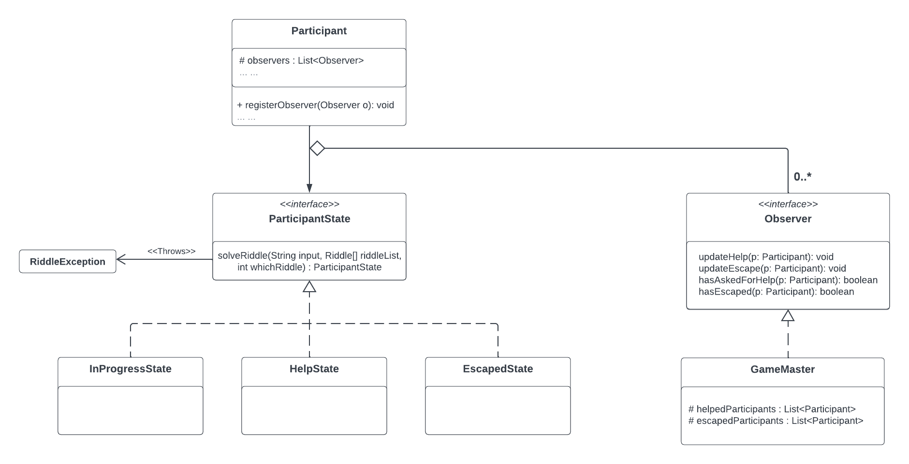
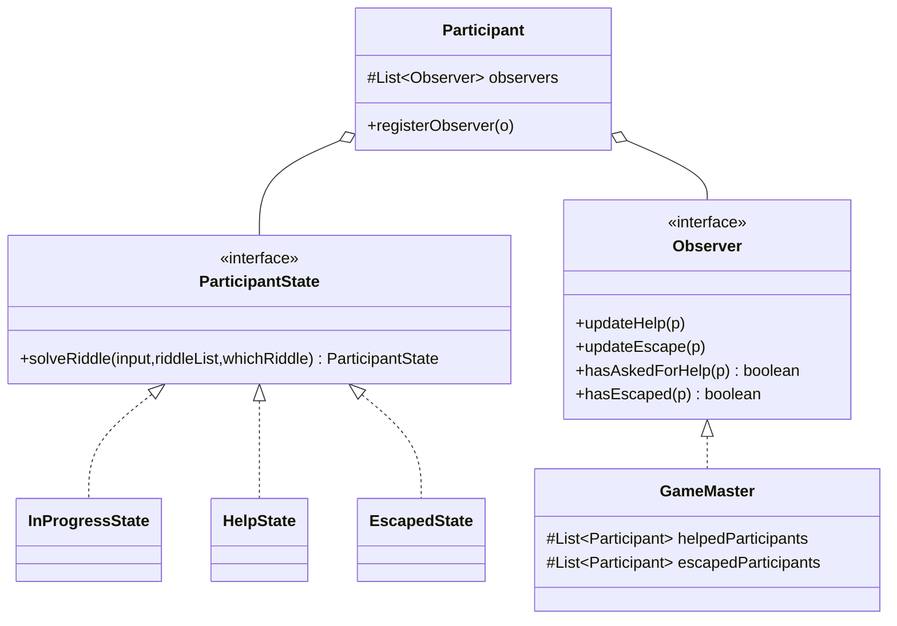

# 第8章 考点D：设计模式（Singleton／State／Observer）

> 目标：不只背模式名，而是能从“对象数量、状态行为、事件通知”识别并实现三种模式。

## 第一部分：知识点的零基础学习

### 知识点 1：Singleton——一个类只应有一个实例

```java
public class Config {
    private static Config instance;

    private Config() {
    }

    public static synchronized Config getInstance() {
        if (instance == null) {
            instance = new Config();
        }
        return instance;
    }
}
```

三个关键：

1. 构造器 `private`，阻止外部 `new Config()`；
2. 唯一实例由类自己保存；
3. 全局访问点 `getInstance()` 返回同一对象。

```java
assertSame(Config.getInstance(), Config.getInstance());
assertEquals(Config.getInstance(), Config.getInstance());
```

`assertSame` 检查是否同一引用，`assertEquals` 检查是否相等；Singleton 最直接的身份测试是 `assertSame`。

 eager（饿汉）在类加载时创建，lazy（懒汉）第一次请求时创建。多线程懒加载要处理两个线程同时创建的问题；考试若已给双重检查骨架，先按骨架补行为，不要顺手删掉同步。

### 知识点 2：State——把不同状态的行为放进不同类



上下文 `Food` 保存当前 `FoodState`，调用时委托：

```java
public void prepare() {
    checkState();
    state.prepare(this);
}
```

每个状态类只关心自己的规则：

- `RawState`：增加时间，必要时转 Ready；
- `ReadyState`：增加时间，必要时转 Burnt；
- `BurntState`：不再准备，抛异常。

**好处**：新增状态时主要加新类，而不是在 `Food` 里继续堆 `if (state == ...)`。如果 elapsed 时间是 source of truth，就先校正 state，再委托，避免时间与状态不一致。

### 知识点 3：Observer——主题变化时通知订阅者



Subject（主题）保存观察者列表，常见操作：

- `attach`：注册，通常忽略 null 与重复；
- `detach`：移除；
- `notify`：遍历当前观察者并调用 `update`；
- 事件只有真正发生才通知：重复 item 添加失败、元素不存在删除失败都不通知。

观察者与主题通过接口解耦：主题只知道 `Observer`，不需要知道通知是打印、发邮件还是写日志。

### 知识点 4：三种模式的快速辨别

| 题目信号 | 模式 |
|---|---|
| 所有状态类都应是同一个实例、构造器私有 | Singleton |
| 当前状态不同，同一操作行为不同，状态会转换 | State |
| 注册／移除监听器，事件发生时批量 update | Observer |

模式可以组合：State 的具体状态类常常用 Singleton 共享，因为这些状态对象本身不保存每个 Food 的独立数据。

## 真题讲解 1：Kitchen 的 State＋Singleton（2025 S1 Q1）

来源：[`Q1README.md`](../exam-practice-questions/past-exams/2025-1/src/Q1/Q1README.md)、[`Kitchen.java`](../exam-practice-questions/past-exams/2025-1/src/Q1/Kitchen.java)、[`Food.java`](../exam-practice-questions/past-exams/2025-1/src/Q1/Food.java)、[`Q1Test.java`](../exam-practice-questions/past-exams/2025-1/src/Q1/Q1Test.java)

### 1.1 题目原文

**中文题意：** 在 Kitchen 系统中应用 Singleton 与 State：统计足够制作／上菜的食材，计算订单缺口；再依据 `elapsedPrepTime` 完成 Raw、Ready、Burnt 三种状态及 `prepare()` 转换。

> You are expected to apply the state and singleton design patterns and complete the program.
>
> A `Recipe` specifies the type and number of `Ingredient`s required for a dish. The state of food is represented by `RawState`, `ReadyState`, and `BurntState`.
>
> `elapsedPrepTime` is the source of truth. If it mismatches the state, elapsedPrepTime is considered accurate and state should be updated accordingly. A recipe is completed if and only if all required ingredients are in ReadyState.
>
> - RawState: not yet ready.
> - ReadyState: prepare() has been triggered required PrepTime or required PrepTime + 1 times.
> - BurntState: preparation has gone two units beyond the required time.
>
> **Task A:** Complete `readyToCook` to check sufficient Raw or Ready food, `readyToServe` to check sufficient Ready food, and `ingredientsRequired` to find additional food needed for all orders. Burnt food is not available.
>
> **Task B:** Complete `Food.checkState`, `prepare` in RawState, ReadyState, BurntState and Food. Food.prepare must first ensure state accuracy, then delegate to the current state. Preparing burnt food throws RuntimeException.

### 1.2 状态边界先写成不等式

设 `p = Ingredient.getPrepTime(ingredient)`，`t = elapsedPrepTime`：

| 条件 | 应有状态 |
|---|---|
| `t < p` | Raw |
| `p <= t <= p + 1` | Ready |
| `t >= p + 2` | Burnt |

### 1.3 Kitchen 完整参考实现

```java
public static boolean readyToCook(Recipe recipe, Set<Food> ava) {
    Map<Ingredient, Integer> counts = new EnumMap<>(Ingredient.class);
    for (Food food : ava) {
        food.checkState();
        if (!(food.state instanceof BurntState)) {
            counts.merge(food.getIngredient(), 1, Integer::sum);
        }
    }
    return hasEnough(recipe, counts);
}

public static boolean readyToServe(Recipe recipe, Set<Food> ava) {
    Map<Ingredient, Integer> counts = new EnumMap<>(Ingredient.class);
    for (Food food : ava) {
        food.checkState();
        if (food.state instanceof ReadyState) {
            counts.merge(food.getIngredient(), 1, Integer::sum);
        }
    }
    return hasEnough(recipe, counts);
}

private static boolean hasEnough(Recipe recipe, Map<Ingredient, Integer> counts) {
    for (Map.Entry<Ingredient, Integer> required : recipe.getIngredients().entrySet()) {
        if (counts.getOrDefault(required.getKey(), 0) < required.getValue()) {
            return false;
        }
    }
    return true;
}

public Map<Ingredient, Integer> ingredientsRequired() {
    Map<Ingredient, Integer> required = new EnumMap<>(Ingredient.class);
    for (Recipe order : orders) {
        for (Map.Entry<Ingredient, Integer> entry : order.getIngredients().entrySet()) {
            required.merge(entry.getKey(), entry.getValue(), Integer::sum);
        }
    }

    Map<Ingredient, Integer> available = new EnumMap<>(Ingredient.class);
    for (Map.Entry<Food, Integer> entry : availableFood.entrySet()) {
        Food food = entry.getKey();
        food.checkState();
        if (!(food.state instanceof BurntState)) {
            available.merge(food.getIngredient(), entry.getValue(), Integer::sum);
        }
    }

    Map<Ingredient, Integer> missing = new EnumMap<>(Ingredient.class);
    for (Map.Entry<Ingredient, Integer> entry : required.entrySet()) {
        int deficit = entry.getValue() - available.getOrDefault(entry.getKey(), 0);
        if (deficit > 0) {
            missing.put(entry.getKey(), deficit);
        }
    }
    return missing;
}
```

### 1.4 Food 与状态类完整参考实现

`Food`：

```java
public void prepare() {
    checkState();
    state.prepare(this);
}

public void checkState() {
    int required = Ingredient.getPrepTime(ingredient);
    if (elapsedPrepTime < required) {
        state = RawState.getState();
    } else if (elapsedPrepTime <= required + 1) {
        state = ReadyState.getState();
    } else {
        state = BurntState.getState();
    }
}
```

`RawState`：

```java
private RawState() {
}

@Override
public void prepare(Food food) {
    food.elapsedPrepTime++;
    if (food.elapsedPrepTime >= Ingredient.getPrepTime(food.ingredient)) {
        food.setState(ReadyState.getState());
    }
}
```

`ReadyState`：

```java
private ReadyState() {
}

@Override
public void prepare(Food food) {
    food.elapsedPrepTime++;
    if (food.elapsedPrepTime >= Ingredient.getPrepTime(food.ingredient) + 2) {
        food.setState(BurntState.getState());
    }
}
```

`BurntState`：

```java
private BurntState() {
}

@Override
public void prepare(Food food) {
    throw new RuntimeException("Food is already burnt");
}
```

**自测 UDON（prepTime=3）**：第 1、2 次仍是 Raw，第 3 次 Ready，第 4 次仍 Ready，第 5 次 Burnt，再准备则抛异常。

### 英文讲解对照（English Explanation）

`readyToCook` counts non-burnt Raw or Ready food by ingredient; `readyToServe` counts only Ready food. `ingredientsRequired` sums quantities for all orders, subtracts available non-burnt quantities, and returns only positive deficits. `checkState` treats elapsed time as the source of truth: below the required time is Raw, required time through required time plus one is Ready, and two or more units beyond is Burnt. Food.prepare first repairs the state and then delegates. Raw and Ready preparation increment elapsed time and transition when their boundaries are reached; Burnt preparation throws RuntimeException.

## 真题讲解 2：Singleton 应声明什么构造器（2025 S1 Q2）

来源：[`MC_Questions_2025_S1.pdf`](../exam-practice-questions/past-exams/2025-1/src/Q4/MC_Questions_2025_S1.pdf)，第 1 页。

### 2.1 题目原文

**中文题意：** 为公开类 `Authenticator` 实现 Singleton；问应声明无构造器、私有构造器、受保护构造器，还是公开构造器。

> A programmer is implementing the Singleton design pattern in a public class called Authenticator. What constructor(s) should the programmer declare in Authenticator?
>
> a. Authenticator should have no explicitly declared constructors.
> b. Authenticator should have a private constructor.
> c. Authenticator should have a protected constructor.
> d. Authenticator should have a public constructor, and a constructor with no access modifiers.

### 2.2 参考答案与解析

**答案：b。** 私有构造器阻止外部直接实例化。若不声明构造器，Java 会提供默认构造器，无法达到限制外部创建对象的目的。

### 英文讲解对照（English Explanation）

A Singleton needs a private constructor to prevent direct external instantiation. No declared constructor is not equivalent, because Java supplies a default constructor, and protected or public constructors still permit unwanted creation.

## 真题讲解 3：Universe 的 Singleton 判断（2025 S2 Q5）

来源：[`MCQQuestions.pdf`](../exam-practice-questions/past-exams/2025-2/src/Q1/MCQQuestions.pdf)，第 2 页。

### 3.1 题目原文

**中文题意：** 分析 `Universe` 类中 `INSTANCE` 与 `getInstance()` 的 Singleton 实现，判断 `assertSame`、`assertEquals`、构造器访问权限及去掉 `static` 的四种说法哪个正确。

```java
public class Universe {
    private static Universe INSTANCE;

    private Universe() { }

    public static Universe getInstance() {
        if(INSTANCE == null) {
            INSTANCE = new Universe();
        }
        return INSTANCE;
    }
}
```

> Considering the class above, which alternative is CORRECT:
>
> a. The JUnit assertion `assertSame(Universe.getInstance(), Universe.getInstance())` will fail.
> b. The JUnit assertion `assertEquals(Universe.getInstance(), Universe.getInstance())` will fail.
> c. You cannot instantiate a Universe instance directly using the constructor outside the class.
> d. You can remove the static modifier from the field INSTANCE and from the method getInstance() if you want to implement a Singleton.

### 3.2 参考答案与解析

**答案：c。** 构造器是 private，类外不能直接 `new Universe()`。两次 `getInstance()` 返回同一对象，所以 a、b 都应当通过；去掉 static 后，实例字段与实例方法无法承担类级唯一访问点，d 错。

### 英文讲解对照（English Explanation）

The constructor is private, so code outside the class cannot directly call `new Universe()`. Both `getInstance()` calls return the same cached object, so reference and equality assertions succeed. Removing static from the instance field and accessor would make them object-level rather than class-level and would no longer provide one shared access point.

## 真题讲解 4：FavouriteList 的 Observer 实现（2025 S2 Q5，跨考点完整收录）

来源：[`Q5README.md`](../exam-practice-questions/past-exams/2025-2/src/Q5/Q5README.md)、[`UML_ob.png`](../exam-practice-questions/past-exams/2025-2/src/Q5/UML_ob.png)、[`FavouriteList.java`](../exam-practice-questions/past-exams/2025-2/src/Q5/FavouriteList.java)

### 4.1 题目原文

**中文题意：** 按 UML 实现 `Observer`、`NotificationService`、`Item`、`User`、`FavouriteList`，处理注册／注销、按 id 添加、按 id 和名称删除与通知，并完成指定的 `Main` 演示。

> You are given a UML diagram that demonstrate the design of a favourites management system that applies the Observer design pattern, where a user’s favourites list notifies observers whenever items change.
>
> Create `Observer`, `NotificationService`, `Item`, `User`, and `FavouriteList` according to the UML. Names and signatures must match; do not introduce extra fields or methods except constructors, getters and setters.
>
> - `attach` adds the observer once, without duplicates; no-op for null.
> - `detach` removes the observer if present, no-op otherwise.
> - `addItem` adds the item if no item with the same id exists; on success call `notify("added", item)`.
> - `removeItem` removes the item if an item with the same id and name exists; on success call `notify("removed", item)`.
> - `NotificationService.update` prints channel, event, item id and item name.
>
> In `Main`, create users with ids 1 and 2 and observers ABC and DEF. Add I1 to both, I2/Item 2A and then I2/Item 2B to user2. Detach user2's observer, then remove I1 from both.

原图：





### 4.2 Task A：Class Structure（类结构）

**English explanation:** Translate the five UML types into Java without changing their names or signatures. Match every field type and visibility marker, reproduce the relationships, and add no members other than constructors, getters, and setters.

**中文讲解：** Task A 只看是否“照图施工”：五个类／接口的名称、字段、可见性和方法签名都要与 UML 一致。`+` 对应 `public`，`-` 对应 `private`，`#` 对应 `protected`；不要自己扩展功能。

**解答 / Solution：**

| 类型 | 必须写出的结构 |
|---|---|
| `Observer` | 接口；`void update(String event, Item item)` |
| `Item` | `protected String id`、`private String name` |
| `NotificationService` | `private String channel`；`implements Observer` |
| `User` | `protected String id`、`private String name`、`private FavouriteList favourites` |
| `FavouriteList` | `List<Item> items`、`List<Observer> observers`，以及图中的五个 public 方法 |

关系对应为：`User` 组合 `FavouriteList`；`FavouriteList` 聚合 `Item`；`FavouriteList` 关联并调用 `Observer`；`NotificationService` 实现 `Observer`。完整类代码见 4.5。

### 4.3 Task B：Design Pattern Implementation（设计模式实现）

**English explanation:** Implement the specified behaviour exactly. `attach` rejects null and duplicate observers; `addItem` rejects an existing id; `removeItem` requires both id and name to match. Notify observers only after a successful change. `NotificationService.update` prints the channel, event, item id, and item name.

**中文讲解：** Task B 的核心是三种不同的匹配规则：观察者按对象去重，添加收藏项只查 id，删除收藏项同时查 id 和 name。操作失败就是 no-op，不改变列表，也不通知；成功后才执行 `notify`。

**解答 / Solution：**

```java
public void attach(Observer o) {
    if (o != null && !observers.contains(o)) {
        observers.add(o);
    }
}

public void detach(Observer o) {
    observers.remove(o);
}

public void addItem(Item item) {
    if (item == null) return;
    for (Item existing : items) {
        if (existing.getId().equals(item.getId())) return;
    }
    items.add(item);
    notify("added", item);
}

public void removeItem(Item item) {
    if (item == null) return;
    for (int i = 0; i < items.size(); i++) {
        Item existing = items.get(i);
        if (existing.getId().equals(item.getId())
                && existing.getName().equals(item.getName())) {
            items.remove(i);
            notify("removed", item);
            return;
        }
    }
}

public void notify(String event, Item item) {
    for (Observer o : observers) {
        o.update(event, item);
    }
}
```

`NotificationService.update` 的解答：

```java
@Override
public void update(String event, Item item) {
    System.out.println("[channel " + channel + "] event: " + event
            + ", item #" + item.getId() + " (" + item.getName() + ")");
}
```

### 4.4 Task C：Demonstration / Main Program（演示程序）

**English explanation:** Attach ABC to user1 and DEF to user2, then perform the additions and removals in the stated order. Item 2B is rejected because id `I2` is already present. Once DEF is detached, it must not receive user2's removal event.

**中文讲解：** Task C 用执行结果检查规则。`Item 2A` 和 `Item 2B` 虽然名字不同，但 id 都是 `I2`，所以后者不能加入。DEF 被 `detach` 后，user2 再删除 item1 也不会通知它。

**解答 / Solution：** 按题目顺序创建两个用户、两个观察者及三个收藏项，完整 `Main` 见 4.5。预期输出为：

```text
[channel ABC] event: added, item #I1 (Item 1)
[channel DEF] event: added, item #I1 (Item 1)
[channel DEF] event: added, item #I2 (Item 2A)
[channel ABC] event: removed, item #I1 (Item 1)
```

ABC 有添加和删除两条通知；DEF 只有两条添加通知。`Item 2B` 被拒绝，detach 后的删除也不再通知 DEF。

### 4.5 完整参考实现

`Observer.java`：

```java
public interface Observer {
    void update(String event, Item item);
}
```

`Item.java`：

```java
public class Item {
    protected String id;
    private String name;

    public Item(String id, String name) {
        this.id = id;
        this.name = name;
    }

    public String getId() { return id; }
    public String getName() { return name; }
}
```

`NotificationService.java`：

```java
public class NotificationService implements Observer {
    private String channel;

    public NotificationService(String channel) {
        this.channel = channel;
    }

    @Override
    public void update(String event, Item item) {
        System.out.println("[channel " + channel + "] event: " + event
                + ", item #" + item.getId() + " (" + item.getName() + ")");
    }
}
```

`FavouriteList.java`：

```java
import java.util.ArrayList;
import java.util.List;

public class FavouriteList {
    private List<Item> items;
    private List<Observer> observers;

    public FavouriteList() {
        this(new ArrayList<>(), new ArrayList<>());
    }

    public FavouriteList(List<Item> items, List<Observer> observers) {
        this.items = items;
        this.observers = observers;
    }

    public void attach(Observer o) {
        if (o != null && !observers.contains(o)) {
            observers.add(o);
        }
    }

    public void detach(Observer o) {
        observers.remove(o);
    }

    public void addItem(Item item) {
        if (item == null) {
            return;
        }
        for (Item existing : items) {
            if (existing.getId().equals(item.getId())) {
                return;
            }
        }
        items.add(item);
        notify("added", item);
    }

    public void removeItem(Item item) {
        if (item == null) {
            return;
        }
        for (int i = 0; i < items.size(); i++) {
            Item existing = items.get(i);
            if (existing.getId().equals(item.getId())
                    && existing.getName().equals(item.getName())) {
                items.remove(i);
                notify("removed", item);
                return;
            }
        }
    }

    public void notify(String event, Item item) {
        for (Observer o : observers) {
            o.update(event, item);
        }
    }
}
```

`User.java`：

```java
public class User {
    protected String id;
    private String name;
    private FavouriteList favourites;

    public User(String id, String name, FavouriteList favourites) {
        this.id = id;
        this.name = name;
        this.favourites = favourites;
    }

    public FavouriteList getFavourites() { return favourites; }
    public void setFavourites(FavouriteList favourites) { this.favourites = favourites; }
    public String getName() { return name; }
}
```

`Main.java`：

```java
public class Main {
    public static void main(String[] args) {
        User user1 = new User("1", "User 1", new FavouriteList());
        User user2 = new User("2", "User 2", new FavouriteList());
        NotificationService abc = new NotificationService("ABC");
        NotificationService def = new NotificationService("DEF");
        user1.getFavourites().attach(abc);
        user2.getFavourites().attach(def);

        Item item1 = new Item("I1", "Item 1");
        user1.getFavourites().addItem(item1);
        user2.getFavourites().addItem(item1);
        user2.getFavourites().addItem(new Item("I2", "Item 2A"));
        user2.getFavourites().addItem(new Item("I2", "Item 2B"));

        user2.getFavourites().detach(def);
        user1.getFavourites().removeItem(item1);
        user2.getFavourites().removeItem(item1);
    }
}
```

**通知次数自检**：ABC 两次（added、removed）；DEF 两次（两次 added）。同 id 的 Item 2B 不通知，detach 后的删除不通知 DEF。

### 英文讲解对照（English Explanation）

`attach` adds a non-null observer only once, and `detach` removes it when present. `addItem` rejects null and duplicate ids and notifies only after a successful insertion. `removeItem` matches both id and name and notifies only after removal. `NotificationService` prints channel, event, item id, and item name. In the demonstration, Item 2B is rejected because id I2 already exists, and user2's removal produces no DEF notification because the observer was detached first.

## 真题讲解 5：Escape Room 的 State＋Observer（2023 S1 Q1）

来源：[`Q1README.md`](../exam-practice-questions/past-exams/2023-1/Q1/Q1README.md)、[`Participant.java`](../exam-practice-questions/past-exams/2023-1/Q1/Participant.java)、[`ParticipantState.java`](../exam-practice-questions/past-exams/2023-1/Q1/ParticipantState.java)、[`ObserverTest.java`](../exam-practice-questions/past-exams/2023-1/Q1/ObserverTest.java)

### 5.1 题目原文

**中文题意：** Escape Room 综合题：先为 `Riddle.checkAnswer` 设计最小分支覆盖测试；再用 State 实现进行中、求助、逃脱三种状态；最后用 Observer 让 GameMaster 记录求助与逃脱。

> **Part 1) Java and Software Testing**
>
> The Escape Room software manages TextRiddle, NumericRiddle, and AnagramRiddle. Your task is to achieve branch complete with the minimal set of test cases for `Riddle.checkAnswer`, written in `RiddleCheckAnswerTest.tests`.
>
> **Part 2a) State**
>
> Each participant can be in one of three states, and `solveRiddle` varies by state:
>
> 1. `InProgressState`: initial state; solveRiddle checks whether the input solves the current riddle.
> 2. `HelpState`: entered by `askForHelp`; solveRiddle solves the riddle regardless of input, then returns to InProgressState if riddles remain, otherwise EscapedState.
> 3. `EscapedState`: entered after all riddles are solved; further solveRiddle calls throw RiddleException.
>
> If a solved riddle is passed to solveRiddle again, throw RiddleException. The participant can choose any riddle using `whichRiddle`. Implement the three state classes, modify Participant according to the UML, and enable `this.state = new HelpState()` in `askForHelp`.
>
> **Part 2b) Observer**
>
> Create a system where an observer is notified when a participant asks for help or escapes. `updateHelp` and `updateEscape` are called on those events; `hasAskedForHelp` and `hasEscaped` check a specific participant. Create `GameMaster`, add the missing observer attribute and registration method to Participant, and notify observers on help and escape.

原图：





### 5.2 Part 1：最小分支测试参考

```java
@Test
public void tests() {
    assertTrue(new Riddle("Q", "Echo", Riddle.RiddleType.TEXT_RIDDLE)
            .checkAnswer("eChO"));
    assertFalse(new Riddle("Q", "Echo", Riddle.RiddleType.TEXT_RIDDLE)
            .checkAnswer("Echo!"));

    assertTrue(new Riddle("Q", "42", Riddle.RiddleType.NUMERIC_RIDDLE)
            .checkAnswer("042"));
    assertFalse(new Riddle("Q", "42", Riddle.RiddleType.NUMERIC_RIDDLE)
            .checkAnswer("4x2"));
    assertFalse(new Riddle("Q", "42", Riddle.RiddleType.NUMERIC_RIDDLE)
            .checkAnswer("41"));

    assertTrue(new Riddle("Q", "Listen", Riddle.RiddleType.ANAGRAM_RIDDLE)
            .checkAnswer("Silent"));
    assertFalse(new Riddle("Q", "Listen", Riddle.RiddleType.ANAGRAM_RIDDLE)
            .checkAnswer("Listen!"));
    assertFalse(new Riddle("Q", "x", null).checkAnswer("x"));
}
```

### 5.3 Part 2a：三个 State 完整参考实现

`InProgressState.java`：

```java
package Q1;

public class InProgressState implements ParticipantState {
    @Override
    public ParticipantState solveRiddle(String input, Riddle[] riddleList,
                                        int whichRiddle) throws RiddleException {
        Riddle riddle = riddleList[whichRiddle];
        if (riddle.isSolved()) {
            throw new RiddleException("Riddle already solved");
        }

        if (riddle.checkAnswer(input) && allSolved(riddleList)) {
            return new EscapedState();
        }
        return this;
    }

    private boolean allSolved(Riddle[] riddles) {
        for (Riddle riddle : riddles) {
            if (!riddle.isSolved()) {
                return false;
            }
        }
        return true;
    }
}
```

`HelpState.java`：

```java
package Q1;

public class HelpState implements ParticipantState {
    @Override
    public ParticipantState solveRiddle(String input, Riddle[] riddleList,
                                        int whichRiddle) throws RiddleException {
        Riddle riddle = riddleList[whichRiddle];
        if (riddle.isSolved()) {
            throw new RiddleException("Riddle already solved");
        }
        riddle.setSolved();

        for (Riddle item : riddleList) {
            if (!item.isSolved()) {
                return new InProgressState();
            }
        }
        return new EscapedState();
    }
}
```

`EscapedState.java`：

```java
package Q1;

public class EscapedState implements ParticipantState {
    @Override
    public ParticipantState solveRiddle(String input, Riddle[] riddleList,
                                        int whichRiddle) throws RiddleException {
        throw new RiddleException("Participant has already escaped");
    }
}
```

### 5.4 Part 2b：Participant 与 GameMaster 完整参考实现

`Participant` 的字段、构造器与注册：

```java
protected java.util.List<Observer> observers;

public Participant(Riddle[] riddleList) {
    this.riddleList = riddleList;
    this.state = new InProgressState();
    this.observers = new java.util.ArrayList<>();
}

public void registerObserver(Observer o) {
    if (o != null && !observers.contains(o)) {
        observers.add(o);
    }
}
```

`askForHelp` 与 `solveRiddle`：

```java
public void askForHelp() {
    this.state = new HelpState();
    for (Observer observer : observers) {
        observer.updateHelp(this);
    }
}

public void solveRiddle(String input, int whichRiddle) throws RiddleException {
    this.state = this.state.solveRiddle(input, riddleList, whichRiddle);
    if (this.state instanceof EscapedState) {
        for (Observer observer : observers) {
            observer.updateEscape(this);
        }
    }
}
```

`GameMaster.java`：

```java
package Q1;

import java.util.ArrayList;
import java.util.List;

public class GameMaster implements Observer {
    protected List<Participant> helpedParticipants;
    protected List<Participant> escapedParticipants;

    public GameMaster() {
        helpedParticipants = new ArrayList<>();
        escapedParticipants = new ArrayList<>();
    }

    @Override
    public void updateHelp(Participant p) {
        if (!helpedParticipants.contains(p)) {
            helpedParticipants.add(p);
        }
    }

    @Override
    public void updateEscape(Participant p) {
        if (!escapedParticipants.contains(p)) {
            escapedParticipants.add(p);
        }
    }

    @Override
    public boolean hasAskedForHelp(Participant p) {
        return helpedParticipants.contains(p);
    }

    @Override
    public boolean hasEscaped(Participant p) {
        return escapedParticipants.contains(p);
    }
}
```

**事件顺序检查**：`askForHelp` 先转 Help 再发 help 通知；每次 `solveRiddle` 先让状态类完成转移，只有新状态为 Escaped 时才发 escape 通知。GameMaster 用两个列表，所以能分别查询特定参与者是否求助、是否逃脱。

### 英文讲解对照（English Explanation）

InProgressState rejects already-solved riddles, checks the selected answer, and returns EscapedState only when every riddle is solved. HelpState marks the selected riddle solved regardless of input and then returns InProgressState if any remain. EscapedState always throws RiddleException. Participant notifies all observers after entering HelpState and after a transition to EscapedState. GameMaster records helped and escaped participants in separate lists and tests membership for the two query methods.


