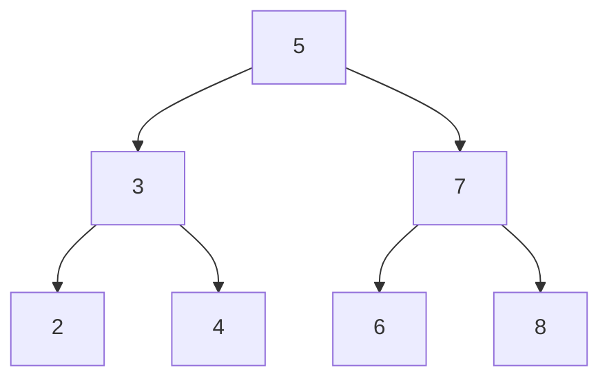
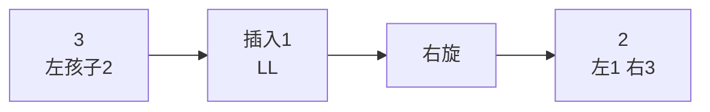
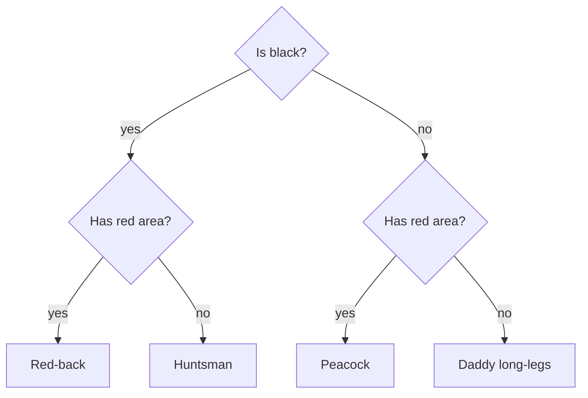
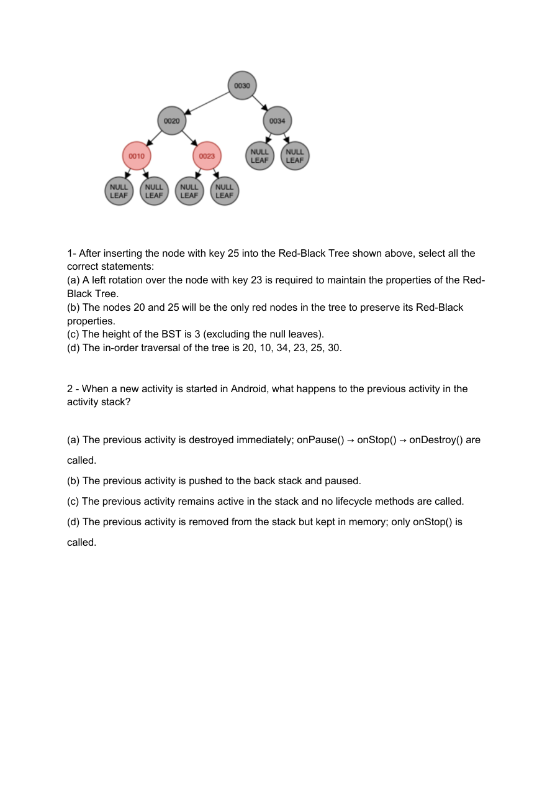
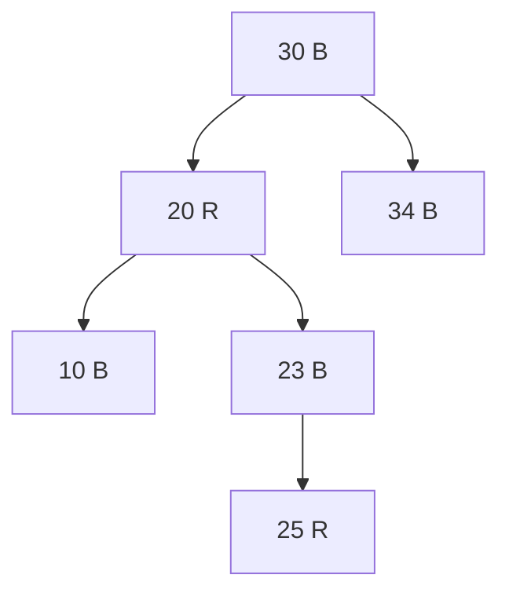
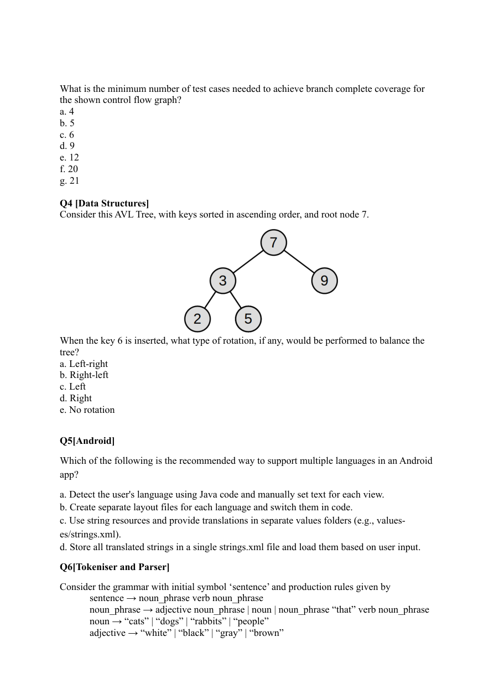
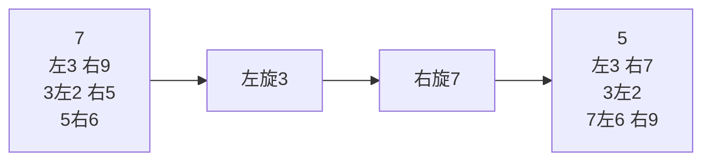
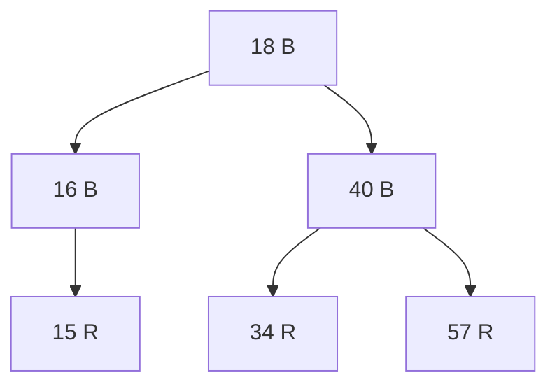
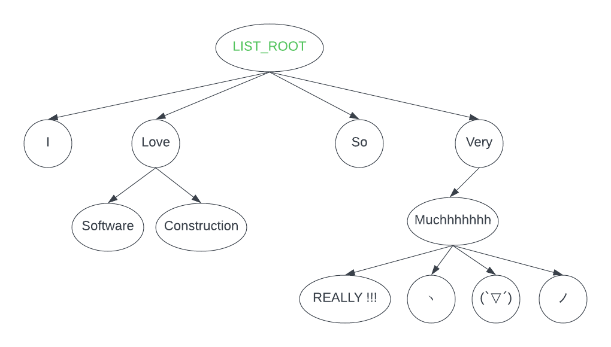
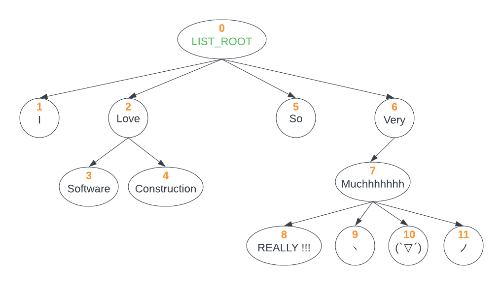

# 第9章 考点C：树与数据结构（BST／AVL／RB／通用树）

> 目标：能手走插入与遍历，能判断 AVL 旋转，理解红黑树修复，并用递归或栈实现树算法。

## 第一部分：知识点的零基础学习

### 知识点 1：先分清节点、深度、高度与遍历



- 根：5；叶子：2、4、6、8。
- 深度 depth：从根向下走了几条边，根深度为 0。
- 高度 height：必须看题目约定。本课程部分题按“非空节点层数”计算，上图高度为 3；若按边数则为 2。
- 前序 pre-order：根左右 → `5,3,2,4,7,6,8`。
- 中序 in-order：左根右 → `2,3,4,5,6,7,8`。
- 后序 post-order：左右根 → `2,4,3,6,8,7,5`。
- 层序 level-order：逐层 → `5,3,7,2,4,6,8`。

递归遍历模板：

```java
void preOrder(Node node, List<Integer> out) {
    if (node == null) return;
    out.add(node.value);
    preOrder(node.left, out);
    preOrder(node.right, out);
}
```

层序通常用队列；迭代前序通常用栈，并先压右孩子再压左孩子。

### 知识点 2：BST 的顺序只由题目规则决定

普通 BST 常见规则是“左小右大”，插入时沿比较结果向下，中序得到升序。若题目像 FamilyTree 一样规定“左大右小或相等”，必须按题目，不可套默认。

```text
插入 5, 9, 2, 4：
5
├─ 9        （9 > 5，按反向规则去左）
└─ 2        （2 < 5，去右）
   └─ 4     （4 > 2，去左）
```

普通 BST 没有自平衡保证，最坏退化成链表，搜索为 `O(n)`；平衡时搜索为 `O(log n)`。

### 知识点 3：AVL 用旋转恢复平衡

平衡因子常写为 `左高 - 右高`，AVL 要求每个节点通常只能是 -1、0、1。插入后从插入点向上找第一个失衡祖先，看“失衡节点与插入路径”：

| 情形 | 路径形状 | 修复 |
|---|---|---|
| LL | 左孩子的左侧 | 右旋 |
| RR | 右孩子的右侧 | 左旋 |
| LR | 左孩子的右侧 | 先左旋左孩子，再右旋当前节点 |
| RL | 右孩子的左侧 | 先右旋右孩子，再左旋当前节点 |



旋转要保持 BST 中序顺序不变，同时改变局部高度。不要只背“哪边重就向另一边转”，LR／RL 需要两次。

### 知识点 4：红黑树用颜色与旋转维持约 O(log n)

常见性质：

1. 节点红或黑；根为黑；外部 NIL 叶子为黑。
2. 红节点的两个孩子都不能是红色，即没有连续红边。
3. 从任一节点到其各 NIL 后代的路径，黑节点数相同。
4. 新插入普通节点先染红，再修复。

```text
父红、叔红：父与叔变黑，祖父变红，继续向上。
父红、叔黑：同侧直接旋转；异侧先旋成同侧，再换色并旋转。
最后：根永远重新染黑。
```

红黑树不要求像 AVL 那样严格左右高差 ≤1，但同样通过对数级高度保证操作复杂度。

### 知识点 5：通用树与决策树

通用树节点可以有任意多个孩子，递归通常写成“先处理当前，再遍历 children”。

决策树则是“内部节点问问题，叶节点给答案”：



构建最优分类器时，每个候选属性把样本分成 yes／no 两组，递归构建两边，并选择让最大决策次数最小的属性。两边不能有一边为空，否则这个属性没有区分能力。

## 真题讲解 1：反向排序的 FamilyTree（2025 S1 Q2）

来源：[`Q2README.md`](../exam-practice-questions/past-exams/2025-1/src/Q2/Q2README.md)、[`FamilyTree.java`](../exam-practice-questions/past-exams/2025-1/src/Q2/FamilyTree.java)、[`EmptyTree.java`](../exam-practice-questions/past-exams/2025-1/src/Q2/EmptyTree.java)、[`Q2Test.java`](../exam-practice-questions/past-exams/2025-1/src/Q2/Q2Test.java)

### 1.1 题目原文

**中文题意：** 实现反向排序的 FamilyTree：较大 ID 去左子树，较小或相等 ID 去右子树；完成构造、查找、顺序校验、插入、层级标签和带 4 倍深度前缀的树形显示。

> Implement a family tree data structure that maintains hierarchical relationships based on unique IDs, supports insertion, searching, validation, and structured display, and correctly labels hierarchy levels.
>
> **Ordering:** During insertion, if the new person’s ID is greater than the current node’s ID, insert it into the left subtree. Otherwise, if it is smaller or equal, insert it into the right subtree.
>
> **Levels and Labels:** A leaf is at level 1 and labelled Kid; a non-leaf is at 1 plus the level of its deepest descendant. Level 2 is Parent, level 3 Grandparent, then Great-Grandparent, and so on.
>
> **Task A:** Implement `FamilyTree(Person value)` and `FamilyTree(Person value, Tree left, Tree right)`.
>
> **Task B:** Complete `find`, `isOrdered`, and mutable `insert`.
>
> **Task C:** Complete `getLevelAndLabel()` in FamilyTree and EmptyTree, plus `show()` and `show(int depth)`. Root depth is 0; for depth ≥1, the prefix contains exactly 4 × depth spaces and dashes. EmptyTree.show may return null or an empty string.

### 1.2 构造器、查找与插入

```java
public FamilyTree(Person value) {
    this.root = value;
    this.left = new EmptyTree();
    this.right = new EmptyTree();
}

public FamilyTree(Person value, Tree left, Tree right) {
    this.root = value;
    this.left = left;
    this.right = right;
}

public Tree find(int id) {
    if (id == getId()) {
        return this;
    }
    return id > getId() ? left.find(id) : right.find(id);
}

public void insert(int newId) {
    if (newId > getId()) {
        if (left instanceof EmptyTree) {
            left = new FamilyTree(new Person(newId));
        } else {
            left.insert(newId);
        }
    } else {
        if (right instanceof EmptyTree) {
            right = new FamilyTree(new Person(newId));
        } else {
            right.insert(newId);
        }
    }
}
```

### 1.3 isOrdered：用上下界检查整棵树

当前子树的 id 必须满足 `lower < id <= upper`。左树保存更大 id，所以更新 lower；右树保存更小或相等 id，所以更新 upper。

```java
public boolean isOrdered() {
    return isOrdered(this, null, null);
}

private static boolean isOrdered(Tree tree, Integer lower, Integer upper) {
    if (tree instanceof EmptyTree) {
        return true;
    }
    int id = tree.getId();
    if ((lower != null && id <= lower) || (upper != null && id > upper)) {
        return false;
    }
    return isOrdered(tree.left, id, upper)
            && isOrdered(tree.right, lower, id);
}
```

### 1.4 层级标签与显示

```java
public int getLevelAndLabel() {
    int level = 1 + Math.max(left.getLevelAndLabel(), right.getLevelAndLabel());
    String label;
    if (level == 1) {
        label = "Kid";
    } else if (level == 2) {
        label = "Parent";
    } else if (level == 3) {
        label = "Grandparent";
    } else {
        label = "Great-".repeat(level - 3) + "Grandparent";
    }
    root.setLabel(label);
    return level;
}

@Override
public String show() {
    return show(0);
}

@Override
public String show(int depth) {
    String prefix = depth == 0 ? "" : "  " + "-".repeat(4 * depth - 2);
    return prefix + root.toString() + "\n"
            + left.show(depth + 1)
            + right.show(depth + 1);
}
```

`EmptyTree.show()` 与 `show(int depth)` 返回 `""`，`getLevelAndLabel()` 返回 0，`find` 返回 `null`，`isOrdered` 返回 `true`。

**自测**：插入 5、9、2、4、1 后，根 5 的左子树为 9，右子树为 2；2 的左、右分别为 4、1。标签从叶子向上计算，不是从根向下编号。

### 英文讲解对照（English Explanation）

Insertion follows the question's custom rule: a larger id goes left, while a smaller or equal id goes right. `find` follows the same comparison tree. `isOrdered` uses lower and upper bounds over the entire subtree rather than checking only immediate children. `getLevelAndLabel` computes level as one plus the maximum descendant level, so leaves are Kid and labels are assigned bottom-up. Display uses exactly `4 × depth` prefix characters for non-root nodes. EmptyTree returns level zero, empty display, and no found node.

## 真题讲解 2：红黑树插入 25（2025 S2 Q1）

来源：[`MCQQuestions.pdf`](../exam-practice-questions/past-exams/2025-2/src/Q1/MCQQuestions.pdf)，第 1 页。

### 2.1 题目原文

**中文题意：** 向上图红黑树插入键 25，判断哪些陈述正确：是否旋转、最终红节点、非空节点高度，以及中序遍历顺序。



> After inserting the node with key 25 into the Red-Black Tree shown above, select all the correct statements:
>
> (a) A left rotation over the node with key 23 is required to maintain the properties of the Red-Black Tree.
>
> (b) The nodes 20 and 25 will be the only red nodes in the tree to preserve its Red-Black properties.
>
> (c) The height of the BST is 3 (excluding the null leaves).
>
> (d) The in-order traversal of the tree is 20, 10, 34, 23, 25, 30.

### 2.2 参考答案与解析

**答案：b、c。**

插入 25 为 23 的右红孩子，父 23 红、叔 10 红，执行“父叔变黑、祖父 20 变红”。祖父的父 30 已为黑，不需要旋转。



- **a 错**：变色已恢复性质，无需对 23 左旋。
- **b 对**：最终只有 20、25 为红。
- **c 对**：非空层数是 30 → 20／34 → 10／23／25，共 3 层。
- **d 错**：中序应升序为 `10,20,23,25,30,34`。

### 英文讲解对照（English Explanation）

Inserting 25 under red node 23 triggers a red-parent/red-uncle recolouring: 23 and 10 become black, and 20 becomes red. No rotation is needed because 20's parent 30 is already black. The final red nodes are 20 and 25, the non-null height is three levels, and the in-order traversal remains the sorted key order `10,20,23,25,30,34`.

## 真题讲解 3：AVL 插入 6 的旋转（2025 S1 Q4）

来源：[`MC_Questions_2025_S1.pdf`](../exam-practice-questions/past-exams/2025-1/src/Q4/MC_Questions_2025_S1.pdf)，第 2 页。

### 3.1 题目原文

**中文题意：** 在给定 AVL 树（根 7，左 3、右 9，3 的子节点为 2、5）中插入键 6，判断需要哪种旋转：LR、RL、左旋、右旋，还是无需旋转。



> Consider this AVL Tree, with keys sorted in ascending order, and root node 7.
>
> When the key 6 is inserted, what type of rotation, if any, would be performed to balance the tree?
>
> a. Left-right
> b. Right-left
> c. Left
> d. Right
> e. No rotation

原树为：根 7，左孩子 3、右孩子 9；3 的孩子为 2、5。

### 3.2 参考答案与解析

**答案：a（Left-right）。** 插入路径为 `7 → 3 → 5 → 6`，根 7 左侧过高，且插入位于左孩子 3 的右侧，属于 LR：先左旋 3，再右旋 7。



### 英文讲解对照（English Explanation）

Inserting 6 follows the path `7 → 3 → 5`, then to the right of 5. The first unbalanced node is 7, and the insertion lies on the right side of its left child, which is the LR case. Rotate left at 3 and then right at 7, making 5 the new subtree root with 3 and 7 as children.

## 真题讲解 4：BST 的迭代式前序遍历（2024 S2 Q1）

来源：[`Q1README.md`](../exam-practice-questions/past-exams/2024-2/src/Q1/Q1README.md)、[`BST.java`](../exam-practice-questions/past-exams/2024-2/src/Q1/BST.java)、[`Q1Test.java`](../exam-practice-questions/past-exams/2024-2/src/Q1/Q1Test.java)

### 4.1 题目原文

**中文题意：** 为 BST 实现迭代器：构造时初始化栈，`hasNext` 检查栈，`next` 按“根—左—右”前序弹出节点并压入子节点。

> Complete the implementation of an iterator for a Binary Search Tree. The iterator should traverse the tree in pre-order (root, left, right) and allow users to iterate using the provided Iterator interface.
>
> - Constructor: initialise the stack and push the root if it is not null.
> - `hasNext()`: check whether there are more nodes by examining the stack.
> - `next()`: return the next element in pre-order, then push new elements if appropriate.
>
> When visiting 5, push its right child 7 and then left child 3, so the next pop visits 3. The iterator does not actively track modifications.

### 4.2 完整参考实现

```java
public BSTIterator(BST<T> root) {
    if (root != null && root.value != null) {
        stack.push(root);
    }
}

@Override
public boolean hasNext() {
    return !stack.isEmpty();
}

@Override
public T next() {
    if (stack.isEmpty()) {
        throw new java.util.NoSuchElementException();
    }

    BST<T> current = stack.pop();
    if (current.right != null) {
        stack.push(current.right);
    }
    if (current.left != null) {
        stack.push(current.left);
    }
    return current.value;
}
```

对 `5,7,3,8,6,2,4` 的插入结果，输出为 `5,3,2,4,7,6,8`。先压右再压左是保证左子树先弹出的关键。

### 英文讲解对照（English Explanation）

The constructor pushes the root if it exists. `hasNext` checks whether the stack is empty. `next` pops the current node, pushes its right child and then its left child so the left child is popped first, and returns the current value. This produces root-left-right pre-order without recursion and without modifying the tree.

## 真题讲解 5：用 12 个节点覆盖 AVL 四种旋转（2024 S1 Q2，跨考点完整收录）

来源：[`Q2README.md`](../exam-practice-questions/past-exams/2024-1/src/Q2/Q2README.md)、[`AVLTreeTest.java`](../exam-practice-questions/past-exams/2024-1/src/Q2/AVLTreeTest.java)

### 5.1 题目原文

**中文题意：** 设计参数化黑盒测试验证 AVL 实现：覆盖四种旋转并尽量少用总节点，正确实现应全过，错误实现至少一败。

> You must use parameterized tests to verify AVL tree correctness through black-box testing. Compare pre-order traversal with expected outcomes.
>
> Implement `data()` to provide sequential tree identifiers and expected pre-order lists, and `createTree()` to construct the selected tree using `createTreeNode()`.
>
> - Minimize the overall number of nodes across all trees.
> - All tests pass on a correct AVL implementation.
> - At least one test fails on an incorrect implementation.
> - Do not test null, duplicates, or incorrect inputs.
> - Do not call `SampleAVLTree` directly.

### 5.2 四种旋转的测试树

| ID | 插入顺序 | 情形 | 预期前序 |
|---|---|---|---|
| 0 | 3,2,1 | LL | `[2,1,3]` |
| 1 | 1,2,3 | RR | `[2,1,3]` |
| 2 | 3,1,2 | LR | `[2,1,3]` |
| 3 | 1,3,2 | RL | `[2,1,3]` |

### 5.3 完整答案代码

```java
@Parameterized.Parameters
public static Collection<Object[]> data() {
    return java.util.Arrays.asList(new Object[][]{
        {0, List.of(2, 1, 3)},
        {1, List.of(2, 1, 3)},
        {2, List.of(2, 1, 3)},
        {3, List.of(2, 1, 3)}
    });
}

private AVLTree createTree(int treeIdentifier) {
    int[][] insertions = {
        {3, 2, 1},
        {1, 2, 3},
        {3, 1, 2},
        {1, 3, 2}
    };
    AVLTree tree = createTreeNode(insertions[treeIdentifier][0]);
    for (int i = 1; i < insertions[treeIdentifier].length; i++) {
        tree = tree.insert(insertions[treeIdentifier][i]);
    }
    return tree;
}
```

不可变插入必须接收返回的新根：`tree = tree.insert(...)`。

### 英文讲解对照（English Explanation）

The four three-node sequences cover LL, RR, LR, and RL, and all should produce pre-order `[2,1,3]`. Using twelve nodes total is minimal for covering all four rotation cases. The immutable insertion method returns a possibly new root, so callers must assign the result back. These tests pass on a correct AVL tree and fail the supplied unbalanced sample.

## 真题讲解 6：普通 BST 的高度（2024 S1 Q4 MCQ5）

来源：[`Q4README.md`](../exam-practice-questions/past-exams/2024-1/src/Q4/Q4README.md)

### 6.1 题目原文

**中文题意：** 按给定顺序把十个节点插入普通 BST，计算树高度，并从 4、5、6、7 中选择正确值。

> You built a plain binary search tree and added the following nodes in this order: 80, 97, 49, 2, 20, 52, 25, 9, 27, 76. Which is the CORRECT tree height?
>
> A. 4
> B. 5
> C. 6
> D. 7

### 6.2 参考答案与解析

**答案：D（7）。** 按非空节点层数计算，最长路径是：

```text
80 → 49 → 2 → 20 → 52 → 25 → 27
```

共 7 个节点。若题目改用边数定义，则对应值是 6；必须先看题目如何定义 height。本章其他按层数的题采用同一口径。

### 英文讲解对照（English Explanation）

The longest path is `80 → 49 → 2 → 20 → 52 → 25 → 27`, containing seven nodes. Under the question's convention that height counts non-null node levels, the answer is 7. If height were defined as edges, the corresponding value would be 6, so the definition must be checked.

## 真题讲解 7：红黑树的后序与颜色（2024 S1 Q4 MCQ6）

来源：[`Q4README.md`](../exam-practice-questions/past-exams/2024-1/src/Q4/Q4README.md)

### 7.1 题目原文

**中文题意：** 按顺序插入 16、34、18、40、57、15 构造红黑树，写出后序遍历的节点及颜色序列。

> You built a red-black tree and added the following nodes in this order: 16, 34, 18, 40, 57, 15. If you walk in this tree using the post-order approach, what will be the CORRECT node and color output?
>
> A. 15 RED, 16 BLACK, 18 BLACK, 34 RED, 40 BLACK, 57 RED
>
> B. 15 RED, 16 BLACK, 34 RED, 57 RED, 40 BLACK, 18 BLACK
>
> C. 15 RED, 57 RED, 34 RED, 16 BLACK, 40 BLACK, 18 BLACK
>
> D. 34 RED, 16 BLACK, 15 RED, 57 RED, 40 BLACK, 18 BLACK

### 7.2 参考答案与解析

**答案：B。** 完成插入与修复后的结构为：



后序是左、右、根：左子树给 `15 R,16 B`；右子树给 `34 R,57 R,40 B`；最后根 `18 B`。合起来正是 B。

### 英文讲解对照（English Explanation）

After all insertions and fixes, the tree has black root 18, black children 16 and 40, red children 15 under 16 and 34/57 under 40. Post-order visits left, right, then root: `15 RED, 16 BLACK, 34 RED, 57 RED, 40 BLACK, 18 BLACK`, which is option B.

## 真题讲解 8：蜘蛛决策树与最优 ClassifierFactory（2023 S2 Q2）

来源：[`readme_Q2.md`](../exam-practice-questions/past-exams/2023-2/src/Q2/readme_Q2.md)、[`Node.java`](../exam-practice-questions/past-exams/2023-2/src/Q2/Node.java)、[`DecisionNode.java`](../exam-practice-questions/past-exams/2023-2/src/Q2/DecisionNode.java)、[`TerminalNode.java`](../exam-practice-questions/past-exams/2023-2/src/Q2/TerminalNode.java)、[`ClassifierFactory.java`](../exam-practice-questions/past-exams/2023-2/src/Q2/ClassifierFactory.java)

### 8.1 题目原文

**中文题意：** 实现蜘蛛二分类决策树：按属性递归分类并返回物种；按规定格式输出整棵树；再由样本集合构建决策次数最少的最优分类器。

> This problem considers binary decision trees operating on Spiders. Each decision step has exactly two branches, based on whether a spider has a particular property or not. These branches may lead to another decision, or to a terminal node reporting the species name.
>
> **Part a) Classify Spiders:** Implement `classify` in Node and its subclasses, following the decision tree until a terminal node is reached.
>
> **Part b) Stringify the Decision Node:** Implement `DecisionNode.toString` using:
>
> ```text
> Is black?
> | Yes: Has coloured area?
> | | Yes: Red-back
> | | No: Huntsman
> | No: Has coloured area?
> | | Yes: Peacock
> | | No: Daddy long-legs
> ```
>
> Every aspect of the output must match, including indenting and punctuation.
>
> **Part c) Classifier Factory:** Implement `ClassifierFactory.createClassifier` to distinguish a non-empty set of spiders with different speciesNames. The resulting tree must be correct and minimise maximumDecisions.

### 8.2 classify：内部节点分支，叶节点返回结果

`DecisionNode`：

```java
@Override
public String classify(Spider spider) {
    return spider.testProperty(testsFor)
            ? yesOutcome.classify(spider)
            : noOutcome.classify(spider);
}
```

`TerminalNode`：

```java
@Override
public String classify(Spider spider) {
    return outcome;
}
```

### 8.3 toString：每条分支增加一段 `| `

```java
@Override
public String toString() {
    return format("", "| ").stripTrailing();
}

private String format(String ownPrefix, String childPrefix) {
    StringBuilder out = new StringBuilder();
    out.append(ownPrefix).append(Spider.propertyToString(testsFor)).append("?\n");
    appendChild(out, yesOutcome, childPrefix, "Yes");
    appendChild(out, noOutcome, childPrefix, "No");
    return out.toString();
}

private void appendChild(StringBuilder out, Node child,
                         String prefix, String label) {
    if (child instanceof DecisionNode decision) {
        out.append(decision.format(prefix + label + ": ", prefix + "| "));
    } else {
        TerminalNode terminal = (TerminalNode) child;
        out.append(prefix).append(label).append(": ")
                .append(terminal.outcome).append("\n");
    }
}
```

根调用使用空前缀和 `| `；每次进入下一层，childPrefix 再增加 `| `，于是自然得到 `| | `、`| | | `。

### 8.4 createClassifier：穷举属性并选择最小最大高度

```java
public static Node createClassifier(Set<Spider> possibilities) {
    if (possibilities.size() == 1) {
        Spider only = possibilities.iterator().next();
        return new TerminalNode(only.speciesName);
    }

    Node best = null;
    int bestHeight = Integer.MAX_VALUE;

    for (Spider.Property property : Spider.Property.values()) {
        Set<Spider> yes = new HashSet<>();
        Set<Spider> no = new HashSet<>();
        for (Spider spider : possibilities) {
            if (spider.testProperty(property)) {
                yes.add(spider);
            } else {
                no.add(spider);
            }
        }
        if (yes.isEmpty() || no.isEmpty()) {
            continue;
        }

        Node yesTree = createClassifier(yes);
        Node noTree = createClassifier(no);
        int height = 1 + Math.max(yesTree.maximumDecisions(), noTree.maximumDecisions());
        if (height < bestHeight) {
            bestHeight = height;
            best = new DecisionNode(property, yesTree, noTree);
        }
    }

    if (best == null) {
        throw new IllegalArgumentException("Spiders cannot be distinguished");
    }
    return best;
}
```

**为什么这是最优而非贪心猜测**：函数对每个属性都递归求出左右子树的最优结果，再比较所有候选根属性；`bestHeight` 保存当前最小值，只有严格更小才替换，平局保持枚举顺序。

### 英文讲解对照（English Explanation）

`classify` follows the yes/no branch according to the tested property and returns the terminal outcome. `toString` recursively prefixes each branch with `| ` and labels the first line of each child with Yes or No; the root has no prefix. `createClassifier` partitions the sample set by every candidate property, recursively builds both sides, and chooses the property minimizing `1 + max(yesHeight, noHeight)`. A split with an empty side is useless. A single remaining spider becomes a terminal node.

## 真题讲解 9：把层级 XML 转成 Location 树（2025 S2 Q4，跨考点完整收录）

来源：[`Q4README.md`](../exam-practice-questions/past-exams/2025-2/src/Q4/Q4README.md)、[`LocationLoader.java`](../exam-practice-questions/past-exams/2025-2/src/Q4/LocationLoader.java)、[`Location.java`](../exam-practice-questions/past-exams/2025-2/src/Q4/Location.java)

### 9.1 题目原文

**中文题意：** 读取位置 XML：Task A 把根的直接子元素映射为名称和可选人口；Task B 按元素标签与嵌套关系递归构造 Location 树，并处理缺失名称、可选人口及错误输入。

> **Task A:** Each direct child of `<Locations>` has a required name attribute and an optional inner `<Population>`. Complete `loadPopulationInfo` to return names mapped to populations; missing or blank Population maps to null; errors return null.
>
> **Task B:** Read hierarchical XML. Element tag names indicate location types, and name attributes specify names. Complete `loadLocations` to return direct children of `<Locations>` with all nested Location children. Skip elements missing name; optional blank population becomes null; ignore additional tags and attributes; errors return null.
>
> ```xml
> <Locations>
>     <Country name="Australia" capital="Canberra" population="26000000">
>         <State name="Tasmania">
>             <Region name="South"><City name="Hobart"/></Region>
>             <Region name="North"><City name="Launceston"/></Region>
>         </State>
>         <State name="New South Wales"></State>
>     </Country>
> </Locations>
> ```

### 9.2 完整参考实现

```java
public static Map<String, Integer> loadPopulationInfo(File f) {
    Map<String, Integer> result = new LinkedHashMap<>();
    try {
        Document document = DocumentBuilderFactory.newInstance()
                .newDocumentBuilder().parse(f);
        Element root = document.getDocumentElement();
        if (!root.getTagName().equals("Locations")) {
            return null;
        }
        NodeList nodes = root.getChildNodes();
        for (int i = 0; i < nodes.getLength(); i++) {
            Node node = nodes.item(i);
            if (node.getNodeType() != Node.ELEMENT_NODE) {
                continue;
            }
            Element location = (Element) node;
            if (!location.hasAttribute("name")) {
                return null;
            }

            Integer population = null;
            int count = 0;
            NodeList children = location.getChildNodes();
            for (int j = 0; j < children.getLength(); j++) {
                Node childNode = children.item(j);
                if (childNode.getNodeType() != Node.ELEMENT_NODE) {
                    continue;
                }
                Element child = (Element) childNode;
                if (!child.getTagName().equals("Population") || count > 0) {
                    return null;
                }
                count++;
                population = parseOptionalInteger(child.getTextContent());
            }
            result.put(location.getAttribute("name"), population);
        }
        return result;
    } catch (Exception e) {
        return null;
    }
}

public static Set<Location> loadLocations(File f) {
    try {
        Document document = DocumentBuilderFactory.newInstance()
                .newDocumentBuilder().parse(f);
        Element root = document.getDocumentElement();
        if (!root.getTagName().equals("Locations")) {
            return null;
        }
        Set<Location> result = new LinkedHashSet<>();
        NodeList nodes = root.getChildNodes();
        for (int i = 0; i < nodes.getLength(); i++) {
            Node node = nodes.item(i);
            if (node.getNodeType() == Node.ELEMENT_NODE) {
                Location location = readLocation((Element) node);
                if (location != null) {
                    result.add(location);
                }
            }
        }
        return result;
    } catch (Exception e) {
        return null;
    }
}

private static Location readLocation(Element element) {
    if (!element.hasAttribute("name")) {
        return null;
    }
    Location result = new Location(element.getTagName(), element.getAttribute("name"));
    result.population = parseOptionalInteger(element.getAttribute("population"));
    NodeList nodes = element.getChildNodes();
    for (int i = 0; i < nodes.getLength(); i++) {
        Node node = nodes.item(i);
        if (node.getNodeType() == Node.ELEMENT_NODE) {
            Location child = readLocation((Element) node);
            if (child != null) {
                result.addChild(child);
            }
        }
    }
    return result;
}

private static Integer parseOptionalInteger(String text) {
    return text == null || text.trim().isEmpty()
            ? null : Integer.valueOf(text.trim());
}
```

**树的构建要点**：递归先创建当前 Location，再把每个直接元素子节点递归创建并 `addChild`。只搜索后代而不维护当前父节点，会把层级压平。

### 英文讲解对照（English Explanation）

The root must be `Locations`. Each element becomes a `Location` using its tag as type and name attribute as name; a missing name skips that subtree. Population is parsed from the optional attribute and blank values become null. Recursion creates and attaches child Location objects, preserving XML hierarchy and order. Errors return null.

## 真题讲解 10：Markdown 列表树与前序遍历（2023 S1 Q2，跨考点完整收录）

来源：[`Q2README.md`](../exam-practice-questions/past-exams/2023-1/Q2/Q2README.md)、[`MDTokenizer.java`](../exam-practice-questions/past-exams/2023-1/Q2/MDTokenizer.java)、[`MDParser.java`](../exam-practice-questions/past-exams/2023-1/Q2/MDParser.java)、[`ListElementsTree.java`](../exam-practice-questions/past-exams/2023-1/Q2/ListElementsTree.java)

### 10.1 题目原文

**中文题意：** 读取 Markdown 文件，把有序／无序嵌套列表分词并按父子关系建树，再实现排除 `LIST_ROOT`、从左到右访问子节点的前序遍历。

> Read list elements in Markdown files. Unordered items start with `- `; ordered items start with an integer and `. `. Level 1 has no indentation; each deeper level adds exactly 4 spaces. Blank lines and mixed nested lists may occur.
>
> Complete file reading, MDTokenizer, MDParser and `ListElementsTree.preOrderWalk()`. The parser must retain parent-children relationships and insertion order beneath a LIST_ROOT. Pre-order visits the current node then children from left to right, excluding LIST_ROOT.





### 10.2 完整参考实现

`MDFileReader.read()`：

```java
public static String read(String filePath) {
    try {
        return java.nio.file.Files.readString(java.nio.file.Path.of(filePath));
    } catch (java.io.IOException | RuntimeException e) {
        return null;
    }
}
```

`MDTokenizer.next()`：

```java
public MDToken next() {
    while (!buffer.isEmpty()) {
        int newline = buffer.indexOf('\n');
        String line;
        if (newline >= 0) {
            line = buffer.substring(0, newline);
            buffer = buffer.substring(newline + 1);
        } else {
            line = buffer;
            buffer = "";
        }
        if (line.endsWith("\r")) {
            line = line.substring(0, line.length() - 1);
        }
        if (line.trim().isEmpty()) {
            continue;
        }
        int spaces = 0;
        while (spaces < line.length() && line.charAt(spaces) == ' ') {
            spaces++;
        }
        if (spaces % 4 != 0) {
            current = null;
            return null;
        }
        int level = spaces / 4 + 1;
        String item = line.substring(spaces);
        if (item.startsWith("- ")) {
            current = new MDToken(MDTokenType.UNORDERED_ITEM, item.substring(2), level);
            return current;
        }
        int dot = item.indexOf(". ");
        if (dot > 0 && item.substring(0, dot).matches("\\d+")) {
            current = new MDToken(MDTokenType.ORDERED_ITEM,
                    item.substring(dot + 2), Integer.parseInt(item.substring(0, dot)), level);
            return current;
        }
        current = null;
        return null;
    }
    current = null;
    return null;
}
```

`MDParser.parse()`：

```java
public ListElementsTree parse() {
    ListElementsTree tree = new ListElementsTree();
    java.util.List<ListElementsTree.Node> parents = new java.util.ArrayList<>();
    parents.add(tree.root);
    while (tokenizer.hasNext()) {
        MDToken token = tokenizer.next();
        if (token == null) {
            if (!tokenizer.hasNext()) break;
            return null;
        }
        int level = token.getLevel();
        if (level < 1 || level > parents.size()) {
            return null;
        }
        while (parents.size() > level) {
            parents.remove(parents.size() - 1);
        }
        ListElementsTree.Node parent = parents.get(level - 1);
        parents.add(parent.insert(token.getContent()));
    }
    return tree;
}
```

`ListElementsTree.preOrderWalk()` 与 `Node.preOrder`：

```java
public List<String> preOrderWalk() {
    List<String> result = new ArrayList<>();
    for (Node child : root.getChildren()) {
        child.preOrder(result);
    }
    return result;
}
```

```java
void preOrder(List<String> result) {
    result.add(value);
    for (Node child : children) {
        child.preOrder(result);
    }
}
```

**树形检查**：`parents` 栈保存当前路径；level 变深时保留父节点，同级时替换栈顶，变浅时弹出深层节点。前序则按 children 原顺序递归。

### 英文讲解对照（English Explanation）

Tokenization uses four-space indentation levels and preserves order, item number, and content. Parsing maintains the current parent stack, attaching each token at the correct depth and popping when the level decreases. `preOrderWalk` visits each child before its descendants while excluding LIST_ROOT.

## 真题讲解 11：红黑树的右到左层序与持久化（2020 S2 Q3，跨考点完整收录）

来源：[`README.md`](../exam-practice-questions/past-exams/2020-2/Q3/README.md)、[`RBTree.java`](../exam-practice-questions/past-exams/2020-2/Q3/RBTree.java)、[`Application.java`](../exam-practice-questions/past-exams/2020-2/Q3/Application.java)

### 11.1 题目原文

**中文题意：** 实现红黑树从右到左的层序遍历；读取分号 CSV 生成 Person；按 id 建红黑树；再按层序输出指定结构的 `people.xml`。

> Implement `levelTraversal()` in RBTree, plus `readCsv()`, `createTree()`, and `saveXML()` in Application. Level traversal is from right to left. CSV fields are separated by `;`. createTree inserts each Person by integer id. saveXML writes `people.xml` with people in level traversal order.
>
> For the tree below, levelTraversal returns `[33, 88, 11, 43, 16, 10]`.
>
> ```text
>         33
>       /    \
>     11      88
>    / \     /
>  10  16  43
> ```

### 11.2 完整参考实现

`RBTree.levelTraversal()`：

```java
public List<Node> levelTraversal() {
    List<Node> ret = new LinkedList<>();
    if (root == null || root.key == null) {
        return ret;
    }
    Queue<Node> queue = new LinkedList<>();
    queue.add(root);
    while (!queue.isEmpty()) {
        Node current = queue.remove();
        ret.add(current);
        if (current.right != null && current.right.key != null) {
            queue.add(current.right);
        }
        if (current.left != null && current.left.key != null) {
            queue.add(current.left);
        }
    }
    return ret;
}
```

`Application` 的 CSV 与建树：

```java
public List<Person> readCsv(String fileName) {
    List<Person> list = new LinkedList<>();
    try (java.io.BufferedReader reader = new java.io.BufferedReader(
            new java.io.FileReader(fileName))) {
        if (reader.readLine() == null) {
            return list;
        }
        String line;
        while ((line = reader.readLine()) != null) {
            if (line.trim().isEmpty()) {
                continue;
            }
            String[] fields = line.split(";", -1);
            if (fields.length != 4) {
                return null;
            }
            list.add(new Person(Integer.valueOf(fields[0].trim()),
                    fields[1].trim(), Integer.valueOf(fields[2].trim()), fields[3].trim()));
        }
        return list;
    } catch (java.io.IOException | RuntimeException e) {
        return null;
    }
}

public RBTree<Integer, Person> createTree(List<Person> personList) {
    RBTree<Integer, Person> tree = new RBTree<>();
    if (personList != null) {
        for (Person person : personList) {
            tree.insert(person.getId(), person);
        }
    }
    return tree;
}
```

`Application.saveXML()` 与 `appendText`：

```java
public void saveXML(RBTree<Integer, Person> tree) {
    if (tree == null) {
        return;
    }
    try {
        List<Node> list = tree.levelTraversal();
        javax.xml.parsers.DocumentBuilder builder =
                javax.xml.parsers.DocumentBuilderFactory.newInstance().newDocumentBuilder();
        org.w3c.dom.Document document = builder.newDocument();
        org.w3c.dom.Element root = document.createElement("people");
        document.appendChild(root);
        for (Node node : list) {
            Person person = (Person) node.getData();
            org.w3c.dom.Element element = document.createElement("person");
            root.appendChild(element);
            appendText(document, element, "id", person.getId());
            appendText(document, element, "name", person.getName());
            appendText(document, element, "age", person.getAge());
            appendText(document, element, "occupation", person.getOccupation());
        }
        javax.xml.transform.Transformer transformer =
                javax.xml.transform.TransformerFactory.newInstance().newTransformer();
        transformer.setOutputProperty(javax.xml.transform.OutputKeys.ENCODING, "UTF-8");
        transformer.setOutputProperty(javax.xml.transform.OutputKeys.INDENT, "yes");
        transformer.transform(new javax.xml.transform.dom.DOMSource(document),
                new javax.xml.transform.stream.StreamResult(new java.io.File("people.xml")));
    } catch (Exception e) {
        return;
    }
}

private void appendText(org.w3c.dom.Document document,
                        org.w3c.dom.Element parent, String tag, Object value) {
    org.w3c.dom.Element child = document.createElement(tag);
    child.setTextContent(String.valueOf(value));
    parent.appendChild(child);
}
```

**遍历检查**：队列先入右孩子再入左孩子，因此每层顺序为右到左；这与“右根左”的 DFS 完全不同。

### 英文讲解对照（English Explanation）

Level traversal uses a queue, adding the right child before the left child for every node. CSV reading skips the header, splits on semicolons, converts id and age, and creates Person objects. Each person is inserted into the red-black tree by id. `saveXML` writes the tree's right-to-left level order as `<person>` elements containing id, name, age, and occupation under `<people>`.


