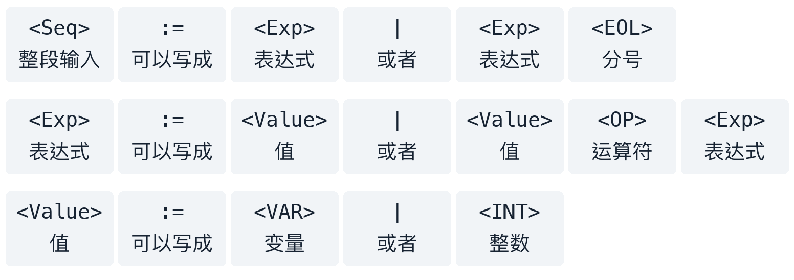
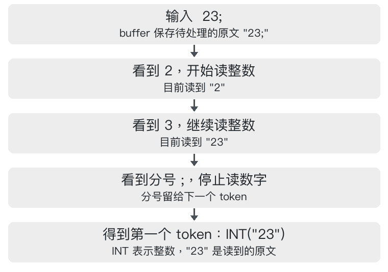
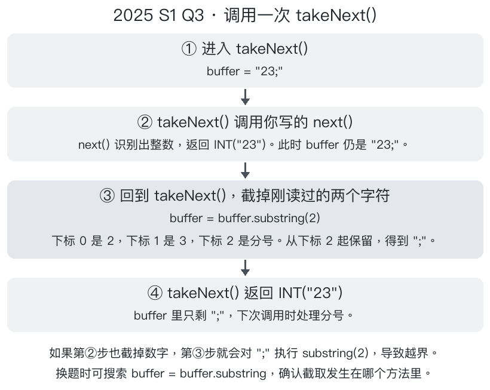

# 01｜Tokeniser 和 Parser：从字符到语法树

> 核心：**Tokeniser 把字符认成 token；Parser 按文法组合 token。**

## 一分钟例子

`x + 23;` 经过 Tokeniser 变成 `VAR(x), OP(+), INT(23), EOL(;)`；Parser 再判断“值 + 值；”是否符合文法。`x + ;` 能分词，但 `+` 后缺少值，所以解析失败。

## 1. 文法怎么读

先别看符号。题目其实只在规定下面三件事：

1. **什么算一个值？** 一个变量（如 `x`），或一个整数（如 `23`）。
2. **什么算一个表达式？** 可以只有一个值（如 `x`）；也可以是“值 + 运算符 + 另一个表达式”（如 `x + 23`）。
3. **整段输入可以长什么样？** 一个表达式；也可以是表达式后面再加一个分号（如 `x + 23;`）。

所以，看到 `x + 23;` 时，从左到右对照就够了：

| 输入中的部分 | 它扮演什么角色 |
|---|---|
| `x` | 第一个值：变量 |
| `+` | 运算符 |
| `23` | 第二个值：整数；它自己也算一个表达式 |
| `;` | 整段输入末尾允许的分号 |

原来的文法写法：

```text
<Seq>   := <Exp> | <Exp> <EOL>
<Exp>   := <Value> | <Value> <OP> <Exp>
<Value> := <VAR> | <INT>
```

每一格上方是文法符号，下方是对应的中文。



这里的 `|` 只表示“或者”，**输入时不用打竖线**。

例如第二行只是在说：**表达式可以是“一个值”，或者“一个值 + 运算符 + 另一个表达式”。** 后面又出现 `<Exp>`，是为了允许继续接下去，例如 `x + y + 23`；读第一遍时先只看 `x + 23` 即可。

`x + ;` 不合法，因为运算符后面没有值。`x 23` 也不合法，因为两个值之间缺运算符。读文法的目的，就是检查输入中的每一部分能否放进上面的规则，且没有多余部分。

## 2. Tokeniser 怎么写

假设用户输入了 `23;`。Java 最初读到三个字符：`2`、`3` 和 `;`。  
读这段输入时，我们会把前两个字符连起来，当成整数 `23`，再把分号 `;` 单独当成一项。  
分词器（Tokeniser）就负责做这件事。分出来的每一项叫一个 **token**。

分词器要逐项读取输入，所以它用一个字符串保存**还没取走的文字**。这个字符串叫 `buffer`，一开始装着完整的 `"23;"`。

在 2025 S1 Q3 里，语法分析器（Parser）需要逐个取出 token，检查它们的顺序是否符合文法。下面跟着它取一次，看看分词器里的两个方法怎样配合。

1. **Parser 要取第一项，于是调用 `takeNext()`。** 这个方法由题目提供，名字可以读成“取出下一项”。括号 `()` 是空的，因为输入已经存在分词器的 `buffer` 里，调用时不用再传入文字。
2. **`takeNext()` 先调用你要补写的 `next()`，认出第一项。** `next()` 从左往右看：`2` 和 `3` 都是数字，可以连成一个整数。看到分号，整数就结束了。它把一个 token 返回给 `takeNext()`，其中记录着类型 `INT`（整数）和原文 `"23"`。这时 `buffer` 仍是 `"23;"`。
3. **`takeNext()` 取走这一项。** 它根据原文 `"23"` 的长度，从 `buffer` 开头移走两个字符，再把整数 token 返回给 Parser。现在 `buffer` 里只剩 `";"`，下次调用就能取到分号。



**先看 `next()` 的伪代码。** 它从 `buffer` 的第一个字符判断这一项是什么，把结果存进 `currentToken` 并返回。整个过程中，`buffer` 保留原文。

```text
方法 next()
    把 currentToken 设为 null
    如果 buffer 为空，返回 null

    看 buffer 的第一个字符
    如果是数字 0 到 9：
        从开头读完连续的数字，遇到其他字符或读到末尾就停
        把读到的文字组成整数 token，存进 currentToken
    否则，如果是小写字母 a 到 z：
        把这个字母组成变量 token，存进 currentToken
    否则，如果是 +、- 或 *：
        把这个符号组成运算符 token，存进 currentToken
    否则，如果是分号：
        把分号组成 EOL token，存进 currentToken

    返回 currentToken（如果以上都没匹配，它仍是 null）
```

**先看 `TokenType.INT` 从哪里来。** 原题在单独的 [TokenType.java](../../exam-practice-questions/past-exams/2025-1/src/Q3/TokenType.java) 文件里用 `enum`（枚举）列出了四种 token 类型：

```java
public enum TokenType {
    VARIABLE,  // 变量，例如 x
    INT,       // 整数，例如 23
    OPERATOR,  // 运算符，例如 +
    EOL        // 在本题中对应分号 ;
}
```

**用 Java 定义一个 token。** 上面的 `TokenType` 列出可选的类别。下面的 `Token` 类把类别 `type` 和原文 `value` 放在同一个对象里。这是题目给好的 [Token.java](../../exam-practice-questions/past-exams/2025-1/src/Q3/Token.java)。

```java
public class Token {
    private TokenType type;  // 类别，例如 INT
    private String value;    // 输入中的原文，例如 "23"

    public Token(TokenType type, String value) {
        this.type = type;    // 把传入的类别存进这个 token
        this.value = value;  // 把传入的原文存进这个 token
    }

    public TokenType getType() {
        return type;
    }

    public String getValue() {
        return value;
    }

    public void setValue(String value) {
        this.value  = value;
    }

    public String toString() {
        return String.format("[%s] %s", this.type, this.value!=null ? this.value : "").trim();
    }
}
```

读到整数 `23` 时，分词器可以这样创建并读取一个 token：

```java
Token token = new Token(TokenType.INT, "23");  // 调用构造器，传入类别和原文
TokenType type = token.getType();              // 得到 TokenType.INT
String digits = token.getValue();              // 得到字符串 "23"
```

**这道题的变量名只有一个小写字母。** 文法写的是 `<VAR> := a | b | … | z`，表示从这些字母中任选一个。输入 `abc` 时，分词器会依次读出三个变量 `a`、`b`、`c`。因此下面的变量分支只取首字符，而数字分支要用循环把连续的数字读完。其他题是否允许多个字母组成变量名，要看各自的文法。

下面是完整的 `Tokeniser` 类。题目提供了 `Token` 和 `TokenType`。找到 `public Token next()` 就能看到考试要补的方法，其中第一个 `if (first >= ...)` 分支负责识别整数。

```java
public class Tokeniser
{


// -------------------这个对象有 buffer 装待处理的串---------------------------------------
    private String buffer;  // 待处理的文字，初始为 "23;"
    private Token currentToken;  // 最近识别出的 token
    
    
    
    
    
    
    
// ---------------------------这个对象初始化时传入一大串东西到 buffer 里面---------------------------------------   
    public Tokeniser(String input)
    {
        this.buffer = input.trim();  // 去掉输入两端的空白
    }
    
    
    
    
    
// ---------------------------开始写 next--------------------------------------- 
    public Token next()  // 识别开头的一项
    {
        currentToken = null;  // 清空上次的识别结果
        if (buffer.isEmpty())  // 没有字符时直接结束
        {
            return null;
        }

        char first = buffer.charAt(0);  // 取首字符，例如 2


// ---------------------------若是数字的话------------------------------------------------         
        if (first >= '0' && first <= '9')
        {
            int end = 1;  // 从第二个字符继续看
            while (end < buffer.length()  // 先检查下标是否越界
                    && buffer.charAt(end) >= '0'
                    && buffer.charAt(end) <= '9')
            {
                end++;  // 读过一个数字，向后移一位
            }
            String digits = buffer.substring(0, end);  // 取 [0, end)，得到 "23"
            currentToken = new Token(TokenType.INT, digits);  // 把 "23" 标为整数
        }
            
            
                       
// --------------------------  若是字母的话-------------------------------------------------                                                                       

        else if (first >= 'a' && first <= 'z')
        {
            currentToken = new Token(TokenType.VARIABLE, String.valueOf(first));  // 把单个小写字母存为字符串
        }
        
        
        
         
// -------------------------- 若运算符的话 ----------------------------------------------   

        else if (first == '+' || first == '-' || first == '*')
        {
            currentToken = new Token(TokenType.OPERATOR, String.valueOf(first));  // 记录具体的运算符
        }
        

//--------------------------- 若是分号的话------------------------------------------------------- 

        else if (first == ';')
        {
            currentToken = new Token(TokenType.EOL, ";");  // 分号对应 EOL
        }

        return currentToken;
    }


//-----------------一个看还有没有东西的方法----------------------------------------------------

    public boolean hasNext() {  // 检查是否还有文字
        return (!this.buffer.isEmpty());
    }


//----------------------------调用写的 next--------------------------------------------------------

    public Token takeNext() {  // 取出一项并更新 buffer
        if (!this.hasNext()) {  // ! 表示取反：没有文字可读时进入这个 if
            this.currentToken = null;
            return null;
        }

        Token nextToken = this.next();  // 先识别第一项

        String value = nextToken.getValue();         // 取出刚识别的原文 "23"
        int count = value.length();                  // "23" 占 2 个字符
        String rest = this.buffer.substring(count);  // 从下标 2 取到末尾，得到 ";"
        this.buffer = rest;                          // 把剩余文字 ";" 存回 buffer
        this.buffer = this.buffer.trim();  // 跳过 token 之间的空白
        this.currentToken = nextToken;
        return nextToken;
    }

    public Token current() {  // 查看当前 token
        return this.currentToken;
    }


}
```

### Tokeniser 类思维导图

```text
Tokeniser 类：把输入文字逐项认成 token
│
├─ 保存状态
│   ├─ buffer：还没取走的文字
│   └─ currentToken：最近识别出的 token
│
├─ 创建对象：Tokeniser(input)
│   └─ input.trim() → 存入 buffer，去掉两端空白
│
├─ next()：只看开头，不改 buffer
│   ├─ 先清空 currentToken；buffer 为空 → 返回 null
│   ├─ 连续数字 → INT，例如 23
│   ├─ 一个小写字母 → VARIABLE，例如 x
│   ├─ +、-、* → OPERATOR
│   ├─ ; → EOL
│   └─ 其他字符 → 返回 null（无法识别）
│
├─ hasNext()：buffer 不为空吗？→ true 或 false
│
├─ takeNext()：真正取走一项
│   ├─ buffer 为空 → 返回 null
│   ├─ 调用 next() 识别开头
│   ├─ 按 token 原文的长度，从 buffer 开头移走字符
│   └─ trim 剩余文字；保存并返回刚取走的 token
│
└─ current()：返回最近识别出的 currentToken

例子：buffer 为 "23;" → next() 看见 INT("23")，buffer 不变
      → takeNext() 取走 23，buffer 剩 ";" → 再取走 EOL(";")
```

注意：这段 `takeNext()` 在 `next()` 返回 `null` 时仍会执行 `nextToken.getValue()`，因此非法字符会触发空指针异常。Parser 应先用 `next()` 检查，再决定是否调用 `takeNext()`。



Parser 第二次调用 `takeNext()` 时，`next()` 看到的第一个字符就是分号，由分号分支返回 `EOL(";")`。`takeNext()` 取走这一个字符后，`buffer` 变成空字符串，整段输入就读完了。

## 3. Parser 怎么写

实例化 `Tokeniser` 时，`buffer` 保存着整段输入。之后每调用一次 `takeNext()`，就取出一个 token，并把对应字符从 `buffer` 中移走：

```java
Tokeniser scanner = new Tokeniser("x + 23;");  // buffer 是 "x + 23;"

scanner.takeNext();  // 返回变量 x，buffer 剩 "+ 23;"
scanner.takeNext();  // 返回运算符 +，buffer 剩 "23;"
scanner.takeNext();  // 返回整数 23，buffer 剩 ";"
scanner.takeNext();  // 返回分号 ;，buffer 变成 ""
scanner.takeNext();  // 已经取完，返回 null
```

每次 `takeNext()` 都会先调用 `next()` 认出开头的一项，再把对应字符从 `buffer` 中移走。下面的 Parser 就通过这些调用逐项读取输入。

上一节读完 `23;`，分词器能依次交出两项：整数 `23` 和分号 `;`。现在轮到 **Parser（语法分析器）** 判断这两项能不能组成题目允许的表达式。能，就返回一个表示表达式的 Java 对象。不能，就返回 `null`。

### 先跟着 Parser 读一次 `23;`

```java
Tokeniser scanner = new Tokeniser("23;");  // 准备好输入
Parser parser = new Parser(scanner);       // 让 Parser 使用这个分词器
Exp result = parser.parse();               // 解析整段输入，得到表示整数 23 的对象
```

这里的 `Exp` 是题目给好的表达式父类。整数用 `IntExp` 表示，变量用 `VarExp` 表示。例如，分词器给出的 `INT("23")` 保存着原文 `"23"`。Parser 取出这串文字，把它转成整数，再创建 `new IntExp(23)`。

| Parser 走到哪一步 | 分词器剩下的文字 |
|---|---|
| 开始读第一条表达式 | `"23;"` |
| 取走整数 token，创建 `IntExp(23)` | `";"` |
| 用 `next()` 看一眼分号，确定当前表达式已经结束 | `";"` |
| 用 `takeNext()` 取走分号。输入读完，返回刚建好的表达式 | `""` |

### 把输入换成 `x + 23;`

读到 `x`，先得到左边的 `VarExp("x")`。这次往后看，看到的是加号，说明表达式还没结束。Parser 取走加号，再读右边，得到 `IntExp(23)`。现在可以把三部分装进一个 **`OpExp`（运算表达式）**：

```java
new OpExp(new VarExp("x"), OpExp.OpType.ADD, new IntExp(23))
```

从左往右，三个参数分别是左边的表达式、运算种类、右边的表达式。`ADD` 是原题给加法起的名字。末尾分号由外层的 `parse()` 取走。

为什么“读右边”要再调用一次解析方法？题目的规则允许右边本身就是一整条表达式。比如读 `x * y + 5`，取走 `x *` 后，右边还有 `y + 5`。同一个方法先读完右边，返回后再组装外层，于是得到 `x * (y + 5)`。如果只有 `x +`，右边没有值，这次解析就失败。

### 写之前，把工作分给两个方法

`parse()` 是原题要求补写的入口，负责**整段输入**。`parseSingle()` 是下面示例添加的辅助方法，负责**一条表达式**。这样也能处理 `x; 23`：外层依次收下两条表达式，装进题目给好的 `SeqExp`（表达式序列）。

**从执行顺序看，`parse()` 的处理过程包含对 `parseSingle()` 的调用。** `parse()` 遇到一条新表达式，就交给 `parseSingle()` 读取。等它返回结果后，`parse()` 再继续检查分号和后面的输入。以 `x; 23` 为例：

```text
parse() 开始读整段输入
    │
    ├─ 调用 parseSingle() → 返回变量表达式 x
    ├─ 取走分号 ;
    ├─ 调用 parseSingle() → 返回整数表达式 23
    └─ 把两条表达式装进 SeqExp，返回整段结果
```

两个方法在 `Parser` 类中并列定义，通过调用配合。另一个调用关系发生在 `parseSingle()` 内部：读到运算符后，它会调用自己去读右边的表达式，这叫递归。


```text
parse() 读整段输入
    先读一条表达式，失败就返回 null
    如果后面还有文字，下一项必须是分号
    取走分号：如果已经读完就结束，否则继续读下一条
    只有一条就返回它，有多条就返回表达式序列

parseSingle() 读一条表达式
    先取一个整数或变量，作为左边的值
    往后看：如果到达结尾或看到分号，就返回这个值
    否则必须看到运算符，取走它
    再调用 parseSingle() 读右边，失败就返回 null
    把左边、运算符、右边装成一个 OpExp
```

### 对照伪代码看完整的 Parser 类

`hasNext()` 检查是否还有文字。对有文字的位置先用 `next()` 确认它是合法 token，再用 `takeNext()` 取走。这样遇到非法字符时就能返回 `null`。

```java
import java.util.ArrayList;
import java.util.List;

public class Parser
{
//---------------准备容器储存要解析的 tokenizer--------------------
    Tokeniser tokeniser;


//实例化 parser 的时候需要传入需要解析的 tokenizer
    public Parser(Tokeniser tokeniser)
    {
        this.tokeniser = tokeniser;  // 保存刚才传进来的 scanner
    }
    
    
    
    
    

    public Exp parse()
    {
//----------------构建容器 按输入顺序保存各条表达式----------------------
        List<Exp> expressions = new ArrayList<>();  
        
        
        
        while (true)
        {
        
//-----------------不停使用读取单个表达式的方法-----------------------
            Exp expression = parseSingle();
            if (expression == null) return null;   // 空输入、缺值或非法字符
            
//------------------把读取到的加进去---------------------------------------            
            expressions.add(expression);
            
//------------------tokenizer 被掏空了就停---------------------------------
            if (!tokeniser.hasNext())              // 例如输入 "23"，整数取走后已经读完
            {
                break;                             // 结束 while，往下返回解析结果
            }

            Token separator = tokeniser.next();    // 还有文字，先看下一项，此时 buffer 不变
            if (separator == null)                 // 下一项是无法识别的字符
            {
                return null;                       // 整段输入解析失败
            }
            if (separator.getType() != TokenType.EOL)  // 表达式之间要有分号
            {
                return null;
            }


//--------------经过上一个 if 已确认是分号，现在把这个表达式取走-----------------------
            tokeniser.takeNext();    


 //--------------如果要读完了就开始解析 expression 里面装进去的东西-------------------           
            if (!tokeniser.hasNext())              // 例如输入 "23;"，取走分号后读完了
            {
                break;                             // 结束 while，往下返回解析结果
            }
            // 例如输入 "x; 23"，取走分号后还剩 "23"，回到循环开头继续读
        }


//---------------解析容器expresssion------------------------------------------------
        if (expressions.size() == 1) return expressions.get(0);  // 列表只有一条表达式时，直接返回它。下标 0 表示第一项
        return new SeqExp(expressions);
    }


    

    private Exp parseSingle()  // private：供本类使用。Exp：返回一种表达式。()：调用时不用传参数
    {
        Token value = tokeniser.next();            // 看开头的 token，buffer 暂时不变
        if (value == null) return null;            // 空输入或非法字符，解析失败

        Exp left;                                 // 准备一个变量，保存左边的表达式
        if (value.getType() == TokenType.INT)      // 例如读到 INT("23")
        {
            try
            {
                String text = value.getValue();   // 取出字符串 "23"
                int number = Integer.parseInt(text);  // 把字符串 "23" 转成整数 23
                left = new IntExp(number);        // 用这个整数创建一个表达式对象
            }
            catch (NumberFormatException e)       // 转换失败时进入这里，例如数字超出 int 范围
            {
                return null;
            }
        }
        else if (value.getType() == TokenType.VARIABLE)  // 例如读到 VARIABLE("x")
        {
            String name = value.getValue();       // 取出变量名 "x"
            left = new VarExp(name);              // 创建表示变量 x 的对象，存到 left
        }
        else
        {
            return null;                          // 开头需要一个值，遇到分号或运算符就失败
        }
        tokeniser.takeNext();                     // 现在取走刚才的值，x + 23; 剩下 + 23;

        if (!tokeniser.hasNext()) return left;    // 例如输入 x，读完后直接返回变量表达式
        Token op = tokeniser.next();              // 看后面还有什么，例如看见加号
        if (op == null) return null;              // 后面有无法识别的字符
        if (op.getType() == TokenType.EOL) return left;  // 例如 x;，返回 x，分号交给外层 parse()
        if (op.getType() != TokenType.OPERATOR) return null;  // 例如 x 23，中间缺运算符

        OpExp.OpType kind;                        // 保存运算种类，OpType 是 OpExp 里定义的枚举
        switch (op.getValue())                    // 根据原文 "+"、"-" 或 "*" 选择
        {
            case "+": kind = OpExp.OpType.ADD; break;       // 加法
            case "-": kind = OpExp.OpType.SUBTRACT; break;  // 减法
            case "*": kind = OpExp.OpType.MULTIPLY; break;  // 乘法
            default: return null;
        }
        tokeniser.takeNext();                     // 取走加号，buffer 剩下 23;
        Exp right = parseSingle();                // 暂停本次调用，再调用一次本方法，读剩下的 23;
        if (right == null) return null;           // 右边解析失败，整个运算也失败
        return new OpExp(left, kind, right);      // 右边返回后，把 x、加法、23 装进一个运算对象
    }
}
```

### Parser 类思维导图

```text
Parser 类：把 token 变成表达式对象
│
├─ 准备：构造方法保存 Tokeniser
│   ├─ hasNext()：还有文字吗？
│   ├─ next()：先看下一个 token，不取走
│   └─ takeNext()：确认合法后才取走
│
├─ parse()：负责整段输入
│   ├─ 建立 expressions 列表
│   ├─ 调用 parseSingle() 读一条 → 失败就返回 null
│   ├─ 成功则加入列表；后面若还有文字，必须是分号
│   ├─ 取走分号 → 后面还有文字就继续读下一条
│   └─ 最后：一条返回该表达式；多条返回 SeqExp
│
├─ parseSingle()：负责一条表达式
│   ├─ 先读左边：INT → IntExp；VARIABLE → VarExp
│   ├─ 取走左边；到末尾或看见分号 → 返回左边
│   ├─ 否则必须是运算符：+ → ADD；- → SUBTRACT；* → MULTIPLY
│   ├─ 取走运算符，再调用 parseSingle() 读完整的右边（递归）
│   └─ 左边 + 运算种类 + 右边 → OpExp
│
└─ 任何一步失败 → null
    ├─ 空输入、非法字符、开头不是值
    ├─ 两个值之间缺运算符或分号；运算符后缺右边
    └─ 整数超出 int 范围
```

**用 `x + 23;` 对照上面的方法。** 最外面的调用先把 `x` 存进 `left`，看到加号后取走它。这时程序走到 `Exp right = parseSingle()`，会先停在这一行，等待另一次调用处理剩下的 `23;`。

| 哪次调用正在执行 | 它看到的 buffer | 做了什么 |
|---|---|---|
| 第一次调用 | `x + 23;` | 建好左边的变量对象，取走 `x` 和 `+`，等待右边的结果 |
| 第二次调用 | `23;` | 建好整数对象，取走 `23`，看到分号，执行 `return left` |
| 回到第一次调用 | `;` | 刚返回的整数对象存进 `right`，继续执行 `new OpExp(left, kind, right)` |

两次调用各有自己的 `left`。第一次的 `left` 表示 `x`，第二次的 `left` 表示 `23`。第二次把自己的 `left` 返回后，第一次用 `right` 接住它。因此最后的三个参数分别是变量 `x`、加法种类和整数 `23`。分号一直留给外层 `parse()` 处理。

用两个错误输入检查自己的代码：`x 23` 读完 `x` 就遇到另一个值，中间缺运算符或分号。`x + ;` 取走加号后，右边需要一个值，却先看见了分号。两种情况都应返回 `null`。

## 4. 考场顺序

1. 读 README 中的字符、空白、大小写和非法输入规则。
2. 看 `Token.java`、枚举和 `Tokeniser.java`，确定 token 值类型及谁截 `buffer`。
3. 给每种 token 写识别分支。
4. 把每条文法规则改成解析方法。
5. 测空输入、非法字符、缺值、重复分隔符和剩余 token。
6. 跑原题测试，确认不会重复消费。

## 5. 真题抓手

2025 S2 的 `fetch` 文法要求 `having id = <整数>`；`having id 2` 缺 `=`，不合法。见[原题](../../exam-practice-questions/past-exams/2025-2/src/Q1/MCQQuestions.pdf)。

语法树的根来自文法开始符号。2025 S1 的句子文法从 `sentence` 开始，主句动词是 `chase`，`talk to` 在 `that` 从句内。见[原题](../../exam-practice-questions/past-exams/2025-1/src/Q4/MC_Questions_2025_S1.pdf)。

完整代码、其他年份的骨架差异在[原稿详细版](../原稿归档/01-tokeniser-parser.md)。
