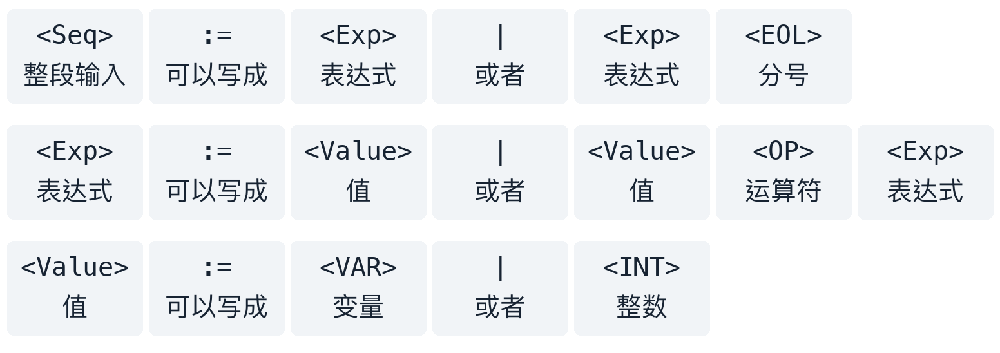

# 01｜Tokeniser 和 Parser：从字符到语法树

> 核心：**Tokeniser 把字符认成 token；Parser 按文法组合 token。**

## 一分钟例子

`x + 23;` 经过 Tokeniser 变成 `VAR(x), OP(+), INT(23), EOL(;)`；Parser 再判断“值 + 值；”是否符合文法。`x + ;` 能分词，但 `+` 后缺少值，所以解析失败。

## 1. 文法怎么读

先别看符号。题目其实只在规定下面三件事：

1. **什么算一个值？** 一个变量（如 `x`），或一个整数（如 `23`）。
2. **什么算一个表达式？** 可以只有一个值（如 `x`）；也可以是“值 + 运算符 + 另一个表达式”（如 `x + 23`）。
3. **整段输入可以长什么样？** 一个表达式；也可以是表达式后面再加一个分号（如 `x + 23;`）。

所以，看到 `x + 23;` 时，从左到右对照就够了：

| 输入中的部分 | 它扮演什么角色 |
|---|---|
| `x` | 第一个值：变量 |
| `+` | 运算符 |
| `23` | 第二个值：整数；它自己也算一个表达式 |
| `;` | 整段输入末尾允许的分号 |

原来的文法写法：

```text
<Seq>   := <Exp> | <Exp> <EOL>
<Exp>   := <Value> | <Value> <OP> <Exp>
<Value> := <VAR> | <INT>
```

每一格上方是文法符号，下方是对应的中文。



这里的 `|` 只表示“或者”，**输入时不用打竖线**。

例如第二行只是在说：**表达式可以是“一个值”，或者“一个值 + 运算符 + 另一个表达式”。** 后面又出现 `<Exp>`，是为了允许继续接下去，例如 `x + y + 23`；读第一遍时先只看 `x + 23` 即可。

`x + ;` 不合法，因为运算符后面没有值。`x 23` 也不合法，因为两个值之间缺运算符。读文法的目的，就是检查输入中的每一部分能否放进上面的规则，且没有多余部分。

## 2. Tokeniser 怎么写

一次 `next()` 认一个 token。数字连续读到最长，`23` 是一个 `INT`。关键字要看完整词，不能把 `github` 错认成 `git`。

写前先打开 `Tokeniser.java`，确定**谁移动 buffer**：

| 骨架 | `next()` 的职责 |
|---|---|
| 构造器预读，提供 `getCurrentToken()` | 更新当前 token；是否截输入看已有代码 |
| `takeNext()` 已截 `buffer` | `next()` 只认，不重复截 |
| `next()` 直接返回并消费 | 认出、截输入、返回 |

2025 S1 Q3 的 `takeNext()` 已经截取，若在 `next()` 再截一次，就会丢 token。

数字分支的核心是：

```java
int end = 0;
while (end < buffer.length()
        && buffer.charAt(end) >= '0'
        && buffer.charAt(end) <= '9') end++;
Token t = new Token(TokenType.INT, buffer.substring(0, end));
```

调用前须确认首字符为数字；之后是否执行 `buffer = buffer.substring(end)`，由原题骨架决定。枚举和构造器名字也以原题为准。

## 3. Parser 怎么写

**一个文法规则对应一个方法。** `<Exp>` 对应 `parseExp()`。方法里的动作只有“看下一个 token、吃掉已确认的 token、调用另一条规则”。

对 `<Exp> := <Value> | <Value> <OP> <Exp>`：

1. 先解析 `Value`，没有值就失败。
2. 看下一项是不是 `OP`。不是就返回左侧值。
3. 是就吃掉 `OP`，递归解析右侧 `Exp`。
4. 右侧失败就失败；成功则构造运算节点。
5. 从开始符号解析完后，确认没有剩余 token。

`x +` 缺右值；`x 23` 有剩余；都应失败。读下一个 token 前要先检查是否已经到结尾。

右递归影响树的形状：这个文法会把 `x * y + 5` 组合为 `x * (y + 5)`。按文法建树，不自行套数学优先级。

## 4. 考场顺序

1. 读 README 中的字符、空白、大小写和非法输入规则。
2. 看 `Token.java`、枚举和 `Tokeniser.java`，确定 token 值类型及谁截 `buffer`。
3. 给每种 token 写识别分支。
4. 把每条文法规则改成解析方法。
5. 测空输入、非法字符、缺值、重复分隔符和剩余 token。
6. 跑原题测试，确认不会重复消费。

## 5. 真题抓手

2025 S2 的 `fetch` 文法要求 `having id = <整数>`；`having id 2` 缺 `=`，不合法。见[原题](../../exam-practice-questions/past-exams/2025-2/src/Q1/MCQQuestions.pdf)。

语法树的根来自文法开始符号。2025 S1 的句子文法从 `sentence` 开始，主句动词是 `chase`，`talk to` 在 `that` 从句内。见[原题](../../exam-practice-questions/past-exams/2025-1/src/Q4/MC_Questions_2025_S1.pdf)。

完整代码、其他年份的骨架差异在[原稿详细版](../原稿归档/01-tokeniser-parser.md)。
