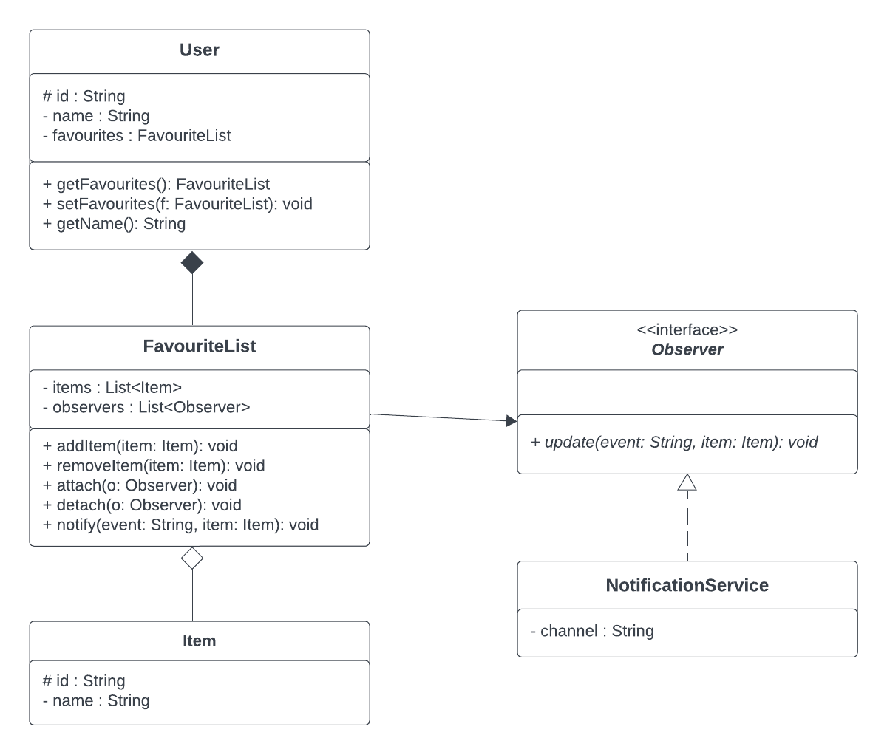

# 03｜UML 和设计模式：先读图，再写类

> UML 说**有哪些类、字段、方法**；设计模式说**这些类怎样分工**。

## 1. 一眼认题型

| 看到 | 先想 |
|---|---|
| `according to UML` | 精确照图建类 |
| `getInstance()` | Singleton 单例 |
| 状态图、`XxxState` | State 状态 |
| `attach`、`detach`、`update` | Observer 观察者 |
| `hasNext()`、`next()` | Iterator 迭代器 |
| `Creator`、`createXxx()` | Factory Method 工厂方法 |

## 2. UML 框怎么读

```text
Account
----------------------
- balance : int
----------------------
+ deposit(amount : int) : void
```

对应 `private int balance;` 和 `public void deposit(int amount)`。UML 写“**名字 : 类型**”，Java 写“**类型 名字**”。

| UML | Java |
|---|---|
| `+` / `-` / `#` | `public` / `private` / `protected` |
| 下划线 | `static` |
| 斜体或 `<<abstract>>` | `abstract` |
| `<<interface>>` | `interface` |
| `0..*` | 零到多个，常用 `List<T>` |

## 3. UML 连线怎么读

### 3.1 六种关系：线型、Java 写法与特点

先认清两个词：**整体（Whole）**是包含其他对象的一方，**部分（Part）**是被包含的一方。例如 Floor（楼层）是整体，Spot（停车位）是部分。

下表中 **A 在左、B 在右**；聚合和组合中的 A 是整体，B 是部分。

| 关系 | 线型与图示 | Java 中通常体现为 | 含义与主要特点 | 例子 |
|---|---|---|---|---|
| Inheritance / Generalization（继承／泛化） | 实线空心三角指向 B：`A ─────▷ B` | `class A extends B` | A **是一种** B（is-a）；子类是父类的更具体类型，可继承可访问的成员 | Car 是一种 Vehicle |
| Realization（实现） | 虚线空心三角指向 B：`A ┄┄┄┄┄▷ B` | `class A implements B` | A **遵守 B 接口的要求**；接口规定能力，具体类提供所需实现 | Car 实现 Drivable 接口 |
| Association（关联） | 普通实线：`A ────── B` | A 长期持有 B 字段，如 `private B b;` | A **和 B 有联系**；不要求整体与部分关系，也不要求生命周期绑定 | 老师教学生：学生不是老师的组成部分 |
| Aggregation（聚合） | 空心菱形在 A 端：`A ◇───── B` | A 用字段或集合保存 B；仅凭字段不能判定聚合 | A **拥有** B（has-a，弱拥有）；B 可独立存在，可能被共享，不要求随 A 销毁 | 学习小组包含学生：小组解散，学生仍然存在 |
| Composition（组合） | 实心菱形在 A 端：`A ◆───── B` | A 用字段或集合保存 B，并负责所属 B 的生命周期 | B 是 A **所属的组成部分**（has-a，强拥有）；同一时刻 B 最多属于一个组合整体，仍归属于 A 的 B 随 A 销毁 | 学生档案包含专属档案条目：本例规定删除档案时，其条目一并删除 |
| Dependency（依赖） | 虚线普通箭头指向 B：`A ┄┄┄┄┄> B` | A 临时使用 B，常为参数、局部变量或方法调用 | A **用到了** B（uses-a），其实现依赖 B；不必将 B 保存为字段 | 老师上课时临时使用投影仪：通过方法参数传入，用完不保存为字段 |

**看图记忆**：`▷` 是空心三角，指向父类或接口；`◇` / `◆` 是菱形，放在“整体”一端；`>` 是普通箭头，指向被使用的类。实线关联本身不指定访问方向，这里的字段说明是常见 Java 写法。

字段格已有的字段不要因连线再加一遍。题目若禁止额外字段或方法，严格核对 UML 和 README。

**① 继承和拥有怎么区分？**

- `Car extends Vehicle`：Car 本身就是一种 Vehicle，所以是继承。
- `ParkingLot` 保存若干 `Floor`：停车场拥有楼层，但停车场不是一种楼层，所以不是继承。
- `Car implements Drivable`：Car 满足接口规定的驾驶能力，所以是实现。

**② 关联、聚合、组合怎么区分？**

聚合和组合都属于带有“整体—部分”含义的关联。普通关联只说明有联系；聚合进一步说明整体拥有部分；组合还强调部分的专属归属和生命周期约束。

**先分清 Association（关联）和 Aggregation（聚合）：关联只表示“有联系”；聚合进一步表示“整体包含部分”。聚合是关联的一种。**

| 对比 | Association（关联） | Aggregation（聚合） |
|---|---|---|
| 核心含义 | A 和 B 有联系 | B 是 A 的一部分，但能独立存在 |
| 是否要求“整体—部分” | 不要求 | 要求 |
| 图示 | `A ───── B` | `A ◇──── B`，菱形在整体端 |
| 例子 | 老师教学生 | 学习小组包含学生 |

**用同一个“学生”理解：**

- **老师 → 学生：关联。** 老师教学生，但学生不是老师的组成部分。
- **学习小组 → 学生：聚合。** 学生是小组的成员；小组解散了，学生仍然存在。

它们在 Java 中可能写得很像。下面的 `List<Student>` 表示保存学生对象的列表：

```java
import java.util.List;

class Student {}

class Teacher {
    List<Student> students; // 关联：老师教哪些学生
}

class StudyGroup {
    List<Student> members;  // 聚合：小组由哪些学生组成
}
```

所以，**不能看到 `List` 或字段就认定是聚合，要看它是否表达“整体由这些部分组成”。**这里的关系判断来自例子的含义，字段的写法本身不能区分两者。

考试记：**有联系 → 关联；整体包含可独立存在的部分 → 聚合。**

假设 A 中有 `private B b;`，**仅靠这个字段不能断定是聚合还是组合**。还要看题目有没有说明：B 能否独立存在？是否由 A 负责其生命周期？同一个 B 能否同时属于多个整体？

- **聚合**：删除整体，不强制删除部分。
- **组合**：删除整体时，仍属于它的部分也随之删除。同一个部分不能同时属于两个组合整体；若模型允许，部分可以先被移出或转移。
- Java 没有 `aggregation` 或 `composition` 关键字；`new B()` 也不能单独证明组合。Java 的垃圾回收不等于 UML 中的业务生命周期规则。

**③ 关联和依赖怎么区分？**

下面两个例子分别理解，重点看 B 是否被长期保存：

```java
// 关联的常见写法：A 用字段保存 B，其他方法以后还可以使用它。
class A {
    private B b;

    A(B b) {
        this.b = b;
    }
}
```

```java
// 依赖的常见写法：A 只在这个方法中使用传进来的 B。
class A {
    void work(B b) {
        b.run(); // 假设 B 定义了 run() 方法
    }
}
```

“长期持有”和“临时使用”是常见判断线索，不是绝对定义。例如参数被存进字段后，就不能只因它是参数而判断为临时依赖。

### 3.2 UML 必背符号与多重性

**访问权限：看字段或方法名字前面的符号。**

| 符号 | Java 对应 | 含义 |
|---|---|---|
| `+` | `public` | 公共，可从类外访问 |
| `-` | `private` | 私有，普通子类代码不能直接访问父类的私有成员 |
| `#` | `protected` | 同包可访问；跨包子类可按 Java 的继承访问规则访问 |
| `~` | package-private（不写访问修饰符） | 仅同包可访问 |

**多重性（Multiplicity）：一个对象可以对应另一端多少个对象。**

| 数字 | 含义 |
|---|---|
| `1` | 恰好一个 |
| `0..1` | 零个或一个 |
| `0..*` 或 `*` | 零个或多个 |
| `1..*` | 一个或多个，至少一个 |
| `m..n` | 至少 m 个、最多 n 个，包含两端 |

读法：**固定一端的一个对象，看另一端旁边的数字。**

```text
ParkingLot  1 ◇──────── 0..*  Floor
```

- 固定一个 ParkingLot，看 Floor 旁边的 `0..*`：一个停车场可以有零个或多个楼层。
- 固定一个 Floor，看 ParkingLot 旁边的 `1`：一个楼层恰好属于一个停车场。
- ParkingLot 旁边的 `◇`：ParkingLot 是聚合关系中的整体。

**菱形回答“是什么关系、谁是整体”，数字回答“有多少个”，两者要分开读。**实心菱形本身不表示“至少一个”；至少一个要看 `1..*`。

### 3.3 停车场 UML 例题：为什么错误选项是 B？

**题目要求：选择 INCORRECT（错误的）选项。正确答案：B。**

下面按提供的题目说明整理，图示是关系示意，不是原题完整类图。

**四个选项（按提供内容整理）：**

| 选项 | 选项内容 | 判断 |
|---|---|---|
| A | Floor 被销毁时，所属的 Spot 也必须被销毁，这是 Composition（组合） | 正确 |
| B | “Car is a Vehicle and Motorcycle is a Vehicle. This relationship is an aggregation.” | **错误：这是继承，不是聚合** |
| C | “One ParkingLot has zero or many instances of Floor.” | 正确 |
| D | Car 和 Motorcycle 继承 Vehicle 的公共方法，可以调用 `getName()`、`getColor()` | 正确 |

**关系示意：**

```text
Car        ─────▷ Vehicle
Motorcycle ─────▷ Vehicle

ParkingLot  1 ◇──────── 0..*  Floor
Floor         ◆──────── 1..*  Spot
```

#### A：Composition（组合关系）——正确

Floor 与 Spot 之间的实心菱形 `◆` 放在 Floor 一端，说明 **Floor 是整体，Spot 是部分**。

- 一个 Floor 包含至少一个 Spot，这由 Spot 一端的 `1..*` 表示。
- Spot 的生命周期依赖于所属的 Floor。
- Floor 被销毁时，仍属于它的 Spot 也必须随之销毁。

因此 A 符合组合关系。

#### B：把 Inheritance（继承）说成 Aggregation（聚合）——错误

原句的前半句“Car 和 Motorcycle 都是一种 Vehicle”正确，但后半句“这是聚合关系”错误。

**is-a（是一种）对应继承／泛化；has-a（拥有）才可能对应聚合或组合。**图中空心三角指向 Vehicle，表示 Vehicle 是父类。

```java
class Vehicle {
    private String name;
    private String color;

    public String getName() {
        return name;
    }

    public String getColor() {
        return color;
    }
}

class Car extends Vehicle {}

class Motorcycle extends Vehicle {}
```

`extends Vehicle` 就是“继承 Vehicle”。Car 和 Motorcycle 都继承 Vehicle 的公共方法。因此 **B 是错误选项，也是本题要选的答案**。

#### C：Multiplicity（多重性）——正确

看 ParkingLot 和 Floor 之间的两个数字：

- Floor 端的 `0..*`：一个 ParkingLot 可以有零个或多个 Floor。
- ParkingLot 端的 `1`：一个 Floor 恰好属于一个 ParkingLot。
- ParkingLot 端的空心菱形 `◇`：两者是聚合关系。

所以 “One ParkingLot has zero or many instances of Floor” 正确。这里按题目给定的模型判断，不用现实建筑是否能独立存在来替换图中的关系。

#### D：Inheritance + Visibility（继承与访问权限）——正确

Vehicle 的 UML 成员如下：

```text
- name: String
- color: String
+ getName(): String
+ getColor(): String
```

- `- name`、`- color`：父类私有字段。
- `+ getName()`、`+ getColor()`：父类公共方法。
- Car 和 Motorcycle 继承这些公共方法，因此可以通过子类对象调用它们。

例如在普通调用代码中：

```java
Car car = new Car();
car.getName();  // 合法：调用继承来的 public 方法
car.getColor(); // 合法：调用继承来的 public 方法
// car.name;   // 非法：不能直接访问 Vehicle 的 private 字段
```

**私有字段仍存在于子类对象的父类部分中，但不是子类可直接访问的继承成员。**`getName()` 定义在 Vehicle 内部，所以它能读取 Vehicle 的私有字段；子类对象可以通过这个公共方法间接读取。上面的简化代码没有初始化字段，所以 getter 返回 `null`，但调用本身合法。

### 3.4 考试快速判断顺序

1. **先看题目要选正确还是错误**：INCORRECT 表示选错误项。
2. **再看线型**：实线空心三角是继承，虚线空心三角是实现，空心菱形是聚合，实心菱形是组合。
3. **看符号在哪一端**：三角指向父类／接口，菱形放在整体一端。
4. **分清“是一种”和“拥有”**：Car 是 Vehicle → 继承；ParkingLot 拥有 Floor → 按图判断聚合或组合。
5. **检查生命周期**：部分随所属整体销毁 → 组合的重要特征。
6. **分别读数字和权限**：另一端的数字表示数量；`+`、`-`、`#`、`~` 表示可见性。

**本题核心陷阱：B 把 Inheritance（继承）说成了 Aggregation（聚合）。**

## 4. 几个模式如何分工

**Singleton**：一个类只提供同一个实例。需要 `private static` 实例、`private` 构造器、`public static getInstance()`（完整对比如下）。例如：

```java
class Config {
    private static final Config INSTANCE = new Config();
    private Config() {}
    public static Config getInstance() { return INSTANCE; }
}
```

### Singleton 展开：普通 `new` 和单例的区别

Singleton（单例模式）的意思是：**类里面自带一个唯一的对象，用方法直接使用这个对象，不需要实例化这个类**。

**1. 普通情况下**

```java
Dog a = new Dog();
Dog b = new Dog();
```

这里创建了两个不同的 `Dog` 对象：

- `a` 指向第一个对象；
- `b` 指向第二个对象；
- `a == b` 是 `false`。

**2. Singleton 单例模式**

```java
class Dog {
    // ① 提前创建唯一的对象
    private static Dog instance = new Dog();

    // ② 禁止外部使用 new Dog()
    private Dog() {}

    // ③ 提供获取对象的方法
    public static Dog getInstance() {
        return instance;
    }
}
```

使用：

```java
Dog a = Dog.getInstance();
Dog b = Dog.getInstance();

System.out.println(a == b); // true
```

`a` 和 `b` 都指向内存中的同一个 `Dog` 对象。

**3. 为什么要这样设计？**

例如一个程序只需要一个全局配置管理器。如果每次都 `new` 一个，可能产生多个配置管理对象；使用 Singleton，可以让整个程序统一访问同一个配置管理器。

**4. 考试记住三个关键点**

1. `private static Dog instance`：保存唯一对象。
2. `private Dog()`：禁止外部随便创建对象。
3. `getInstance()`：让外部获取这个唯一对象。

一句话：普通类可以不断 `new`，Singleton 不让外部 `new`，只能通过 `getInstance()` 拿到同一个对象。

> 真题：2025 S2 Q1 第 5 题给的是“懒汉式”（第一次调用时才 `new`，即 `if (INSTANCE == null)`），考 `assertSame` / `assertEquals` 的差别和能否去掉 `static`，见下文该题讲解。

**State**：对象把事件交给当前状态处理。先将状态图抄为“当前状态 / 事件 / 下一状态”表，再把每行写入对应状态类。看接口签名：有的状态方法返回下一状态，有的调用上下文的 `setState`。若题目要求状态单例，用 `getInstance()` 转换，不能 `new`。

### State 展开：用红绿灯跑一遍

这段话是在教你：Java 的 State（状态模式）考试题应该怎么写。用一个最简单的例子：红绿灯。

**1. State 模式是什么？**

假设红绿灯有三个状态：红灯（Red）、绿灯（Green）、黄灯（Yellow）。每次发生 `next()` 事件，红绿灯切换到下一个状态。

状态图：红灯 → 绿灯 → 黄灯 → 红灯

也就是前面说的“当前状态 / 事件 / 下一状态”表：

| 当前状态 | 事件 | 下一状态 |
|---|---|---|
| Red | next() | Green |
| Green | next() | Yellow |
| Yellow | next() | Red |

**2. 把每个状态写成一个类**

先定义接口：

```java
interface State {
    State next();
}
```

意思是每个状态都必须有 `next()` 方法，返回下一个状态。

然后写三个状态类：

```java
class Red implements State {
    public State next() {
        return new Green();
    }
}

class Green implements State {
    public State next() {
        return new Yellow();
    }
}

class Yellow implements State {
    public State next() {
        return new Red();
    }
}
```

例如：

```java
State s = new Red();
s = s.next(); // 变成 Green
s = s.next(); // 变成 Yellow
```

**3. `setState()` 是什么？**

有些题目不是让 `next()` 返回状态，而是要求直接修改 Context（上下文对象）保存的当前状态。

你可以把 `setState()` 理解成：**修改一个对象当前的状态**。先不考虑设计模式，只看最简单的 Java 代码。

**① 一个红绿灯对象**

```java
class TrafficLight {
    String state = "Red";
}
```

创建对象：

```java
TrafficLight light = new TrafficLight();
```

现在 `light.state` 是 `"Red"`。

**② 我们想让红灯变成绿灯**

最直接的方式：

```java
light.state = "Green";
```

但是我们也可以写一个方法，专门修改状态：

```java
class TrafficLight {
    String state = "Red";

    void setState(String s) {
        state = s;
    }
}
```

然后调用：

```java
light.setState("Green");
```

实际执行的就是 `state = "Green";`。所以 `setState()` 没有什么神奇的，它就是一个普通的方法，用于修改变量。

**③ 为什么题目里是 `State` 而不是 `String`？**

因为 State 设计模式中，状态不是字符串，而是对象。

```java
interface State {}

class Red implements State {}
class Green implements State {}
```

于是红绿灯可以写成：

```java
class TrafficLight {
    State state = new Red();

    void setState(State s) {
        state = s;
    }
}
```

调用：

```java
TrafficLight light = new TrafficLight();

light.setState(new Green());
```

逐步执行：

| 时机 | `light.state` |
|---|---|
| 调用前 | `Red` 对象 |
| 调用 `light.setState(new Green())` 后 | `Green` 对象 |

注意：`light` 始终是同一个红绿灯对象，只是它内部的 `state` 从 Red 对象换成了 Green 对象。

**④ 那 Context 又是什么？**

Context 就是保存当前状态的那个对象。在这个例子中：

| 名称 | 对应什么 |
|---|---|
| Context | `TrafficLight` |
| State | `State` 接口 |
| 具体状态 | `Red`、`Green` |
| `setState()` | 修改当前状态 |

所以题目里的：

```java
context.setState(new Green());
```

如果 `context` 指向 `TrafficLight` 对象，就相当于：

```java
light.setState(new Green());
```

最后记住：

- `new Green()`：创建一个绿色状态对象。
- `setState(...)`：把当前状态换成传进去的对象。
- `context`：保存当前状态的红绿灯对象。

这三个概念弄懂，题目中的代码就基本理解了。

注意：`next()` 返回状态和 `setState()` 修改状态是两种实现方式，要根据题目给出的接口选择。

**4. 为什么说不能 `new`，要用 `getInstance()`？**

因为有些题目要求每个状态类采用单例模式 Singleton。例如 Red：

```java
class Red implements State {
    private static Red instance = new Red();

    private Red() {}

    public static Red getInstance() {
        return instance;
    }

    public State next() {
        return Green.getInstance();
    }
}
```

这时不能：

```java
return new Green(); // 错误
```

必须：

```java
return Green.getInstance(); // 正确
```

原因是题目要求每种状态只有一个共享实例，而不是每次切换都创建新对象。

**5. 考试套路总结**

看到 State 状态图：

1. 画表：当前状态 + 事件 → 下一状态。
2. 定义接口：例如 `State next()`。
3. 每个状态写一个类：`Red`、`Green`、`Yellow`。
4. 实现状态转换：返回下一个状态，或调用 `context.setState()`。
5. 检查 Singleton 要求：如果状态类必须是单例，就用 `getInstance()`，不能 `new`。

最关键的一点：State 模式就是把不同状态下的行为分别写到不同的类中，而不是把所有状态判断都堆在一个巨大的 `if-else` 里面。

**Observer**：subject 保存 `List<Observer>`。通过 `attach` 登记，`detach` 移除；**成功修改后**逐个调用 `update`。是否拒绝 null、是否去重、通知参数以题目规格为准。

### Observer 展开：老师通知学生

先不管什么设计模式，只理解一件事：

老师有一个学生名单。老师发布消息时，名单里的所有学生都会收到通知。

**① 老师保存学生名单**

```java
List<Observer> students = new ArrayList<>();
```

这行代码的意思是：创建一个列表 `students`，专门存放学生（Observer）对象。

假设现在名单是：

```text
students = [小明, 小红, 小刚]
```

**② `attach()` 是添加学生**

```java
void attach(Observer o) {
    students.add(o);
}
```

例如：

```java
teacher.attach(小明);
teacher.attach(小红);
```

现在名单变成：

```text
students = [小明, 小红]
```

这里 `o` 就是传进来的某个学生对象。

**③ `detach()` 是删除学生**

```java
void detach(Observer o) {
    students.remove(o);
}
```

例如：

```java
teacher.detach(小明);
```

名单就变成：

```text
students = [小红]
```

**④ `update()` 把消息存进学生自己的容器**

每个学生都有自己的消息列表：

```java
class Student implements Observer {
    List<String> messages = new ArrayList<>();

    public void update(String message) {
        messages.add(message);
    }
}
```

这里：

- `messages`：学生自己的消息容器。
- `update(message)`：接收老师发来的消息。
- `messages.add(message)`：把消息存入容器。

**⑤ 老师发送消息**

```java
void notifyStudents(String message) {
    for (Observer o : students) {
        o.update(message);
    }
}
```

老师调用：

```java
teacher.notifyStudents("明天考试");
teacher.notifyStudents("作业周五交");
```

**⑥ 最终结果**

```text
Teacher
  ├─ notifyStudents("明天考试")
  └─ notifyStudents("作业周五交")
       ├─ 小明的 messages = [明天考试, 作业周五交]
       └─ 小红的 messages = [明天考试, 作业周五交]
```

每个学生都有独立的消息列表，老师只是通过 `update()` 把消息发给他们。

这才是 Observer 模式真正重要的地方：

> Subject 不需要知道每个 Observer 收到消息后具体做什么。

例如：

- 小明的 `update()` 把消息存进列表。
- 小红的 `update()` 把消息显示在屏幕上。
- 小刚的 `update()` 把消息写入文件。

老师只负责统一调用 `update()`，具体怎么处理由各个观察者自己决定。

**⑦ 最后把几个词对上**

```text
老师（Subject）
  └─ 保存学生名单，发布消息 → 逐个调用 update(message)
       ├─ 小明.update(message)
       ├─ 小红.update(message)
       └─ 小刚.update(message)
```

所以这几个单词对应：

| 代码 | 中文意思 |
|---|---|
| `Subject` | 老师 |
| `Observer` | 学生 |
| `List<Observer>` | 学生名单 |
| `attach()` | 加入名单 |
| `detach()` | 移出名单 |
| `update(message)` | 收到消息时执行的方法 |

最容易搞混的一点：`update()` 是学生的方法，不是老师的方法。老师只是调用学生的 `update()`。

而 Observer 设计模式就是用这种方式，让一个对象能够通知多个对象。

**Iterator**：`hasNext()` 只判断，不移动；`next()` 返回一个元素并前进。树的前序遍历为“根、左、右”。用栈时先压右孩子、再压左孩子，左孩子才会先弹出。

### Iterator 展开：像取号机一样逐个取元素

这是 Java 的 Iterator（迭代器模式）。核心思想：**按照一定顺序，一个一个地取出元素**。

比如有一个列表：

```java
List<Integer> nums = List.of(10, 20, 30);
```

我们希望依次取出 `10 → 20 → 30`。

**① `hasNext()` 和 `next()` 是什么？**

假设迭代器有一个指针，指向下一个准备取出的元素。

```text
已取出 0 / 3
  指针 ↓
  [10]   20     30        hasNext() = true，下一次 next() 返回 10

已取出 1 / 3
        指针 ↓
   10   [20]    30        hasNext() = true，下一次 next() 返回 20

已取出 2 / 3
               指针 ↓
   10    20   [30]        hasNext() = true，下一次 next() 返回 30

已取出 3 / 3
                    指针 ↓（越界）
   10    20    30         hasNext() = false
```

- `hasNext()`：判断后面还有没有元素，**不移动指针**。
- `next()`：取出下一个元素，同时把指针**向前移动一格**。

Java 代码：

```java
Iterator<Integer> it = nums.iterator();

System.out.println(it.hasNext()); // true
System.out.println(it.next());    // 10
System.out.println(it.next());    // 20
System.out.println(it.next());    // 30
System.out.println(it.hasNext()); // false
```

注意：没有下一个元素时继续调用 `next()`，通常会抛出 `NoSuchElementException`。

**② 树的前序遍历是什么？**

如果元素不是存在普通列表里，而是存在一棵树中：

```text
        A
       / \
      B   C
     / \
    D   E
```

前序遍历：`A → B → D → E → C`

前序遍历（Preorder）规则：

1. 先访问根节点。
2. 再遍历左子树。
3. 最后遍历右子树。

所以前面说的：

> 用栈时先压右孩子、再压左孩子，左孩子才会先弹出。

这是因为栈（Stack）是后进先出（LIFO）。例如：

```java
stack.push(right);
stack.push(left);
```

左孩子最后放进去，所以最先被 `pop()` 取出来。

**③ 考试需要记什么？**

| 看到 | 立刻想到 |
|---|---|
| `hasNext()` | 只检查是否还有元素 |
| `next()` | 返回元素并前进 |
| `Iterator` | 迭代器模式 |
| Preorder | 根 → 左 → 右 |
| Stack | 后进先出 |
| 先 push 右，再 push 左 | 保证先遍历左子树 |

一句话：Iterator 就像一个取号机，每调用一次 `next()`，就拿出下一个元素；`hasNext()` 只负责告诉你还有没有号。

**Factory Method**：父类声明创建方法，由子类决定具体 `new` 什么。**Template Method**：父类固定流程，某几步交给子类。两者可一起出现。

### Factory Method 与 Template Method 展开：一个管 `new`，一个管步骤

这两个都是 Java 的设计模式，而且很容易混淆。最核心的区别：

- **Factory Method**（工厂方法）：子类决定创建什么对象。
- **Template Method**（模板方法）：父类决定执行哪些步骤，子类决定某些步骤怎么做。

我们用一个例子理解。

**① Factory Method（工厂方法）**

假设你开了一家动物工厂，可以生产猫和狗。

父类规定：必须有一个创建动物的方法。

```java
abstract class AnimalFactory {
    abstract Animal createAnimal();
}
```

子类决定创建什么：

```java
class DogFactory extends AnimalFactory {
    Animal createAnimal() {
        return new Dog();
    }
}

class CatFactory extends AnimalFactory {
    Animal createAnimal() {
        return new Cat();
    }
}
```

假设 `Dog` 和 `Cat` 都实现了 `Animal` 接口。

```text
AnimalFactory
  └─ createAnimal()
       ├─ DogFactory → new Dog() → 创建狗
       └─ CatFactory → new Cat() → 创建猫
```

父类并不知道要创建猫还是狗，由子类决定 `new` 什么。

**② Template Method（模板方法）**

假设你要制作饮料。不管做茶还是咖啡，都需要：烧水 → 冲泡 → 倒进杯子。

父类规定完整流程：

```java
abstract class Drink {

    // 固定整个制作流程
    final void make() {
        boilWater();
        brew();
        pour();
    }

    void boilWater() {
        System.out.println("烧水");
    }

    abstract void brew();

    void pour() {
        System.out.println("倒进杯子");
    }
}
```

注意 `brew()` 是抽象方法，父类不知道具体如何冲泡。

让子类实现：

```java
class Tea extends Drink {
    void brew() {
        System.out.println("泡茶叶");
    }
}

class Coffee extends Drink {
    void brew() {
        System.out.println("冲咖啡");
    }
}
```

执行：

```java
Drink d = new Tea();
d.make();
```

输出：

```text
烧水
泡茶叶
倒进杯子
```

如果换成 `new Coffee()`，就会变成：`烧水`、`冲咖啡`、`倒进杯子`。

父类决定做事顺序，子类只负责其中某个步骤。

**③ 考试怎么区分？**

|  | Factory Method | Template Method |
|---|---|---|
| 关注点 | 创建对象 | 执行流程 |
| 父类负责 | 声明创建方法 | 定义完整步骤 |
| 子类负责 | 决定 `new` 什么 | 实现某些步骤 |
| 常见方法名 | `createXxx()` | `make()`、`execute()` |
| 典型代码 | `return new Dog()` | `step1(); step2(); step3();` |

**④ 为什么两者可以一起出现？**

因为固定流程里面可以包含创建对象的步骤。例如：

```java
abstract class AnimalFactory {

    // Template Method：固定流程
    final void run() {
        Animal a = createAnimal();
        a.eat();
    }

    // Factory Method：交给子类创建
    abstract Animal createAnimal();
}
```

子类：

```java
class DogFactory extends AnimalFactory {
    Animal createAnimal() {
        return new Dog();
    }
}
```

这里：

- `run()` 是 Template Method：固定先创建动物，再让动物吃东西。
- `createAnimal()` 是 Factory Method：子类决定创建什么动物。

考试一句话记忆：**Factory Method 管 `new`，Template Method 管步骤。**

**Facade**：一个简单入口转调多个子系统。**Strategy**：多种可互换算法各自实现同一接口，由调用方选择。

### Facade 与 Strategy 展开：一个简化入口，一个替换算法

这两个也是 Java 设计模式。

- **Facade**（外观模式）：把多个复杂操作包装成一个简单方法。
- **Strategy**（策略模式）：同一件事有多种做法，可以自由选择和替换。

**① Facade（外观模式）**

假设你有一台电脑，启动电脑需要三个步骤：

1. 启动 CPU。
2. 启动内存。
3. 启动硬盘。

原本你需要分别调用：

```java
cpu.start();
memory.start();
disk.start();
```

使用 Facade 后，把三个操作包装在一个类里：

```java
class ComputerFacade {
    CPU cpu = new CPU();
    Memory memory = new Memory();
    Disk disk = new Disk();

    void start() {
        cpu.start();
        memory.start();
        disk.start();
    }
}
```

以后只需要：

```java
ComputerFacade computer = new ComputerFacade();
computer.start();
```

就自动完成三个步骤。

```text
computer.start()
  └─ 一个简单入口：ComputerFacade.start()
       ├─ CPU.start()
       ├─ Memory.start()
       └─ Disk.start()
```

Facade 的核心：用户不需要知道内部有多少个子系统，只需要调用统一入口。

**② Strategy（策略模式）**

假设你做一个计算器，支持两种计算策略：加法（Add）和乘法（Multiply）。

首先定义统一接口：

```java
interface Strategy {
    int calculate(int a, int b);
}
```

两种策略分别实现：

```java
class Add implements Strategy {
    public int calculate(int a, int b) {
        return a + b;
    }
}

class Multiply implements Strategy {
    public int calculate(int a, int b) {
        return a * b;
    }
}
```

现在可以自由选择使用哪种算法：

```java
Strategy s = new Add();

System.out.println(s.calculate(3, 4)); // 7

s = new Multiply();

System.out.println(s.calculate(3, 4)); // 12
```

注意：调用的方法始终是 `calculate()`，但实际执行的算法取决于 `s` 指向哪种策略对象。

```text
选择 Add：      s.calculate(3, 4) → 3 + 4 = 7    （实际执行 Add.calculate()）
选择 Multiply： s.calculate(3, 4) → 3 * 4 = 12   （实际执行 Multiply.calculate()）
```

**③ 考试如何区分？**

|  | Facade | Strategy |
|---|---|---|
| 中文 | 外观模式 | 策略模式 |
| 目的 | 简化复杂操作 | 替换不同算法 |
| 特点 | 一个入口调用多个系统 | 多个类实现同一接口 |
| 关键词 | `Facade`、`start()` | `Strategy`、`setStrategy()` |
| 例子 | 一键启动电脑 | 选择加法或乘法 |

一句话记忆：

- **Facade**：把复杂事情变简单，一个方法帮你完成多项操作。
- **Strategy**：把不同做法变得可替换，调用同一个接口，可以执行不同算法。

Strategy 和之前学的 State 也很像，但 Strategy 强调**选择算法**，State 强调**根据当前状态改变行为以及进行状态转换**。

## 5. 按图实现的顺序

1. 列清所有 class、abstract class、interface、enum。
2. 逐个照抄字段、方法签名、可见性和大小写。
3. 翻译继承、实现、持有关系；检查重复字段。
4. State 画转换表；Observer 标通知时机；Iterator 手走输出顺序。
5. 运行原题测试：先修编译与签名，再修行为。
6. 一个 `public` 类一个同名文件，接口方法的实现必须写 `public`。

更完整的代码骨架和历年题在[原稿详细版](../零基础快速掌握手册/原稿归档/03-design-patterns-uml.md)。

---

## 往年题逐题讲解（年份倒序）

以下精选 UML、模式实现和重构题。同一学期先讲完整实现题，再讲选择题；跨学期严格按从近到远排列。参考代码是对应部分的教学写法，不是官方答案。

### 2025 S2｜Q5：收藏夹通知，先翻译 UML，再实现 Observer

#### 题目（原题内容）

**作答任务（中文）：** 严格按 UML 创建收藏夹系统，完成 Observer 订阅、取消订阅、增删与通知，并按 Task C 演示指定操作。

**原文题干／本节对应小问：**

> ## Introduction 
>
> You are given a UML diagram that demonstrate the design of a favourites management system that applies the Observer design pattern, where a user’s favourites list notifies observers (like a notification service) whenever items change.
>
>
> ## Tasks
>
> Implement the class(es) and interface(s) according to the provided UML diagram (see src/Q5/UML_ob.png).
>
> Your work will be assessed on three main areas:
>
> ### Task A: Class Structure
>
> Create the classes in accordance with the provided UML diagram. You will be marked based on
> how accurately your code reflects the structure and relationships defined in the UML, for
>   - `Observer`, `NotificationService`, `Item`, `User`, and `FavouriteList`.
>
> As a hint, a partial implementation for the `FavouriteList` class has already been provided in `FavouriteList.java`. 
> You can uncomment the code and get started from there, or delete the provided code and get started with your own 
> implementation. Note that some parts of the provided code does not follow the UML and you should fix it.
>
> Tip: In IntelliJ, you can comment/uncomment code with the shortcut `Ctrl`+`/` (Linux) 
> after selecting multiple lines.
>
>
> Notes
>   - Ensure that all classes, fields, and methods **exactly match the names and signatures** specified in the provided UML diagram. 
>     Ensure there are no spelling mistakes and that you use the correct case for all names. 
>   - Do not introduce any extra fields or methods, except that **you may implement constructor(s),
>     getters, and setters** in any of the classes as needed to complete the method implementation.
>
> ### Task B: Design Pattern Implementation
>
> Implement methods in the respective classes:
>
>   - In `FavouriteList`,
>     - `attach` adds the observer once, without duplicates. No-op if the parameter is null.
>       (Note that "no-op" means no-operations, i.e., does nothing when executed)
>     - `detach` remove the observer passed in if present, no-op otherwise.
>     - `addItem`: adds the `item` to the list of items if no items with the same id exists.
>        No-op otherwise. If successfully added, call `notify("added", item)`.
>     - `removeItem`: removes the `item` from the list of items if an item with the same id and name exists.
>       No-op otherwise. If successfully removed, call `notify("removed", item)`.
>   - In `NotificationService`,
>     - `update` should print a message which includes the channel, 
>       event, item id and item name. For instance, the printed message may look like 
>       `[channel ABC] event: added, item #I1 (exam question)`
>
>
> ### Task C: Demonstration / Main Program
>
> In the (static) main function of `Main.java`, 
> -  Create two Users (with id = "1" and id = "2", respectively) and attach them (through their FavouriteList) 
>    to two observers that are NotificationService with `channel` "ABC" and "DEF", respectively.
> -  Add items to the favouriteList of the users:
>    -  Add an item (**item1**) with id `I1` and name `Item 1` to both users' favouriteList.
>    -  Add an item (**item2**) with id `I2` and name `Item 2A` to user2's favouriteList.
>    -  Add an item (**item3**) with id `I2` and name `Item 2B` to user2's favouriteList.
> -  Detach the observer from the second user (with id = "2"), then
>     -  Remove **item1** from both users' favouriteLists.
>
>
> -----------
>
> #### Additional Notes:
>
> - The basic tests in `Q5Test.java` provide basic name-checkings. 
>   Note that the checking are NOT comprehensive and you should read and understand the 
>   specification above instead of relying on the tests.
>   Note that passing the tests does not necessarily mean you will receive marks for the tasks, although it is a good indicator. You must follow the specifications in the UML.
>
> * * *

**原题 UML（作答依据，点击可查看原图）：**



#### 逐步讲解与做题套路


原题：[说明](../exam-practice-questions/past-exams/2025-2/src/Q5/Q5README.md) · [UML 原图](../exam-practice-questions/past-exams/2025-2/src/Q5/UML_ob.png)。

**题目要什么？** 收藏夹增删物品后，通知订阅它的通知服务。名字、字段类型、访问权限和方法签名必须与 UML 一致。

**第一步：先写类之间的分工。**

| UML 中的类 | 负责什么 | Java 中需要注意什么 |
|---|---|---|
| User | 持有自己的收藏夹 | `# id` 是 protected；`name`、`favourites` 是 private |
| FavouriteList | 保存物品和观察者 | 两张私有列表：`List<Item>`、`List<Observer>` |
| Item | 保存 id 和 name | id 是 protected，name 是 private |
| Observer | 规定接收通知的方法 | interface，声明 `update(String event, Item item)` |
| NotificationService | 真正接收通知并打印 | `implements Observer`，有 private channel |

`NotificationService` 到 `Observer` 的虚线空心三角表示“实现接口”，不是继承一个普通类。`User` 到收藏夹的实心菱形表示组成关系，不要翻译成 `User extends FavouriteList`。

**第二步：先做最短的订阅与通知。** 在列表已初始化的前提下：

```java
public void attach(Observer o) {
    if (o != null && !observers.contains(o)) observers.add(o);
}

public void detach(Observer o) {
    observers.remove(o);
}

public void notify(String event, Item item) {
    for (Observer o : observers) {
        o.update(event, item);
    }
}
```

`attach` 是订阅；`detach` 是取消订阅；`notify` 遍历当前订阅者，每人通知一次。这里只展示 FavouriteList 的三个方法，其余字段、构造函数和类按 UML 补全。

**第三步：明确什么时候通知。**

- 添加：只要已经有相同 **id** 的物品，就不添加、不通知。
- 删除：必须同时匹配 **id 和 name**，才删除并通知。
- 不要在循环里还没确定能否添加，就先调用通知。
- 字符串内容用 `.equals` 比较，不用 `==`。

可以先把添加写成人话：`检查所有旧物品 → 有同 id 就 return → 没有才 add → notify("added", item)`。

**第四步：跟着原题 Main 的操作算通知次数。**

| 操作 | 数据是否改变 | 谁收到通知 |
|---|---|---|
| user1 添加 I1 / Item 1 | 是 | ABC 收到 added |
| user2 添加 I1 / Item 1 | 是 | DEF 收到 added |
| user2 添加 I2 / Item 2A | 是 | DEF 收到 added |
| user2 添加 I2 / Item 2B | 否，同 id 已存在 | 无 |
| user2 取消订阅 DEF | 观察者列表改变 | 无物品事件 |
| user1 删除 I1 / Item 1 | 是 | ABC 收到 removed |
| user2 删除 I1 / Item 1 | 是 | 无，DEF 已取消订阅 |

因此按这一流程，共产生 **4 次 update 通知**。取消订阅不会禁止删除，只会使该观察者不再收到消息。

**做题套路：逐框翻译类结构 → 接口方法补到实现类 → 写订阅列表 → 业务操作成功后才通知 → 手算一遍事件顺序。** 原题提醒提供的 FavouriteList 草稿并非完全符合 UML，不能直接取消注释就当完成。

### 2025 S2｜Q3：PaymentProcessor，把按类型分支改为 Strategy

#### 题目（原题内容）

**作答任务（中文）：** 阅读 PaymentProcessor，按 A–E 回答一个坏味道、位置、危害、模式和重构方法；严格遵守各问字数上限。

**原文题干／本节对应小问：**

> ### Task - Open-ended response.
>
> Analyze the `PaymentProcessor` class and
> identify one code smell that could be resolved using one design pattern covered in the course.
>
> In `Q3Answers.java`, respond to the following questions:
> - A) What is the name of the code smell you identified? (Word limit: ≤4)
> - B) Precisely indicate where in the code the smell occurs. (Word limit: ≤20)
> - C) Explain the problem caused by this code smell in the context of the software. (Word limit: ≤100)
> - D) What is the name of the design pattern you propose to apply? (Word limit: ≤4)
> - E) Describe how to apply this design pattern to refactor the code. (Word limit: ≤100)
>   Be specific and precise about what changes should be made, to which part(s) of the code,
>   and where the changes should be placed.
>
> 
>
> * * *
>
> #### Note that
>
> - You must replace the placeholders (`<Your UID>` and `<Your Name>`) in Q3Answers.java with your information.
> - Respond to the questions by updating the values of the corresponding string fields in the java file.
> - **Strict word limits apply to each section**. Failure to comply will result in:
>   (1) A mark penalty, AND
>   (2) Only the first W words (where W is the word limit) being graded.
>
> 
>
> * * *

**已给代码：`PaymentProcessor.java`（原文件）**

```java
public class PaymentProcessor {

    public void processPayment(String method, double amount) {
        System.out.println("Processing payment of $" + amount);

        if (method.equals("CREDIT_CARD")) {
            System.out.println("Connecting to credit card gateway...");
            System.out.println("Charging card: $" + amount);
        } else if (method.equals("PAYPAL")) {
            System.out.println("Connecting to PayPal...");
            System.out.println("Transferring funds: $" + amount);
        } else if (method.equals("BANK_TRANSFER")) {
            System.out.println("Connecting to bank...");
            System.out.println("Initiating bank transfer of $" + amount);
        } else {
            System.out.println("Unknown payment method: " + method);
        }

        System.out.println("Payment completed.");
    }
}
```

#### 逐步讲解与做题套路


原题：[说明与字数限制](../exam-practice-questions/past-exams/2025-2/src/Q3/Q3README.md) · [原代码](../exam-practice-questions/past-exams/2025-2/src/Q3/PaymentProcessor.java)。

**题目要什么？** 找一个代码坏味道，精确指出位置、危害，提出一个设计模式和具体改法。不是泛泛写“代码不够优雅”。

**第一步：定位变化点。** `processPayment` 根据字符串 method 判断 CREDIT_CARD、PAYPAL、BANK_TRANSFER。每增加一种付款方式，就要修改这个方法的分支。

**第二步：说明实际问题。** 支付方式越多，处理器越长；修改一种方式时要进入包含其他方式的类；各支付流程难以单独替换和测试。

**第三步：把变化部分抽出去。**

```text
PaymentStrategy 接口：pay(amount)
├── CreditCardPayment：信用卡连接和扣款
├── PayPalPayment：PayPal 连接和转账
└── BankTransferPayment：银行连接和转账

PaymentProcessor：保存/接收一个策略，调用 strategy.pay(amount)
```

这里 `strategy` 就是“本次选用的支付办法”。打印共同的开始和结束信息，可以继续留在 PaymentProcessor。

**第四步：每个小问只回答它要的内容。** 可用下面的英文基础答案；均按该小问字数上限控制，不是官方标准答案：

| 小问 | 上限 | 参考回答 |
|---|---:|---|
| A 坏味道名 | 4 words | Conditional Complexity |
| B 具体位置 | 20 words | The if/else chain inside processPayment selects payment behavior by comparing method with three payment type strings. |
| C 危害 | 100 words | Adding a payment method requires changing PaymentProcessor. The class mixes dispatch logic with several payment workflows, so changes can affect unrelated methods and each workflow is harder to test independently. |
| D 模式名 | 4 words | Strategy |
| E 具体改法 | 100 words | Define PaymentStrategy with pay(double amount). Move each payment branch into CreditCardPayment, PayPalPayment, or BankTransferPayment implementing that interface. Give PaymentProcessor a strategy through its constructor and delegate payment to strategy.pay(amount), keeping shared logging in the processor. Select the appropriate strategy in client code or a factory, and handle unknown payment methods there. |

如果任务还要求保留原来的 `processPayment(String method, double amount)` 接口，就让它在入口通过映射或工厂选择策略再委托；不能一边承诺兼容，一边悄悄删除旧方法。本题是设计论述，可以清楚提出上述接口调整。

**做题套路：找反复变化的 if/else → 说清新增需求会改哪里 → 一个变化分支一个实现 → 主类只依赖共同接口。** 不要只写“使用 Strategy”而不说哪些代码搬到哪个类。

### 2025 S2｜Q1 第 5 题：Singleton，先看构造函数权限

#### 题目（原题内容）

**作答任务（中文）：** 阅读 Universe 的 Singleton 实现，从四个选项中选择正确说法。

**原文题干／本节对应小问：**

```text
5 - Considering the class below, which alternative is CORRECT: 
a. The JUnit assertion assertSame(Universe.getInstance(), 
Universe.getInstance()) will fail. 
b. The JUnit assertion assertEquals(Universe.getInstance(), 
Universe.getInstance()) will fail. 
c. You cannot instantiate a Universe instance directly using the constructor 
outside the class. 
d. You can remove the static modifier from the field INSTANCE and from the 
method getInstance() if you want to implement a Singleton. 
 
public class Universe { 
 
    private static Universe INSTANCE; 
 
    private Universe() { } 
 
    public static Universe getInstance() { 
        if(INSTANCE == null) { 
            INSTANCE = new Universe(); 
        } 
        return INSTANCE; 
    } 
}
```

#### 逐步讲解与做题套路


原题：[MCQQuestions.pdf](../exam-practice-questions/past-exams/2025-2/src/Q1/MCQQuestions.pdf)。

题目中的 `Universe` 有三个关键部分：

```java
private static Universe INSTANCE;
private Universe() { }
public static Universe getInstance() {
    if (INSTANCE == null) INSTANCE = new Universe();
    return INSTANCE;
}
```

**逐步执行两次调用：** 第一次 INSTANCE 为 null，创建对象并保存；第二次已经有对象，直接返回同一个引用。因此，在本题通常的顺序调用条件下，`assertSame(getInstance(), getInstance())` 不会失败；类也没有重写 equals，这里的 assertEquals 同样不会失败。

`private Universe()` 表示类外不能直接 `new Universe()`，所以选 **C**。把 static 都删掉，会要求先有一个对象才能调用实例方法，破坏这里的统一入口设计，因此 D 不正确。

**做题套路：构造器是否 private → 唯一实例放哪里 → 获取入口是否 static → 每次是否返回同一个对象。** 本题没有要求并发实现，不需要为这道选择题背锁的写法。

**同类补充题原文：2025 S1 Q4 第 2 题**

```text
Q2 [Design Patterns]  
A programmer is implementing the Singleton design pattern in a public class called 
Authenticator. What constructor(s) should the programmer declare in Authenticator? 
a. Authenticator should have no explicitly declared constructors. 
b. Authenticator should have a private constructor. 
c. Authenticator should have a protected constructor. 
d. Authenticator should have a public constructor, and a constructor with no access modifiers.
```

同类基础题还见 [2025 S1 Q4 第 2 题](../exam-practice-questions/past-exams/2025-1/src/Q4/MC_Questions_2025_S1.pdf)：问 Authenticator 应声明什么构造函数，答案同样是 **private constructor（B）**。不写构造器并不等价于私有构造器。

### 2025 S1｜Q1 Task B：Food 的状态以时间为准

#### 题目（原题内容）

**作答任务（中文）：** 根据 elapsedPrepTime 校正食物状态并完成 prepare；Raw/Ready 推进时间，Burnt 抛异常。只做状态管理，不做 Task A 食材统计。

**原文题干／本节对应小问：**

> ## Introduction
>
> A `Recipe` specifies the type and number of `Ingredient`s required for a dish.
>
> The different types of ingredients are listed in the `Ingredient` enum.
> An ingredient may (or may not) need to be prepared before it can be used. The 
> required preparation time is stored in the `prepTimeMap` in `Ingredient.java`.
>
> The **state** of food is represented by the corresponding state class under the 
> `FoodState` interface. The available states include `RawState`, `ReadyState`, and
> `BurntState`.
>
> In the `Food` class, the instance field `ingredient` stores the type of ingredient; 
> `elapsedPrepTime` indicates the amount of preparation time that has elapsed; 
> and `state` represents the preparation state of the food.
>
> Note that `elapsedPrepTime` is considered the source of truth, i.e.,
> if `prepTimeDone` mismatches the `state` of an ingredient instance, `elapsedPrepTime` is
> considered accurate and (for the purpose of the `prepare` function) `state` should be updated
> accordingly.
>
> A recipe is completed if and only if all required ingredients are in the `ReadyState`.
>
>
> ### Transition of Ingredient States
> - `RawState`: represents ingredients that are not yet ready.
> - `ReadyState`: represents ingredients that are ready (and not burnt), i.e., 
>    if `prepare()` has been triggered `<required PrepTime>` or `<required PrepTime> + 1` times.
>   (i.e., the ingredient can be prepared for 1 extra unit of time as buffer before it becomes overcooked).
> - `BurntState`: represents ingredients that are burnt.
>
> For example, the `prepTimeMap` shows that `UDON` requires **3 units** of preparation time.
> So, an UDON ingredient (initially with a `elapsedPrepTime` of 0 and in the `RawState`) remains
> in the raw state after `prepare` is triggered twice. When `prepare` is triggered a third time,
> the ingredient should transition to the `ReadyState`.
> - The ingredient should remain in the `ReadyState` after being prepared a fourth time, and 
>   should transition to the `BurntState` after being prepared for 2 additional units of time 
>   beyond the required prep time.
>
> * * *
>
> ### Task B: Food State Management.
>
> - **Complete the Classes**:
>   - Complete the `checkState` method in `Food`.
>     - Check and fix the ingredient's `state` by referring to `elapsedPrepTime`.
>       Note that only updates in `state` is expected.
>     - For instance, The prep-time required for the `CUP_NOODLES` ingredient is 3.
>       An instance of Food with `CUP_NOODLES` as the ingredient, a elapsedPrepTime
>       of 2 but a state `ReadyState` is in the wrong state, and the method should
>       correct the food so that it is in a `RawState` instead.
>
>   - Complete the `prepare` method in `RawState`, `ReadyState`, and `BurntState`.
>     - In `RawState` or `ReadyState`, the `prepare` method should perform Transition of FoodState, 
>       and update `elapsedPrepTime` and `state` (if needed) of the food.
>     - In `BurntState`, however, the method only needs to throw a `RuntimeException`.
>     - Read the docString in the methods of the food-state classes for detailed specifications.
>
>   - Complete the `prepare` method in `Food` and all concrete classes that implements `FoodState`.
>     - `prepare` in `Food` must first ensure the accuracy of `state` (same requirement for `checkState`),
>       then complete preparation by triggering `prepare()` from the corresponding food-state classes.
>     - After each call to `prepare`, the state of the food should change to reflect any required change in 
>       `elapsedPrepTime` and `state`.
>
> -----------
>
> #### Additional Notes:
>
> - You may create helper methods within `Food.java`, but **NOT** helper fields.
> - You must not create or make changes to any existing fields in ANY of the classes.
> - Do not alter any of the method signatures, as doing so may result in receiving 
>   zero marks for the entire question. This means that you can not add, for example, 
>   `throw IOException` to any methods.
> - You must not change any existing methods, except for those explicitly marked
>   as editable by comments. Only modify sections of code that are clearly
>   indicated and delimited by these comments.
> - The basic tests in `Q1Test.java` can assist with your code development and understanding.
> 
>
>
> * * *

**已给代码：`Food.java`（原文件）**

```java
/** A class that represent ingredients that have been prepared (cooked) or are to be prepared. */
public class Food {
    Ingredient ingredient;
    FoodState state;
    int elapsedPrepTime;

    public Food(Ingredient ingredient, FoodState state, int elapsedPrepTime) {
        this.ingredient = ingredient;
        this.state = state;
        this.elapsedPrepTime = elapsedPrepTime;
    }

    public Food(Ingredient ingredient) {
        this(ingredient, RawState.getState(), 0);
    }


    /**
     * Check and fix the state of the food, then
     * prepare the food.
     *
     * Update the food by increasing the prep-time done,
     * and update state if there is a change in the state.
     */
    public void prepare() {
        // TODO - Start your code


        // TODO - End your code
    }


    /** check and update state if needed */
    public void checkState() {
        // TODO - Start your code


        // TODO - End your code
    }


    public void setState(FoodState state) {
        this.state = state;
    }

    public void setPrepTimeDone(int elapsedPrepTime) {
        this.elapsedPrepTime = elapsedPrepTime;
    }

    public Ingredient getIngredient() {
        return this.ingredient;
    }

}
```

**已给代码：`FoodState.java`（原文件）**

```java
public interface FoodState {

    /**
     * Update the appropriate fields of food as it gets prepared,
     * including to perform state transition if needed.
     */
    void prepare(Food food);

}
```

**状态类的待实现方法（原文摘录）**

```java
// RawState
public void prepare(Food food) {
        // TODO - Start your code


        // TODO - End your code
    }

// ReadyState
public void prepare(Food food) {
        // TODO - Start your code


        // TODO - End your code
    }

// BurntState
public void prepare(Food food) {
        // TODO - Start your code


        // TODO - End your code
    }
```

#### 逐步讲解与做题套路


原题：[说明](../exam-practice-questions/past-exams/2025-1/src/Q1/Q1README.md) · [Food.java](../exam-practice-questions/past-exams/2025-1/src/Q1/Food.java) · [RawState.java](../exam-practice-questions/past-exams/2025-1/src/Q1/RawState.java)。本节只讲状态部分，不展开食材计数和订单集合运算。

**题目要什么？** 未熟、可用、烧焦三个状态；准备时间是事实依据。标签写错时先纠正标签，再执行准备行为。

以原题 UDON 需要 3 单位时间为例，先列边界表：

| elapsedPrepTime | 正确状态 | 原因 |
|---:|---|---|
| 0、1、2 | RawState | 小于所需时间 3 |
| 3、4 | ReadyState | 刚完成，或只多准备 1 单位 |
| 5 及以后 | BurntState | 多准备至少 2 单位 |

**第一步：写纯粹的纠错方法。** 在 Food 的 `checkState()` 中：

```java
int required = Ingredient.getPrepTime(ingredient);
if (elapsedPrepTime < required) {
    state = RawState.getState();
} else if (elapsedPrepTime <= required + 1) {
    state = ReadyState.getState();
} else {
    state = BurntState.getState();
}
```

这一步**只改 state，不增加时间**。如果当前写着 ReadyState，但 elapsedPrepTime=2，就应改回 RawState。

**第二步：Food.prepare 先纠错，再委托。**

```java
checkState();
state.prepare(this);
```

`this` 是“当前这份 Food”。状态对象负责决定它现在能怎么准备。

**第三步：RawState 和 ReadyState 各自的 prepare 方法中，先增加时间再校正状态。**

```java
food.elapsedPrepTime++;
food.checkState();
```

BurntState 的 `prepare` 则抛 `RuntimeException`，不继续加时间。这样从时间 2 开始，一次 prepare 后是 3/Ready，再一次是 4/Ready，再一次是 5/Burnt，下一次调用抛异常。

**容易错在哪里？** 先看旧状态而不校正，会让“时间已经烧焦但标签仍是 Raw”的对象继续准备。把 Ready 的上界写成 required，也会让第 4 单位时间过早烧焦。

**做题套路：先列状态区间和边界 → 区分校正与推进 → 上下文先校正，再委托状态 → 每个边界前后各手算一次。**

### 2024 S1｜Q1：工厂方法负责造哪种动物，模板方法固定造的流程

#### 题目（原题内容）

**作答任务（中文）：** 完成循环取名、默认值和参数检查、具体动物创建，以及模板创建与批量创建流程。

**原文题干／本节对应小问：**

> Implement methods in a set of classes that simulate the creation of different animals, which
> is part of a larger system that manages different types of animals using
> factory methods.
>
> - _Animal_: An abstract class representing the general concept of an animal.
> - Dog: A concrete subclass of Animal representing a dog.
> - Penguin: A concrete subclass of Animal representing a penguin.
> - _AnimalCreator_: An abstract class for creating Animal objects.
> - DogCreator: A concrete subclass of  AnimalCreator for creating Dog instances.
> - PenguinCreator: A concrete subclass of  AnimalCreator for creating Penguin instances.
>
> ***
>
> Each subclass of AnimalCreator is used to create a specific type of Animal and set their attributes:
> 1. `ageConfig` sets the age whereas `levelConfig` sets the activity level (i.e., the total time that animals spend being active, measured in hours per day) of an animal. These attributes must be defined for the creation of new Animal instances (e.g., a DogCreator with ageConfig=3 and levelConfig=3 will always create dogs with an activity level of '3' and an age of '3').
> 2. Each subclass of AnimalCreator must iterate through a fixed list of `NAMES` in order to assign names to the newly created animals.
>   The names are predefined within the corresponding AnimalCreator subclasses. For example, in the `DogCreator` subclass, there are four predefined names: `Rex`, `Buddy`, `Max` and `Rocky`, which means that the first `Dog` created by the `DogCreator` should be named `Rex` and the next `Buddy`, and so on.
>   The naming process continues by iterating through the list. For example, after iterating through the four names, the fifth name will be `Rex` again.
>
> ### Task A) Implement the `getNextName()` method
> - Implement the method `getNextName()` in `DogCreator` and `PenguinCreator` classes according to the provided specification (see item 2 above).
>
> ### Task B) Implement the constructor and the `createAnimal()` method in the `DogCreator` and `PenguinCreator` classes
> - Implement the constructor in the `DogCreator` and `PenguinCreator` classes to correctly update `ageConfig` and `levelConfig` attributes.
>   Note that if any of the attributes (`age` and `level`) are `null`, an appropriate default value must be used:
>   - For `DogCreator`, use the default `ageConfig` and `levelConfig` defined in the  `AnimalCreator` superclass.
>
>   - For `PenguinCreator`, use the following default values: `ageConfig=1` and `levelConfig=2`.
>
>   - **Hint**: a subclass can call a constructor defined by its superclass using `super(parameter-list)`.
> - Implement `createAnimal()` in the `DogCreator` and `PenguinCreator` classes.
>
> Note that the `AnimalCreator` constructor has a precondition for creating animals. It validates whether the values passed in the `age` and `level` parameters are non-negative (>=0).
>   - if any of the values are negative, throw an `IllegalArgumentException`.
>   - `null` values are allowed and no exceptions should be thrown based on `null` values.
>   - Example 1: `AnimalCreator(null, null)` is valid and no exception is thrown. 
>   - Example 2: `AnimalCreator(-1, null)` and `AnimalCreator(2, -1)` are invalid. In these cases, the `IllegalArgumentException` must be thrown.
>
> ### Task C) Implement the `createAnimalTemplate()` and `createBatch()` methods in the abstract `AnimalCreator` class
>
> - Implement the template method `createAnimalTemplate()`, which is used to create one animal instance for each call (See specification as comment in the `AnimalCreator` class).
>
> - Implement the `createBatch()` method, which returns a list of _n_ animals. The method receives a `n` parameter to create _n_ animals using the `createAnimalTemplate()` method.
>
>
> #### Additional Notes:
> - The basic tests in `FactoryTest.java` can assist with your code development and understanding.
> - Do not alter any of the method signatures, as doing so may result in receiving zero marks for the entire question.
>
> 
>
>
> * * *

**已给代码：`AnimalCreator.java`（原文件）**

```java
import java.util.*;

public abstract class AnimalCreator {
    int ageConfig = 0;  // default `ageConfig` and `levelConfig`
    int levelConfig = 0;

    public AnimalCreator(Integer age, Integer level) {
        // TODO - Your code starts here


        // TODO - Your code ends here
    }

    public abstract Animal createAnimal(String id, String name);

    public abstract String getNextName();

    /**
     * A template method used to create the ID, Name of an animal,
     * then returns the Animal created using these information.
     * <p>
     * 1) Create the ID using the string representation of `randomUUID()` from `UUID`.
     *    (Reference: https://docs.oracle.com/javase/8/docs/api/java/util/UUID.html#randomUUID--)
     * 2) Get the next name for the animal.
     *    (Use the appropriate helper method which should be implemented in the subclasses)
     * 3) Create the animal, passing the ID and Name
     *    (Hint: `createAnimal()` should be implemented in the subclasses)
     */
    public Animal createAnimalTemplate() {
        // TODO - Your code starts here


        return null; // feel free to change this line
        // TODO - Your code ends here
    }

    /**
     * Return a list of `number` animals.
     * @param number: number of animals to be created.
     */
    public List<Animal> createBatch(int number) {
        // TODO - Your code starts here


        return null; // feel free to change this line
        // TODO - Your code ends here
    }

}
```

**已给代码：`DogCreator.java`（原文件）**

```java
import java.util.List;
import java.util.Random;


public class DogCreator extends AnimalCreator {
    public static final List<String> NAMES = List.of("Rex", "Buddy", "Max", "Rocky");
    private int nextNameIndex = 0;

    /**
     *  See README.
     *  Hint: you may use `nextNameIndex`
     */
    public String getNextName() {
        // TODO - Your code starts here


        return null;  // feel free to change this line
        // TODO - Your code ends here
    }

    public String getRandomName() {
        return NAMES.get(new Random().nextInt(NAMES.size()));
    }

    public DogCreator(Integer age, Integer level) {
        // TODO - Your code starts here
        super(null, null);  // feel free to change this line


        // TODO - Your code ends here
    }

    @Override
    public Animal createAnimal(String id, String name) {
        // TODO - Your Code Starts Here


        return null;  // feel free to change this line
        // TODO - Your Code Ends Here
    }

}
```

**已给代码：`PenguinCreator.java`（原文件）**

```java
import java.util.List;
import java.util.Random;


public class PenguinCreator extends AnimalCreator {
    private static final List<String> NAMES = List.of("Ace", "Alaska", "Aurora", "Bam-Bam", "Banjo");
    private static int nextNameIndex = 0;

    public String getNextName() {
        // TODO - Your code starts here


        return null;  // feel free to change this line
        // TODO - Your code ends here
    }

    public String getRandomName() {
        return NAMES.get(new Random().nextInt(NAMES.size()));
    }

    public PenguinCreator(Integer age, Integer level) {
        // TODO - Your code starts here
        super(null, null);  // feel free to change this line


        // TODO - Your code ends here
    }

    @Override
    public Animal createAnimal(String id, String name) {
        // TODO - Your Code Starts Here

        
        return null;  // feel free to change this line
        // TODO - Your Code Ends Here
    }

}
```

#### 逐步讲解与做题套路


原题：[说明](../exam-practice-questions/past-exams/2024-1/src/Q1/Q1README.md) · [AnimalCreator.java](../exam-practice-questions/past-exams/2024-1/src/Q1/AnimalCreator.java) · [DogCreator.java](../exam-practice-questions/past-exams/2024-1/src/Q1/DogCreator.java)。

**题目要什么？** DogCreator 造狗，PenguinCreator 造企鹅；创建流程相同，但具体类型和名字表不同。

**第一步：把简单的循环取名做出来。** Dog 的名字依次为 Rex、Buddy、Max、Rocky，然后回到 Rex。在 `getNextName()` 中：

```java
String name = NAMES.get(nextNameIndex);
nextNameIndex = (nextNameIndex + 1) % NAMES.size();
return name;
```

`%` 是取余。下标从 0 开始：取完第 4 个名字时，下标 3 加 1 得 4，`4%4=0`，于是下一次回到 Rex。不能调用 `getRandomName()`，因为原题要求固定顺序。

**第二步：分清默认值与非法值。**

- Dog：null 保留父类默认值 0。
- Penguin：age 为 null 时用 1，level 为 null 时用 2。
- 任何非 null 的负数都要抛 `IllegalArgumentException`，不能把负数也当作“没填”。

例如 `DogCreator(null, 3)` 应得到 age=0、level=3；`PenguinCreator(null, 3)` 则是 age=1、level=3；`DogCreator(-1, 3)` 应抛异常。构造器通过 `super(...)` 让父类处理共有的字段初始化和检查。

**第三步：写固定的模板流程。** AnimalCreator 的 `createAnimalTemplate()` 可以写：

```java
String id = UUID.randomUUID().toString();
String name = getNextName();
return createAnimal(id, name);
```

这个方法规定“生成 ID → 取名字 → 创建动物”的顺序，就是模板方法。`createAnimal` 由子类实现，DogCreator 返回 Dog，PenguinCreator 返回 Penguin，这是工厂方法的变化点。

**第四步：批量创建只重复调用模板。**

```java
List<Animal> animals = new ArrayList<>();
for (int i = 0; i < number; i++) {
    animals.add(createAnimalTemplate());
}
return animals;
```

不要只创建一次，再把同一个动物对象反复加进列表，否则并没有创建 number 个不同的动物。

**做题套路：共有步骤留父类 → 类型差异交子类 → null 和非法值分开 → 用 5 次取名验证循环回绕。**
