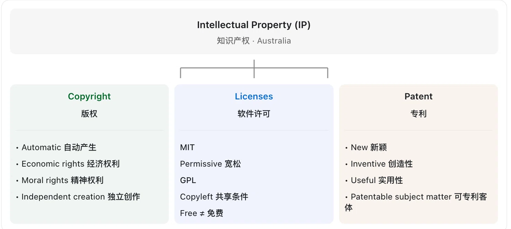
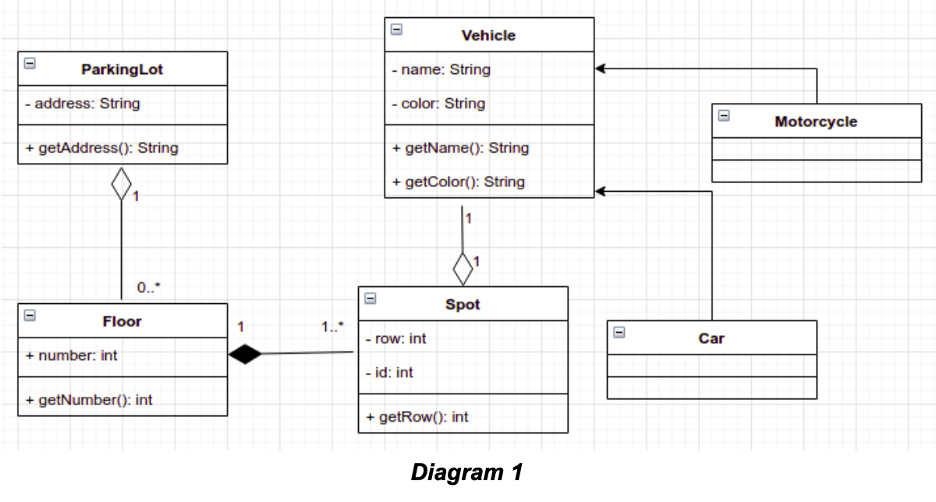
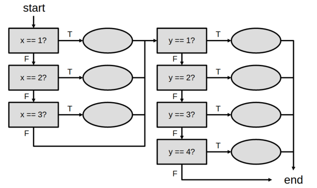
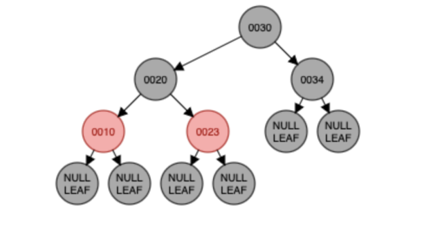
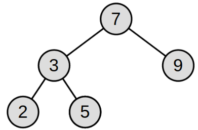

# 往年选择题按主题汇总（从简单到难）

收录 `exam-practice-questions/past-exams` 中题面完整的全部 29 道选择题，来自 2025 S2（5 道）、2025 S1（10 道）和 2024 S1（14 道）。

主题顺序按零基础复习所需的概念数量、代码阅读量和手工推演步骤估计，属于学习顺序建议。同一主题内按年份从近到远排列，同年 S2 在 S1 前，每道题保留原题号。英文题干、选项、代码与原题图片均保留，PDF 换行调整为 Markdown 段落。部分题目在题面后附中文逐项解析，其余题目保持原题面。

2025 S1 原卷注明每题只有一个正确答案。2024 S1 原卷注明每题至少一个正确选项，需留意题目要求选择 CORRECT 还是 INCORRECT。2025 S2 按各题题干要求作答。

2019 S1 的 PDF 从 Q2 开始，2019 S2 仅有选择题运行说明，2020 S1 缺 Q2，其余现有年份未找到可纳入的选择题题面。2024 S2 Q4 为开放论述题。缺失题面未计入这 29 道。

## 主题目录

| 顺序 | 主题 | 参考难度 | 题数 | 主要任务 |
|---|---|---|---:|---|
| 1 | [软件构建基本概念](#topic-1) | 较易 | 1 | 识别软件构建包含的活动。 |
| 2 | [软件工程伦理](#topic-2) | 较易 | 1 | 根据隐私、安全和职业责任判断情境。 |
| 3 | [知识产权与许可证](#topic-3) | 较易 | 2 | 记忆版权、许可证与专利的基本区别。 |
| 4 | [契约式设计、JML 与文档注释](#topic-4) | 较易 | 2 | 识别规范工具的用途与参数注释写法。 |
| 5 | [设计模式 — Singleton 单例](#topic-5) | 较易 | 2 | 理解私有构造函数、静态成员与唯一实例。 |
| 6 | [Android](#topic-6) | 中等 | 3 | 记忆生命周期、返回栈、资源与组件规则。 |
| 7 | [数据持久化与文件格式](#topic-7) | 中等 | 1 | 结合文件结构判断数据分片是否合适。 |
| 8 | [UML 类图](#topic-8) | 中等 | 1 | 读懂类之间的关系、多重性与可见性。 |
| 9 | [代码坏味道与重构](#topic-9) | 中等 | 2 | 阅读代码，识别结构问题及合适的改进。 |
| 10 | [SOLID 设计原则](#topic-10) | 中等偏难 | 2 | 把开闭原则与里氏替换原则应用到具体设计。 |
| 11 | [Git 提交历史](#topic-11) | 中等偏难 | 1 | 跟踪提交图、合并操作与分支指针。 |
| 12 | [Tokeniser、Parser 与文法](#topic-12) | 中等偏难 | 4 | 从概念判断过渡到文法推导与语法树分析。 |
| 13 | [软件测试与分支覆盖](#topic-13) | 较难 | 3 | 分析控制流、短路条件与最少测试输入。 |
| 14 | [树 — BST、AVL 与红黑树](#topic-14) | 较难 | 4 | 手动推演插入、旋转、颜色变化、树高与遍历。 |

<a id="topic-1"></a>

## 1. 软件构建基本概念

参考难度为较易。识别软件构建包含的活动。

### 2024 S1 · MCQ1

原题来源为 [2024 S1 Q4](../exam-practice-questions/past-exams/2024-1/src/Q4/Q4README.md)。

Software Construction - select all that does NOT apply to complete the statement below.

Software Construction includes...

- **A.** coding

- **B.** testing

- **C.** debugging

- **D.** modular design

- **E.** problem definition

- **F.** readability

- **G.** planning

- **H.** construction with reuse

- **I.** use of standards

- **J.** the use of integrated development environments

- **K.** construction for reuse

- **L.** use of profiling and performance analysis tools to support code tuning

#### 题目在问什么

Software Construction（软件构造）指把软件设计真正变成可运行程序的过程。

题干是 *select all that does NOT apply*——**反向多选**，要选的是“不属于软件构造”的选项，不是选属于的。

#### 核心知识点

软件开发（Software Development）是一个大过程，可以简化为四个阶段：

1. **Problem Definition（问题定义）**：弄清楚要解决什么问题。
2. **Planning（规划）**：决定开发目标、时间、资源。
3. **Software Construction（软件构造）**：Coding、Testing、Debugging，以及模块化、代码复用、代码质量、开发工具等。
4. **Deployment & Maintenance（部署与维护）**。

这是帮助理解的简化流程；实际开发中各阶段会重叠、反复迭代。

#### 逐项判断

| 选项 | 中文 | 属于 Construction？ |
|---|---|:---:|
| A. coding | 编写代码 | 是 |
| B. testing | 测试代码 | 是 |
| C. debugging | 调试、修复错误 | 是 |
| D. modular design | 模块化设计 | 是 |
| E. problem definition | 定义问题 | **否** |
| F. readability | 代码可读性 | 是 |
| G. planning | 项目规划 | **否** |
| H. construction with reuse | 利用现有代码构造 | 是 |
| I. use of standards | 使用编码标准 | 是 |
| J. the use of IDEs | 使用集成开发环境 | 是 |
| K. construction for reuse | 编写可复用代码 | 是 |
| L. profiling / performance analysis tools | 性能分析与调优工具 | 是 |

#### 三个易混点

1. **Modular design 为什么算 Construction？** 软件构造不只是敲代码，还包括决定代码怎么组织，例如把大程序拆成多个函数、模块。
2. **Construction with reuse 与 construction for reuse 的区别？** *With reuse* 是使用别人已写好的代码（例如调用 Java 标准库）；*for reuse* 是自己写通用代码供未来复用。两者都属于软件构造。
3. **Readability 为什么也算？** 软件构造强调代码质量：不仅要能运行，还要易读、易懂、易维护。

#### 答案

**E、G**

E. Problem definition、G. Planning 属于软件开发前期的问题定义与项目规划，不是软件构造本身。

记忆：**Software Construction = Coding + Testing + Debugging + Code Quality + Reuse + Tools**；Problem Definition 与 Planning 属于更大范围的 Software Engineering。

<a id="topic-2"></a>

## 2. 软件工程伦理

参考难度为较易。根据隐私、安全和职业责任判断情境。

### 2024 S1 · MCQ8

原题来源为 [2024 S1 Q4](../exam-practice-questions/past-exams/2024-1/src/Q4/Q4README.md)。

ETHICS - Select all scenarios where the software engineer's decision
is well aligned with the IEEE Code of Ethics for software engineers?

- **A.** A software engineer discovers a critical security flaw in a popular social media platform but chooses not to disclose it to the public to avoid damaging the platform's reputation, based on the second principle ("CLIENT and EMPLOYER") of the IEEE Code of Ethics related to the employer.

- **B.** A software engineer, tasked with developing a new mobile app, includes a hidden feature that collects user data without their consent to improve marketing strategies. This relates to the first principle ("PUBLIC") of the IEEE Code of Ethics, and it is acceptable to collect data as it can be used to further improve the mobile app.

- **C.** A software engineer prioritizes speed and efficiency over thorough testing, resulting in the release of a software product with known bugs. As long as the bugs are known to users, this should not compromise user safety. Therefore, the software engineer will meet the principle related to integrity and judgment.

- **D.** A software engineer refuses to work on a project that involves developing surveillance technology used to infringe upon individuals' privacy rights, citing adherence to ethical principles.

#### 题目在问什么

*Select all scenarios where the software engineer's decision is well aligned with the IEEE Code of Ethics.*

选出**符合** IEEE 软件工程师职业道德规范的行为。这次是正向选择，不是找错误行为。

#### 核心知识点

IEEE/ACM《Software Engineering Code of Ethics》有 8 条原则：

| # | 原则 | 中文理解 |
|---|---|---|
| 1 | PUBLIC | 公众利益优先 |
| 2 | CLIENT AND EMPLOYER | 对客户和雇主负责，但不得损害公众利益 |
| 3 | PRODUCT | 保证软件质量与安全 |
| 4 | JUDGMENT | 保持独立、诚实的专业判断 |
| 5 | MANAGEMENT | 管理过程遵守职业道德 |
| 6 | PROFESSION | 维护行业声誉 |
| 7 | COLLEAGUES | 公平对待同事 |
| 8 | SELF | 持续学习、提升职业能力 |

考试最常用的一条：**公众利益与安全不能为了公司利润、发布速度而牺牲**；对雇主的责任（原则 2）不能压过对公众的责任（原则 1）。

#### 逐项判断

**A. 隐瞒严重安全漏洞——错误。** 工程师发现社交平台的严重安全漏洞，为保护公司名誉而选择不公开，这是拿公众安全换公司声誉，违背 PUBLIC。

> 细究：不向公众披露漏洞细节本身未必错，正确做法是通过负责任渠道报告并推动修复；错在“单纯隐瞒”。

**B. 未经同意收集用户数据——错误。** 偷偷加入收集用户数据的功能以改善营销，即使“有助于改进 App”，也侵犯用户隐私，违背 PUBLIC。

**C. 为追求速度而减少测试——错误。** 跳过充分测试、发布带已知 Bug 的产品；用户“知道有 Bug”不等于软件安全，尤其当缺陷可能影响人身安全时，违背 PRODUCT 与 JUDGMENT。

**D. 拒绝开发侵犯隐私的监控技术——正确。** 拒绝参与侵犯个人隐私权的监控项目，是保护公众权利、坚持职业判断，符合 PUBLIC 与 JUDGMENT。

#### 答案

**D**

#### 速记

遇到 Ethics 题，按四类快速判断：

- **Privacy**：未经同意收集数据 → 错
- **Safety**：隐瞒风险、放任严重漏洞 → 错
- **Quality**：为速度牺牲必要测试 → 错
- **Public interest / judgment**：优先保护公众、坚持独立客观判断 → 对

一句话：**Public Safety & Interest First.**

<a id="topic-3"></a>

## 3. 知识产权与许可证

参考难度为较易。记忆版权、许可证与专利的基本区别。

### 2025 S1 · MCQ10

原题来源为 [2025 S1 Q4](../exam-practice-questions/past-exams/2025-1/src/Q4/MC_Questions_2025_S1.pdf)。

A colleague has found an implementation of an algorithm publicly available on GitHub, but there is no license listed accompanying the code. Your colleague wants to use this code in their work. Can they? What conditions must they adhere to?

- **A.** The code is assumed to be under an exclusive license, and cannot legally be used.

- **B.** The author is assumed to retain all copyright to the code, but because the code is publicly available, as long as appropriate attribution is provided, the code may legally be used.

- **C.** The code is assumed to be under no license, and can legally be used without attribution. However, if the code contains a glitch or bug, the original author is not liable.

- **D.** According to GitHub’s terms of service, public GitHub repositories without an explicit license are assumed to be under the GNU GPL v3 License. Your colleague may therefore use this code only if the modified source code is shared publicly.

#### 题目在问什么

同事在 GitHub 上找到一份公开的算法实现，但仓库没有附任何 License。他能不能直接用到自己的项目里？需要遵守什么条件？

#### 核心知识点

**Publicly available ≠ Open source ≠ Free to use**（公开可见 ≠ 开源授权 ≠ 可以随便用）。代码放在 GitHub 上人人可见，不等于任何人都有权复制、修改、分发。

| 概念 | 含义 |
|---|---|
| Copyright（版权） | 作者通常自动拥有自己创作的代码版权 |
| License（许可证） | 作者授权别人以特定方式使用代码 |
| No license（无许可证） | 默认保留版权，没有一般性的复制、修改、再分发许可 |

对比常见许可证：

- **MIT**：允许商业使用、修改、分发，但要保留版权与许可声明。
- **GPL v3**：允许使用和修改，但触发分发条件时须遵守相应的源码公开与许可要求。
- **No license**：不能因为代码公开就默认获得授权。

三类 License 允许别人做什么，对照表在 [2024 S1 · MCQ4](#topic-3-mcq4-2024) 的「场景推演」；本题只需抓住：**No License = 保留所有权利**，公开可见不等于授权，署名也不构成授权。

#### 逐项判断

| 选项 | 内容 | 判断 |
|---|---|:---:|
| A | 没有 License，推定为其处于专有许可之下，不能合法使用 | **正确（最接近）** |
| B | 作者保留版权，但代码公开，只要注明出处即可合法使用 | 错误 |
| C | 没有 License，可合法使用且无需署名，出 Bug 作者也不负责 | 错误 |
| D | GitHub 服务条款把无 License 仓库默认归为 GPL v3 | 错误 |

**A 为什么对？** 没有 License 时版权仍归作者，不能擅自复制、修改或用于自己的软件，结论“不能合法使用”成立。

> 但 A 的措辞并不严谨：无 License 不等于存在某种特定的 *exclusive license*，更准确的说法是 **All rights reserved（保留所有权利）**。GitHub 仍允许用户查看、通过平台 Fork 公开仓库，但这不构成对其他使用权的授予。

**B 为什么错？** 署名（attribution）只是许可证里的一项条件，不是许可本身；没有许可证就没有可援引的授权。

**C 为什么错？** 无 License 恰恰意味着默认保留权利，既不能随便用，也不存在“无需署名”的许可；免责声明更不能凭空产生。

**D 为什么错？** GitHub 不会把无 License 仓库自动改成 GPL v3；GPL 只在该仓库明确采用 GPL 时适用。

#### 答案

**A**

#### 速记

**No license = All rights reserved.**

- Public repository ≠ free to use
- Attribution ≠ permission（署名不等于授权）
- No license ≠ GPL
- 想用：先联系作者取得许可，或改用明确授权的替代实现。

补充：可以学习公开代码里的**算法思想**再独立实现；思想与受版权保护的具体代码表达不是一回事。

<a id="topic-3-mcq4-2024"></a>

### 2024 S1 · MCQ4

原题来源为 [2024 S1 Q4](../exam-practice-questions/past-exams/2024-1/src/Q4/Q4README.md)。

Intellectual Property - Select all CORRECT statements considering the Australian context.

- **A.** Copyright is automatically attributed to an author in Australia, although others can reproduce the same work. Authors must demonstrate their capability of creating the work independently.

- **B.** Copyright protects non-economic rights.

- **C.** Unlike Copyright, software using Copyleft licenses is free, and no fees can be charged whatsoever.

- **D.** MIT License is an example of Copyleft license.

- **E.** Patents protect inventions that are new, useful, inventive, and of suitable subject matter. Software can be patented if it presents technical or business innovation.

#### 题目在问什么

*Intellectual Property — Select all CORRECT statements considering the Australian context.*

按澳大利亚法律选出所有**正确**陈述（正选）。涉及三个概念：Copyright（版权，保护源代码、文章、图片等原创表达）、Copyleft（一种允许使用、修改、传播但附带共享条件的开源许可机制）、Patent（专利，保护符合条件的技术发明）。

#### 场景推演：假设你自己写了一个 Java 程序并上传到 GitHub

**① Copyright（版权）**：代码是你原创的，版权**自动**归你。别人不能因为看到了你的代码，就随便复制、修改、分发。

**② License（许可证）**：你可以给代码添加不同的 License，授权别人以特定方式使用。

| License | 别人可以做什么 |
|---|---|
| No License | 默认没有一般性的复制、修改、分发授权 |
| MIT | 可以复制、修改、商用、闭源，但需要保留版权及许可声明 |
| GPL v3 | 可以复制、修改、商用，但分发衍生程序时通常需要遵守相应的开源条件 |

这张表对应本题的 Copyright 与 Licenses 两面；Patent 是第三根支柱，要件见下。

#### 核心知识点

- 版权在作品创作完成时**自动产生**，无需注册；保护的是具体**表达**，不是思想。
- 版权同时包含**经济权利**与**人身权（moral rights）**：署名、反对错误署名、保护作品完整性。
- 许可证分两大类：**Copyleft**（GPL，要求衍生作品沿用同一许可）与 **Permissive**（MIT、Apache，允许闭源商用）。
- 专利四要件：**New + Inventive + Useful + Patentable subject matter**。



上图把本题三个概念并列：版权（自动产生、经济权利、精神权利、独立创作）、软件许可（MIT = 宽松、GPL = Copyleft 共享条件、Free ≠ 免费）、专利（新颖、创造性、实用性、可专利客体）。

#### 逐项判断

**A. 版权自动归属——正确。** 澳大利亚的版权在原创作品产生时自动生效，不需注册。版权保护表达而非思想，两人**独立**创作出相同或相似作品，不必然侵权。句中的 independently 指独立创作、非抄袭，并不是说申请版权前要提交证明。

**B. 版权保护非经济权利——正确。** 版权除经济利益外，还保护 moral rights（署名权、保护作品完整权等）。

> 措辞提醒：严格说版权以**经济权利**为核心，同时**也**保护非经济权利。若把 B 读成“版权只保护非经济权利”，就成了错句；本题按“版权也涵盖非经济权利”理解才成立。

**C. Copyleft 软件不能收费——错误。** Copyleft 不等于免费。GPL 软件可以收费分发，只是分发时须履行许可证义务。Free Software 的 Free 指 **freedom（自由）**，不是 free of charge（零价格）。

**D. MIT 是 Copyleft——错误。** MIT 是 **Permissive** 许可证，允许用于闭源商业软件，不要求衍生项目开源。典型 Copyleft 是 **GPL**。

**E. 专利保护发明——基本正确，措辞偏宽。** 澳大利亚专利要求发明具备新颖性、创造性、实用性，并属于可专利客体；软件相关发明也可能获专利，例如提升计算机数据处理效率的技术。

> 细节：仅“商业创新（business innovation）”不足以获得专利；软件或商业方法须满足技术性等法律要求。E 末句把 technical 与 business innovation 并列，法律上偏宽；按课程概括性知识点，预期仍计入正确。

#### 答案

**A、B、E（预期答案）**

E 的末句表述过宽（商业创新本身不够），但课程按概括知识点出题时通常仍选 E；若题目要求严格法律判断，需对 E 保留。

#### 速记

| 概念 | 核心 |
|---|---|
| Copyright | 自动产生；保护表达与 moral rights |
| Copyleft | 传染性共享条件；**可以收费** |
| MIT | Permissive，不是 Copyleft |
| GPL | Copyleft，允许商业使用 |
| Patent | New + Inventive + Useful + 可专利客体 |

两个最高频陷阱：**Free ≠ free of charge**；**MIT ≠ Copyleft，GPL = Copyleft**。

<a id="topic-4"></a>

## 4. 契约式设计、JML 与文档注释

参考难度为较易。识别规范工具的用途与参数注释写法。

### 2025 S2 · MCQ4

原题来源为 [2025 S2 Q1](../exam-practice-questions/past-exams/2025-2/src/Q1/MCQQuestions.pdf)。

Which of the following cannot be achieved using JML (Java Modeling Language)?

- **A.** Formally specify preconditions, postconditions, and invariants for Java methods and classes.

- **B.** Perform runtime assertion checking（运行时断言检查，RAC：运行的时候自动检查是否满足 JML 规范）。

- **C.** Document detailed design decisions.

- **D.** Support design by contract.

- **E.** Handle Java XML processing.

#### 题目在问什么

*Which of the following cannot be achieved using JML (Java Modeling Language)?*

选出 **JML 做不到**的事。本题属于 Software Construction 中的 Software Specification（软件规范），除做题外还要分清 JML、Design by Contract、Java assert、Javadoc 各自管什么。

#### 逐项判断

| 选项 | 含义 | 判断 |
|---|---|:---:|
| A | 定义前置条件、后置条件、不变量 | 可以 |
| B | 运行时断言检查（RAC）：运行程序时自动检查是否满足 JML 规范 | 可以 |
| C | 记录详细设计决策 | 不是 JML 的用途 |
| D | 支持契约式设计 | 可以 |
| E | 处理 Java XML | 不可以 |

**C 的解释空间**：JML 能记录行为约束，但不能替代解释架构选择与设计理由的详细设计文档；E 则毫无争议——JML 不是 XML 解析工具。

#### 答案

**C、E**

#### 扩展：Design by Contract（契约式设计）

`int divide(int a, int b) { return a / b; }` 这个函数希望规定：调用前 `b != 0`，调用后返回值等于 `a / b`。这就是契约（Contract）：**调用者满足前置条件，方法就必须保证后置条件。**

```text
Precondition（调用者保证 b != 0）
        ↓
Method divide(10, 2)
        ↓
Postcondition（函数保证 result == 5）
```

| 类型 | JML | 意思 |
|---|---|---|
| Precondition 前置条件 | `requires` | 函数执行前必须满足 |
| Postcondition 后置条件 | `ensures` | 函数正常执行后必须满足 |
| Invariant 不变式 | `invariant` | 对象在规定的可观察状态下必须满足 |

记忆：**Pre = Before；Post = After；Invariant = Always**（在规定的状态下）。

#### 扩展：JML 语法

JML（Java Modeling Language）用特殊注释为 Java 程序写**形式化规范（formal specification）**。

本质上，JML **仍然是注释**——写在 `//@` 或 `/*@ ... @*/` 里，普通 `javac` 会照样把整段当注释跳过。区别在于它是**能被工具读懂并检查**的注释：普通注释只给人看，JML 注释同时给 JML 工具（如 OpenJML）看，可用来做静态验证或运行时检查。

```java
class BankAccount {

    //@ invariant balance >= 0;
    private int balance;

    /*@
      requires amount > 0;
      requires amount <= balance;
      ensures balance == \old(balance) - amount;
    @*/
    void withdraw(int amount) {
        balance -= amount;
    }
}
```

- `invariant balance >= 0`：余额不能为负。
- `requires amount > 0`：取款金额必须为正。
- `requires amount <= balance`：不能超额取款。
- `ensures balance == \old(balance) - amount`：结束后新余额 = 旧余额 − 取款额。
- `\old(balance)` 是执行**前**的余额，`balance` 是执行**后**的余额。

其他常考关键字：

| 关键字 | 功能 | 最小例子 |
|---|---|---|
| `requires` | 前置条件：调用前必须成立 | `requires amount > 0;` |
| `ensures` | 后置条件：正常返回后必须成立 | `ensures \result == a + b;` |
| `invariant` | 类不变量：对象状态始终满足 | `invariant balance >= 0;` |
| `\result` | 方法返回值（只能写在 `ensures` / `signals` 里） | `ensures \result >= 0;` |
| `\old(x)` | 方法执行前 x 的值（只能写在**后置**条件里） | `ensures balance == \old(balance) - amount;` |
| `signals` | 抛出指定异常时必须成立的条件 | `signals (IllegalArgumentException e) amount <= 0;` |
| `assignable` | 允许修改哪些字段/位置（帧条件） | `assignable balance;` |

把它们放进同一个类里看：

```java
public class Account {
    private int balance;

    //@ invariant balance >= 0;                    // 任何可观察状态下余额都非负

    /*@
      assignable balance;                          // 只允许改 balance
      ensures balance == \old(balance) + amount;   // 返回后余额 = 旧余额 + 存款
      signals (IllegalArgumentException e) amount <= 0;  // 抛 IAE 时，必然 amount <= 0
    @*/
    public void deposit(int amount) {
        if (amount <= 0) {
            throw new IllegalArgumentException("amount must be positive");
        }
        balance += amount;
    }

    /*@
      ensures \result == balance;                  // \result 指返回值
    @*/
    public int getBalance() {
        return balance;
    }
}
```

逐行对应：

- `assignable balance;` 声明这个方法**只**动 `balance`，其他字段不会被改；调 `getBalance()` 自然不会出现在它的 assignable 里。
- `ensures ... \old(balance) ...` 中的 `\old(balance)` 是进入方法前的余额，`balance` 是返回时的余额。
- `signals (... e) amount <= 0;` 读作“**如果**抛出 `IllegalArgumentException`，**那么** `amount <= 0` 成立”，所以 `deposit(-5)` 合法地抛异常不算违约。
- `ensures \result == balance;` 里 `\result` 就是 `getBalance()` 的返回值。

```java
/*@
  requires x >= 0;
  ensures \result == x * x;
@*/
int square(int x) {
    return x * x;
}
```

注意：JML 注释本身不会让普通 `javac` 自动检查契约，需要 JML 支持工具。

#### 扩展：Runtime Assertion Checking

JML 不只用来写规范，还能借工具检查运行中是否违反规范。

```java
/*@
  requires x > 0;
  ensures \result > 0;
@*/
int doubleValue(int x) {
    return -x * 2;
}
```

调用 `doubleValue(5)` 得到 `-10`，违反 `ensures \result > 0;`，启用 Runtime Assertion Checking 即可检测到契约违反。

- **Runtime checking**：程序运行时检查条件。
- **Static verification**：不运行程序，尝试证明条件成立。

两者都是 JML 工具生态的重要能力。

#### 扩展：JML、Java assert、Javadoc 的区别

这是高频考点。

| 工具 | 主要用途 | 例子 |
|---|---|---|
| JML | 形式化规定程序行为 | `requires x > 0` |
| Java `assert` | 检查程序内部假设 | `assert x > 0;` |
| Javadoc | 生成人类可读的 API 文档 | `@param x` |

```java
int x = 5;
assert x > 0;   // 以 java -ea 启用；条件为 false 时抛 AssertionError
```

```java
/**
 * Calculates the square of a number.
 *
 * @param x the input number
 * @return the square of x
 */
int square(int x) {
    return x * x;
}
```

`@param`、`@return`、`@throws` 只是生成文档，**不是运行时检查**；而 JML 的 `requires/ensures` 是能被工具理解和检查的形式化规范。

#### 速记

```text
Java Specification
├── JML — Formal Specification
│   ├── requires / ensures / invariant
│   └── Runtime checking、Static verification
├── Java assert — Internal checks
│   └── assert condition（-ea 启用，失败抛 AssertionError）
└── Javadoc — Documentation
    └── @param / @return / @throws
```

三句话：**JML = what must be true；Javadoc = what the code does；Java assert = check an assumption。**

#### 自测

1. Which JML keyword specifies a precondition? A. `ensures` B. `requires` C. `invariant` D. `\result`
2. Which tag describes a method parameter in Javadoc? A. `@param` B. `@requires` C. `@invariant` D. `@argument`
3. Which tool is designed to parse XML in Java? A. JML B. Javadoc C. DOM D. Java assert

参考答案：1-B、2-A、3-C。

### 2025 S1 · MCQ9

原题来源为 [2025 S1 Q4](../exam-practice-questions/past-exams/2025-1/src/Q4/MC_Questions_2025_S1.pdf)。

```java
/** 
 * Interchanges the elements at indices i and j of the array. 
 * (1) 
 */ 
public static void <T> swap(T[] array, int i, int j) { 
 
T oldi = array[i]; 
 
array[i] = array[j]; 
 
array[j] = oldi; 
}
```

The method swap interchanges the elements at indices i and j of an array. A developer wishes to write some JML annotations which can fill the label (1).

Which JML annotation has the correct syntax to give an informal description to the parameter i?

- **A.** @parameter “The first index” i

- **B.** @input i: “The first index.”

- **C.** @param i The first index.

- **D.** @argument The first index = i

<a id="topic-5"></a>

## 5. 设计模式 — Singleton 单例

参考难度为较易。理解私有构造函数、静态成员与唯一实例。

### 2025 S2 · MCQ5

原题来源为 [2025 S2 Q1](../exam-practice-questions/past-exams/2025-2/src/Q1/MCQQuestions.pdf)。

Considering the class below, which alternative is CORRECT:

- **A.** The JUnit assertion assertSame(Universe.getInstance(), Universe.getInstance()) will fail.

- **B.** The JUnit assertion assertEquals(Universe.getInstance(), Universe.getInstance()) will fail.

- **C.** You cannot instantiate a Universe instance directly using the constructor outside the class.

- **D.** You can remove the static modifier from the field INSTANCE and from the method getInstance() if you want to implement a Singleton.

```java
public class Universe { 
 
    private static Universe INSTANCE; 
 
    private Universe() { } 
 
    public static Universe getInstance() { 
        if(INSTANCE == null) { 
            INSTANCE = new Universe(); 
        } 
        return INSTANCE; 
    } 
}
```

### 2025 S1 · MCQ2

原题来源为 [2025 S1 Q4](../exam-practice-questions/past-exams/2025-1/src/Q4/MC_Questions_2025_S1.pdf)。

A programmer is implementing the Singleton design pattern in a public class called Authenticator. What constructor(s) should the programmer declare in Authenticator?

- **A.** Authenticator should have no explicitly declared constructors.

- **B.** Authenticator should have a private constructor.

- **C.** Authenticator should have a protected constructor.

- **D.** Authenticator should have a public constructor, and a constructor with no access modifiers.

<a id="topic-6"></a>

## 6. Android

参考难度为中等。记忆生命周期、返回栈、资源与组件规则。

### 2025 S2 · MCQ2

原题来源为 [2025 S2 Q1](../exam-practice-questions/past-exams/2025-2/src/Q1/MCQQuestions.pdf)。

When a new activity is started in Android, what happens to the previous activity in the activity stack?

- **A.** The previous activity is destroyed immediately; onPause() → onStop() → onDestroy() are called.

- **B.** The previous activity is pushed to the back stack and paused.

- **C.** The previous activity remains active in the stack and no lifecycle methods are called.

- **D.** The previous activity is removed from the stack but kept in memory; only onStop() is called.

### 2025 S1 · MCQ5

原题来源为 [2025 S1 Q4](../exam-practice-questions/past-exams/2025-1/src/Q4/MC_Questions_2025_S1.pdf)。

Which of the following is the recommended way to support multiple languages in an Android app?

- **A.** Detect the user's language using Java code and manually set text for each view.

- **B.** Create separate layout files for each language and switch them in code.

- **C.** Use string resources and provide translations in separate values folders (e.g., values- es/strings.xml).

- **D.** Store all translated strings in a single strings.xml file and load them based on user input.

### 2024 S1 · MCQ12

原题来源为 [2024 S1 Q4](../exam-practice-questions/past-exams/2024-1/src/Q4/Q4README.md)。

Select all INCORRECT statements related to Android Development.

- **A.** Failure to declare internet permission in the AndroidManifest.xml file will result in a compile-time error.

- **B.** When creating an explicit intent, the target component's class name must be provided.

- **C.** The onCreate() method is called when the activity is first created, and it is the only required method to be implemented in the activity lifecycle along with onStart().

- **D.** Constraint Layout supports positioning views relative to each other.

- **E.** Listeners are only applicable to certain types of UI components, such as buttons and text fields.

- **F.** Toasts are used to display brief messages to the user for a short duration of time.

<a id="topic-7"></a>

## 7. 数据持久化与文件格式

参考难度为中等。结合文件结构判断数据分片是否合适。

### 2025 S1 · MCQ7

原题来源为 [2025 S1 Q4](../exam-practice-questions/past-exams/2025-1/src/Q4/MC_Questions_2025_S1.pdf)。

A client wishes to apply “sharding” to a large amount of data persistently. Sharding is the practice of splitting a single large file into a large number of smaller files, each of which can be accessed concurrently for greater performance. For example, instead of a file with 10,000 instances, the client wants to generate 10 files, each with 1,000 instances. Which formats are suitable for this purpose?

- **A.** CSV is suitable, because it is non-hierarchical, so the parser does not need to know what tags are open at the start of a particular shard.

- **B.** XML is suitable, because it supports attributes, which allow the developer to indicate where a shard ends and begins.

- **C.** JSON is suitable, as it has native support for sharding through the GSON Java library.

- **D.** Serialization is suitable only if the objects are each less than 128 bytes in size. In this case, Java can serialize multiple objects to the same file.

<a id="topic-8"></a>

## 8. UML 类图

参考难度为中等。读懂类之间的关系、多重性与可见性。

### 2024 S1 · MCQ9

原题来源为 [2024 S1 Q4](../exam-practice-questions/past-exams/2024-1/src/Q4/Q4README.md)。

Considering the class diagram below, which alternative is INCORRECT? 

 

In case the UML diagram for MCQ9 is not showing, look for the file named "UML-MCQ9.png" in the root directory of Q4.

- **A.** The relationship between Floor and Spot is a composition. It means that if an instance of Floor is destroyed the Spot instance must also be destroyed.

- **B.** Car is a Vehicle and Motorcycle is a Vehicle. This relationship is an aggregation.

- **C.** One ParkingLot has zero or many instances of Floor.

- **D.** Vehicle is the parent class of Motorcycle and Car. It means that the Car and Motorcycle inherits the operation getColor() and getName(). Besides, the attributes name and color are private in Vehicle class.

<a id="topic-9"></a>

## 9. 代码坏味道与重构

参考难度为中等。阅读代码，识别结构问题及合适的改进。

### 2024 S1 · MCQ11

原题来源为 [2024 S1 Q4](../exam-practice-questions/past-exams/2024-1/src/Q4/Q4README.md)。

CODE SMELLS - Given the RecipeManager class, select all code smells present in the code and potential solutions to resolve them with refactoring.
```
  public class RecipeManager {
     private static final String DEFAULT_UNIT = "grams";
     public static void main(String[] args) {
         RecipeManager rm = new RecipeManager();
         rm.addRecipe("Spaghetti Bolognese", "500 grams spaghetti", "300 grams minced beef", "2 cups tomato sauce", "1 onion, diced", "2 cloves garlic, minced", "Salt and pepper to taste");
         rm.addRecipe("Vegan Salad", "200 grams lettuce", "100 grams cherry tomatoes", "50 grams olives", "30 grams vegan cheese", "1 tbsp olive oil", "Salt to taste", "Pepper to taste");
         rm.calculateCalories();
     }
     public void addRecipe(String recipeName, String ingredient1, String ingredient2, String ingredient3, String ingredient4, String ingredient5, String ingredient6) {
         System.out.println("Adding recipe: " + recipeName);
         System.out.println("Ingredients: " + ingredient1 + ", " + ingredient2 + ", " + ingredient3 + ", " + ingredient4 + ", " + ingredient5 + ", " + ingredient6);
     }
     public void calculateCalories() {
         System.out.println("Calculating calories for Spaghetti Bolognese...");
         int spaghettiCalories = 500;
         int mincedBeefCalories = 300;
         int tomatoSauceCalories = 80;
         int onionCalories = 40;
         int garlicCalories = 10;
         int totalCalories = spaghettiCalories + mincedBeefCalories + tomatoSauceCalories + onionCalories + garlicCalories;
         System.out.println("Total calories for Spaghetti Bolognese: " + totalCalories);
         System.out.println("Calculating calories for Vegan Salad...");
         int lettuceCalories = 15;
         int cherryTomatoesCalories = 20;
         int olivesCalories = 120;
         int veganCheeseCalories = 70;
         int oliveOilCalories = 120;
         int totalSaladCalories = lettuceCalories + cherryTomatoesCalories + olivesCalories + veganCheeseCalories + oliveOilCalories;
         System.out.println("Total calories for Vegan Salad: " + totalSaladCalories);
     }
     public void displaySomething() {
         System.out.println("This method does nothing...");
     }
}
```

- **A.** DRY

- **B.** Hardcoding

- **C.** Mysterious Names

- **D.** Dead Code

- **E.** Long parameter list

- **F.** The RecipeManager class has no code smells. This class does not need to be refactored

- **G.** Create a method to calculate recipe calories receiving a list of ingredients may remove one of the existing code smells

- **H.** Removing the displaySomething method may remove at least two code smells.

### 2024 S1 · MCQ14

原题来源为 [2024 S1 Q4](../exam-practice-questions/past-exams/2024-1/src/Q4/Q4README.md)。

Consider the classes:
```
public class Player {
   private String name;
   private String position;
   private int jerseyNumber;
   // Constructor, getters, setters, and methods are not provided for simplicity
}
```
```
import java.util.List;

public class Team {
   private String name;
   private String coach;
   private List<Player> players;
   // Constructor, getters, setters, and methods are not provided for simplicity
}
```
```
import java.util.Date;

public class Match {
   private Team homeTeam;
   private Team awayTeam;
   private Date date;
   private String location;
   // Constructor, getters, setters, and methods are not provided for simplicity
}
```
Which of the following suggestions would be appropriate for refactoring the given classes?

- **A.** Create a new "Person" and "Coach" classes. "Player"  and "Coach" classes should implement "Person" Class.

- **B.** Create a "Location" class to better represent the location of a Match.

- **C.** Change the access modifier of the players attribute in the Team class from private to public.

- **D.** Use an ENUM to represent player positions instead of String.

- **E.** In case we would like to add and visualise statistics about the matches, related methods and attributes should be in the Match class.

<a id="topic-10"></a>

## 10. SOLID 设计原则

参考难度为中等偏难。把开闭原则与里氏替换原则应用到具体设计。

### 2025 S1 · MCQ8

原题来源为 [2025 S1 Q4](../exam-practice-questions/past-exams/2025-1/src/Q4/MC_Questions_2025_S1.pdf)。

```java
class Vector2 { 
     private double x, y; 
     public Vector2(double x, double y) { 
          this.x = x; 
          this.y = y; 
     } 
      
     // Returns the distance from the origin to this vector. 
     public double getLength() { 
          return Math.sqrt(x*x + y*y); 
     } 
      
     // Scales the vectors together componentwise 
     public Vector2 dilate(Vector2 other) { 
          return new Vector2(x*other.x, y*other.y); 
     } 
}
```

Video game engines frequently use classes like the one partially shown above to represent a position in 2D space. A developer is tasked with extending this functionality by writing a Vector3 class to represent a position in 3D space by adding a z-axis. What might the developer do in this situation to avoid violating the Liskov substitution principle?

- **A.** Have Vector2 and Vector3 both extend an abstract Vector class.

- **B.** Invert the class hierarchy by making Vector2 a subclass of Vector3.

- **C.** Convert Vector2 from a class to an interface which is implemented by Vector3.

- **D.** Make Vector2 and Vector3 both be immutable by marking their fields as final.

### 2024 S1 · MCQ10

原题来源为 [2024 S1 Q4](../exam-practice-questions/past-exams/2024-1/src/Q4/Q4README.md)。

A software application for managing a recipe database includes a Recipe class that has methods for displaying recipe details. The application is frequently updated to support new types of recipes (e.g., vegetarian, vegan, gluten-free) and to provide new ways of displaying information about these recipes.


Select all design approaches that best adheres to the Open/Closed Principle (OCP) of SOLID?

- **A.** Modify the Recipe class to include additional methods for each new type of recipe and display format.

- **B.** Use inheritance to create subclasses like VegetarianRecipe and VeganRecipe, each with their own methods for displaying information.

- **C.** Implement an interface Displayable with a method displayInfo(), and have each recipe type class implement this interface.

- **D.** Use a single Recipe class and add conditional statements in the displayInfo() method to handle different types of recipes and formats.

<a id="topic-11"></a>

## 11. Git 提交历史

参考难度为中等偏难。跟踪提交图、合并操作与分支指针。

### 2025 S1 · MCQ1

原题来源为 [2025 S1 Q4](../exam-practice-questions/past-exams/2025-1/src/Q4/MC_Questions_2025_S1.pdf)。

In a git repository, Bernardo and Dylan have made conflicting changes to a tracked file. Bernardo pushes his changes first, and these are accepted. When Dylan goes to push, discovering the conflict, he uses “git fetch” and “git merge” to merge these changes, then pushes. Dylan uses “git log --graph –oneline” to see what has happened, which gives an output including.

```text
*   A (HEAD -> my_branch) 
|\ 
| * B (origin/my_branch) 
* | C 
|/ 
*   D
```

Which of these statements is plausible?

- **A.** Commit D was the most recent of the four commits.

- **B.** Commits A and B were created by the “git merge” command.

- **C.** Commit C was pointed to by a remote-tracking branch prior to merging.

- **D.** Commits B and D were made by Bernardo.

<a id="topic-12"></a>

## 12. Tokeniser、Parser 与文法

参考难度为中等偏难。从概念判断过渡到文法推导与语法树分析。

### 2025 S2 · MCQ3

原题来源为 [2025 S2 Q1](../exam-practice-questions/past-exams/2025-2/src/Q1/MCQQuestions.pdf)。

Considering the grammar below and assuming that there is a parser for it, which instruction is NOT acceptable for this grammar?

- **A.** fetch name, age in Person having id = -12

- **B.** fetch street in Address having id = 1

- **C.** fetch name, age, height in Person having id 2

- **D.** fetch name in Person having id = 4

```text
<command> := fetch <fields> in <table_name> having id = <id_value> 
 <fields> := <field>, <fields> | <field> 
 <table_name> := <string_value> 
 <id_value> := <int_value> 
 <field> := <string_value>
```

### 2025 S1 · MCQ6

原题来源为 [2025 S1 Q4](../exam-practice-questions/past-exams/2025-1/src/Q4/MC_Questions_2025_S1.pdf)。

Consider the grammar with initial symbol ‘sentence’ and production rules given by

```text
sentence → noun_phrase verb noun_phrase 
 
noun_phrase → adjective noun_phrase | noun | noun_phrase “that” verb noun_phrase 
 
noun → “cats” | “dogs” | “rabbits” | “people” 
 
adjective → “white” | “black” | “gray” | “brown” 

 
verb → “like” | “chase” | “talk to” | “see”
```

implemented with a tokeniser that ignores capitalisation and punctuaction, and a recursive descent parser.

When applied to the input “Dogs chase gray rabbits that talk to white rabbits.”, what node would be at the root of the parse tree?

- **A.** a Sentence with verb=“chase”

- **B.** a Sentence with verb=“talk to”

- **C.** a Verb with string “chase”

- **D.** a Verb with string “talk to”

### 2024 S1 · MCQ7

原题来源为 [2024 S1 Q4](../exam-practice-questions/past-exams/2024-1/src/Q4/Q4README.md)。

Tokenisation - Select all INCORRECT options.

- **A.** The tokenisation process ends after identifying all tokens of a text and evaluating the expressions found. For instance, it is part of the tokenisation to detect the tokens of the expression “((1+2) * 3)” and show its result, in this case, 9.

- **B.** A tokenisation process can be case-insensitive or case-sensitive since it is usual to find texts with lower and upper case words.

- **C.** A token is defined as a string with an assigned meaning. It is structured as a pair consisting of a type and value. For instance, in the sentence “Hello 1 2 3”, number and word can be values of tokens.

- **D.** Tokenisation is the process of converting a sequence of characters into a sequence of tokens. Considering the sentence “I am 30 years old.”, the words “I”, “years”, “am”,  “old”, the punctuation mark “.” and the number “30” may be examples of tokens.

### 2024 S1 · MCQ13

原题来源为 [2024 S1 Q4](../exam-practice-questions/past-exams/2024-1/src/Q4/Q4README.md)。

Select all CORRECT statements that apply, considering the following context-free 
grammar that attempts to model a subset of a syntax of a new programming language.
```
S -> Modifier Type Identifier ; | Type Identifier ;
Modifier -> public | private | protected
Type -> PrimitiveType | Identifier
PrimitiveType -> int | double | boolean | void
Identifier -> a | b | c | d | e | f
```
Note that all lowercase characters/words are terminals whereas words starting with uppercase characters are non-terminals. The Start variable is S.

- **A.** "private void a;" and "int c;" are valid strings according to the grammar.

- **B.** This grammar presents the basic structure of a method signature in Java.

- **C.** According to the grammar, "blah" would be considered a correct identifier.

- **D.** The inclusion of a modifier is optional according to the provided grammar.

- **E.** "protected final int a;" is a valid string according to the grammar.

<a id="topic-13"></a>

## 13. 软件测试与分支覆盖

参考难度为较难。分析控制流、短路条件与最少测试输入。

### 2025 S1 · MCQ3

原题来源为 [2025 S1 Q4](../exam-practice-questions/past-exams/2025-1/src/Q4/MC_Questions_2025_S1.pdf)。

Consider a program with the following control flow graph, where each oval represents a distinct statement.



What is the minimum number of test cases needed to achieve branch complete coverage for the shown control flow graph?

- **A.** 4

- **B.** 5

- **C.** 6

- **D.** 9

- **E.** 12

- **F.** 20

- **G.** 21

### 2024 S1 · MCQ2

原题来源为 [2024 S1 Q4](../exam-practice-questions/past-exams/2024-1/src/Q4/Q4README.md)。

How many branches are present in the following function?
```
   public boolean checkAnswer(RiddleType type, String input) {
       boolean isCorrect = false;

       if (type == RiddleType.TEXT_RIDDLE) {
           if (input.equalsIgnoreCase(answer)) {
               isCorrect = true;
           }
       } else if (type == RiddleType.NUMERIC_RIDDLE) {
           if (input.matches("\\d+") && Integer.parseInt(input) == Integer.parseInt(answer)) {
               isCorrect = true;
           }
       } else if (type == RiddleType.ANAGRAM_RIDDLE) {
           char[] inputChars = input.toLowerCase().toCharArray();
           char[] answerChars = answer.toLowerCase().toCharArray();
           Arrays.sort(inputChars);
           Arrays.sort(answerChars);
           if (Arrays.equals(inputChars, answerChars)) {
               isCorrect = true;
           }
       }

       if (isCorrect) {
           isSolved = true;
       }
       return isCorrect;
   }
 ```

- **A.** 10

- **B.** 11

- **C.** 12

- **D.** 14

- **E.** 15

- **F.** 16

### 2024 S1 · MCQ3

原题来源为 [2024 S1 Q4](../exam-practice-questions/past-exams/2024-1/src/Q4/Q4README.md)。

本题引用的 `checkAnswer` 函数见紧邻上方的 2024 S1 · MCQ2。

How many distinct test inputs are necessary to ensure full branch coverage of 
  the `checkAnswer` function shown in MCQ2?

- **A.** 5

- **B.** 6

- **C.** 7

- **D.** 8

<a id="topic-14"></a>

## 14. 树 — BST、AVL 与红黑树

参考难度为较难。手动推演插入、旋转、颜色变化、树高与遍历。

### 2025 S2 · MCQ1

原题来源为 [2025 S2 Q1](../exam-practice-questions/past-exams/2025-2/src/Q1/MCQQuestions.pdf)。



After inserting the node with key 25 into the Red-Black Tree shown above, select all the correct statements:

- **A.** A left rotation over the node with key 23 is required to maintain the properties of the Red- Black Tree.

- **B.** The nodes 20 and 25 will be the only red nodes in the tree to preserve its Red-Black properties.

- **C.** The height of the BST is 3 (excluding the null leaves).

- **D.** The in-order traversal of the tree is 20, 10, 34, 23, 25, 30.

### 2025 S1 · MCQ4

原题来源为 [2025 S1 Q4](../exam-practice-questions/past-exams/2025-1/src/Q4/MC_Questions_2025_S1.pdf)。

Consider this AVL Tree, with keys sorted in ascending order, and root node 7.



When the key 6 is inserted, what type of rotation, if any, would be performed to balance the tree?

- **A.** Left-right

- **B.** Right-left

- **C.** Left

- **D.** Right

- **E.** No rotation

### 2024 S1 · MCQ5

原题来源为 [2024 S1 Q4](../exam-practice-questions/past-exams/2024-1/src/Q4/Q4README.md)。

You built a plain binary search tree and added the following nodes in this order:
80, 97, 49, 2, 20, 52, 25, 9, 27, 76
(You first added node 80, then node 97, then node 49, and so on).

Which is the CORRECT tree height?

- **A.** 4

- **B.** 5

- **C.** 6

- **D.** 7

### 2024 S1 · MCQ6

原题来源为 [2024 S1 Q4](../exam-practice-questions/past-exams/2024-1/src/Q4/Q4README.md)。

You built a red-black tree and added the following nodes in this order 
  16, 34, 18, 40, 57, 15 (You first added node 16, then node 34, then node 18, and so on). 
  If you walk in this tree using the post-order approach, what will be the 
  CORRECT node and color output?

- **A.** 15 RED, 16 BLACK, 18 BLACK, 34 RED, 40 BLACK, 57 RED

- **B.** 15 RED, 16 BLACK, 34 RED, 57 RED, 40 BLACK, 18 BLACK

- **C.** 15 RED, 57 RED, 34 RED, 16 BLACK, 40 BLACK, 18 BLACK

- **D.** 34 RED, 16 BLACK, 15 RED, 57 RED, 40 BLACK, 18 BLACK
